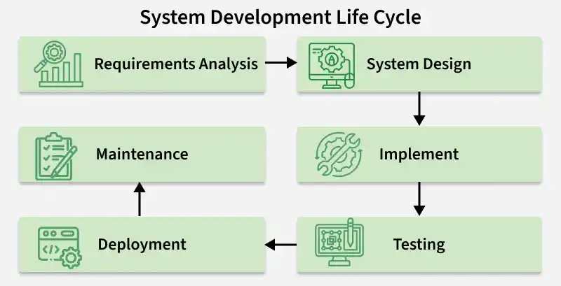
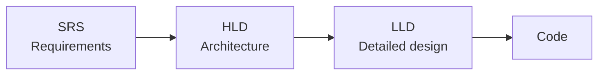
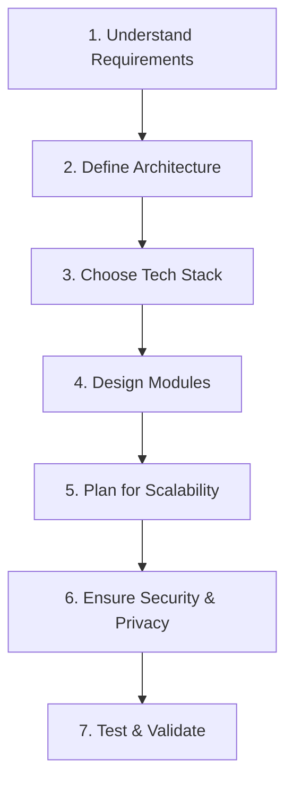

# 1.1.1 Introduction to System Design (HLD & LLD)

> **Phase 1: Introduction to System Design → 1.1 Basics**
> Source: GeeksforGeeks, *System Design Introduction – LLD & HLD* (last updated 29 Sep 2026)

---

## Table of Contents

1. [What is System Design?](#1-what-is-system-design)
2. [System Design in the SDLC](#2-system-design-in-the-sdlc)
3. [The Two Parts of System Design](#3-the-two-parts-of-system-design)
4. [High-Level Design (HLD)](#4-high-level-design-hld)
5. [Low-Level Design (LLD)](#5-low-level-design-lld)
6. [HLD vs LLD](#6-hld-vs-lld)
7. [Steps to Get Started with System Design](#7-steps-to-get-started-with-system-design)
8. [Key Qualities of a Well-Designed System](#8-key-qualities-of-a-well-designed-system)
9. [Quick Revision](#9-quick-revision)
10. [Self-Check Quiz: Interview Q&A](#10-self-check-quiz-interview-qa)

---

## 1. What is System Design?

**System Design** is the process of planning the **architecture of a software system** based on its requirements. It defines how the different components of a system are structured and how they work together to deliver the desired functionality.

System design:

- **Defines** the system components, the data flow, and the interactions between services.
- **Ensures** the system is **scalable**, **maintainable**, and **performs efficiently** as it grows.

### Example: Online Shopping System

System design decides how these components interact:

```
 ┌──────────────┐      ┌──────────────────┐      ┌─────────────────┐
 │ User         │ ───▶ │ Product Catalog  │ ───▶ │                 │
 │ Interface    │      └──────────────────┘      │    Database     │
 │ (Web/App)    │      ┌──────────────────┐      │                 │
 │              │ ───▶ │ Payment Service  │ ───▶ │                 │
 └──────────────┘      └──────────────────┘      └─────────────────┘
```

- **User interface** – where customers browse and buy
- **Product catalog** – lists products, prices, stock
- **Payment service** – handles transactions
- **Database** – persists users, products, orders

> 💡 **Key idea:** System design is about *how the pieces fit together*, not just what each piece does.

---

## 2. System Design in the SDLC

System Design is an important phase of the **Software Development Life Cycle (SDLC)**. It acts as the **bridge between requirements and implementation**.



Before any coding begins, the design defines:

| What the design defines | Why it matters |
|---|---|
| **System architecture** | The overall shape/structure of the system |
| **Components & responsibilities** | Who does what — clear ownership |
| **Data flow & interactions** | How information moves between parts |
| **Technology & database choices** | The right tools for the requirements |
| **Scalability, security & performance** | Non-functional qualities planned up front |

A good design also helps the system **handle failures and exceptional cases** gracefully, rather than discovering them in production.

---

## 3. The Two Parts of System Design

System Design is divided into **two complementary parts**:

```
                    System Design
                         │
         ┌───────────────┴───────────────┐
         ▼                               ▼
  High-Level Design (HLD)        Low-Level Design (LLD)
  "The big picture"              "The detailed blueprint"
  Architecture & interactions    Classes, methods, logic
```

- **HLD** → *What* components does the system need, and *how do they interact*?
- **LLD** → *How* will each component be *implemented*?

---

## 4. High-Level Design (HLD)

**High-Level Design (HLD)** defines the **overall architecture** of a system and how the main components interact. It gives a **big-picture view** of the system structure, services, and data flow.

### 4.1 Characteristics

- Identifies **major modules, services, and their interactions**.
- Focuses on **system architecture** and **high-level decisions**.
- Usually created by **architects, stakeholders, and senior developers**.

### 4.2 Prerequisite Technical Knowledge for HLD

| Area | What to know |
|---|---|
| **Fundamentals** | Basic programming, Data Structures & Algorithms |
| **Requirements** | Functional vs. Non-functional requirements |
| **Core components** | Databases (**SQL** & **NoSQL**), Caches (**Redis**, **Memcached**, **CDNs**), **APIs** |
| **Networking** | DNS; protocols — **TCP/UDP**, **HTTP**, **WebSockets** |
| **Security** | **OAuth**, **JWT**, **TLS/SSL**, rate-limiting, API security, basic **DDoS** protection |
| **Messaging & streaming** | Message queues / streaming tools like **Kafka** or **RabbitMQ** |
| **Architecture styles** | **Microservices vs. Monoliths** — when to split services, managing dependencies |
| **Resilience** | Fault tolerance, fallback strategies, redundancy |
| **Traffic distribution** | Load balancer types & algorithms |
| **Observability** | **Prometheus**, **Grafana**, **ELK Stack** (Elasticsearch, Logstash, Kibana); alerting (e.g. **PagerDuty**) |

### 4.3 Topics Covered in HLD

HLD focuses on system architecture, modules, and their interactions:

1. **System architecture overview** – Major components/modules and how they interact (services, queues, databases).
2. **Data flow & component interaction** – How data moves between modules, key integrations and interfaces.
3. **Technology stack & infrastructure** – High-level decisions on frameworks, platforms, hardware, databases, hosting.
4. **Module responsibilities** – What each module does and how modules relate to one another.
5. **Performance & trade-offs** – Design trade-offs, performance, scalability, security, cost, and other non-functional factors.
6. **Artifacts** – Architecture diagrams, component & deployment diagrams, data flow diagrams, and possibly ER/DB schema overviews.

### 4.4 Real-World Examples of HLD Decisions

HLD decisions in large-scale systems focus on **scalability, performance, reliability, and handling high traffic**.

| Company | HLD Decision | Why |
|---|---|---|
| **Netflix** | Cloud-native, **microservices-based** architecture. Migrated from a monolith to hundreds of microservices as part of its cloud migration (completed in **2016**). | Scalability & reliability |
| **Uber** | **Event-driven** and **real-time** architectures; **Kafka** and streaming systems are central to its infrastructure. | Processing huge volumes of events, real-time services |
| **X (formerly Twitter)** | **Distributed services**, large-scale **caching** (users, Tweets, timelines), and **load balancing** across service instances. | Handling very high request volumes |

> 💡 Notice the pattern: each decision is about the *shape* of the system (microservices, events, caches), not about individual classes or functions — that's what makes them HLD.

---

## 5. Low-Level Design (LLD)

**Low-Level Design (LLD)** focuses on the **internal implementation details** of each component. It gives developers a **clear, detailed blueprint** for how modules, classes, and functions should be built.

### 5.1 Characteristics

- Describes the **internal logic, classes, methods, and data structures** of each module.
- **Converts the HLD** into detailed implementation plans.
- Usually created by **senior developers or designers** before coding begins.

### 5.2 Prerequisite Technical Knowledge for LLD

- **Basic coding skills** — Data Structures and Algorithms
- **Strong grasp of OOP concepts**:
  - **Encapsulation** – bundling data and the methods that act on it; hiding internal state
  - **Inheritance** – reusing behaviour from a parent class
  - **Polymorphism** – one interface, many implementations
  - **Abstraction** – exposing only essential features, hiding complexity

### 5.3 Topics Covered in LLD

LLD covers how each component is implemented — classes, methods, and logic:

1. **Component/module breakdown** – Internal logic for each module: class responsibilities, methods, attributes, interactions.
2. **Database schema & structure** – Tables, keys, indexes, relationships; SQL/NoSQL refinements.
3. **API & interface definitions** – Precise request/response formats, error codes, methods, endpoints, internal interfaces.
4. **Error handling & validation logic** – How each module handles invalid input, failures, edge cases, and logging.
5. **Design patterns & SOLID** – Applying design patterns and SOLID principles for clean, extensible, maintainable code.
6. **UML & pseudocode artifacts** – Class diagrams, sequence diagrams, pseudocode, or flowcharts to clarify logic paths and method calls.

### 5.4 Illustrative Example (Online Shopping → Payment Service)

Where HLD says *"there is a Payment Service that talks to the Order Service and the database"*, LLD drills into it:

```text
class PaymentService
  - paymentGateway : PaymentGateway        // abstraction (interface)
  - paymentRepo    : PaymentRepository
  + processPayment(orderId, amount, method) : PaymentResult
  + refund(paymentId) : RefundResult
  - validate(amount, method)               // throws InvalidPaymentException

Table: payments
  id (PK) | order_id (FK, indexed) | amount | status | created_at

POST /payments   → 201 Created | 400 Invalid input | 402 Payment failed
```

*(Illustrative only — shows the level of detail LLD works at.)*

---

## 6. HLD vs LLD

> HLD defines the **overall system architecture**, while LLD focuses on the **detailed implementation of individual components**.

| Aspect | High-Level Design (HLD) | Low-Level Design (LLD) |
|---|---|---|
| **Scope** | Overall system architecture | Detailed component-level design |
| **Describes** | Modules and their interactions | Internal logic of each module |
| **Also known as** | Macro-level / system design | Micro-level / detailed design |
| **Created by** | Solution architects | Developers / designers |
| **Based on** | SRS (Software Requirement Specification) | Reviewed HLD |
| **Typical artifacts** | Architecture, component, deployment, data-flow diagrams | Class & sequence diagrams, DB schema, API specs, pseudocode |
| **Prerequisites** | Networking, DBs, caching, queues, security, observability | DSA, OOP, design patterns, SOLID |

### The one-line summary

```
HLD = WHAT components does the system need, and HOW do they INTERACT?
LLD = HOW will EACH component be IMPLEMENTED?
```

Flow of documents:



---

## 7. Steps to Get Started with System Design



| # | Step | What it means | Example |
|---|---|---|---|
| 1 | **Understand Requirements** | Gather and analyse business needs to clearly define functionality and avoid issues later. | **Food delivery app:** user login, restaurant listing, order placement, online payment. |
| 2 | **Define Architecture** | Plan the overall structure, components, and their interactions. | **E-commerce:** user service, product service, order service, payment service. |
| 3 | **Choose Tech Stack** | Pick technologies, frameworks, and databases based on requirements and scalability. | **Web app:** React (frontend), Node.js (backend), MongoDB (database). |
| 4 | **Design Modules** | Split the system into smaller components with specific responsibilities. | **Banking:** account management, transaction processing, customer management. |
| 5 | **Plan for Scalability** | Design for growth; identify bottlenecks early. | **Video streaming:** multiple servers + caching to serve millions of concurrent users. |
| 6 | **Ensure Security & Privacy** | Apply authentication, encryption, and secure communication. | **Online banking:** secure login, encrypted transactions, multi-factor authentication. |
| 7 | **Test & Validate** | Verify the system meets functional and performance requirements. | **Ride-hailing:** test booking, driver matching, payment processing. |

> 💡 Steps 1–3 and 5–6 lean towards **HLD**; step 4 bridges into **LLD**; step 7 validates both.

---

## 8. Key Qualities of a Well-Designed System

Designing a system means **balancing performance, scalability, and maintainability** to meet both current and future business needs.

| Quality | The system should… |
|---|---|
| **Scalability** | Handle increased load; scale **horizontally** (add more machines) or **vertically** (bigger machines) as needed. |
| **Performance** | Run efficiently with **minimal latency** and response time. |
| **Reliability** | Be dependable and **available**, with minimal downtime or failures. |
| **Security** | Prevent unauthorised access and **protect sensitive data**. |
| **Maintainability** | Be easy to maintain and update — clear documentation, well-organised code. |
| **Interoperability** | Work seamlessly with other systems via **clear, well-defined interfaces**. |
| **Usability** | Be user-friendly and intuitive with a clear, consistent UI. |
| **Cost-effectiveness** | Minimise development and operational costs while still meeting requirements. |

**Mnemonic — "SPRS-MIUC":** **S**calability · **P**erformance · **R**eliability · **S**ecurity · **M**aintainability · **I**nteroperability · **U**sability · **C**ost-effectiveness

> ⚖️ These qualities often **trade off** against each other (e.g. more redundancy → better reliability but higher cost). Good system design is about making those trade-offs *deliberately*.

---

## 9. Quick Revision

- **System Design** = planning a system's architecture from its requirements: components, data flow, interactions.
- It sits between **requirements** and **implementation** in the **SDLC**.
- Two complementary parts:
  - **HLD** → macro view; architecture, services, data flow, tech stack, trade-offs; by architects; based on **SRS**.
  - **LLD** → micro view; classes, methods, DB schema, APIs, error handling, patterns/SOLID, UML; by developers; based on **HLD**.
- HLD needs breadth (DBs, caches, networking, security, queues, microservices, load balancing, observability).
- LLD needs depth (DSA, OOP — encapsulation, inheritance, polymorphism, abstraction).
- Real-world HLD: **Netflix** (microservices, cloud), **Uber** (event-driven, Kafka), **X/Twitter** (caching, load balancing).
- 7 steps: Requirements → Architecture → Tech stack → Modules → Scalability → Security → Test.
- 8 qualities: Scalability, Performance, Reliability, Security, Maintainability, Interoperability, Usability, Cost-effectiveness.

---

## 10. Self-Check Quiz: Interview Q&A

> ⭐ These 8 questions come from the GeeksforGeeks suggested quiz and are **important for system design interviews**. Try each one before opening the answer.

### Q1. Which statement best describes the purpose of High-Level Design (HLD)?

- A. Defining class diagrams and method-level logic
- B. Describing overall system architecture and component interactions
- C. Creating SQL table structures
- D. Writing pseudocode for module logic

<details>
<summary>Answer</summary>

**B. Describing overall system architecture and component interactions**

HLD provides the big-picture architecture, showing the major components, data flow, and interactions. Detailed code-level design belongs to LLD. *(A, C and D are all LLD activities.)*
</details>

### Q2. In system design, scalability mainly refers to the ability of the system to:

- A. Reduce security vulnerabilities
- B. Run with fewer resources
- C. Improve UI/UX
- D. Support increasing load without performance degradation

<details>
<summary>Answer</summary>

**D. Support increasing load without performance degradation**

Scalability ensures the system can handle more users, requests, or data by scaling **horizontally** (adding more machines) or **vertically** (using bigger machines).
</details>

### Q3. Which of the following is MOST relevant during Low-Level Design (LLD)?

- A. Choosing between SQL and NoSQL databases
- B. Drawing deployment diagrams
- C. Defining class structure, attributes, and method-level interactions
- D. Identifying microservices boundaries

<details>
<summary>Answer</summary>

**C. Defining class structure, attributes, and method-level interactions**

LLD focuses on class diagrams, methods, APIs, schema details, and internal logic. Architectural choices such as SQL vs NoSQL, deployment diagrams, and microservice boundaries belong to HLD.
</details>

### Q4. What is the primary purpose of message queues like Kafka or RabbitMQ in system design?

- A. Storing long-term historical data
- B. Improving system security
- C. Enabling asynchronous communication between services
- D. Optimizing SQL query performance

<details>
<summary>Answer</summary>

**C. Enabling asynchronous communication between services**

Message queues allow event-driven, asynchronous communication, which **decouples** services and improves system **reliability**. A producer doesn't wait for the consumer, and messages are buffered if a consumer is slow or down.
</details>

### Q5. During a system design interview question, the first step should be:

- A. Clarify and break down the requirements
- B. Begin coding the solution
- C. Start drawing architecture diagrams
- D. Choose a tech stack immediately

<details>
<summary>Answer</summary>

**A. Clarify and break down the requirements**

You must understand and break down the requirements before proposing an architecture. Jumping into diagrams or a tech stack too early leads to incorrect designs. *(See 1.1.2 Functional and Non-Functional Requirements.)*
</details>

### Q6. Which of the following is an example of a Non-Functional Requirement (NFR)?

- A. User should be able to upload a profile picture
- B. The system must allow user registration
- C. The UI must contain a login button
- D. API should respond within 200 ms under peak load

<details>
<summary>Answer</summary>

**D. API should respond within 200 ms under peak load**

Response time, scalability, and latency are non-functional requirements: they describe system **quality**, not features. A, B and C are functional requirements.
</details>

### Q7. In HLD, performance trade-offs primarily involve:

- A. How to name variables in the code
- B. Balancing scalability, cost, latency, and consistency
- C. Choosing between array and linked list
- D. Selecting coding style or formatting

<details>
<summary>Answer</summary>

**B. Balancing scalability, cost, latency, and consistency**

HLD decisions weigh performance against cost and consistency against availability, and cover caching strategies, replication, and so on. A, C and D are code-level (LLD or implementation) concerns.
</details>

### Q8. Why are assumptions important during a system design interview?

- A. To avoid discussing edge cases
- B. To reduce the need for scalable architecture
- C. To skip communicating with the interviewer
- D. To fill missing data with logical estimates and justify design decisions

<details>
<summary>Answer</summary>

**D. To fill missing data with logical estimates and justify design decisions**

Important system parameters (traffic volume, request frequency, storage growth) are often unknown, so reasonable assumptions help justify architecture choices. **State them out loud** so the interviewer can confirm or correct them.
</details>

### 🧠 Key Takeaways for Interviews

| # | Remember |
|---|---|
| 1 | **HLD** = architecture and component interactions; **LLD** = classes, methods, schema, internal logic |
| 2 | **Scalability** = handling more load without performance loss (horizontal or vertical) |
| 3 | **Message queues** = asynchronous, decoupled, more reliable communication |
| 4 | **Always start by clarifying requirements**, never with diagrams or tech choices |
| 5 | **NFRs** are measurable qualities (e.g. "< 200 ms under peak load"), not features |
| 6 | **HLD trade-offs:** scalability vs cost vs latency vs consistency |
| 7 | **State assumptions** (traffic, storage, read/write ratio) to justify your design |

### Bonus Questions

**B1. LLD is based on which document?**

<details>
<summary>Answer</summary>

The **reviewed HLD**. (HLD itself is based on the **SRS**.)
</details>

**B2. Netflix moving from a monolith to microservices: is that an HLD or LLD decision?**

<details>
<summary>Answer</summary>

**HLD**. It changes the overall architecture and how services interact, not the internals of any one class.
</details>

**B3. Name the four OOP pillars needed for LLD.**

<details>
<summary>Answer</summary>

Encapsulation, Inheritance, Polymorphism, Abstraction.
</details>

---

### 📚 Further Reading

- GeeksforGeeks — *The Secrets of a Good System Design* (System Design Course, Lecture 1)
- Next topics in this track: Functional vs Non-Functional Requirements · System Design Life Cycle · Scalability · Databases
