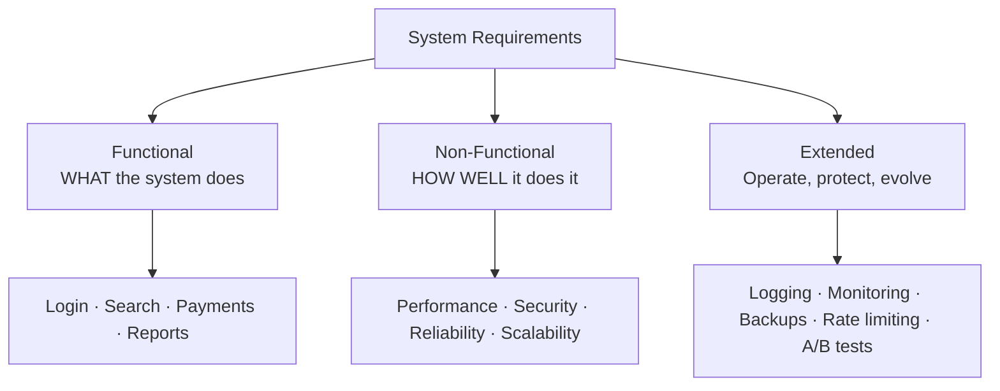
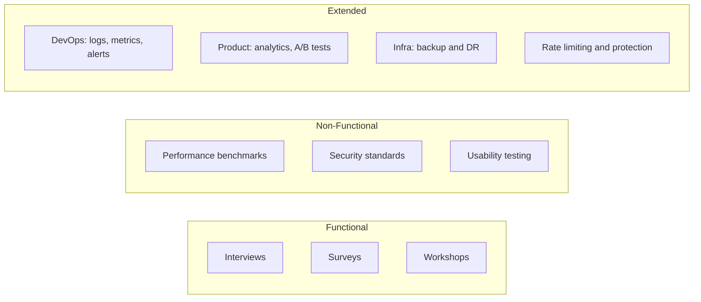

# 1.1.2 Functional and Non-Functional Requirements

> **Phase 1: Introduction to System Design → 1.1 Basics**
> Source: GeeksforGeeks, *Functional and Non Functional Requirements* (last updated 29 Sep 2026)
> Previous: [1.1.1 Introduction to System Design](./1.1.1-Introduction.md)

---

## Table of Contents

1. [What is Requirements Analysis?](#1-what-is-requirements-analysis)
2. [Functional Requirements (FRs)](#2-functional-requirements-frs)
3. [Non-Functional Requirements (NFRs)](#3-non-functional-requirements-nfrs)
4. [Extended Requirements](#4-extended-requirements)
5. [Worked Examples](#5-worked-examples)
6. [Functional vs Non-Functional](#6-functional-vs-non-functional)
7. [Common Challenges](#7-common-challenges)
8. [Gathering Requirements](#8-gathering-requirements)
9. [Interview Tips: Requirements in a System Design Interview](#9-interview-tips-requirements-in-a-system-design-interview)
10. [Quick Revision](#10-quick-revision)
11. [Self-Check Quiz](#11-self-check-quiz)

---

## 1. What is Requirements Analysis?

**Requirements analysis** is a crucial phase of software development in which the **needs and expectations of users and stakeholders** are identified and documented. It ensures the system is **built correctly** and **meets its intended goals**.

Requirements fall into two main categories (plus a third "extended" group covered later):

| Type | Question it answers | Focus |
|---|---|---|
| **Functional Requirements** | **WHAT** should the system do? | Features and operations |
| **Non-Functional Requirements** | **HOW (well)** should the system perform? | Quality, performance, constraints |
| **Extended Requirements** | How will we **operate, protect, and evolve** it? | Operations, observability, experimentation, growth |

### Example: Online Shopping System

- **Functional:** user login, order placement
- **Non-functional:** performance, security, scalability



> 💡 **Why this matters for system design:** Functional requirements tell you *which components* you need; non-functional requirements tell you *how to build and arrange them* (caching, replication, sharding, load balancing…).

---

## 2. Functional Requirements (FRs)

**Functional requirements** define the **specific features and operations** a system must perform to meet business and user needs. They describe **what the system should do** and **how it interacts** with users or other systems.

### 2.1 Characteristics

- Focus on the **behaviour and functionality** of the system.
- Represent features that can be **directly observed and tested** in the final product.
- Typically phrased as: *"The system shall…"* / *"Users should be able to…"*

### 2.2 Common Examples

| Feature | Example FR |
|---|---|
| **User authentication** | Users can sign up and log in with email and password. |
| **Data processing** | The system calculates the order total including tax. |
| **Search functionality** | Users can search products by name or category. |
| **Payment processing** | Users can pay by card or wallet. |
| **Report generation** | Admins can download a monthly sales report. |

### 2.3 Sample Questions to Ask

- What **features** should the system include?
- What **edge cases or special scenarios** should the system handle?

*(Additional useful questions: Who are the users/actors? What are the core use cases vs. nice-to-haves? What inputs and outputs does each feature have?)*

---

## 3. Non-Functional Requirements (NFRs)

**Non-functional requirements** define **how well** a system should operate. They cover qualities such as performance, reliability, security, and usability, rather than specific features.

> ⚠️ **Key rule:** NFRs should be defined using **measurable criteria or metrics** so they can be **tested and evaluated**.
>
> ❌ "The system should be fast."
> ✅ "The system should respond to 95% of requests in under 200 ms."

### 3.1 Core NFR Categories

| Category | What it means | Typical measurable target |
|---|---|---|
| **Performance** | Response time, throughput, or latency targets | p95 latency < 200 ms; 10k requests/sec |
| **Security** | Protection against unauthorised access and security threats | All data encrypted in transit (TLS) and at rest; MFA for admins |
| **Usability** | Ease of use and user experience | New user completes checkout in < 3 steps |
| **Reliability** | Stability, availability, and recovery from failure | 99.9% uptime; recover from failure within 5 minutes |
| **Scalability** | Handles growing users, traffic, or data | Support 10× traffic growth without redesign |
| **Maintainability** | Ease of updating, modifying, and fixing | Deploy a fix within 1 hour; modular codebase |
| **Portability** | Runs across different environments or platforms | Runs on any cloud provider via containers |

*(Measurable targets in this table are illustrative examples, not from the source.)*

### 3.2 Sample Questions to Ask

- How **fast** should the system respond to user actions?
- How **secure** should it be against unauthorised access?
- How **available and reliable** should the system be?

### 3.3 Why NFRs Drive Architecture

| NFR | Typical design decision it leads to |
|---|---|
| Low latency | Caching (Redis, CDN), read replicas |
| High availability | Redundancy, replication, failover, multiple regions |
| Scalability | Horizontal scaling, load balancers, sharding |
| Security | Encryption, auth (OAuth/JWT), API gateways |
| Maintainability | Modular services, clear interfaces, good docs |

---

## 4. Extended Requirements

Beyond functional and non-functional requirements, many systems have additional needs related to **operations, security, experimentation, and future growth**. The source groups these as **extended requirements**:

| Extended requirement | Purpose |
|---|---|
| **Logging** | Record system activities and errors for debugging and analysis |
| **Monitoring & Alerting** | Track system health and performance; get notified about failures |
| **Analytics** | Collect usage data to understand user behaviour and system performance |
| **Backup & Disaster Recovery** | Ensure data can be restored after failures or disasters |
| **Rate Limiting** | Control the number of requests to prevent overload or abuse |
| **Feature Flags / A-B Testing** | Enable controlled feature releases and experiments |

### Sample Questions to Ask

- How will the system be **monitored**, and how will we be **alerted** when failures occur?
- How will **logs and analytics** be collected for debugging and insights?
- How will the system **recover** from failures or data loss?

> 💡 These are often forgotten in interviews and early designs, yet they are what keep a system running in production. Mentioning them shows **operational maturity**.

---

## 5. Worked Examples

### 5.1 Online Banking System

| Type | Requirements |
|---|---|
| **Functional** | • Users log in with username and password.<br>• Users can check their account balance.<br>• Users receive notifications after making a transaction. |
| **Non-Functional** | • Respond to user actions in **< 2 seconds**.<br>• All transactions **encrypted** and compliant with industry security standards.<br>• Handle **100 million users** with minimal downtime. |
| **Extended** | • **Log** all transactions for auditing and fraud detection.<br>• **Automatic backups** and disaster recovery.<br>• **Monitoring and alerts** to detect unusual activity. |

### 5.2 Food Delivery App

| Type | Requirements |
|---|---|
| **Functional** | • Users browse the menu and place an order.<br>• Users make payments and **track orders in real time**. |
| **Non-Functional** | • Load the restaurant menu in **< 1 second**.<br>• Support up to **50,000 concurrent orders** at peak hours.<br>• **Easy to use** for first-time users, with an intuitive interface. |
| **Extended** | • **Analytics** on popular dishes and order trends.<br>• **Monitoring and logging** to track errors and performance.<br>• **A/B testing** for new features such as promotions or UI changes. |

> 🧠 **Notice:** Each NFR has a number attached (2 s, 100M users, 1 s, 50k orders). That is what makes it testable.

### 5.3 Practice: Classify These (URL Shortener)

Try classifying each before opening the answer.

1. Users can create a short URL from a long URL.
2. Redirects should complete in under 100 ms.
3. Track how many times each short link is clicked.
4. The service should be available 99.99% of the time.
5. Limit each user to 100 new links per hour.
6. Users can set a custom alias.

<details>
<summary>Answers</summary>

1. **Functional**: a feature
2. **Non-functional**: performance
3. **Extended**: analytics (could also be functional if it is a user-facing feature)
4. **Non-functional**: reliability/availability
5. **Extended**: rate limiting
6. **Functional**: a feature
</details>

---

## 6. Functional vs Non-Functional

| Aspect | Functional Requirements | Non-Functional Requirements |
|---|---|---|
| **Defines** | **What** the system should do (features & functionality) | **How** the system should perform (quality attributes) |
| **Focus** | System behaviour and operations | Performance, usability, security, reliability |
| **Describes** | Specific actions: login, data processing, transactions | Constraints: response time, scalability, availability |
| **Visibility** | Directly visible to users and business needs | Indirectly visible; improve overall user experience |
| **Measurability** | Easier to measure (output-based validation) | Harder to measure; uses metrics like **SLAs** and **benchmarks** |
| **Impact** | Drive the **core functionality** | Influence **architecture and design decisions** |
| **Documented using** | Use cases, user stories | Technical specs, performance criteria |
| **Examples** | Login authentication, data input/output, transaction processing | Scalability, security, response time, reliability, maintainability |

### Quick Test to Tell Them Apart

```
Can I describe it as an ACTION a user/system performs?   → Functional
Does it describe a QUALITY or CONSTRAINT on those actions? → Non-Functional
```

> Example: *"Users can upload a photo"* → **Functional**.
> *"Photo upload completes in under 3 seconds for files up to 10 MB"* → **Non-Functional**.

---

## 7. Common Challenges

Requirements must balance functionality, performance, and long-term goals. **Poorly defined requirements** can cause design issues, delays, or systems that fail to meet user expectations.

| Challenge | Description | How to mitigate (tip) |
|---|---|---|
| **Ambiguity** | Vague or incomplete requirements make it hard to define what the system should do and how it should perform. | Ask clarifying questions; attach numbers and acceptance criteria. |
| **Changing requirements** | Business goals, markets, or user expectations shift over time. | Design for extensibility; iterate; version requirements. |
| **Difficulty prioritising** | FRs get attention while scalability, security, and monitoring are overlooked. | Explicitly list NFRs and extended requirements; use MoSCoW-style prioritisation. |
| **Measuring NFRs** | Features are easy to test, but usability, scalability, and reliability are harder to measure. | Define SLAs/SLOs, benchmarks, and load tests. |
| **Overlapping / conflicting requirements** | E.g. strong security measures may hurt performance. | Make trade-offs explicit and agree on priorities with stakeholders. |

*(The mitigation column is added guidance, not from the source.)*

---

## 8. Gathering Requirements

Gathering requirements involves **multiple approaches** and **collaboration** between the development team, stakeholders, and end users.



### 8.1 Functional Requirements

| Technique | How it works |
|---|---|
| **Interviews** | Talk to stakeholders or users to understand their needs. |
| **Surveys** | Send questionnaires to gather input from a larger audience. |
| **Workshops** | Host sessions to brainstorm features and gather feedback. |

### 8.2 Non-Functional Requirements

| Technique | How it works |
|---|---|
| **Performance benchmarks** | Consult IT teams to set expectations for performance and load. |
| **Security standards** | Consult security experts to define best practices for data protection. |
| **Usability testing** | Test the system to find where users struggle, then refine the interface. |

### 8.3 Extended Requirements

Gathered to improve **monitoring, reliability, and future enhancements** beyond core functionality.

| Area | Who to work with | What to decide |
|---|---|---|
| **Monitoring & Logging** | DevOps teams | How logs, metrics, and alerts are collected and analysed |
| **Analytics & Reporting** | Product teams | Which user behaviour and system data to track |
| **Backup & Disaster Recovery** | Infrastructure teams | Backup strategy and recovery procedures |
| **Rate Limiting & System Protection** | Engineering / security | Limits on API requests and traffic control |
| **Feature Flags & Experiments** | Product teams | Controlled feature releases and A/B testing |

---

## 9. Interview Tips: Requirements in a System Design Interview

*(Added guidance, not from the source.)*

Clarifying requirements is usually **the first 5–10 minutes** of a system design interview. A simple routine:

1. **List the core functional requirements** (3–5 is enough) and confirm scope with the interviewer.
2. **State what is out of scope** (e.g. "I won't design the payment system").
3. **Ask for scale and quality targets:** users (DAU), requests/sec, read vs. write ratio, latency, availability, consistency needs.
4. **Mention extended requirements briefly:** monitoring, logging, rate limiting, backups.
5. **Write them down** and refer back when making design decisions ("We need < 100 ms reads, so I'll add a cache here").

---

## 10. Quick Revision

- **Requirements analysis** identifies and documents stakeholder needs so the system is built correctly.
- **Functional** = **WHAT** the system does → features, behaviour, directly testable; documented as use cases or user stories.
- **Non-functional** = **HOW WELL** it does it → performance, security, usability, reliability, scalability, maintainability, portability; **must be measurable**; drives architecture.
- **Extended** = operating and evolving the system → logging, monitoring and alerting, analytics, backup and DR, rate limiting, feature flags and A/B testing.
- **Challenges:** ambiguity, changing requirements, prioritisation, measuring NFRs, conflicting requirements.
- **Gathering:** FRs via interviews, surveys, workshops; NFRs via benchmarks, security standards, usability testing; extended via DevOps, product, and infrastructure teams.

---

## 11. Self-Check Quiz

> ⭐ **Q1–Q5 are from the GeeksforGeeks suggested quiz and are common interview questions.** Try each one before opening the answer.

### Q1. Which statement best differentiates functional and non-functional requirements?

- A. Functional requirements describe system performance; non-functional requirements describe system operations.
- B. Functional requirements define what the system must do; non-functional requirements define how well it must perform.
- C. Functional requirements are optional; non-functional requirements are mandatory.
- D. Functional requirements cover constraints like performance, security, and scalability, while non-functional requirements focus on system features.

<details>
<summary>Answer</summary>

**B. Functional requirements define what the system must do; non-functional requirements define how well it must perform.**

Functional requirements define **what** the system does (features). Non-functional requirements define **how well** it performs (quality attributes such as performance and scalability).

- **A** and **D** swap the two definitions.
- **C** is false: both types are essential. A system with every feature but 30-second response times, or a fast system missing core features, both fail.
</details>

### Q2. A system must handle 100 million users with minimal downtime. This is an example of:

- A. Functional Requirement
- B. Security Requirement
- C. Reliability/Scalability Requirement
- D. Maintainability Requirement

<details>
<summary>Answer</summary>

**C. Reliability/Scalability Requirement**

This is not a functional feature. It describes how the system performs under load (**scalability**: 100 million users) and how well it stays up (**reliability**: minimal downtime). Both are non-functional requirements.
</details>

### Q3. "The app should load the restaurant menu in under 1 second." This requirement primarily belongs to which NFR category?

- A. Usability
- B. Maintainability
- C. Portability
- D. Performance

<details>
<summary>Answer</summary>

**D. Performance**

The requirement is about speed and responsiveness. It defines **how fast** the system should respond, not **what** feature it provides. Note that it is measurable ("under 1 second"), which is exactly how a good NFR should be written.
</details>

### Q4. Which of the following is the MOST challenging aspect when gathering non-functional requirements?

- A. They are hard to measure and validate using metrics or SLAs.
- B. They require extensive coding changes.
- C. They conflict with functional requirements.
- D. They are not visible to the user.

<details>
<summary>Answer</summary>

**A. They are hard to measure and validate using metrics or SLAs.**

NFRs often start out qualitative ("fast", "secure", "reliable"), but they have to be turned into clear, measurable metrics such as "p95 < 200 ms" or "99.9% uptime". That makes them harder to test, validate, and guarantee than functional requirements. *(See section 7: Measuring Non-Functional Requirements.)*
</details>

### Q5. "A user should receive a notification after completing a transaction." This is an example of which type of requirement, and why?

- A. Non-functional, because notifications enhance usability.
- B. Functional, because it defines a specific system behavior.
- C. Non-functional, because it improves overall system performance.
- D. Functional, because it improves security.

<details>
<summary>Answer</summary>

**B. Functional, because it defines a specific system behavior.**

It describes a specific **action** the system must perform (send a notification after a transaction), so it is a functional requirement. It is not about performance or another quality attribute. *(D gets the type right but the reason wrong.)*

> 💡 Compare: "The notification must arrive **within 5 seconds**" would add a **non-functional** (performance) requirement on top of the functional one.
</details>

### More Practice

**Q6. "Users should be able to check their account balance." Which type?**

<details>
<summary>Answer</summary>

**Functional**: it describes a feature or action.
</details>

**Q7. Why is "the app should be fast" a poor non-functional requirement?**

<details>
<summary>Answer</summary>

It is **not measurable**. NFRs need concrete metrics, e.g. "menu loads in under 1 second".
</details>

**Q8. Which type of requirement most strongly influences architecture decisions?**

<details>
<summary>Answer</summary>

**Non-functional requirements**: e.g. scale and latency targets decide caching, replication, load balancing, and sharding.
</details>

**Q9. Name four extended requirements.**

<details>
<summary>Answer</summary>

Any four of: logging, monitoring & alerting, analytics, backup & disaster recovery, rate limiting, feature flags / A-B testing.
</details>

**Q10. Give an example of conflicting requirements.**

<details>
<summary>Answer</summary>

Strong security measures (e.g. heavy encryption, extra authentication checks) can hurt **performance** (higher latency).
</details>

**Q11. How are functional requirements usually documented, compared with non-functional ones?**

<details>
<summary>Answer</summary>

FRs: **use cases and user stories**. NFRs: **technical specs and performance criteria** (SLAs, benchmarks).
</details>

---

### 📚 Next

- [1.1.3 Software Requirements Specification (SRS)](./1.1.3-Software-Requirements-Specification.md) · [SRS Template](./1.1.3-SRS-Template.md)
