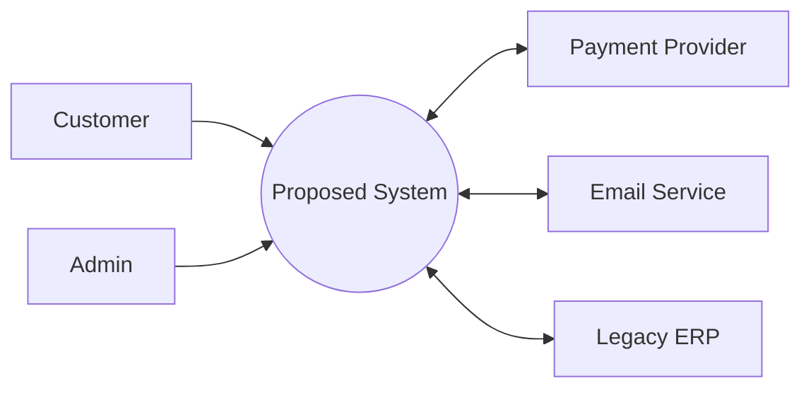
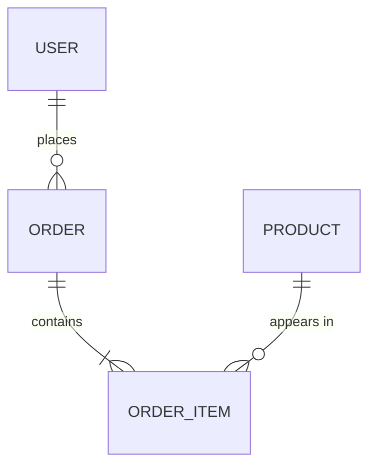

# Software Requirements Specification (SRS)

## [Project Name]

> **How to use this template**
> - Text in `[square brackets]` is a placeholder. Replace it.
> - Lines starting with `> 💡` are guidance. Delete them before publishing.
> - Delete sections that don't apply, but write **"N/A — reason"** rather than silently removing a required section.
> - Aligned with the structure of **ISO/IEC/IEEE 29148:2018** (successor to IEEE 830). Adapt it to your project.
> - Companion notes: [1.1.3 Software Requirements Specification](./1.1.3-Software-Requirements-Specification.md)

---

## Document Control

| Field | Value |
|---|---|
| **Document ID** | [SRS-PROJ-001] |
| **Version** | [0.1] |
| **Status** | [Draft / Under Review / Approved / Superseded] |
| **Date** | [YYYY-MM-DD] |
| **Author(s)** | [Name, Role] |
| **Owner** | [Name, Role: accountable for keeping this document current] |
| **Development approach** | [Agile / Waterfall / Hybrid] |
| **Location of record** | [Repo path / ALM tool link: the single source of truth] |

### Revision History

| Version | Date | Author | Description of change | Approved by |
|---|---|---|---|---|
| 0.1 | [YYYY-MM-DD] | [Name] | Initial draft | — |
| [1.0] | [YYYY-MM-DD] | [Name] | [Baseline approved] | [Name] |

### Approvals / Sign-off

> 💡 The author should not approve the document alone. Get sign-off from each group that relies on it.

| Role | Name | Signature / Approval | Date |
|---|---|---|---|
| Product Owner / Business Sponsor | [Name] | | |
| Lead Architect / Tech Lead | [Name] | | |
| QA Lead | [Name] | | |
| Security / Compliance | [Name] | | |
| Client / Key Stakeholder | [Name] | | |

---

## Table of Contents

1. [Introduction](#1-introduction)
2. [Overall Description](#2-overall-description)
3. [Functional Requirements](#3-functional-requirements)
4. [Non-Functional Requirements](#4-non-functional-requirements)
5. [External Interface Requirements](#5-external-interface-requirements)
6. [Data Requirements](#6-data-requirements)
7. [Business Rules](#7-business-rules)
8. [Operational (Extended) Requirements](#8-operational-extended-requirements)
9. [Legal, Regulatory and Other Requirements](#9-legal-regulatory-and-other-requirements)
10. [Risk Management (FMEA)](#10-risk-management-fmea)
11. [Verification and Acceptance](#11-verification-and-acceptance)
12. [Appendices](#12-appendices)

---

## Requirement Conventions

> 💡 Read this first. It keeps every requirement consistent, traceable, and testable.

### Keywords

| Keyword | Meaning |
|---|---|
| **shall** | Mandatory requirement |
| **should** | Recommended; deviation needs justification |
| **may** | Optional |
| **will** | Statement of fact or intent (not a requirement) |

### ID Scheme

| Prefix | Type | Example |
|---|---|---|
| `BR-` | Business requirement | BR-01 |
| `UC-` | Use case | UC-01 |
| `FR-` | Functional requirement | FR-1.2 (feature 1, requirement 2) |
| `NFR-` | Non-functional requirement | NFR-PERF-01 |
| `IR-` | External interface requirement | IR-SW-01 |
| `DR-` | Data requirement | DR-01 |
| `RULE-` | Business rule | RULE-01 |
| `OPS-` | Operational (extended) requirement | OPS-LOG-01 |
| `CR-` | Compliance / regulatory requirement | CR-01 |
| `RISK-` | Risk item | RISK-01 |
| `TBD-` | Open item | TBD-01 |

> 💡 IDs are **permanent**. Never reuse or renumber an ID; mark a removed requirement as `Deleted` instead.

### Requirement Attributes

Every requirement in sections 3–9 should carry these attributes:

| Attribute | Values / Description |
|---|---|
| **ID** | Unique, permanent identifier |
| **Statement** | One requirement per statement, written in EARS form where possible |
| **Priority** | **M**ust / **S**hould / **C**ould / **W**on't (MoSCoW) |
| **Source** | Stakeholder, BR, regulation, or user story it traces back to |
| **Rationale** | Why it exists (helps future change decisions) |
| **Acceptance criteria** | Measurable, pass/fail condition(s) |
| **Verification method** | **T**est / **D**emonstration / **I**nspection / **A**nalysis |
| **Status** | Proposed / Approved / Implemented / Verified / Deleted |

### Writing Patterns (EARS)

| Pattern | Template |
|---|---|
| Ubiquitous | The `<system>` shall `<response>`. |
| Event-driven | **When** `<trigger>`, the `<system>` shall `<response>`. |
| State-driven | **While** `<state>`, the `<system>` shall `<response>`. |
| Unwanted behaviour | **If** `<condition>`, **then** the `<system>` shall `<response>`. |
| Optional feature | **Where** `<feature is included>`, the `<system>` shall `<response>`. |

> 💡 **Banned words** unless they are quantified: *fast, quick, easy, user-friendly, intuitive, reliable, secure, robust, scalable, flexible, minimal, adequate, etc., and/or, as appropriate, support (as a vague verb).*

---

## 1. Introduction

### 1.1 Purpose
[State the purpose of this document, which product and release it covers, and the version of the product.]

### 1.2 Intended Audience and Use
> 💡 Say who will read this and how they should use it.

| Audience | How they use this document |
|---|---|
| Developers | [Understand what to build] |
| QA / Testers | [Derive test cases from acceptance criteria] |
| Architects | [Derive the High-Level Design] |
| Project Managers | [Track scope and estimate] |
| Stakeholders / Client | [Approve scope and expectations] |

### 1.3 Product Scope

**Business problem:** [What problem does the product solve, and for whom?]

**Objectives and success metrics:**

| Objective | Success metric (measurable) |
|---|---|
| [Reduce booking time] | [Average booking completed in < 60 s] |
| [Increase online sales] | [+20% conversion within 6 months] |

**In scope:**
- [Capability 1]
- [Capability 2]

**Out of scope (explicitly excluded):**
- [Excluded capability 1, e.g. "Native desktop app"]
- [Excluded capability 2, e.g. "Payments: handled by existing system"]

### 1.4 Definitions, Acronyms, and Abbreviations

| Term | Definition |
|---|---|
| [SRS] | [Software Requirements Specification] |
| [RPO / RTO] | [Recovery Point Objective / Recovery Time Objective] |
| [Domain term] | [Definition] |

> 💡 For jargon-heavy domains, move this to a full glossary in Appendix A.

### 1.5 References

| ID | Document / Standard | Version | Link |
|---|---|---|---|
| REF-1 | [Product Requirements Document (PRD)] | [1.2] | [link] |
| REF-2 | [ISO/IEC/IEEE 29148:2018] | — | [link] |
| REF-3 | [Brand / UI style guide] | [x.y] | [link] |
| REF-4 | [Regulation, e.g. GDPR / HIPAA / PCI DSS] | — | [link] |

### 1.6 Document Overview
[One paragraph describing how the rest of this document is organised.]

---

## 2. Overall Description

### 2.1 Product Perspective
[Explain how this product fits into the wider ecosystem. Is it new, a replacement, an add-on, or an integration with an existing product?]

> 💡 Add a **context diagram** showing the system as one box, with users and external systems around it.



### 2.2 Product Functions (Summary)
> 💡 A high-level list only. Details go in section 3.

- [Function 1: e.g. User registration and authentication]
- [Function 2: e.g. Product search and browse]
- [Function 3: e.g. Order placement and tracking]

### 2.3 Stakeholders

| Stakeholder | Interest / Concern | Involvement |
|---|---|---|
| [Business Sponsor] | [ROI, timeline] | [Approves scope] |
| [End Users] | [Ease of use] | [Interviews, UAT] |
| [Operations / DevOps] | [Deployability, monitoring] | [Reviews NFRs and OPS requirements] |
| [Security / Legal] | [Compliance, data protection] | [Reviews CRs and security NFRs] |

### 2.4 User Classes and Characteristics

| User class | Description | Technical expertise | Frequency of use | Key permissions | Priority |
|---|---|---|---|---|---|
| [Anonymous Guest] | [Browses without account] | [Low] | [Occasional] | [Read public content] | [Secondary] |
| [Registered Customer] | [Places orders] | [Low–Medium] | [Weekly] | [Manage own account and orders] | [Primary] |
| [System Admin] | [Manages users and config] | [High] | [Daily] | [Full access] | [Primary] |

> 💡 Add **personas** in an appendix if they help. For regulated domains (e.g. medical), consider purchaser, end user, **and** patient needs.

### 2.5 Operating Environment

| Aspect | Specification |
|---|---|
| Client platforms | [Chrome/Edge/Firefox/Safari, latest 2 versions; iOS 17+; Android 13+] |
| Server / Hosting | [e.g. AWS, region eu-west-1; containers on Kubernetes] |
| Hardware minimums | [e.g. 4 GB RAM device] |
| Network | [e.g. Works on 3G with degraded media] |

### 2.6 Design and Implementation Constraints
> 💡 Only **genuine** constraints (contractual, regulatory, organisational). Otherwise, leave design choices to the engineering team.

| ID | Constraint | Reason / Source |
|---|---|---|
| CON-01 | [Must use the corporate SSO (Azure AD)] | [Security policy SEC-12] |
| CON-02 | [Personal data must remain in the EU] | [GDPR] |
| CON-03 | [Must be built in Java 21 / Spring Boot] | [Team skills, maintenance contract] |

### 2.7 Assumptions

| ID | Assumption | Impact if false |
|---|---|---|
| AS-01 | [Peak traffic will not exceed 5,000 concurrent users in year 1] | [Re-size infrastructure] |
| AS-02 | [Third-party maps API remains free under 100k calls/month] | [Budget increase] |

### 2.8 Dependencies

| ID | Dependency | Owner | Status / Risk |
|---|---|---|---|
| DEP-01 | [Payment provider sandbox access] | [Vendor] | [Pending] |
| DEP-02 | [Reuse of auth module from Project X] | [Team Y] | [Available] |

### 2.9 User Documentation
[What user documentation will be delivered: online help, tutorials, API docs, admin guide.]

---

## 3. Functional Requirements

> 💡 Group by **feature** (or by user class). Each requirement must be **unique, numbered, atomic, and testable**. Use EARS patterns. Add use cases or Gherkin acceptance criteria for complex behaviour.

### 3.1 Feature: User Authentication

**Description and priority:** [Allows users to register, log in, and recover access.] **Priority:** Must

**Related business requirement / user stories:** [BR-01; US-12, US-13]

| ID | Requirement | Priority | Source | Acceptance criteria | Verif. |
|---|---|---|---|---|---|
| FR-1.1 | The system shall allow a user to register an account using an email address and a password. | M | US-12 | Registration with a valid email and password creates an account with status "Unverified". | T |
| FR-1.2 | **If** a submitted password is shorter than 8 characters or lacks at least one number and one special character, **then** the system shall reject it and display the password rules. | M | SEC policy | Each invalid case is rejected with a message; valid passwords are accepted. | T |
| FR-1.3 | **When** a user completes registration, the system shall send a verification email to the registered address. | M | US-12 | Email received within 60 s; link valid for 24 h. | T |
| FR-1.4 | **If** 3 consecutive login attempts fail, **then** the system shall lock the account for 15 minutes and notify the user by email. | M | RISK-02 | 4th attempt is blocked; unlock happens after 15 min; email is sent. | T |
| FR-1.5 | **Where** "Remember me" is selected, the system shall keep the user logged in on that device for up to 30 days. | S | US-14 | Session persists across browser restart for ≤ 30 days. | T |

#### Use Case UC-01: Login

| Field | Description |
|---|---|
| **Actor(s)** | [Registered Customer] |
| **Preconditions** | [User has a verified account] |
| **Trigger** | [User opens the login page] |
| **Main flow** | 1. User enters email/username and password. 2. User clicks "Login". 3. System validates the credentials. 4. System creates a session and redirects to the dashboard. |
| **Alternative flows** | A1 *Forgot password*: user requests a reset link, receives an email, sets a new password. A2 *Remember me*: system stores a secure token on the device. |
| **Exceptions** | E1 *Invalid credentials*: error shown, attempt counted. E2 *Account locked*: lock message with unlock instructions. E3 *Account deactivated*: explanatory message. E4 *System outage*: outage message with estimated restoration time. |
| **Postconditions** | [User is authenticated; login event is logged] |

#### Acceptance Criteria (Gherkin)

```gherkin
Scenario: Successful login
  Given a verified user with valid credentials
  When the user submits the login form
  Then the user is redirected to the dashboard within 2 seconds

Scenario: Account lock after repeated failures
  Given a verified user
  When the user enters an incorrect password 3 times in a row
  Then the account is locked for 15 minutes
  And the user receives a notification email
```

### 3.2 Feature: [Feature Name 2]

**Description and priority:** [Short description.] **Priority:** [M/S/C/W]

**Related business requirement / user stories:** [BR-xx; US-xx]

| ID | Requirement | Priority | Source | Acceptance criteria | Verif. |
|---|---|---|---|---|---|
| FR-2.1 | [When <trigger>, the system shall <response>.] | [M] | [US-xx] | [Measurable pass/fail condition] | [T] |
| FR-2.2 | [Requirement] | [ ] | [ ] | [ ] | [ ] |

---

## 4. Non-Functional Requirements

> 💡 Every NFR needs a **metric**, a **target**, the **conditions** under which it applies, and a **measurement method**. "Fast" is not a requirement.

### 4.1 Performance

| ID | Requirement | Metric | Target | Conditions | How measured |
|---|---|---|---|---|---|
| NFR-PERF-01 | The dashboard shall load within the target time. | p95 page load | ≤ 2.0 s | 1,000 concurrent users, standard load | Load test (k6/JMeter) |
| NFR-PERF-02 | The API shall sustain the target throughput. | Requests/sec | ≥ 500 rps | Peak hour profile | Load test |
| NFR-PERF-03 | [Payment authorisation response time] | p99 latency | ≤ 3 s | Production load | APM monitoring |

### 4.2 Scalability & Capacity

| ID | Requirement | Target |
|---|---|---|
| NFR-SCAL-01 | The system shall support growth in users without redesign. | [Scale to 10× year-1 users (50,000 concurrent) by adding instances] |
| NFR-SCAL-02 | The system shall accommodate data growth. | [5 TB storage growth/year without performance degradation] |

> 💡 Include **capacity estimates**: DAU, peak RPS, read:write ratio, and storage per year. These feed directly into the High-Level Design.

### 4.3 Availability & Reliability

| ID | Requirement | Target |
|---|---|---|
| NFR-AVL-01 | Monthly uptime, excluding scheduled maintenance windows | [99.9% (≈ 43 min downtime/month)] |
| NFR-REL-01 | Recovery Time Objective (RTO) | [≤ 15 minutes] |
| NFR-REL-02 | Recovery Point Objective (RPO) | [≤ 5 minutes of data loss] |
| NFR-REL-03 | Mean Time Between Failures (MTBF) | [≥ 720 hours] |
| NFR-REL-04 | Graceful degradation | [If the recommendation service fails, product pages still load without recommendations] |

### 4.4 Security

| ID | Requirement |
|---|---|
| NFR-SEC-01 | All passwords shall be hashed with bcrypt (cost ≥ 12) before storage. |
| NFR-SEC-02 | All data in transit shall use HTTPS with TLS 1.3 (TLS 1.2 minimum). |
| NFR-SEC-03 | Sensitive data at rest shall be encrypted with AES-256. |
| NFR-SEC-04 | Administrative access shall require multi-factor authentication. |
| NFR-SEC-05 | Access shall follow role-based access control (RBAC) and the principle of least privilege. |
| NFR-SEC-06 | The system shall have no Critical/High findings from the OWASP Top 10 at release (verified by a penetration test). |
| NFR-SEC-07 | Sessions shall expire after [30] minutes of inactivity. |

### 4.5 Usability & Accessibility

| ID | Requirement | Target / Measure |
|---|---|---|
| NFR-USE-01 | The UI shall comply with accessibility guidelines. | WCAG 2.1 Level AA (or 2.2) |
| NFR-USE-02 | A first-time user shall complete [checkout] without assistance. | ≥ 90% task success in usability testing; ≤ 3 steps |
| NFR-USE-03 | The UI shall be responsive. | Usable from 360 px to 2560 px widths |

### 4.6 Maintainability & Supportability

| ID | Requirement |
|---|---|
| NFR-MNT-01 | Automated unit test coverage shall be ≥ [80]% for business logic. |
| NFR-MNT-02 | A standard bug fix shall be deployable to production within [1 hour] through the CI/CD pipeline. |
| NFR-MNT-03 | Public APIs shall be documented using OpenAPI 3.x. |

### 4.7 Portability & Compatibility

| ID | Requirement |
|---|---|
| NFR-PORT-01 | The application shall run in OCI-compliant containers on any major cloud provider. |
| NFR-COMP-01 | The web client shall support the latest 2 versions of Chrome, Edge, Firefox, and Safari. |

### 4.8 Safety (if applicable)

| ID | Requirement |
|---|---|
| NFR-SAFE-01 | [e.g. Audio output shall not exceed 85 dB(A) by default, to protect user hearing.] |

---

## 5. External Interface Requirements

### 5.1 User Interfaces
[Describe or link to wireframes, mockups, a design system, and UI style guides. List screen-level rules such as error message style, navigation patterns, and localisation of UI text.]

| ID | Requirement |
|---|---|
| IR-UI-01 | [All forms shall show inline validation errors next to the relevant field.] |

### 5.2 Hardware Interfaces
[Logical and physical characteristics of supported hardware: devices, sensors, ports, protocols.]

| ID | Requirement |
|---|---|
| IR-HW-01 | [The device shall support Bluetooth 5.3 with A2DP and AVRCP profiles.] |

### 5.3 Software Interfaces

| ID | External system | Purpose | Interface / Protocol | Data exchanged | Owner | SLA / Limits |
|---|---|---|---|---|---|---|
| IR-SW-01 | [Stripe] | [Payments] | [REST/JSON, webhooks] | [Payment intents, status] | [Vendor] | [100 req/s] |
| IR-SW-02 | [SendGrid] | [Transactional email] | [REST API] | [Email payloads] | [Vendor] | [—] |
| IR-SW-03 | [Corporate SSO] | [Authentication] | [OIDC / SAML 2.0] | [ID tokens, claims] | [IT] | [—] |

### 5.4 Communications Interfaces

| ID | Requirement |
|---|---|
| IR-COM-01 | [All client-server communication shall use HTTPS; real-time updates shall use WebSockets.] |
| IR-COM-02 | [Email notifications shall support HTML and plain-text formats.] |

---

## 6. Data Requirements

### 6.1 Logical Data Model
> 💡 Insert a high-level ERD or list of key entities. Detailed schema belongs in the design (LLD).



### 6.2 Data Specifications

| ID | Data item | Format / Validation | Source | Retention | Classification |
|---|---|---|---|---|---|
| DR-01 | [Email address] | [RFC 5322, max 254 chars, unique] | [User input] | [Account lifetime + 30 days] | [Personal] |
| DR-02 | [Transaction record] | [—] | [Payment service] | [7 years] | [Financial] |

### 6.3 Data Migration (if applicable)
[Source systems, volumes, mapping rules, validation, cut-over plan.]

---

## 7. Business Rules

| ID | Rule | Source |
|---|---|---|
| RULE-01 | [Orders over $10,000 require manager approval before fulfilment.] | [Finance policy F-03] |
| RULE-02 | [Discounts cannot be combined with other promotions.] | [Marketing] |

---

## 8. Operational (Extended) Requirements

> 💡 Often forgotten, but this is what keeps the system running in production. Agree these with the DevOps, Product, and Infrastructure teams.

| ID | Area | Requirement |
|---|---|---|
| OPS-LOG-01 | Logging | All transactions and authentication events shall be logged with timestamp, user ID, and correlation ID; logs retained for [90] days. |
| OPS-MON-01 | Monitoring & Alerting | The on-call engineer shall be alerted within [5] minutes when error rate exceeds [1]% or p95 latency exceeds the NFR target. |
| OPS-ANL-01 | Analytics | The system shall capture [feature usage events] for product analytics, respecting user consent. |
| OPS-BKP-01 | Backup & DR | Databases shall be backed up [every 24 h] with point-in-time recovery; backups shall be tested [quarterly]. |
| OPS-RL-01 | Rate Limiting | Public APIs shall limit each client to [100] requests per minute and return HTTP 429 when exceeded. |
| OPS-FF-01 | Feature Flags / A-B Testing | New features shall be releasable behind feature flags to a configurable percentage of users. |
| OPS-DEP-01 | Deployment | Deployments shall be zero-downtime (rolling or blue-green). |

---

## 9. Legal, Regulatory and Other Requirements

### 9.1 Legal & Regulatory Compliance

| ID | Regulation / Standard | Requirement |
|---|---|---|
| CR-01 | [GDPR] | [Users shall be able to export and delete their personal data within 30 days of a request.] |
| CR-02 | [PCI DSS] | [Card data shall never be stored; tokenisation via the payment provider.] |
| CR-03 | [HIPAA / ISO 13485 / IEC 62304, etc.] | [ ] |

### 9.2 Internationalisation & Localisation

| ID | Requirement |
|---|---|
| NFR-I18N-01 | [The UI shall support English and Thai at launch; all strings externalised.] |
| NFR-I18N-02 | [Dates, currencies, and numbers shall be formatted according to the user's locale; times stored in UTC.] |

### 9.3 Licensing & Intellectual Property
[Open-source licence restrictions, third-party licences, ownership of deliverables.]

---

## 10. Risk Management (FMEA)

> 💡 **RPN = Severity × Occurrence × Detection** (each scored 1–10). Mitigate the highest RPNs first, and link each mitigation to a requirement.

| ID | Function / Requirement | Failure mode | Effect | Cause | S | O | D | RPN | Mitigation (→ Req ID) | Owner |
|---|---|---|---|---|---|---|---|---|---|---|
| RISK-01 | [FR-1.1 Login] | [Brute-force succeeds] | [Account takeover] | [No lockout] | 8 | 5 | 3 | 120 | [Lockout + MFA → FR-1.4, NFR-SEC-04] | [ ] |
| RISK-02 | [NFR-AVL-01] | [Database outage] | [Service unavailable] | [Single instance] | 9 | 3 | 2 | 54 | [Multi-AZ replica → NFR-REL-01] | [ ] |
| RISK-03 | [ ] | [ ] | [ ] | [ ] | | | | | [ ] | [ ] |

---

## 11. Verification and Acceptance

### 11.1 Verification Approach

| Requirement type | Primary verification method |
|---|---|
| Functional (FR) | Automated and manual functional tests; Gherkin scenarios |
| Performance / Scalability | Load and stress tests against NFR targets |
| Security | SAST/DAST scans, penetration test |
| Usability / Accessibility | Usability testing, WCAG audit |
| Compliance | Inspection, audit evidence |

### 11.2 Acceptance Criteria for Release
- [All **Must** requirements implemented and verified.]
- [No open Critical/High defects.]
- [All NFR targets met in the pre-production environment.]
- [UAT signed off by the Product Owner.]

---

## 12. Appendices

### Appendix A: Glossary
[Extended definitions of domain terms.]

### Appendix B: Analysis Models & Diagrams
[Context diagram, data flow diagrams (DFD), use case diagrams, ERD, state diagrams, process flows, wireframes.]

### Appendix C: Requirements Traceability Matrix (RTM)

> 💡 Trace **backwards** to the source and **forwards** to design and tests. In an ALM tool this is generated automatically.

| Req ID | Source (BR / User story) | Design element (HLD/LLD) | Test case(s) | Test status | Release |
|---|---|---|---|---|---|
| FR-1.1 | [BR-01 / US-12] | [Auth Service] | [TC-101, TC-102] | [Pass / Fail / Not tested] | [v1.0] |
| NFR-PERF-01 | [SLA] | [CDN + Redis cache] | [TC-300 (load)] | [ ] | [v1.0] |

**Coverage summary:** [Total: __ · Passed: __ · Failed: __ · Not tested: __ · Not covered: __]

### Appendix D: To Be Determined (TBD) List

| ID | Section / Req | Open question | Owner | Due date | Resolution |
|---|---|---|---|---|---|
| TBD-01 | [NFR-SCAL-01] | [Confirm expected peak concurrent users] | [PO] | [YYYY-MM-DD] | [ ] |

### Appendix E: Change Request Log

| CR # | Date | Requirement(s) affected | Change | Rationale | Impact (scope/cost/time) | Decision | Approved by |
|---|---|---|---|---|---|---|---|
| CHG-01 | [ ] | [FR-2.1] | [ ] | [ ] | [ ] | [Approved / Rejected] | [ ] |

---

## ✅ SRS Quality Checklist (before submitting for approval)

- [ ] Every requirement has a unique, permanent **ID**
- [ ] Each statement contains **one** requirement and uses **shall / should / may** consistently
- [ ] No vague words (fast, easy, user-friendly, reliable…) without a **measurable** target
- [ ] Every requirement has **acceptance criteria** and a **verification method**
- [ ] Every requirement has a **priority** and a **source**
- [ ] Requirements describe the **need**, not the **design** (unless it is a genuine constraint)
- [ ] **Out of scope** is stated explicitly
- [ ] NFRs cover performance, scalability, availability, security, usability, maintainability, and compliance
- [ ] Operational requirements (logging, monitoring, backup, rate limiting) are included
- [ ] No contradictions between requirements
- [ ] All TBDs have an owner and a due date
- [ ] Traceability matrix is complete (no requirement without a test)
- [ ] Reviewed by business, development, QA, and security; not approved by the author alone
