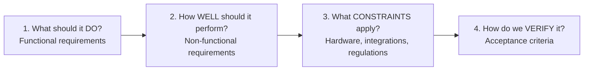
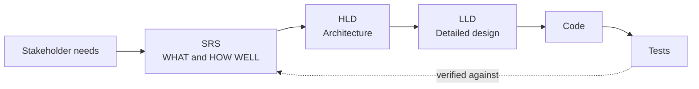
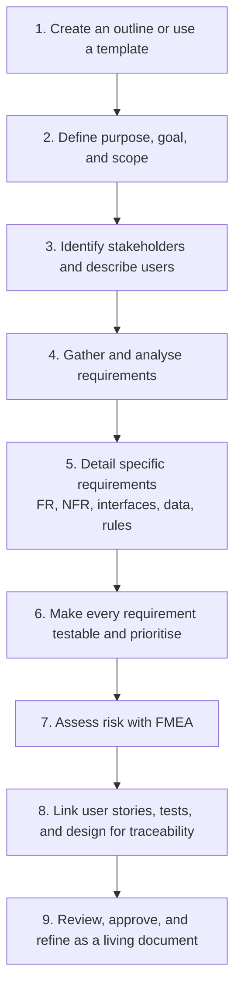
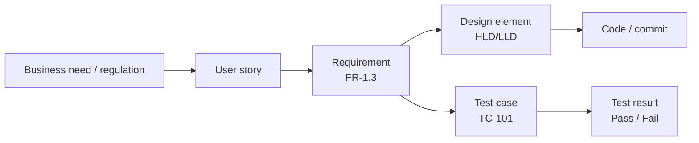
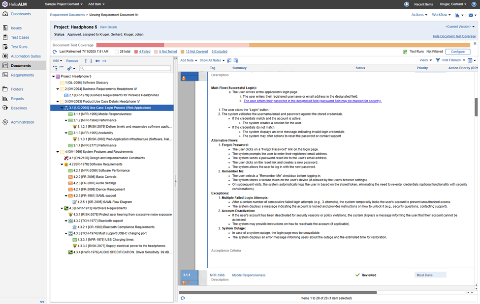

# 1.1.3 Software Requirements Specification (SRS)

---

## Table of Contents

1. [What is an SRS?](#1-what-is-an-srs)
2. [Why an SRS Matters (the "fast search" problem)](#2-why-an-srs-matters)
3. [The Four Questions an SRS Answers](#3-the-four-questions-an-srs-answers)
4. [Where the SRS Fits: SRS → HLD → LLD](#4-where-the-srs-fits-srs--hld--lld)
5. [Who Uses an SRS?](#5-who-uses-an-srs)
6. [What is a Software Requirement?](#6-what-is-a-software-requirement)
7. [Structure of an SRS Document](#7-structure-of-an-srs-document)
8. [Writing Requirements Well: EARS, Gherkin, Acceptance Criteria](#8-writing-requirements-well)
9. [How to Write an SRS: Step by Step](#9-how-to-write-an-srs-step-by-step)
10. [Risk Assessment with FMEA](#10-risk-assessment-with-fmea)
11. [Traceability](#11-traceability)
12. [Best Practices and Characteristics of a Good SRS](#12-best-practices-and-characteristics-of-a-good-srs)
13. [Benefits of a Well-Written SRS](#13-benefits-of-a-well-written-srs)
14. [Challenges: Keeping the SRS Current](#14-challenges-keeping-the-srs-current)
15. [SRS in Agile vs Waterfall](#15-srs-in-agile-vs-waterfall)
16. [Tools: Word/Docs vs Requirements Management Software](#16-tools-worddocs-vs-requirements-management-software)
17. [Worked Example: Hospital Appointment App](#17-worked-example-hospital-appointment-app)
18. [FAQ](#18-faq)
19. [SRS and System Design Interviews](#19-srs-and-system-design-interviews)
20. [Quick Revision](#20-quick-revision)
21. [Self-Check Quiz](#21-self-check-quiz)
22. [Sources](#22-sources)

---

## 1. What is an SRS?

A **Software Requirements Specification (SRS)** is a **formal document** that describes:

- **what** a software system must do,
- **how well** it must perform, and
- **which constraints** it must follow.

It serves as a **single source of truth** and a **blueprint** for developers, testers, and stakeholders. In some projects it also acts as a **legal or operational contract** between the client, product owners, developers, and testers, so everyone agrees on scope *before* code is written.

> 📘 **Standard:** The formal term comes from **ISO/IEC/IEEE 29148** (requirements engineering). As of 2026, **ISO/IEC/IEEE 29148:2018** is still the published standard, and a third edition is under development. It replaced the older **IEEE 830**, which many SRS outlines are still based on.

### Think of it as a blueprint

| Building a house | Building software |
|---|---|
| Client brief: "3 bedrooms, near a school" | Stakeholder needs |
| **Architect's blueprint** | **SRS** |
| Structural and engineering drawings | HLD / LLD |
| Construction | Coding |
| Building inspection | Testing against the SRS |

According to Perforce, the core elements an SRS should contain are:

| Element | Meaning |
|---|---|
| **Purpose** | *Why* the software is being built |
| **Description** | *What* the software will do |
| **Requirements** | Specific functionality and constraints |
| **Links** | Connections between user stories and specific requirements |
| **Approval process** | How all stakeholders sign off and stay aligned |

---

## 2. Why an SRS Matters

### The "fast search" problem (from Avenga)

> A stakeholder asks for a **"fast"** search function.
> - The **developer** reads "fast" as **2 seconds**.
> - The **product owner** expects **0.5 seconds**.
> - The **QA engineer** has **no measurable target** at all.
>
> Everyone understood the requirement. They just understood it **differently**.

An SRS exists to remove this kind of ambiguity **before it reaches production**. The fix is a measurable requirement:

> ✅ "Search results must be returned within **500 ms** for **95%** of queries under normal load."

### Key reasons

| Reason | Explanation |
|---|---|
| **Reduces ambiguity** | Turns vague requests into measurable, testable criteria |
| **Aligns teams** | Keeps business goals and technical work in sync across PMs, developers, and QA |
| **Improves estimates** | Gives a reliable basis for budgets, resourcing, and schedules before coding starts |
| **Reduces rework** | Problems found in a document are far cheaper to fix than problems found in code |
| **Supports testing and compliance** | Every requirement can be traced to a test, which regulators often require |

---

## 3. The Four Questions an SRS Answers

Following ISO/IEC/IEEE 29148, an SRS answers **four critical questions**:



| # | Question | Captured as | Example |
|---|---|---|---|
| 1 | What should the software **do**? | Functional requirements | "The system shall send a verification email on registration." |
| 2 | How **well** should it perform? | Non-functional requirements | "95% of pages load within 2 s." |
| 3 | What **constraints** must be respected? | Constraints, interfaces, compliance | "Must comply with GDPR; must integrate with Stripe." |
| 4 | How will the team **verify** it works? | Acceptance criteria | "Given a valid email, when the user registers, then an email arrives within 60 s." |

> 💡 Questions 1 and 2 are exactly the **functional vs non-functional** split from [1.1.2](./1.1.2-Functional-and-Non-functional-Requirements.md). The SRS is where those requirements are formally written down.

---

## 4. Where the SRS Fits: SRS → HLD → LLD



- **SRS** → the problem: *what* is needed, *how well*, and under *which constraints*.
- **HLD** → the architecture that satisfies the SRS (built **from the SRS**).
- **LLD** → detailed design of each component (built **from the reviewed HLD**).
- **Tests** → trace back to the SRS to prove each requirement is met.

> ⚠️ **An SRS describes the need, not the design.** Avenga warns against premature design instructions:
>
> | ✅ Requirement | ❌ Premature design instruction |
> |---|---|
> | "The system must verify a user's identity before displaying regulated personal information." | "The system must use Vendor X's authentication library version Y." |
>
> The second statement belongs in the SRS **only** if there is a valid architectural or contractual reason (then it becomes a *constraint*). Otherwise it needlessly restricts the engineering team.

---

## 5. Who Uses an SRS?

| Role | How they use the SRS |
|---|---|
| **Product owners and business analysts** | **Define** and coordinate the requirements |
| **Developers** | Understand **what to build** |
| **Architects** | Derive the HLD; check feasibility and constraints |
| **Testers / QA** | Create **test cases** and validate the system |
| **Project managers** | Track **scope** and **progress**; estimate |
| **Clients and stakeholders** | **Approve** features and expectations |
| **Security, legal, and compliance** | Validate security, privacy, and regulatory requirements |
| **Operations / DevOps** | Validate availability, monitoring, and deployment needs |

---

## 6. What is a Software Requirement?

A **software requirement** describes a **capability, behaviour, quality, or constraint** the software must satisfy.

| ❌ Weak requirement | ✅ Better requirement |
|---|---|
| The application should process payments quickly. | The software must return a payment authorisation result within **3 seconds** for **99%** of transactions under the defined production load. |

The second version is **measurable**: the developer knows the target, and the tester can verify it.

### The 8 qualities of a good requirement

| Quality | Meaning | Ask yourself |
|---|---|---|
| **Clear** | One interpretation only | Could two people read it differently? |
| **Specific** | Concrete values, not adjectives | Are there numbers or conditions? |
| **Necessary** | Traces to a real need | What breaks if we delete it? |
| **Feasible** | Achievable within budget, time, and technology | Can we actually build this? |
| **Consistent** | Doesn't contradict other requirements | Does it conflict with anything? |
| **Traceable** | Linked to a source (need, rule, story) | Where did this come from? |
| **Testable** | Pass/fail can be determined | Can QA write a test for it? |
| **Prioritised** | Has a relative importance | Must-have or nice-to-have? |

### Words to avoid (and what to use instead)

| ❌ Vague | ✅ Measurable alternative |
|---|---|
| Fast | "within 2 s for 95% of requests" |
| User-friendly / easy | "a new user completes checkout in ≤ 3 steps without help"; "complies with WCAG 2.1 AA" |
| Reliable | "99.9% monthly uptime; RTO ≤ 15 min" |
| Highly secure | "passwords hashed with bcrypt; TLS 1.3 for all traffic; MFA for admins" |
| Handles many users | "supports 50,000 concurrent users" |
| Etc., and/or, as appropriate | List items explicitly; split into separate requirements |

> 💡 **"Shall" vs "should" vs "may":** in formal SRS language, **shall** = mandatory, **should** = recommended, **may** = optional. Use them consistently.

---

## 7. Structure of an SRS Document

There is **no universal template**: a medical platform, a retail app, a banking system, and an internal reporting tool all need different things. A classic outline (based on IEEE 830 / ISO 29148) looks like this:

```
1. Introduction
   1.1 Purpose · 1.2 Intended audience & use · 1.3 Scope (incl. out of scope)
   1.4 Definitions, acronyms · 1.5 References
2. Overall Description
   2.1 Product perspective · 2.2 Product functions · 2.3 User classes
   2.4 Operating environment · 2.5 Constraints · 2.6 Assumptions & dependencies
3. Functional Requirements          (grouped by feature, numbered, testable)
4. Non-Functional Requirements      (performance, security, reliability, usability, …)
5. External Interface Requirements  (UI, hardware, software/APIs, communications)
6. Other Requirements               (data, business rules, legal, i18n, risk/FMEA)
7. Appendices                       (glossary, diagrams, traceability matrix, TBD list)
```

### What each section covers (Avenga's table, extended)

| SRS section | What it covers |
|---|---|
| **Purpose and scope** | Why the product exists, what is included and **explicitly excluded** |
| **Stakeholders and users** | Who will use, operate, maintain, or approve the system |
| **Overall description** | Product context, assumptions, dependencies, constraints |
| **Functional requirements** | Behaviours and capabilities the system must provide |
| **Non-functional requirements** | Performance, security, scalability, availability, usability, and other qualities |
| **Data requirements** | Inputs, outputs, formats, processing, retention, validation |
| **Interface requirements** | Connections with users, APIs, hardware, and other systems |
| **Business rules** | Conditions and policies that affect behaviour (e.g. "orders over $10k need manager approval") |
| **Acceptance criteria** | Evidence required to confirm a requirement has been met |
| **Dependencies** | External systems, services, infrastructure, or teams |
| **Traceability** | Links between requirements, design, implementation, and tests |

### 7.1 External interfaces in more detail

External interface requirements are a special kind of functional requirement describing how the product connects to the outside world. They are especially important for **embedded systems** and **integrations**, because wrong integration assumptions often cause late changes.

| Interface type | Examples |
|---|---|
| **User** | Screens, wireframes, design system, accessibility |
| **Hardware** | Sensors, Bluetooth devices, printers, USB-C charging |
| **Software** | Databases, OS, third-party APIs (Stripe, SendGrid), identity providers |
| **Communications** | Protocols (HTTPS, MQTT, WebSockets), email, message formats |

### 7.2 Non-functional categories to cover

Performance · Availability · Reliability · Security · Scalability · Usability · Accessibility · Compatibility · Maintainability · Portability · Safety · Regulatory compliance · Data retention

> The importance of NFRs varies by industry. In **medical technology, life sciences, and automotive**, detailed NFRs must be carefully tracked to **prove regulatory compliance**.

---

## 8. Writing Requirements Well

### 8.1 EARS: Easy Approach to Requirements Syntax

EARS gives each requirement a fixed sentence pattern, which removes ambiguity.

| Pattern | Template | Example |
|---|---|---|
| **Ubiquitous** (always true) | The `<system>` shall `<response>`. | The system shall encrypt all stored passwords using bcrypt. |
| **Event-driven** | **When** `<trigger>`, the `<system>` shall `<response>`. | When a user completes registration, the system shall send a verification email. |
| **State-driven** | **While** `<state>`, the `<system>` shall `<response>`. | While the user is offline, the app shall queue messages locally. |
| **Unwanted behaviour** | **If** `<condition>`, **then** the `<system>` shall `<response>`. | If 3 consecutive logins fail, then the system shall lock the account for 15 minutes. |
| **Optional feature** | **Where** `<feature is included>`, the `<system>` shall `<response>`. | Where SSO is enabled, the system shall redirect users to the identity provider. |

### 8.2 Specification by Example / BDD (Gherkin)

Instead of the vague *"Users can log in"*, write a concrete scenario:

```gherkin
Feature: User login

  Scenario: Successful login with valid credentials
    Given a registered user with a valid username and password
    When the user submits the login form
    Then the user is redirected to their dashboard

  Scenario: Account locked after repeated failures
    Given a registered user
    When the user enters a wrong password 3 times in a row
    Then the account is locked for 15 minutes
    And the user sees a message explaining how to unlock it
```

Gherkin scenarios double as **acceptance criteria** and can be turned directly into **automated tests** (Cucumber, SpecFlow, Behave).

### 8.3 Acceptance criteria

**Acceptance criteria** are explicit, testable conditions used to decide whether the expected behaviour has been delivered (as Atlassian defines them). Every important requirement should have them.

### 8.4 Use cases: main flow, alternative flows, exceptions

The Helix ALM screenshot below shows a typical use case written inside an SRS (*UC-2065 Login Process*):

| Part | Example from the screenshot |
|---|---|
| **Main flow** | User enters username/email and password → clicks Login → system validates → creates a session, or shows an error |
| **Alternative flows** | *Forgot password* (reset link by email); *Remember me* (secure token on the device) |
| **Exceptions** | *Multiple failed attempts* → temporary lock; *Account deactivated* → explanatory message; *System outage* → outage message with estimated restoration time |
| **Acceptance criteria** | Testable conditions for each flow |

---

## 9. How to Write an SRS: Step by Step

This combines Perforce's 7 steps with Avenga's 7 steps.



### Step 1: Create an outline or use a template
Start from a structure (see [section 7](#7-structure-of-an-srs-document) or the [SRS Template](./1.1.3-SRS-Template.md)). Adapt it: add or remove sections to suit the project.

### Step 2: Define the product's purpose, goal, and scope
- **Business problem**: why does this software need to exist?
- **Intended audience and use** of the SRS: who reads it and how (devs, QA, PMs, leadership, sales, marketing).
- **Product scope**: objectives, benefits, alignment with company goals.
- **Explicit exclusions**: an ideal SRS states what will **not** be built.
- **Definitions and acronyms**: add a glossary if the domain is jargon-heavy.

### Step 3: Identify stakeholders and describe what you're building
Ask:
- Why is this product needed? Who is it for?
- Is it a **new product**, an **add-on**, or does it **integrate** with another product?
- **User needs**: primary vs secondary users, their roles, the problem solved for them. *(In medical devices you may need the needs of the purchaser, the end user, **and** the patient.)*
- **Assumptions and dependencies**: third-party APIs, reused components, infrastructure. Writing these down shows where the product might fail.

Stakeholders to consider: end users, product owners, business leaders, developers, architects, QA, security, operations, legal and compliance, external partners.

### Step 4: Gather and analyse requirements
Techniques: interviews · workshops · existing documentation · user research · process observation · prototypes · analytics · technical audits · regulatory documentation.

> ⚠️ **The initial request is not automatically the final requirement.** A stakeholder may ask for a feature when the underlying business need could be solved more simply. Analyse the *need* behind the ask.

### Step 5: Detail specific requirements
Break requirements into categories: **functional** (using EARS or Gherkin), **external interface**, **system features**, **non-functional**, **data**, and **business rules**. Include as much detail as needed, with no irrelevant noise.

### Step 6: Make requirements testable and prioritise them
- Replace subjective words with **measurable conditions**; add **acceptance criteria**.
- **Prioritise** by business value, risk, regulatory need, technical dependency, user impact, cost, and release timing. Common schemes: **MoSCoW** (Must / Should / Could / Won't) or the *Must Have* priority shown in Helix ALM.

### Step 7: Assess risk with FMEA
See [section 10](#10-risk-assessment-with-fmea).

### Step 8: Link user stories and tasks to requirements
Map each user story or task to a requirement ID for **traceability** (see [section 11](#11-traceability)). Use clear, consistent identifiers.

### Step 9: Deliver, review, and refine
- **The author should not approve the document alone.** A business stakeholder checks intent, a developer spots missing technical context, and QA flags untestable requirements.
- Circulate for feedback and **formal approval** (e.g. *Status: Approved* in the screenshot).
- Treat the SRS as a **living document** with **controlled** change (see [section 14](#14-challenges-keeping-the-srs-current)).

---

## 10. Risk Assessment with FMEA

**Failure Modes and Effects Analysis (FMEA)** is a systematic method to identify potential **failure modes**, evaluate their **causes and effects**, and **prioritise** them.

Each failure mode is scored (typically 1–10) on:

| Factor | Question | 1 = | 10 = |
|---|---|---|---|
| **Severity (S)** | How bad is the effect? | Negligible | Catastrophic / safety-critical |
| **Occurrence (O)** | How likely is it? | Very unlikely | Almost certain |
| **Detection (D)** | How hard is it to detect before it reaches the user? | Almost certainly detected | Undetectable |

```
RPN (Risk Priority Number) = Severity × Occurrence × Detection      (range 1–1000)
```

**Higher RPN means higher risk**, so mitigate those first.

### Example FMEA (headphone / login system, illustrative)

| Function | Failure mode | Effect | Cause | S | O | D | **RPN** | Mitigation |
|---|---|---|---|---|---|---|---|---|
| Volume limiter | Output exceeds safe dB | Hearing damage | Firmware bug | 9 | 3 | 4 | **108** | Hardware limiter + automated audio tests |
| Login | Brute-force attack succeeds | Account takeover | No lockout | 8 | 5 | 3 | **120** | Lock after 3 attempts, MFA, rate limiting |
| USB-C charging | Battery overheats | Device damage | Faulty charge controller | 9 | 2 | 5 | **90** | Thermal cut-off, certification tests |
| Bluetooth pairing | Pairing fails | Poor UX | Protocol incompatibility | 4 | 4 | 3 | **48** | Compliance testing on reference devices |

> The Helix ALM screenshot shows this in practice: risk items such as **RISK-2132 Protect user hearing from excessive noise exposure** and **RISK-2077 Supply electrical power to the headphones** sit next to the requirements they affect, and there is an **Action Priority (RPN)** column.

---

## 11. Traceability

**Traceability** means every requirement can be followed **backwards** (to its source: a stakeholder need, business goal, regulation, or user story) and **forwards** (to design elements, code, and test cases).



### Requirements Traceability Matrix (RTM)

| Req ID | Source | User story | Design | Test case | Status |
|---|---|---|---|---|---|
| FR-1.1 | Stakeholder workshop | US-12 | Auth Service (HLD §3.2) | TC-101, TC-102 | ✅ Passed |
| FR-1.3 | Product owner | US-13 | Email Service | TC-110 | ❌ Failed |
| NFR-1966 | SLA | — | CDN + cache | TC-300 (load test) | ⏳ Not tested |

**Why it matters:**
- Proves **every requirement is tested** (and every test has a purpose).
- Shows the **impact of a change** (which code and tests are affected).
- Is often **mandatory for audits** in regulated industries (medical, automotive, aerospace, finance).

> The screenshot's **Document Test Coverage** bar (*28 total · 4 Failed · 5 Not Tested · 13 Not Covered · 6 Excluded*) is traceability in action: you can see at a glance which requirements have no tests yet.

### Real-world SRS in an ALM tool



*An SRS for "Headphone 5" in Helix ALM (Perforce ALM). On the left is a numbered requirement tree (glossary, business requirements, use cases, NFRs, risks, hardware requirements). On the right is the use case **UC-2065 Login Process** with its main flow, alternative flows, exceptions, and acceptance criteria. Along the top is a test-coverage bar showing traceability.*

Notice the **ID prefixes**, which make requirements easy to trace:

| Prefix | Meaning |
|---|---|
| `GL` | Glossary |
| `OV` | Overview / section |
| `BR` | Business requirement |
| `UC` | Use case |
| `NFR` | Non-functional requirement |
| `FR` | Functional requirement |
| `SR` | Software requirement |
| `DN` | Design constraint |
| `HWR` | Hardware requirement |
| `TCH` | Technical requirement |
| `CR` | Compliance requirement |
| `RISK` | Risk item (FMEA) |

---

## 12. Best Practices and Characteristics of a Good SRS

### 12.1 Characteristics of a good SRS

| Characteristic | Meaning |
|---|---|
| **Unambiguous and measurable** | No "fast" or "user-friendly"; e.g. "loads within 2 s for 95% of requests" |
| **Testable / verifiable** | QA can write a clear pass/fail test for every requirement |
| **Traceable** | Linked to user stories, code, and test plans (Azure DevOps, Jira, ALM tools) |
| **Complete** | Covers all functional, non-functional, interface, and constraint needs; no hidden TBDs |
| **Consistent** | No contradictions; uniform terminology and formatting |
| **Correct** | Reflects real stakeholder needs |
| **Prioritised / ranked** | Importance is clear |
| **Modifiable** | Well organised, version-controlled, and easy to update |
| **Design-independent** | Describes needs, not implementation (unless it is a true constraint) |

### 12.2 Ten best practices (Perforce)

1. **Be clear and specific**: use concise, unambiguous language.
2. **Use Specification by Example (SBE)**: realistic scenarios show exactly what the system should do.
3. **Don't overload with irrelevant detail**: focus on essentials.
4. **Ensure traceability**: map requirements to design, tests, and implementation.
5. **Include acceptance criteria**: measurable success conditions for each requirement.
6. **Prioritise requirements**: deliver high-value features first.
7. **Use visual aids**: diagrams, flowcharts, and tables for complex ideas.
8. **Maintain consistency**: in structure, terminology, and formatting.
9. **Review, update, and validate** regularly with all stakeholders.
10. **Use version control and collaboration tools** (ALM platforms) to track changes.

---

## 13. Benefits of a Well-Written SRS

| Benefit | How |
|---|---|
| **Improves clarity** | Removes ambiguity through controlled language |
| **Sets clear expectations** | Defines what success looks like |
| **Clearer estimates** | Developers can estimate once behaviour, dependencies, and constraints are known |
| **Less rework** | Moves important discussions earlier. Fixing a requirement in a document is far cheaper than fixing it after architecture, code, and tests depend on it |
| **Better testing** | Test cases trace directly to SRS requirements |
| **Boosts traceability** | Links requirements to design, code, and tests |
| **Better stakeholder communication** | Disagreements become "Should this requirement change?" rather than "What did we originally mean?" |
| **Controlled scope** | Prevents informal scope creep |
| **Enables compliance** | Traceable, version-controlled requirements help meet regulatory standards |

> 💬 *"Requirements are valuable when they remove uncertainty for both the business and the engineering team. A strong specification should make the intended outcome clear while leaving developers enough room to make sound technical decisions."*
> (Jacek Chmiel, Director of Avenga Labs)

---

## 14. Challenges: Keeping the SRS Current

The hardest part of writing an SRS is rarely the formatting. **It's uncertainty:**

- Stakeholders disagree.
- Users change their behaviour.
- A legacy system works differently than expected.
- New regulation adds a constraint.
- A prototype shows the original workflow is impractical.

So the SRS is a **living document**, but **change must be controlled**. A good SRS maintains:

| Must maintain | Why |
|---|---|
| **Version history** | Know what the document said at any point |
| **Requirement IDs** | Stable references for links and discussion |
| **Ownership** | Someone is accountable for each requirement |
| **Approval status** | Draft / Under review / Approved |
| **Dependencies** | Understand the knock-on effects of a change |
| **Traceability** | See which design, code, and tests are affected |
| **Change rationale** | Record *what* changed, *why*, and *who* approved it |

> ⚠️ **An obsolete 100-page requirements document can be less useful than a concise, actively maintained set of requirement specifications.** The SRS is only valuable while it is current enough to be trusted.

---

## 15. SRS in Agile vs Waterfall

**Agile does not mean "no documentation".** It changes *when* and *how much* documentation teams create.

| Aspect | Waterfall | Agile |
|---|---|---|
| **When written** | Fully up front, before design | Incrementally, refined each sprint |
| **Size** | Large, comprehensive document | Compact "living" spec plus backlog |
| **Format** | Formal SRS (IEEE/ISO structure) | User stories + acceptance criteria + a lean SRS for system-wide concerns |
| **Change** | Formal change requests | Expected; still versioned and traceable |
| **Best for** | Fixed scope, regulated, contract-based work | Evolving products, fast feedback loops |

In Agile, the work is split up:
- **User stories** capture user goals.
- **Acceptance criteria** describe expected outcomes.
- **The SRS** preserves the **broader system requirements** that span many stories: architecture constraints, interface requirements, compliance rules, and **non-functional requirements**.

For **regulated or technically complex** software, formal specifications may still be required even when delivery happens in short iterations. *"The document should support the team, not become a separate product nobody reads."*

---

## 16. Tools: Word/Docs vs Requirements Management Software

| | Microsoft Word / Google Docs | Requirements management / ALM tools (Perforce/Helix ALM, Jama, Azure DevOps, Jira + plugins) |
|---|---|---|
| **Setup** | Easy; reusable template | Needs configuration |
| **Versioning** | Manual; conflicts are common | Real-time updates; full history |
| **Traceability** | Manual tables that go stale | Built-in links from requirements to tests to results |
| **Reviews and approvals** | Email and comments | Workflow-driven, faster sign-off |
| **Test coverage** | Not visible | Live coverage dashboards |
| **Compliance and audits** | Hard to prove | Audit trails make compliance easier to demonstrate |
| **Best for** | Small, simple projects | Scalable, complex, or regulated projects |

---

## 17. Worked Example: Hospital Appointment App

❌ **Poor requirement:** *"Patients should be able to book appointments easily."*

✅ **Split into testable SRS requirements:**

| Type | ID | Requirement |
|---|---|---|
| **Functional** | FR-3.1 | A patient can select an available appointment slot and confirm the booking. |
| **Performance** | NFR-1.1 | Available appointment slots must appear within **2 seconds** for **95%** of valid requests. |
| **Security** | NFR-2.1 | Only an **authenticated** patient can access their personal appointment history. |
| **Interface** | IR-1.1 | A confirmed booking must be sent to the hospital scheduling system through the **approved API**. |
| **Availability** | NFR-3.1 | The booking service must maintain **99.9% monthly uptime**, excluding defined maintenance windows. |

**Acceptance criteria for FR-3.1 (Gherkin):**

```gherkin
Scenario: Patient books an available slot
  Given an authenticated patient viewing Dr. Lee's available slots
  When the patient selects 10:00 on 12 Oct and confirms
  Then the booking is saved with status "Confirmed"
  And the slot is no longer shown as available to other patients
  And the booking is sent to the hospital scheduling system
```

> This gives developers far more information **without dictating implementation**. A template gives you organisation, but the quality of the requirements still depends on the analysis behind them.

---

## 18. FAQ

**What does SRS stand for?**
Software Requirements Specification.

**What is the difference between an SRS and an SDS?**

| | SRS: Software **Requirements** Specification | SDS: Software **Design** Specification |
|---|---|---|
| Answers | **What** the system must do and how well | **How** the system will be built |
| Contains | FRs, NFRs, interfaces, constraints, acceptance criteria | Architecture, components, data models, algorithms, class/sequence diagrams |
| Audience | Business, product, QA, developers | Developers, architects |
| System design equivalent | Input to design | Roughly equal to **HLD + LLD** |
| Order | First | Second (derived from the SRS) |

**Who writes the SRS?**
Usually **product owners, business analysts, or requirements engineers** coordinate it. **Developers, architects, testers, users, security specialists**, and other stakeholders review and validate their parts. It should never be approved by its author alone.

**Can an SRS be used in Agile?**
Yes. See [section 15](#15-srs-in-agile-vs-waterfall).

**SRS vs PRD?**
A **PRD (Product Requirements Document)** is product- and market-focused: the problem, the users, the goals, and *why* to build. An **SRS** is more technical and detailed: exactly *what* the software must do and how well. A PRD often comes first and feeds into the SRS.

---

## 19. SRS and System Design Interviews

In a system design interview **there is no SRS handed to you**. **The first 5–10 minutes, spent clarifying requirements, are you writing a mini-SRS out loud.**

| SRS section | Interview equivalent |
|---|---|
| Purpose and scope | "So we're designing X for Y users. Is Z in scope?" |
| Functional requirements | "Core features: post, follow, view feed." |
| Non-functional requirements | "Latency < 200 ms, 99.99% availability, eventual consistency is OK." |
| Assumptions | "Assume 100M DAU, a 100:1 read:write ratio, 1 KB per post." |
| Constraints | "Mobile clients, global users, and a limited budget?" |
| Out of scope | "I'll skip auth and payments unless you'd like me to cover them." |
| Acceptance criteria | Revisit at the end: "Does this design meet the NFRs we agreed on?" |

> ✅ Write these on the whiteboard and **refer back to them** when justifying design decisions.

---

## 20. Quick Revision

- **SRS** = formal document describing **what** the system must do, **how well**, and under which **constraints**. It is the single source of truth and blueprint (and sometimes a contract).
- Standard: **ISO/IEC/IEEE 29148:2018** (successor to IEEE 830).
- It answers **4 questions**: what to do (FR) · how well (NFR) · what constraints · how to verify (acceptance criteria).
- Order: **SRS → HLD → LLD → Code → Tests (traced back to the SRS)**.
- It describes the **need, not the design**, unless something is a genuine constraint.
- Good requirements are **clear, specific, necessary, feasible, consistent, traceable, testable, and prioritised**.
- Write them with **EARS** ("When…, the system shall…") and **Gherkin** (Given/When/Then) acceptance criteria.
- Core sections: Introduction · Overall description · FRs · NFRs · External interfaces · Other (data, business rules, legal, risk) · Appendices (glossary, traceability matrix, TBD list).
- **FMEA**: RPN = Severity × Occurrence × Detection; mitigate the highest scores first.
- **Traceability**: need → story → requirement → design → code → test → result (the RTM).
- **Living document**: version history, IDs, owners, approval status, change rationale.
- **Agile**: user stories plus acceptance criteria, plus a lean SRS for cross-cutting NFRs and constraints.
- **Tools**: Word for small projects; ALM tools for traceability, versioning, and compliance.

---

## 21. Self-Check Quiz

### Q1. What is the primary purpose of an SRS?

- A. To describe the class structure and algorithms of the system
- B. To define what the system must do, how well it must perform, and its constraints, as a single source of truth
- C. To record the project budget and staffing plan
- D. To document test results after release

<details>
<summary>Answer</summary>

**B.** A describes an SDS/LLD, C is a project plan, and D is a test report.
</details>

### Q2. Which is the best-written requirement?

- A. The search should be fast.
- B. The search should be user-friendly and fast.
- C. The system shall return search results within 500 ms for 95% of queries under normal load.
- D. The search shall use Elasticsearch.

<details>
<summary>Answer</summary>

**C.** It is measurable and testable. A and B are vague. D is a premature design decision, unless there is a genuine constraint.
</details>

### Q3. Which international standard governs SRS documents today?

- A. ISO 9001
- B. ISO/IEC/IEEE 29148
- C. IEEE 802.11
- D. ISO 27001

<details>
<summary>Answer</summary>

**B. ISO/IEC/IEEE 29148:2018** (successor to IEEE 830). ISO 9001 = quality management, IEEE 802.11 = Wi-Fi, ISO 27001 = information security management.
</details>

### Q4. In FMEA, a failure mode has Severity 8, Occurrence 5, and Detection 3. What is its RPN?

<details>
<summary>Answer</summary>

**RPN = 8 × 5 × 3 = 120.** Higher RPNs get mitigated first.
</details>

### Q5. Rewrite "Users can log in" using EARS (event-driven).

<details>
<summary>Answer</summary>

"**When** a registered user submits a valid username and password, **the system shall** create an authenticated session and redirect the user to their dashboard within 2 seconds."
</details>

### Q6. What does a Requirements Traceability Matrix (RTM) show?

<details>
<summary>Answer</summary>

The links between each requirement and its **source** (need or story) and its **design, code, and test cases** (and results). It shows coverage gaps and the impact of changes.
</details>

### Q7. Does Agile development eliminate the need for an SRS?

<details>
<summary>Answer</summary>

**No.** Agile changes *when* and *how much* documentation is written. User stories and acceptance criteria cover features, while a lean SRS keeps cross-cutting NFRs, interfaces, constraints, and compliance rules.
</details>

### Q8. What is the difference between an SRS and an SDS?

<details>
<summary>Answer</summary>

The **SRS** describes **what** the system must do (requirements). The **SDS** describes **how** it will be built (design: architecture, components, data models). In system design terms, the SDS is roughly HLD plus LLD.
</details>

### Q9. Why shouldn't the author approve the SRS alone?

<details>
<summary>Answer</summary>

Different reviewers catch different problems. Business stakeholders check **intent**, developers find **missing technical context**, and QA flags **untestable** requirements. Review finds ambiguity *before* coding starts.
</details>

### Q10. How does the SRS relate to the first minutes of a system design interview?

<details>
<summary>Answer</summary>

Clarifying functional requirements, non-functional requirements, scale assumptions, constraints, and out-of-scope items **is** writing a mini-SRS. It sets the targets your design must meet.
</details>

---

## 22. Sources

- [Perforce: How to Write a Software Requirements Specification (SRS) Document](https://www.perforce.com/blog/alm/how-write-software-requirements-specification-srs-document)
- [Avenga: Software requirement specification](https://www.avenga.com/magazine/software-requirement-specification/)
- [Wikipedia: Software requirements specification](https://en.wikipedia.org/wiki/Software_requirements_specification)
- [Built In: Software Requirement Specification Meaning](https://builtin.com/articles/software-requirement-specification-meaning)
- [Scopic: What is SRS in Software?](https://scopicsoftware.com/blog/what-is-srs-in-software/)
- [Modern Requirements: Software Requirements Specification glossary](https://www.modernrequirements.com/glossary/software-requirements-specification/)
- [Inflectra: Requirements Definition](https://www.inflectra.com/Ideas/Topic/Requirements-Definition.aspx)
- [Jama Software: System Requirements Specification](https://www.jamasoftware.com/requirements-management-guide/writing-requirements/system-requirements-specification/)
