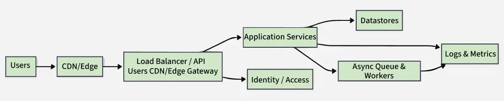
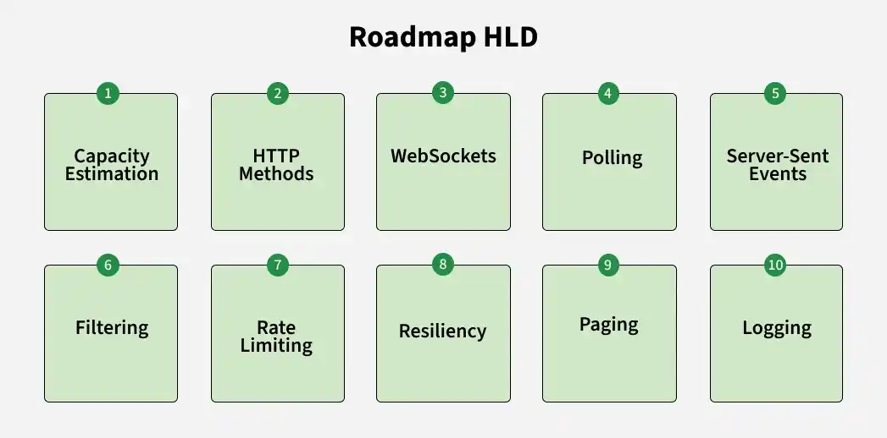
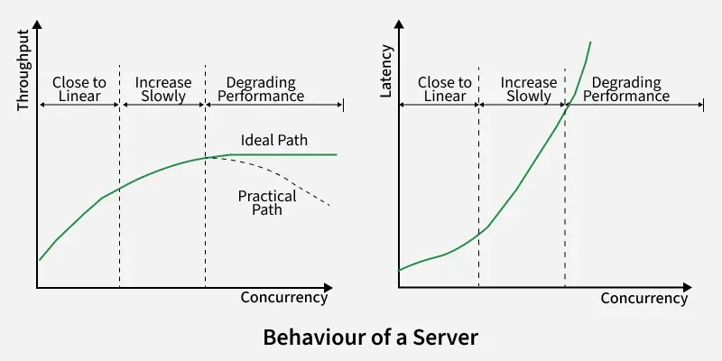
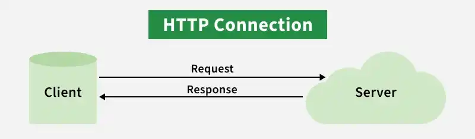
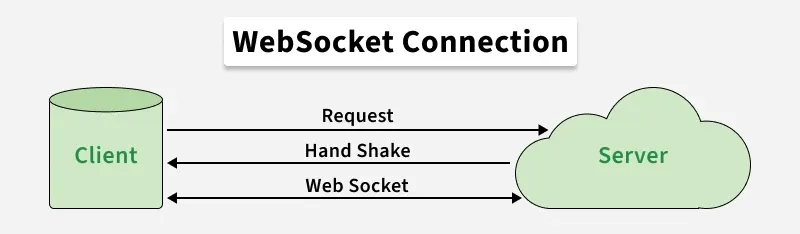
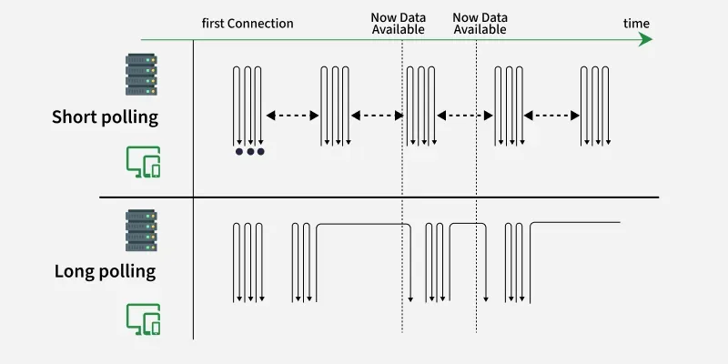
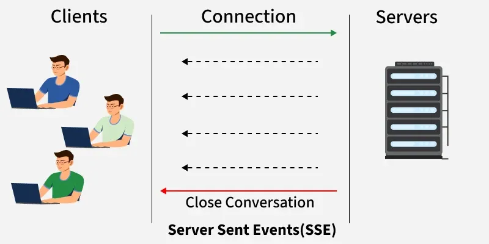
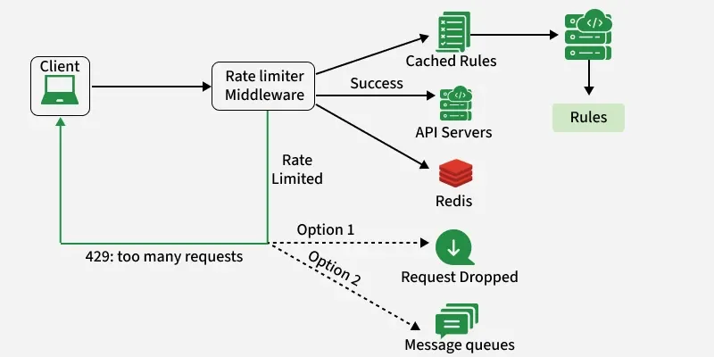
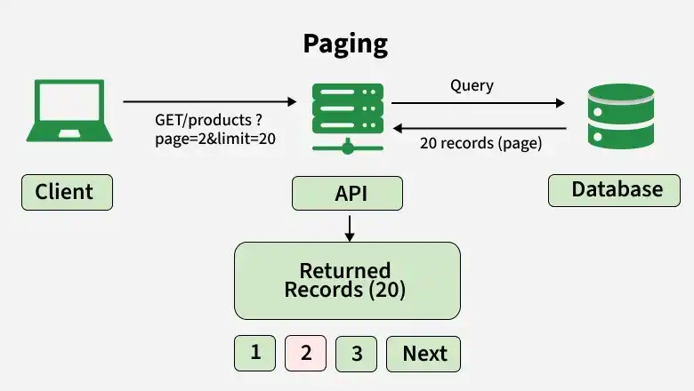

# 1.2.1 Introduction to High-Level Design (HLD)

> **Phase 1: Introduction to System Design → 1.2 High-Level Design**
> Source: GeeksforGeeks, *Introduction to High Level Design* (last updated 29 Sep 2026)
> Previous: [1.1.1 Introduction to System Design (HLD & LLD)](../../1.1-Basics/1.1.1-Introduction.md)

---

## Table of Contents

1. [What is High-Level Design?](#1-what-is-high-level-design)
2. [The Common Request Flow](#2-the-common-request-flow)
3. [Components of High-Level Design](#3-components-of-high-level-design)
4. [The HLD Document](#4-the-hld-document)
5. [Purpose and Characteristics of HLD](#5-purpose-and-characteristics-of-hld)
6. [HLD vs LLD](#6-hld-vs-lld)
7. [The HLD Roadmap: Designing Scalable Systems](#7-the-hld-roadmap-designing-scalable-systems)
8. [Quick Revision](#8-quick-revision)
9. [Self-Check Quiz: Interview Q&A](#9-self-check-quiz-interview-qa)

---

## 1. What is High-Level Design?

**High-Level Design (HLD)** is an early step in building an application, where the **overall structure of the system is planned**. It focuses on **how the components work together**, not on internal code or implementation details.

- It helps **everyone on the project** understand the goals and keeps communication clear during development.
- It matters to **developers, architects, and product managers**, because it keeps every stakeholder aligned with the project objectives.
- Because it looks at the system as a whole, HLD is also called **macro-level design**.

> 💡 **Key idea:** HLD answers *"what are the big boxes, and how do the arrows between them work?"* It does not answer *"what does the code inside each box look like?"* (that's LLD).

---

## 2. The Common Request Flow

Most applications follow the same basic path, **from the user to the data and back**. Knowing this path is the starting point for almost every HLD.



| Hop | What happens |
|---|---|
| **Users → Edge/Gateway** | The **CDN/edge** serves cached content, terminates **TLS**, and absorbs basic **DDoS** traffic. The **load balancer / API gateway** routes each request to the right service. |
| **Gateway → Services** | The **application layer** runs authentication and business logic, and calls the dependencies it needs ("fan-out"). |
| **Services → Data** | Services read from and write to **SQL / NoSQL / object storage / search**. **Hot reads** are served from a cache; writes are persisted. |
| **Services → Async** | Slow or non-urgent work (emails, webhooks, re-indexing, heavy jobs) goes onto a **queue**; **workers** process it later. |
| **Auth & Observability** | Auth is enforced at the gateway and/or services. Every component emits **logs, metrics, and traces** for monitoring and alerts. |
| **Response → User** | The reply travels back through the gateway and edge, and **caches are updated** so the next request is faster. |

> 💡 In an interview, drawing this skeleton first and then adapting it to the problem is a quick way to get started.

---

## 3. Components of High-Level Design

An HLD is made of the following parts:

| Component | What it covers |
|---|---|
| **System Architecture** | An overview of the whole system: its structure and the relationships between components. Usually shown as a diagram of how the parts interact. |
| **Modules and Components** | The system broken into modules, each with a **distinct role and responsibility** that contributes to the whole. |
| **Data Flow Diagrams (DFDs)** | How **data moves** through the system: where it enters, how it's processed, and where it ends up. |
| **Interface Design** | **APIs** for integration between components/systems, and **UIs** for user interaction. |
| **Technology Stack** | The languages, frameworks, databases, and tools the system will use. |
| **Deployment Architecture** | How the system is **hosted and accessed**: servers, cloud infrastructure, networking. |

```
                     High-Level Design
                            │
   ┌──────────┬─────────────┼─────────────┬──────────┬──────────────┐
   ▼          ▼             ▼             ▼          ▼              ▼
 System    Modules &     Data Flow    Interface   Tech Stack   Deployment
 Architect. Components   Diagrams     (APIs/UIs)              Architecture
```

---

## 4. The HLD Document

> 📖 **Deep dive:** [1.2.3 The High-Level Design Document (HLDD)](1.2.1.3-High-Level-Design-Document.md)

The **HLD document** captures the design so that developers can understand and implement it. It contains **data flows, flowcharts, and data structures** that explain how the system is meant to work.

The document:

- Explains the **connections between system components and operations**, showing the system's logic.
- Describes the **architecture of every module**, based on the **functional requirements** (from the SRS, see [1.1.3](../../1.1-Basics/1.1.3-Software-Requirements-Specification.md)).

### A typical HLD document outline

| Section | Contents |
|---|---|
| 1. Overview & scope | What the system does, goals, out-of-scope items |
| 2. Requirements summary | Key functional and non-functional requirements |
| 3. Architecture diagram | Main components and how they interact |
| 4. Module descriptions | Responsibility of each service/module |
| 5. Data flow | DFDs / sequence of main user flows |
| 6. Interfaces | External and internal APIs, UI overview |
| 7. Data storage | Choice of databases, high-level data model |
| 8. Technology stack | Languages, frameworks, infrastructure |
| 9. Deployment | Environments, cloud setup, networking |
| 10. Non-functional design | Scalability, availability, security, performance targets |
| 11. Trade-offs & risks | Alternatives considered, why this design was chosen |

*(Illustrative outline. Teams adapt it to their own needs.)*

---

## 5. Purpose and Characteristics of HLD

HLD **translates functional requirements into a technical model** of the whole system. It lets the team see how the components interact and how data flows before any code is written.

An HLD typically includes:

- A **diagram for each design aspect**, based on the business requirements and expected results.
- A description of the **hardware, software interfaces, and user interfaces**.
- The **workflow of a user's typical process**, along with **performance specifications**.

---

## 6. HLD vs LLD

- **HLD** is the general design, where you make **trade-offs between frameworks, components, and databases**, and choose the best fit for the business needs and how the system should behave.
- **LLD** turns the HLD into **smaller, specific details**: class diagrams, methods, data structures, and algorithms. It focuses on **how each part will be implemented**.

| Aspect | HLD | LLD |
|---|---|---|
| **Level** | Macro-level | Micro-level |
| **Focus** | Components and how they interact | Internals of each component |
| **Decisions** | Which databases, services, protocols, infrastructure | Which classes, methods, data structures, algorithms |
| **Artifacts** | Architecture, data-flow, deployment diagrams | Class, sequence diagrams, DB schema, API specs |
| **Input** | SRS | Reviewed HLD |

> See [1.1.1 §6](../../1.1-Basics/1.1.1-Introduction.md#6-hld-vs-lld) for the full comparison.

---

## 7. The HLD Roadmap: Designing Scalable Systems

To design any high-level system, it helps to learn a set of concepts in order. Together they explain how real services scale. The roadmap below covers ten of them.



### 7.1 Capacity Estimation

**Capacity estimation** predicts the resources (CPU, memory, storage, bandwidth) needed to handle the expected workload. It ensures the system can meet **current and future demand**, guides how resources are allocated, and helps prevent performance bottlenecks.

**Example: Twitter/X.** Tweets from popular accounts must reach millions of followers quickly. How do we size the system so the service isn't affected?

A quick **back-of-the-envelope** estimate (illustrative assumptions):

| Assumption | Value |
|---|---|
| Daily active users (DAU) | 200 million |
| Tweets read per user per day | 100 |
| Tweets posted per user per day | 2 |
| Average tweet size (text + metadata) | ~300 bytes |

| Metric | Calculation | Result |
|---|---|---|
| Reads / second (average) | 200M × 100 ÷ 86,400 s | **≈ 230,000 reads/s** |
| Writes / second (average) | 200M × 2 ÷ 86,400 s | **≈ 4,600 writes/s** |
| Read : write ratio | 100 : 2 | **≈ 50 : 1 → read-heavy** |
| New storage per day | 400M tweets × 300 B | **≈ 120 GB/day** (text only) |

> 💡 A **read-heavy** result points straight to design choices such as **caching** and **pre-computed timelines**. Peak traffic is usually **2–3× the average**, so plan for that too.

#### Throughput vs latency

A server's behaviour is measured with two numbers:

- **Throughput**: how many requests it completes per second.
- **Latency**: how long one request takes.



As load grows, throughput rises until the server reaches its capacity. After that point, requests queue up and **latency rises sharply**. Capacity estimation tells you how many servers you need to stay below that point.

### 7.2 HTTP Methods

**HTTP (HyperText Transfer Protocol)** is how clients and servers communicate. 



The **HTTP method** says what kind of operation the client wants.

| Method | Purpose | Example | Idempotent? |
|---|---|---|---|
| **GET** | Retrieve data | `GET /products/42` | ✅ Yes |
| **POST** | Create / submit new data | `POST /orders` | ❌ No |
| **PUT** | Update or **replace** an existing resource | `PUT /users/7` | ✅ Yes |
| **PATCH** | **Partially** update a resource | `PATCH /users/7` (just the email) | ⚠️ Not guaranteed |
| **DELETE** | Remove data | `DELETE /cart/items/3` | ✅ Yes |

> 💡 **Idempotent** means sending the same request many times has the same effect as sending it once. This matters when clients **retry** after a timeout.

### 7.3 WebSockets

In the normal client-server model, the client sends a request and the server replies. But some apps need the **server to push data to the client** as soon as something happens. The two main ways to do that are **WebSockets** and **polling**.

**WebSocket** is a **full-duplex** protocol: once the connection is open, **both client and server can send messages at any time** over the same **persistent connection**.



- Low latency: no new request for every update.
- **Use cases:** chat apps, online gaming, live notifications, real-time dashboards.

### 7.4 Polling

**Polling** is the other way for a client to get updates: the client keeps **asking the server**.

| Type | How it works | Downside |
|---|---|---|
| **Short polling** | The client sends a request at **fixed intervals** (e.g. every 5 s). The server replies **immediately**, whether or not there is new data. | Many wasted requests that return nothing new. |
| **Long polling** | The client sends a request and the server **holds it open** until **new data is available** (or a timeout), then replies. The client immediately sends the next request. | Each waiting client ties up an open connection on the server. |



> **Tip:** Long polling is usually preferred over short polling because **fewer requests** are sent.

### 7.5 Server-Sent Events (SSE)

**SSE** is built for **one-way communication from server to client** over a normal **HTTP** connection. The client opens the connection once, and the server **pushes updates automatically** as they become available.



| | WebSockets | SSE | Long polling |
|---|---|---|---|
| **Direction** | Two-way | Server → client only | Client asks, server answers |
| **Connection** | Persistent | Persistent (HTTP) | Repeated requests |
| **Good for** | Chat, games | Live feeds, stock tickers, streaming updates | Simple apps, older infrastructure |

**Examples:** live sports scores, news feeds, real-time streaming of results.

### 7.6 Filtering

**Filtering** selects only the data that matches certain conditions from a larger dataset. It cuts unnecessary processing and returns only what the user needs.

**Example: e-commerce product filters**

- Category: Electronics
- Price: ₹10,000–₹50,000
- Brand: Samsung
- Rating: 4 stars and above

```http
GET /products?category=electronics&minPrice=10000&maxPrice=50000&brand=samsung&minRating=4
```

This returns only products that match all the filters. Filtering is used in **APIs, databases, search systems, and data pipelines** to reduce the data returned and improve efficiency.

### 7.7 Rate Limiting

A **rate limiter** caps **how many requests a client can make in a time window** (e.g. 100 requests per minute). Once the limit is reached, further requests are **blocked or rejected** (usually with HTTP **429 Too Many Requests**) until the window resets.



Why it matters:

- Protects services from **overload** and **abuse** (e.g. bots, brute-force login attempts, DoS).
- Keeps usage **fair** between clients.
- Controls **cost** when calling paid third-party APIs.

Common algorithms (covered later in the course): **token bucket**, **leaky bucket**, **fixed window**, **sliding window**.

### 7.8 Resiliency

However well a system is designed, **failures will happen**: hardware faults, software issues (e.g. running out of memory), or human error. **Resiliency** is the system's ability to keep working, or recover quickly, when that happens. It is achieved through:

| Technique | Meaning |
|---|---|
| **Replication** | Keep copies of data/services on several machines. |
| **Redundancy** | Have spare components ready to take over (no single point of failure). |
| **Availability** | Design so the service stays up even when parts fail (failover, health checks). |

> **Note:** System design interviews start open-ended and then add **constraints** step by step. Handling those constraints with sensible **trade-offs** is what makes a design resilient, and it's a big part of passing the interview.

### 7.9 Paging (Pagination)

**Paging** splits a large dataset into **smaller pages** and returns only one page at a time. This reduces the data sent per request and improves performance and user experience.



For example, instead of returning 10,000 products at once, the API returns **20 products per page**:

```http
GET /products?page=2&limit=20
```

| Approach | How it works | Best for |
|---|---|---|
| **Offset-based** | `offset` + `limit` (e.g. skip 20, take 20). | Small or stable datasets; jumping to page *N*. |
| **Cursor-based** | A **cursor** marks where the last page ended; the next request continues from it. | Large or **frequently changing** datasets (feeds, timelines). |

> 💡 Offset-based paging gets **slower on deep pages** (the database still has to skip all earlier rows) and can **skip or repeat items** if data changes between requests. Cursor-based paging avoids both problems.

### 7.10 Logging

> 📖 **Deep dive:** [1.2.1.1 Logging in System Design](1.2.1.2-Logging.md)

A **log** records events in an application, such as transactions, service actions, and errors. Logging is essential for **monitoring behaviour**, tracking **system health and performance**, and **debugging** issues in distributed systems.

Ways to handle logs at scale:

| Approach | Description |
|---|---|
| **Centralized logging service** | All services send logs to one central place (e.g. the **ELK Stack**: Elasticsearch, Logstash, Kibana). |
| **Distributed logging system** | Logs are collected and stored across many nodes to handle very high volume. |
| **Cloud-based logging service** | A managed cloud service collects, stores, and searches logs for you. |

> 💡 In a microservices system, one user request can touch many services. Tagging every log line with a shared **request/trace ID** makes it possible to follow that request end to end.

---

## 8. Quick Revision

- **HLD** = the **macro-level** plan of a system: its components and how they interact, without implementation details.
- **Request flow:** Users → CDN/Edge → LB/API Gateway → Services → Cache / DB / Queue → Response (with auth and observability throughout).
- **6 components of HLD:** System architecture · Modules & components · Data flow diagrams · Interface design (APIs/UIs) · Technology stack · Deployment architecture.
- **HLD document:** data flows, flowcharts, module architecture, based on the **functional requirements**.
- **HLD vs LLD:** HLD chooses **frameworks, components, databases** (trade-offs); LLD defines **classes, methods, data structures, algorithms**.
- **HLD roadmap (10 concepts):**
  1. **Capacity estimation**: size the system (QPS, storage, read/write ratio). Watch **throughput vs latency**.
  2. **HTTP methods**: GET, POST, PUT, PATCH, DELETE.
  3. **WebSockets**: full-duplex, persistent, real-time.
  4. **Polling**: short (fixed intervals) vs long (server holds the request). Long is usually better.
  5. **SSE**: one-way server → client push over HTTP.
  6. **Filtering**: return only matching data.
  7. **Rate limiting**: cap requests per time window (429).
  8. **Resiliency**: replication, redundancy, availability.
  9. **Paging**: offset-based vs cursor-based.
  10. **Logging**: centralized, distributed, or cloud-based.

---

## 9. Self-Check Quiz: Interview Q&A

> ⭐ These 7 questions come from the GeeksforGeeks suggested quiz and are **important for system design interviews**. Try each one before opening the answer.

### Q1. What is the main purpose of High-Level Design (HLD)?

- A. Writing program code
- B. Planning the overall structure of a system
- C. Testing system modules
- D. Deploying applications

<details>
<summary>Answer</summary>

**B. Planning the overall structure of a system**

HLD focuses on defining the system architecture and how the major components interact. Writing code, testing, and deploying come later in the SDLC.
</details>

### Q2. What does High-Level Design mainly avoid focusing on?

- A. System architecture
- B. Component interaction
- C. Internal coding and implementation details
- D. Technology stack selection

<details>
<summary>Answer</summary>

**C. Internal coding and implementation details**

HLD focuses on the overall system structure rather than detailed coding logic. Implementation details belong to LLD. *(A, B and D are all part of HLD.)*
</details>

### Q3. Which of the following is a key component of High-Level Design?

- A. Unit test cases
- B. System architecture
- C. Debugging logs
- D. Source code

<details>
<summary>Answer</summary>

**B. System architecture**

System architecture defines the overall structure and the relationships between system components. *(See [§3 Components of HLD](#3-components-of-high-level-design).)*
</details>

### Q4. What is the purpose of Data Flow Diagrams (DFDs) in HLD?

- A. Writing algorithms
- B. Showing how data moves within the system
- C. Deploying applications
- D. Managing databases

<details>
<summary>Answer</summary>

**B. Showing how data moves within the system**

DFDs help visualize how information flows between the different parts of the system: where it enters, how it is processed, and where it ends up.
</details>

### Q5. Which technology enables real-time two-way communication between client and server?

- A. HTTP
- B. Polling
- C. FTP
- D. WebSockets

<details>
<summary>Answer</summary>

**D. WebSockets**

WebSockets allow **full-duplex** communication, where both client and server can send data at the same time over one persistent connection. *(See [§7.3](#73-websockets).)*
</details>

### Q6. What is the main purpose of rate limiting in system design?

- A. Increase server memory
- B. Restrict the number of requests in a given time period
- C. Improve database indexing
- D. Encrypt data communication

<details>
<summary>Answer</summary>

**B. Restrict the number of requests in a given time period**

Rate limiting protects systems from overload by controlling how many requests a user can send. Requests over the limit are rejected, usually with **429 Too Many Requests**. *(See [§7.7](#77-rate-limiting).)*
</details>

### Q7. What is the goal of capacity estimation in High-Level Design?

- A. Writing code efficiently
- B. Predicting resources needed to handle workload
- C. Designing UI components
- D. Creating APIs

<details>
<summary>Answer</summary>

**B. Predicting resources needed to handle workload**

Capacity estimation ensures the system has enough resources (CPU, memory, storage, bandwidth) to handle the expected traffic. *(See [§7.1](#71-capacity-estimation).)*
</details>

### 🧠 Key Takeaways for Interviews

| # | Remember |
|---|---|
| 1 | HLD = **big boxes and arrows**; LLD = what's **inside** each box |
| 2 | Start with the **standard request flow**, then adapt it to the problem |
| 3 | **Estimate capacity** early (QPS, storage, read/write ratio). It drives caching, sharding, and scaling choices |
| 4 | Real-time: **WebSockets** (two-way) · **SSE** (server push) · **long polling** (fallback) |
| 5 | Protect the system with **rate limiting**; keep it up with **replication + redundancy** |
| 6 | Large result sets need **paging**; changing feeds need **cursor-based** paging |
| 7 | **Centralized logs + trace IDs** make distributed systems debuggable |

### Bonus Questions

> Extra practice on the roadmap topics.

### B1. Why is HLD also called "macro-level design"?

- A. It only covers the user interface
- B. It describes the overall system structure and how components interact
- C. It is written using macros in code
- D. It focuses on class and method design

<details>
<summary>Answer</summary>

**B.** HLD looks at the whole system: the main components and how they work together. Class and method design (D) is LLD, which is "micro-level".
</details>

### B2. Which of these is NOT one of the components of an HLD?

- A. Deployment architecture
- B. Data flow diagrams
- C. Method-level pseudocode for each class
- D. Technology stack

<details>
<summary>Answer</summary>

**C.** Pseudocode for individual classes belongs to LLD. HLD covers architecture, modules, DFDs, interfaces, tech stack, and deployment.
</details>

### B3. A chat app needs both the client and server to send messages at any time with low latency. Which is the best fit?

- A. Short polling
- B. Server-Sent Events
- C. WebSockets
- D. Pagination

<details>
<summary>Answer</summary>

**C. WebSockets.** They give a persistent, **full-duplex** connection. SSE (B) is one-way (server → client only), and short polling (A) wastes requests and adds delay.
</details>

### B4. What is the main difference between short polling and long polling?

<details>
<summary>Answer</summary>

In **short polling**, the server replies **immediately** every time, even if nothing changed, so the client asks again and again. In **long polling**, the server **holds the request open** until there is new data (or a timeout), so far **fewer requests** are sent.
</details>

### B5. A live stock-price ticker only needs the server to push updates to the browser. Which is the simplest fit?

- A. WebSockets
- B. Server-Sent Events
- C. Short polling
- D. HTTP DELETE

<details>
<summary>Answer</summary>

**B. Server-Sent Events.** The data only flows one way (server → client), and SSE does exactly that over plain HTTP. WebSockets would also work but add two-way capability you don't need.
</details>

### B6. What HTTP status code does a rate limiter usually return when a client exceeds its limit?

<details>
<summary>Answer</summary>

**429 Too Many Requests.** The client should wait (often told how long by a `Retry-After` header) before trying again.
</details>

### B7. You're paging through a social media feed where new posts arrive constantly. Offset-based or cursor-based paging?

<details>
<summary>Answer</summary>

**Cursor-based.** With offsets, new posts shift every item down, so the user sees **duplicates or misses posts**, and deep pages get slow. A cursor continues exactly from the last item seen.
</details>

### B8. 50 million DAU each make 20 requests a day. Roughly what is the average QPS?

<details>
<summary>Answer</summary>

50M × 20 = 1 billion requests/day. 1,000,000,000 ÷ 86,400 ≈ **11,600 requests/s** on average. Plan for **2–3× that at peak** (~25,000–35,000 QPS).
</details>

### B9. Which three techniques make a system resilient?

<details>
<summary>Answer</summary>

**Replication** (copies of data/services), **redundancy** (spare components, no single point of failure), and **availability** (failover so the service stays up when parts fail).
</details>

### B10. What is the difference between PUT and PATCH?

<details>
<summary>Answer</summary>

**PUT** **replaces** the whole resource with the one sent (and is idempotent). **PATCH** **partially updates** only the fields sent.
</details>

---

### 📚 Further Reading

- GeeksforGeeks: *Introduction to High Level Design*
- Next topics in this track: Capacity Estimation · Availability · Consistency · Load Balancing · Caching
