# 1.2.1.1 Logging in System Design

> **Phase 1: Introduction to System Design → 1.2 High-Level Design → HLD Roadmap #10**
> Sources: GeeksforGeeks, *Centralized Logging Systems – System Design* (10 Jun 2026) · *Logging in Distributed Systems* (18 Nov 2025) · *Google Cloud Monitoring & Logging* (17 Mar 2026)
> Previous: [1.2.1 Introduction to High-Level Design](./1.2.1-Introduction.md#710-logging)

---

## Table of Contents

1. [What is Logging?](#1-what-is-logging)
2. [Types of Logs](#2-types-of-logs)
3. [Logging in Distributed Systems](#3-logging-in-distributed-systems)
4. [Centralized Logging Systems](#4-centralized-logging-systems)
5. [A Modern Logging Pipeline](#5-a-modern-logging-pipeline)
6. [Log Collection and Aggregation](#6-log-collection-and-aggregation)
7. [Log Storage and Management](#7-log-storage-and-management)
8. [Log Analysis, Monitoring and Alerting](#8-log-analysis-monitoring-and-alerting)
9. [Log Latency and Consistency](#9-log-latency-and-consistency)
10. [Challenges](#10-challenges)
11. [Best Practices](#11-best-practices)
12. [Use Cases and Benefits](#12-use-cases-and-benefits)
13. [Case Study: Google Cloud Monitoring & Logging](#13-case-study-google-cloud-monitoring--logging)
14. [Quick Revision](#14-quick-revision)
15. [Self-Check Quiz: Interview Q&A](#15-self-check-quiz-interview-qa)

---

## 1. What is Logging?

A **log** is a time-stamped record of an event in a system: a request served, a transaction completed, an error thrown, a server restarted. **Logging** is the practice of capturing and storing these records so you can:

- **Monitor** how the system behaves.
- **Track** system health and performance.
- **Debug** failures, often after the fact.
- **Audit** who did what and when (security and compliance).

### 1.1 Log levels

Most logging libraries tag each entry with a **severity level**, so you can filter noise and alert on what matters:

| Level | Use it for | Example |
|---|---|---|
| **DEBUG** | Detailed internals, usually off in production | `cache lookup key=user:42 hit=false` |
| **INFO** | Normal, expected events | `order 981 created` |
| **WARN** | Something odd that didn't break anything | `retrying payment gateway (attempt 2/3)` |
| **ERROR** | An operation failed | `failed to connect to orders-db` |
| **FATAL / CRITICAL** | The service can't continue | `out of memory, shutting down` |

### 1.2 Structured vs unstructured logs

```text
# Unstructured (plain text): easy to read, hard to search at scale
2026-10-11 14:02:11 ERROR Payment failed for order 981 user 42 after 3 retries
```

```json
// Structured (JSON): every field is searchable and filterable
{
  "timestamp": "2026-10-11T14:02:11.483Z",
  "level": "ERROR",
  "service": "payment-service",
  "trace_id": "a3f9c2e1",
  "order_id": 981,
  "user_id": 42,
  "retries": 3,
  "message": "Payment failed"
}
```

> 💡 With structured logs you can ask questions like *"all ERRORs from payment-service for user 42 in the last hour"* instead of grepping text.

---

## 2. Types of Logs

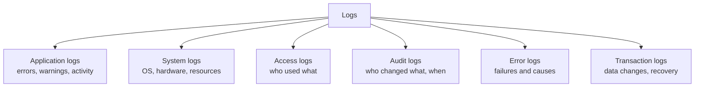

| Type | What it records | Example | Mainly used by |
|---|---|---|---|
| **Application logs** | Events from the software itself: errors, warnings, normal activity | The web app crashes, and the log shows what went wrong | Developers |
| **System logs** | Operating-system events: startup, hardware issues, low resources | Server running low on disk or memory | System administrators |
| **Access logs** | Who is using the system and what they're doing | A user visits a page; the request path, status code, and client IP are recorded | Ops, analytics |
| **Audit logs** | Changes and actions, for security and compliance: **who** changed **what**, and **when** | An admin changes a setting; a user updates their profile | Security, compliance |
| **Error logs** | Problems only: error messages and their causes | A service can't connect to its database | Developers, on-call |
| **Transaction logs** | Transactions and data updates | A purchase is made; a database row is changed. Used for **consistency and recovery** | Databases, finance systems |

---

## 3. Logging in Distributed Systems

In a **distributed system**, one user action may pass through many services on many machines. **Distributed logging** captures events from all of them so you can follow behaviour, find failures, and debug across the whole system.

Key characteristics:

- Tracks events **across multiple services**.
- Helps with **debugging and error detection**.
- Gives **visibility into performance**.
- Uses **centralized log storage**.
- Is usually paired with **monitoring and tracing** tools.

### 3.1 Example: a layered log storage architecture

At very large scale, logs themselves need a dedicated storage system. Twitter's **DistributedLog** design splits the job into three layers:

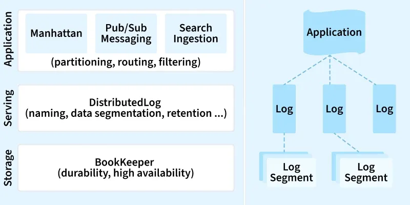

Each log is split into **segments**, so old segments can be retained, archived, or deleted independently, and reads and writes stay efficient.

* The left side shows a three-layer architecture: Application - Serving - Storage.
* The Application layer (Manhattan, Pub/Sub Messaging, Search Ingestion) handles partitioning, routing, and filtering.
* The Serving layer (DistributedLog) manages naming, data segmentation, and data retention.
* The Storage layer (BookKeeper) ensures durability and high availability of data.
* The right side shows an application writing data into multiple logs, each log split into log segments for efficient storage and retrieval.

---

### 3.2 Types of Logs

In distributed systems, various types of logs help us keep track of what’s happening and fix problems.

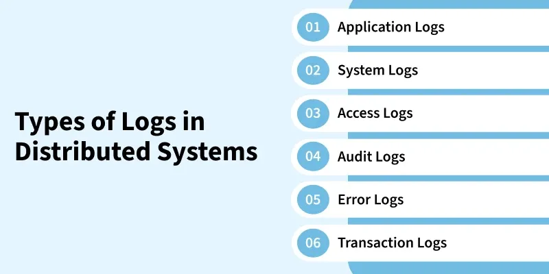

1. **Application Logs**

* These logs come from the software or services running in the system.
* They record events like errors, warnings, and normal activities.
* For example, if a web application crashes, the application log will show what went wrong. This helps developers understand and fix problems in the software.

3. **System Logs**

* System logs track what happens at the operating system level.
* They record details like when the server starts up, any issues with the hardware, or if the system is running low on resources.
* These logs help system administrators keep the servers healthy and troubleshoot issues that might affect performance.

3. **Access Logs**

* Access logs keep a record of who is using the system and what they are doing.
* For example, they log when a user visits a website, what pages they view, and if there are any errors. This helps in monitoring user activity and ensuring everything is working as expected.

4. **Audit Logs**

* Audit logs track changes and actions within the system for security and compliance.
* They record who made changes, what changes were made, and when.
* For example, if someone updates their profile or an admin changes settings, an audit log will capture this. It’s important for checking that everything is done correctly and for security reviews.

5. **Error Logs**

* Error logs focus on problems and mistakes in the system.
* They provide details about errors that occur, such as error messages and what caused the problem.
* For instance, if a service can’t connect to a database, the error log will help identify the issue. These logs are crucial for fixing issues quickly.

6. **Transaction Logs**
   
* Transaction logs track actions like transactions or updates to the system.
* For example, they record when a purchase is made or a database entry is changed. These logs are important for keeping track of data changes, making sure everything is consistent, and recovering data if something goes wrong.

---

### 3.3 A Modern Logging Pipeline

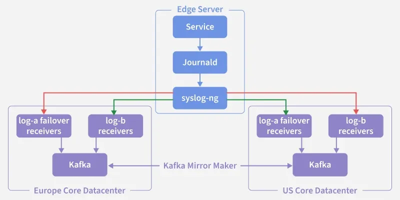

A modern centralized logging system functions as a multi-stage pipeline rather than a single tool. Each stage has a clear responsibility, from log creation to final visualization.

1. **Generation**
   
* Applications produce logs, ideally in structured formats like JSON.
* In containerized environments, logs are commonly written to stdout instead of local files.

2. Collection (Shipping)

* A lightweight log shipper runs on each server or container host.
* Tools such as Filebeat, Fluentd, or Loki Promtail continuously read log files or capture stdout streams and forward them to the processing layer.

3. Aggregation and Processing

A log processing engine (e.g., Logstash, Vector) receives data from all shippers and performs essential ETL functions:

* **Parsing:** Converts raw text into structured fields (e.g., extracting IP addresses or timestamps).
* **Enrichment:** Adds additional metadata, such as GeoIP data or service information.
* **Filtering:** Removes unnecessary or noisy logs to reduce storage costs and increase efficiency.

4. **Storage and Indexing**
   
Processed logs are forwarded to a database optimized for large-scale search.

* **Elasticsearch:** Most widely used, provides fast indexing and querying.
* **Loki:** A cost-efficient alternative that indexes labels/metadata instead of full log content.

5. **Analysis and Visualization**
   
* A user interface on top of the storage layer allows engineers to search logs, troubleshoot issues, and build dashboards.
* Common tools include Kibana, Grafana, and Splunk, each providing querying, visualization, and alerting capabilities.

---

### 3.4 Log Collection and Aggregation in Distributed Systems

Log Collection and Log Aggregation are important steps in managing and using logs from a distributed system.

1. **Log Collection**
   
Log Collection is about gathering logs from different parts of the system and sending them to a central place. Each part of the system, like different servers or services, creates its own logs.

* Log collection involves taking these logs and sending them to a central server or storage area where they can be kept together.
* This process makes sure that all the logs from various parts of the system are collected in one place so they can be reviewed and used later.

2. **Log Aggregation**
   
Log Aggregation happens after collection. It involves combining all these collected logs into a single, organized view. Once the logs are gathered, aggregation tools sort and organize them, making it easier to find and understand the information.

* Aggregation helps put together logs from different sources to see a complete picture.
* For example, if several services are involved in a single user action, log aggregation can bring together all the related logs, helping to understand what happened across the whole system.

---

### 3.5 Log Storage and Management in Distributed Systems

Log Storage and Log Management is very important in Distributed Systems:

1. **Log Storage**
   
Log Storage is about where you keep the logs after they are collected. In large systems, logs can grow quickly, so you need a good place to store them.

* Logs are usually stored in databases, cloud storage, or special log storage systems. The storage system should be able to handle a lot of data and keep it safe over time.
* It’s also important to organize the logs so that you can easily find what you need later. This might involve labeling logs with tags, dates, or categories to keep them sorted.

2. **Log Management**
   
Log Management is about taking care of the logs after they’ve been stored. This includes deciding how long to keep logs, which is known as setting a retention policy.

* Some logs are important and need to be kept for a long time, while others can be deleted after a while.
* Log management also means keeping logs secure, making sure only the right people can see them, especially since logs can have sensitive information.
* Another part of log management is making sure you can easily search through the logs to find specific events or problems.

---

### 3.6 Log Analysis and Monitoring in Distributed Systems

Log Analysis and Log Monitoring are important for keeping track of what’s happening in a system.

1. **Log Analysis**
   
It is about looking at logs to find useful information. Logs are records of events that happen in a system, like errors, user actions, or system performance. By analyzing these logs, you can understand what has happened in the system and why.

* For example, if there’s a problem, you can look at the logs to figure out what went wrong.
* Log analysis also helps you spot patterns, like repeated issues or unusual activity, which can help prevent future problems.
* There are tools that make it easier to search and analyze logs, even when there are a lot of them.

2. **Log Monitoring**
   
It is about watching logs in real-time to quickly find and fix problems. Unlike log analysis, which usually looks at past events, log monitoring happens continuously. It involves keeping an eye on the logs as they come in and setting up alerts to warn you if something unusual happens, like a system crash or a security threat.

* Monitoring helps you catch issues early so you can fix them before they cause bigger problems.
* For example, if a server is having trouble, log monitoring can alert you right away, so you can take action before it affects users.

---

### 3.7 Handling Log Latency and Consistency in Distributed Systems

Handling Log Latency and Log Consistency are important for managing logs in a distributed system.

1. **Log Latency**
   
Log Latency is the delay between when something happens and when you see it in the logs. In a big system with many parts, this delay can happen because logs need time to travel from different places to a central storage or because of slow network connections.

* High log latency is a problem because it means you might not see important events quickly, making it harder to fix issues right away.
* To reduce log latency, you can use faster ways to transfer data, store logs locally for a short time, or process logs close to where they are created before sending them to central storage.

2. **Log Consistency**

Log Consistency means making sure that logs from different parts of the system are in sync and tell the full, accurate story of what happened. In a distributed system, different servers or services might record logs at different times, or logs might arrive out of order.

* This can make it hard to understand what really happened, especially when trying to solve a problem.
* To handle this, logs should have accurate timestamps, and the system should be able to sort logs correctly, even if they come in out of order.
* Using synchronized clocks across servers can also help keep logs consistent.

---

### 3.8 Key Challenges in Distributed Logging

While powerful, building a centralized logging pipeline presents significant challenges.

* **Log Volume & Cost:** Distributed systems generate a tsunami of log data. Storing, indexing, and processing terabytes of data per day is extremely expensive and can become a major operational cost.
* **Loss of Context:** A user's click might involve five services. How do you find the five specific log entries for that one click amidst millions of other logs? This is the single biggest problem.
* **Log Latency:** The delay between an event happening and it appearing in your search UI. High latency makes real-time debugging impossible.
* **Inconsistent Timestamps:** If server clocks are not perfectly synchronized (using NTP - Network Time Protocol), logs from different services will be out of order, making the story impossible to read correctly.
* **Security & PII:** Logs often contain sensitive user data (passwords, API keys, personal info). This creates a massive security risk and can violate compliance laws like GDPR or HIPAA if not handled properly.

---

## 4. Centralized Logging Systems

A **centralized logging system** collects, stores, and manages logs from many servers, applications, and services in **one central place**.

```
 Server A ──┐
 Server B ──┤                         ┌─────────────────────────┐
 Service C ─┼──── logs ────────────▶  │ Central logging system  │ ──▶ search, dashboards, alerts
 Database ──┤                         └─────────────────────────┘
 Network ───┘
```

- **Aggregates** logs from different sources into one platform.
- Enables **real-time monitoring, searching, and analysis**.
- Improves **security** and simplifies log management with **central control**.

**Popular tools:** **ELK Stack** (Elasticsearch, Logstash, Kibana), **Splunk**, **Graylog**.

### 4.1 Why it matters

| Reason | Explanation |
|---|---|
| **Improved visibility** | Logs from every system in one place give a clear picture of behaviour, errors, and security issues. |
| **Faster troubleshooting** | No logging into 50 servers one by one. Problems are found and fixed faster, which reduces downtime. |
| **Better security** | Comparing logs from many sources makes unusual activity and threats easier to spot. |
| **Compliance & audit trails** | Detailed, historical records are available when regulators or auditors ask. |

### 4.2 Components

| Component | Role |
|---|---|
| **Log collection** | Agents or tools gather logs from servers, apps, databases, and network devices. |
| **Log aggregation** | Collected logs are combined and sent to a central location, often through **message queues** or **streaming systems** (e.g. Kafka). |
| **Log storage** | Durable, scalable storage: distributed file systems or cloud storage. |
| **Search & query** | Users find information with keywords, filters, and criteria. |
| **Alerting** | Automatic notifications when rules, errors, or unusual activity are detected. |
| **Integration** | Connects to monitoring, security (SIEM), and incident-management tools. |

---

## 5. A Modern Logging Pipeline

A modern centralized logging system is a **multi-stage pipeline**, not a single tool. Each stage has one clear job.

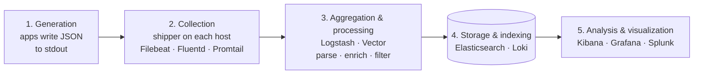

| Stage | What happens | Typical tools |
|---|---|---|
| **1. Generation** | Applications produce logs, ideally **structured (JSON)**. In containers, logs go to **stdout** rather than local files. | App logging libraries |
| **2. Collection (shipping)** | A lightweight **shipper** on each server/container host reads log files or stdout streams and forwards them. | Filebeat, Fluentd, Promtail |
| **3. Aggregation & processing** | A processing engine receives logs from all shippers and does ETL: **parsing** (raw text → fields such as IP or timestamp), **enrichment** (add GeoIP, service name, environment), **filtering** (drop noisy logs to save cost). | Logstash, Vector |
| **4. Storage & indexing** | Processed logs go to a store built for large-scale search. | **Elasticsearch** (full-text index, fast queries) · **Loki** (indexes only labels/metadata, so it's much cheaper) |
| **5. Analysis & visualization** | A UI to search logs, troubleshoot, build dashboards, and set alerts. | Kibana, Grafana, Splunk |

> 💡 **Elasticsearch vs Loki** is a classic trade-off: full-text indexing gives fast, flexible search but costs more storage and compute. Label-only indexing is cheaper but slower for free-text searches.

> 💡 At high volume, teams often put a **buffer** such as **Kafka** between collection and processing, so a spike or a slow processor doesn't cause logs to be dropped.

---

## 6. Log Collection and Aggregation

### 6.1 Collection vs aggregation

| | Log collection | Log aggregation |
|---|---|---|
| **What** | Gathering logs from every part of the system and **sending them to a central place** | **Combining** collected logs into one organized view |
| **When** | First | After collection |
| **Result** | All logs are in one location | Related logs (e.g. all services involved in one user action) can be seen **together** |

### 6.2 Collection methods

| Method | How it works | Pros / when to use | Example tools |
|---|---|---|---|
| **Agent-based** | A software **agent** installed on each server/device reads logs and forwards them. | Real-time forwarding; can **preprocess** (parse, filter) at the source. The most common choice. | Fluentd, Logstash, Splunk Universal Forwarder |
| **Syslog** | A **standard protocol** for sending log messages (with timestamp, source, severity) to a central log server. | Built into most OSes and network devices. Works over **UDP** (fast, may lose messages) or **TCP** (reliable). | rsyslog, syslog-ng |
| **File-based** | Local log files are **copied** to central storage. | For **legacy** or **agentless** systems where agents can't be installed. Not real-time. | SCP, FTP, rsync |

---

## 7. Log Storage and Management

### 7.1 Storage options

| Option | Examples | Strengths |
|---|---|---|
| **Distributed file / object storage** | HDFS, Amazon S3, Google Cloud Storage | Cheap, scalable, durable. Good for huge volumes and **long-term archives**. |
| **NoSQL / search databases** | Elasticsearch, Cassandra, MongoDB | Fast, flexible storage for structured or unstructured logs, with fast queries. |
| **Managed cloud services** | AWS CloudWatch Logs, Azure Monitor, Google Cloud Logging | No servers to run: storage, search, and retention are handled for you. |

A common pattern is **tiered storage**, which keeps cost down:

```
 HOT  (last ~7 days)      → fast search index (e.g. Elasticsearch)   → most expensive
 WARM (weeks)             → slower/cheaper nodes
 COLD (months – years)    → object storage (e.g. S3 / GCS)           → cheapest, for audit/compliance
```

### 7.2 Log management

Storing logs is only half the job. **Log management** also covers:

- **Retention policy:** how long each kind of log is kept. Audit logs may need years; debug logs maybe days.
- **Organization:** tagging logs with service, environment, date, and category so they're easy to find.
- **Security:** access control and encryption, because logs often contain sensitive data.
- **Searchability:** making sure engineers can quickly find specific events.

---

## 8. Log Analysis, Monitoring and Alerting

| | Log analysis | Log monitoring |
|---|---|---|
| **Looks at** | **Past** events | Events **as they arrive (real time)** |
| **Goal** | Understand *what* happened and *why*; spot patterns and repeated issues | Catch problems **early** and react before users are affected |
| **Example** | After an outage, trace the logs to find the root cause | A server starts erroring, and an alert fires immediately |

### 8.1 Alerting mechanisms

| Mechanism | Description |
|---|---|
| **Real-time alerts** | Logs are watched continuously; an alert fires as soon as a predefined pattern or critical error appears. |
| **Custom thresholds** | Avoid noise by alerting only past a threshold, e.g. *"this error more than 10 times in 1 minute"*. |
| **Multiple channels** | Email, SMS, Slack, PagerDuty, so the right person is reached wherever they are. |
| **Severity levels** | **Critical** (outage → page someone now) vs **warning** vs **info** (can wait). |

> ⚠️ **Alert fatigue:** too many low-value alerts train people to ignore them. Alert on symptoms users feel, and tune thresholds.

---

## 9. Log Latency and Consistency

### 9.1 Log latency

**Log latency** is the delay between an event happening and it **showing up in the logs** you can search. It comes from network transfer, buffering, and processing.

- **Why it hurts:** high latency makes real-time debugging impossible. You can't see the problem while it's happening.
- **How to reduce it:** faster transport, short local buffering, and **processing logs close to where they're created** before sending them on.

### 9.2 Log consistency

**Log consistency** means logs from different services are **in sync** and tell an accurate story. Logs may be recorded at different times, and they may **arrive out of order**.

- Use **accurate timestamps** (ideally UTC, with milliseconds).
- **Synchronize clocks** across servers using **NTP (Network Time Protocol)**.
- Make sure the system can **sort logs correctly** even when they arrive out of order.

### 9.3 Solving "loss of context" with correlation IDs

The **biggest problem** in distributed logging: one click might touch five services. How do you find those five entries among millions?

The answer is to generate a **correlation (trace) ID** at the edge and **pass it along with every downstream call**. Each service includes it in every log line.

```
User click ─▶ API Gateway  (trace_id=a3f9c2e1)
                 │
                 ├─▶ Order Service    log: {trace_id: a3f9c2e1, "order created"}
                 ├─▶ Payment Service  log: {trace_id: a3f9c2e1, "payment failed"}
                 └─▶ Notify Service   log: {trace_id: a3f9c2e1, "email queued"}

Search: trace_id = "a3f9c2e1"  →  the whole story of that one click
```

> 💡 This is the bridge between **logging** and **distributed tracing** (e.g. OpenTelemetry, Jaeger, Cloud Trace).

---

## 10. Challenges

| Challenge | Why it's hard | Common mitigation |
|---|---|---|
| **Volume & cost** | Distributed systems produce **terabytes of logs per day**. Indexing and storing them is a major operating cost. | Filter noise, **sample** debug logs, tiered storage, retention limits, label-only indexing (Loki) |
| **Scalability** | Ingestion must keep up as sources and volume grow, without bottlenecks. | Horizontal scaling, buffering with Kafka, partitioning |
| **Loss of context** | Finding the entries for *one* request across many services. | **Correlation / trace IDs**, structured logs |
| **Log latency** | Slow pipelines make real-time debugging impossible. | Stream processing, edge processing |
| **Inconsistent timestamps** | Clock drift puts logs out of order. | **NTP**, UTC timestamps, sort at query time |
| **Reliability** | Logs must not be lost or corrupted. | Replication, backups, durable queues, acknowledgements |
| **Performance impact** | Logging itself uses CPU, I/O, and network on busy services. | **Asynchronous** logging, batching, sensible log levels |
| **Security & PII** | Logs may hold passwords, API keys, personal data, which is a risk under **GDPR / HIPAA**. | **Mask/redact** sensitive fields, encrypt in transit and at rest, role-based access |
| **Integration** | Many different apps, formats, and legacy systems. | Standard formats (JSON), common agents, OpenTelemetry |

---

## 11. Best Practices

1. **Know what to log:** decide what information you need, which sources, which log types, and **how long to keep** each.
2. **Use structured logs (JSON)** with consistent field names (`timestamp`, `level`, `service`, `trace_id`…).
3. **Add a correlation ID** to every request and log line.
4. **Pick appropriate tools** that fit your budget and can grow with you.
5. **Design for scale:** the logging system must handle more logs over time without slowing down.
6. **Secure your logs:** encryption, access controls, and **never log secrets or raw PII**.
7. **Set clear objectives and granular alerts:** alert on specific conditions and avoid alert fatigue.
8. **Use custom metrics and logs** for application-specific signals.
9. **Monitor the logging system itself**, and **review and update** the setup regularly as the system evolves.

---

## 12. Use Cases and Benefits

### Use cases

| Use case | What logs enable |
|---|---|
| **IT operations monitoring** | Tracking system health, performance, and availability |
| **Security monitoring** | Spotting threats, anomalies, and intrusion attempts in real time |
| **Compliance & regulation** | Producing reports and evidence for audits and investigations |
| **Application performance** | Finding slow spots and errors in apps running across many machines |
| **Incident response** | Building a **timeline** of events during a security incident or outage |
| **Capacity & scaling** | Using traffic and resource trends to scale up or down |

### Benefits

- **Quick issue detection and troubleshooting:** everything is in one place.
- **Better system visibility:** one unified view across all services.
- **Improved collaboration:** everyone works from the same data.
- **Automated alerts:** fast response to critical events.
- **Historical analysis:** spot trends and recurring issues over time.

---

## 13. Case Study: Google Cloud Monitoring & Logging

Google Cloud provides **Cloud Monitoring** and **Cloud Logging** to track metrics, analyze logs, and detect issues. They are part of the **Google Cloud Operations Suite** (formerly **Stackdriver**, now branded **Google Cloud Observability**).

### 13.1 The suite

| Tool | Purpose |
|---|---|
| **Cloud Monitoring** | Tracks metrics and system health: dashboards, Metrics Explorer, alerting policies |
| **Cloud Logging** | Collects, stores, searches, and exports logs |
| **Cloud Trace** | Analyzes request **latency** across distributed services |
| **Cloud Profiler** | Finds CPU/memory **performance bottlenecks** in code |
| **Cloud Debugger** | Inspected running apps without stopping them. *Note: Google deprecated and shut it down in 2023; the open-source Snapshot Debugger replaced it.* |

These map neatly onto the three **pillars of observability**: **logs** (Cloud Logging), **metrics** (Cloud Monitoring), and **traces** (Cloud Trace).

### 13.2 Cloud Monitoring features

- **Dashboards:** visualize CPU, memory, network traffic, latency.
- **Metrics Explorer:** filter and analyze metrics to find unusual behaviour.
- **Alerting policies:** threshold-based alerts sent via Email, SMS, Slack, Pub/Sub, or PagerDuty.

**Setup in brief:**

1. **Enable the API:** Console → *APIs & Services* → *Enable APIs and Services* → enable **Cloud Monitoring API**.

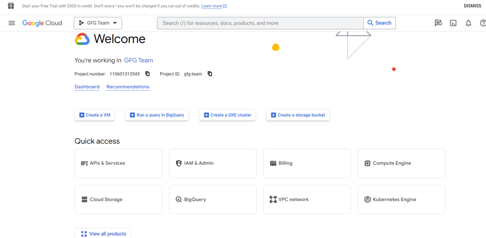

2. **Create a dashboard:** *Monitoring* → *Dashboards* → *Create Dashboard*, then add charts and widgets.
3. **Create an alert:** *Monitoring* → *Alerting* → *Create Policy* → set a condition (e.g. metric threshold) → add notification channels.

### 13.3 Cloud Logging features

- **Centralized log management** for all GCP services.
- **Logs Explorer:** filter by time, severity, resource type, and metadata.
- **Log export (sinks):** route logs to **Cloud Storage** (archive), **BigQuery** (analytics), or **Pub/Sub** (streaming to other tools).
- **Monitoring integration:** link logs with metrics to diagnose issues faster.

---

#### 13.3.1 Google Cloud Monitoring (Step-by-Step Guide)

**Step 1: Enable Monitoring API**

Open the Google Cloud Console.

Select your existing project or create a new project.


Navigate to the "APIs & Services" > "Dashboard" and click on on the "+ ENABLE APIS AND SERVICES" button.

Search for "Monitoring API" and enable it.


**Step 2: Create a Monitoring Workspace**

In the Google Cloud Console, navigate to "Monitoring" > "Dashboards."

Click on "Create Dashboard."

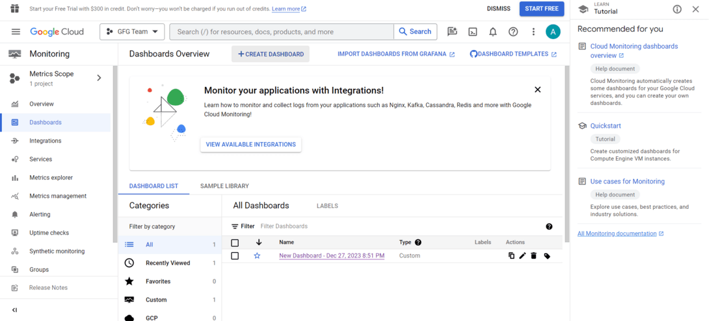

Add charts and widgets in your dashboard based totally to your monitoring requirements.

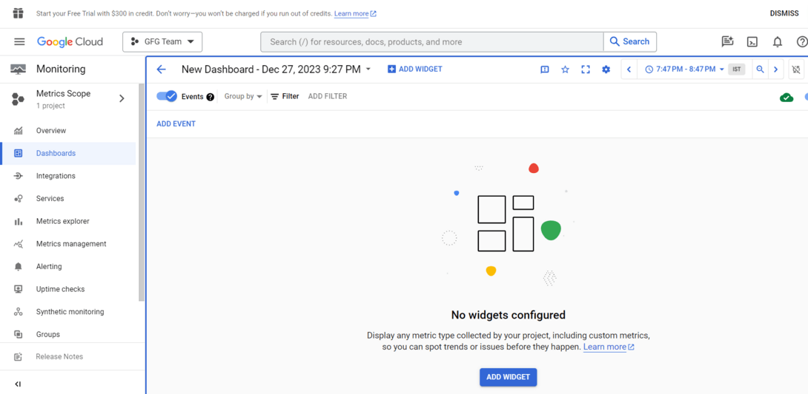

**Step 3: Set Up Monitoring Alerts**

In the Google Cloud Console, navigate to "Monitoring" > "Alerting."

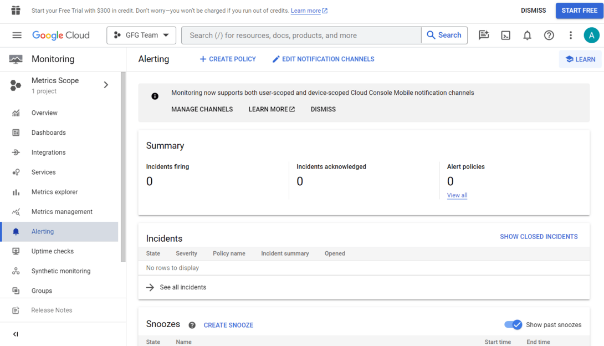

Click on "Create Policy."

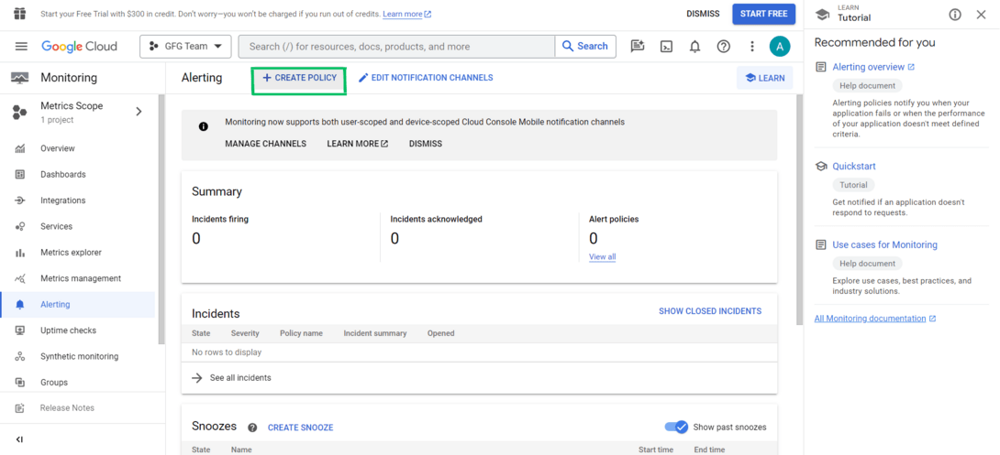

Configure the conditions in your alert (e.g., metric threshold).

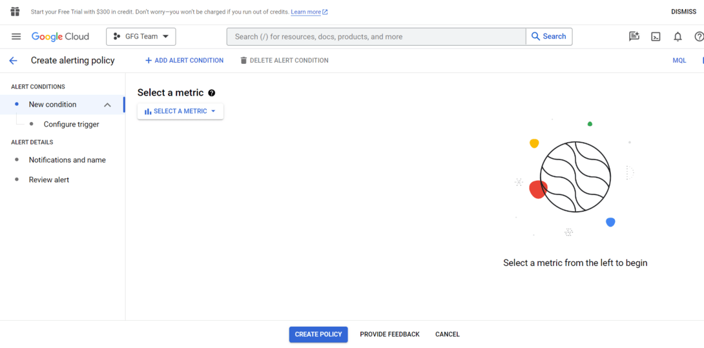

Set up notification channels (e.g., email, SMS, or Pub/Sub) for alert notifications.

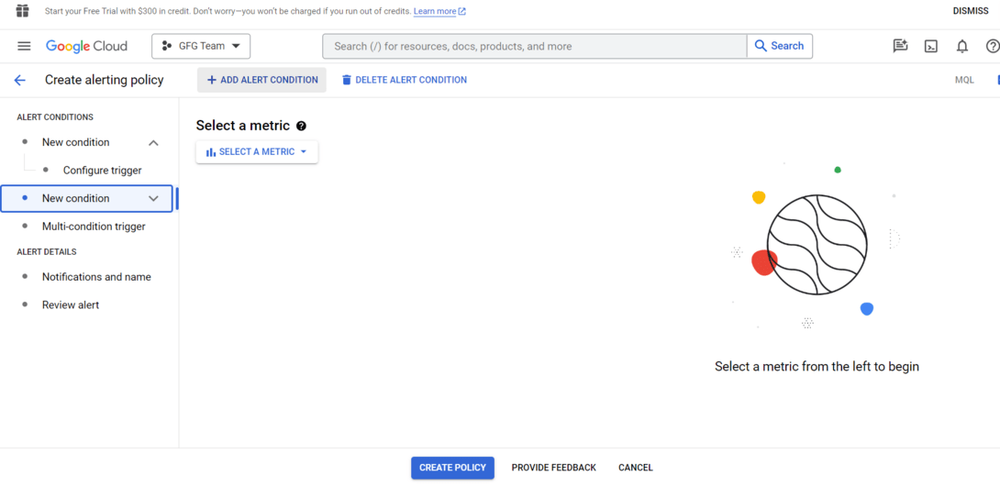

---

#### 13.3.2 Google Cloud Logging (Step-by-Step Guide)

**Step 1: Enable Logging API**

In the Google Cloud Console, go to "APIs & Services" > "Dashboard."

Click on "+ ENABLE APIS AND SERVICES."

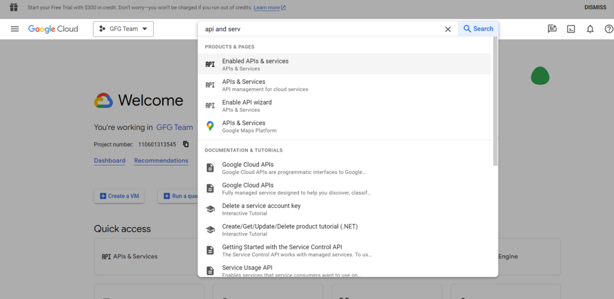

Search for "Cloud Logging API" and enable it.

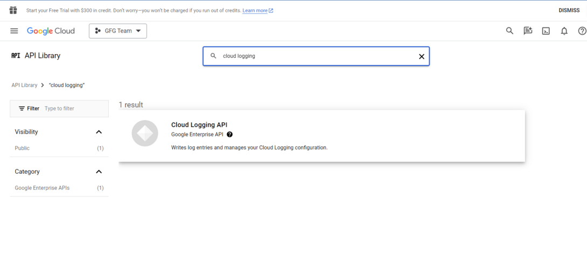

**Step 2: View Logs inside the Console**
In the Google Cloud Console, navigate to "Logging" > "Logs Explorer."

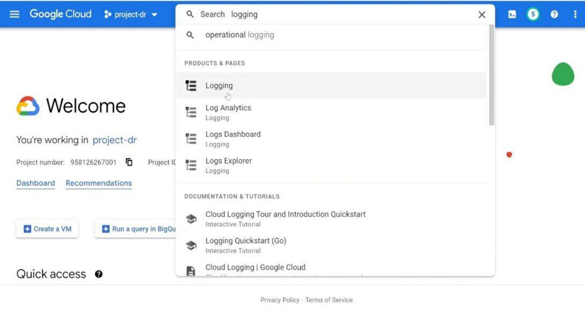

Use the Logs Explorer to search, filter out, and examine logs generated by way of your GCP resources.

**Step 3: Configure Log Exports**

In the Google Cloud Console, go to "Logging" > "Exports."Click on "Create Export."Choose the log entries that you want to export and pick out a destination (for e.g., Cloud Storage, BigQuery).

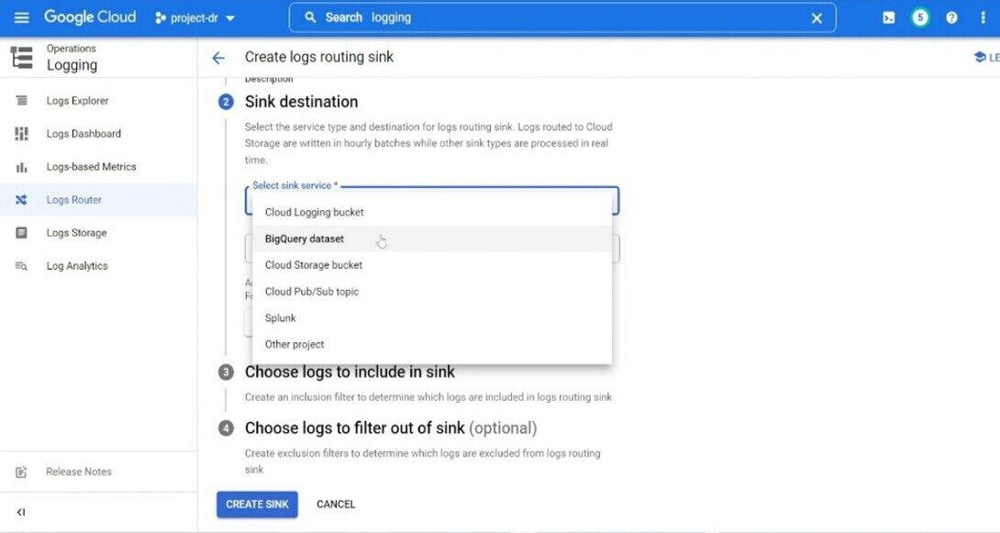

**Step 4: Use Logging in Code**

Integrate logging into your application using your selected programming language. For example, in Python, you may use the google-cloud-logging library:

```python
from google.cloud import logging

client = logging.Client()
logger = client.logger("my-log")

logger.log_text("Hello, this is a log message.")                 # plain text
logger.log_struct({"event": "order_created", "order_id": 981},   # structured
                  severity="INFO")
```

### 13.4 Real-world example: monitoring a web application

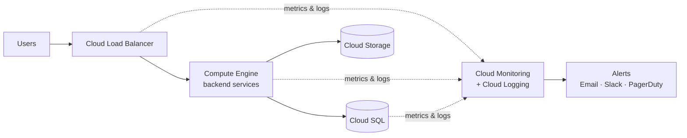

- **Monitoring** tracks CPU usage, request latency, and traffic patterns.
- **Logging** records application errors and API requests.
- **Alerts** notify admins when, for example, CPU goes above a threshold.
- **Logs** help developers debug errors quickly.

### 13.5 Use Cases and Examples

* **Performance Optimization:** Monitor software performance to identify bottlenecks and optimize code or infrastructure.
* **Anomaly Detection:** Implement anomaly detection to routinely discover unusual conduct or deviations from the norm.
* **Security Incident Response:** Use logs to investigate security incidents and set up a timeline of activities for powerful incident response.
* **Resource Scaling:** Utilize tracking metrics to dynamically scale sources primarily based on demand, ensuring ideal overall performance and price efficiency.
* **Fault Detection and Diagnostics:** Quickly detect faults by putting in alerts for critical errors and using logs for specific diagnostics at some stage in troubleshooting.

### 13.6 Integrations

| Tool | Used for |
|---|---|
| **PagerDuty** | Integrate with PagerDuty to enhance alert notifications and incident response abilities. |
| **ServiceNow** |  Integrate Google Cloud Monitoring and Logging with ServiceNow for streamlined incident management and backbone |
| **Grafana** | Use Grafana for advanced visualization and information analysis, integrating it with Google Cloud Monitoring for a greater complete dashboard. |
| **ELK Stack** | Integrate Elasticsearch, Logstash, and Kibana (ELK Stack) for effective log evaluation and visualization abilities. |
| **Prometheus** | Leverage the compatibility of Google Cloud Monitoring with Prometheus for a robust monitoring and alerting solution. |

---

### 13.7 Best Practices for Monitoring and Logging

* **Define Clear Objectives:** Clearly define the goal of your tracking and logging method. Understand what metrics and logs are important for your specific use case.
* **Granular Alerting:** Implement granular alerting to receive notifications for particular conditions. Avoid unnecessary alerts to save you from alert fatigue.
* **Regularly Review and Update:** Regularly evaluate and replace your monitoring and logging configurations. Systems and applications evolve, and so should your observability strategy.
* **Utilize Custom Metrics and Logs:** Take gain of custom metrics and logs to seize application-specific statistics. Tailor your monitoring to the specific traits of your system.

---

## 14. Quick Revision

- **Log** = time-stamped record of an event. Use **levels** (DEBUG → FATAL) and **structured JSON**.
- **6 log types:** Application · System · Access · Audit · Error · Transaction.
- **Distributed logging** = capture events from many services/machines; centralized storage; paired with monitoring and tracing.
- **Centralized logging** = everything in one place → visibility, faster troubleshooting, security, compliance. Tools: **ELK, Splunk, Graylog**.
- **Components:** Collection → Aggregation → Storage → Search → Alerting → Integration.
- **Pipeline:** Generation → Collection (Filebeat/Fluentd/Promtail) → Processing (Logstash/Vector: parse, enrich, filter) → Storage (Elasticsearch/Loki) → Visualization (Kibana/Grafana/Splunk).
- **Collection methods:** Agent-based · Syslog (UDP/TCP) · File-based (legacy/agentless).
- **Storage:** distributed FS/object storage · NoSQL/search DBs · managed cloud. Use **retention policies** and **hot/warm/cold** tiers.
- **Analysis** = past events; **monitoring** = real time + alerts (thresholds, channels, severity).
- **Latency** = delay before logs are searchable. **Consistency** = correct ordering (**NTP**, accurate timestamps).
- **Biggest challenge:** loss of context → fix with **correlation/trace IDs**.
- **Other challenges:** volume and cost, scalability, reliability, performance, **PII/GDPR**, integration.
- **GCP:** Cloud Monitoring (metrics) + Cloud Logging (logs) + Cloud Trace (traces); export logs to Cloud Storage, BigQuery, or Pub/Sub.

---

## 15. Self-Check Quiz: Interview Q&A

> ⭐ Try each question before opening the answer.

### Q1. What is the main purpose of a centralized logging system?

- A. To speed up database queries
- B. To collect, store, and manage logs from many sources in one place
- C. To replace application monitoring entirely
- D. To encrypt network traffic

<details>
<summary>Answer</summary>

**B.** Centralized logging aggregates logs from servers, applications, and services into a single platform for searching, analysis, monitoring, and alerting.
</details>

### Q2. Which type of log records *who* changed *what* and *when*, mainly for security and compliance?

- A. Access logs
- B. Error logs
- C. Audit logs
- D. System logs

<details>
<summary>Answer</summary>

**C. Audit logs.** Access logs record *who used* the system; audit logs record *changes and actions* for security reviews and compliance.
</details>

### Q3. A user's click passes through five microservices. What is the best way to find all the related log entries?

- A. Search every server's log files by time
- B. Add a correlation (trace) ID that is passed to every service and included in each log line
- C. Increase the log level to DEBUG
- D. Store logs in a relational database

<details>
<summary>Answer</summary>

**B.** A **correlation/trace ID** links every log entry for one request. Searching for that ID returns the full story. This solves the **loss of context** problem, the biggest challenge in distributed logging.
</details>

### Q4. In a modern logging pipeline, what does the processing stage (e.g. Logstash, Vector) do?

- A. Generates logs inside the application
- B. Parses, enriches, and filters logs
- C. Only displays dashboards
- D. Replaces the need for storage

<details>
<summary>Answer</summary>

**B.** It does ETL: **parsing** raw text into fields, **enriching** with metadata (GeoIP, service name), and **filtering** noisy logs to cut storage cost.
</details>

### Q5. Why might a team choose Loki over Elasticsearch for log storage?

- A. Loki indexes the full text of every log, so it's faster for every search
- B. Loki indexes only labels/metadata, so it's much cheaper to run at large volume
- C. Loki is a visualization tool
- D. Loki doesn't need any storage

<details>
<summary>Answer</summary>

**B.** Loki indexes only **labels**, not the full log content, so it's cheaper. The trade-off is slower free-text search compared with Elasticsearch's full-text index.
</details>

### Q6. Logs from different services appear out of order. What is the most likely cause, and the fix?

<details>
<summary>Answer</summary>

**Clock drift** between servers. Fix it by synchronizing clocks with **NTP**, using accurate **UTC timestamps**, and having the system **sort by timestamp** when logs arrive out of order.
</details>

### Q7. When would you use file-based log collection instead of agents?

<details>
<summary>Answer</summary>

On **legacy or agentless** systems where you can't install a collection agent. Logs are copied with tools like **rsync, SCP, or FTP**. The downside is that it's **not real-time**.
</details>

### Q8. What's the difference between log analysis and log monitoring?

<details>
<summary>Answer</summary>

**Log analysis** looks at **past** events to understand what happened and why, and to spot patterns. **Log monitoring** watches logs **in real time** and fires **alerts** so problems are caught early.
</details>

### Q9. Name two ways to stop logs from becoming a security or compliance risk.

<details>
<summary>Answer</summary>

Any two of: **mask/redact** sensitive fields (passwords, API keys, PII), **never log secrets** in the first place, **encrypt** logs in transit and at rest, apply **role-based access control**, and set **retention policies** that meet laws such as **GDPR/HIPAA**.
</details>

### Q10. In Google Cloud, where can you export (route) logs, and why would you send them to BigQuery?

<details>
<summary>Answer</summary>

Logs can be routed to **Cloud Storage** (cheap, long-term archive), **BigQuery** (SQL **analytics** over large log volumes), or **Pub/Sub** (stream to other tools such as Splunk or ELK). BigQuery is used when you want to **query and analyze** logs at scale.
</details>

### 🧠 Key Takeaways for Interviews

| # | Remember |
|---|---|
| 1 | Use **structured (JSON) logs** with levels and consistent fields |
| 2 | **Centralize** logs: collection → processing → storage → search/alerts |
| 3 | Always add a **correlation/trace ID**. It's the answer to "how do you debug across microservices?" |
| 4 | **Buffer with Kafka** between shippers and processors to survive spikes |
| 5 | Control **cost**: filter, sample, use retention and hot/warm/cold tiers |
| 6 | Keep clocks in sync with **NTP**; use UTC timestamps |
| 7 | **Never log secrets or raw PII**; encrypt and restrict access |
| 8 | Logs + metrics + traces = the **three pillars of observability** |

---

### 📚 Further Reading

- GeeksforGeeks: *Centralized Logging Systems – System Design*
- GeeksforGeeks: *Logging in Distributed Systems*
- GeeksforGeeks: *Google Cloud Monitoring & Logging*
- Next topics: Monitoring & Metrics · Distributed Tracing · Rate Limiting
