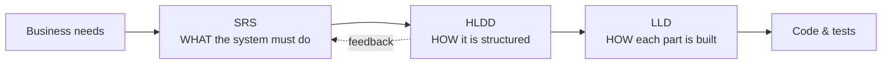
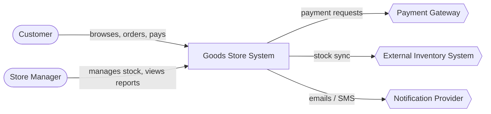
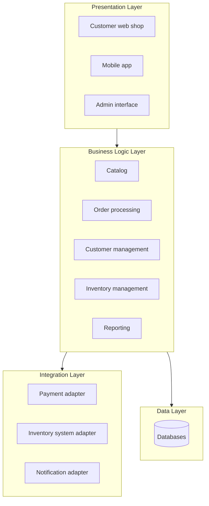
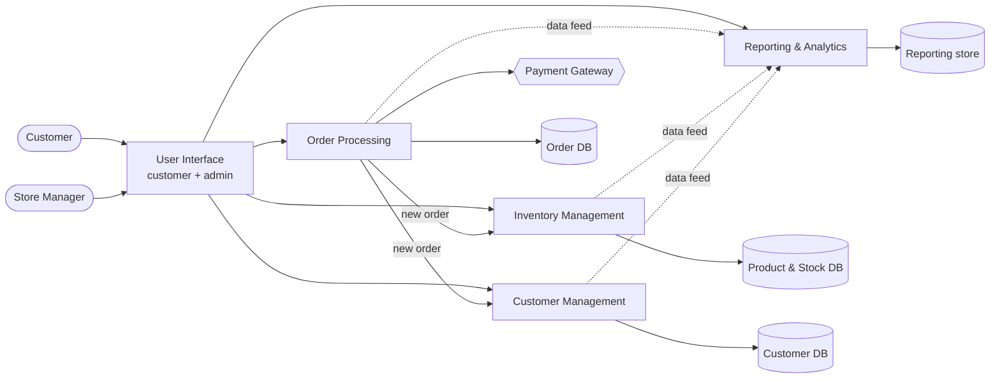
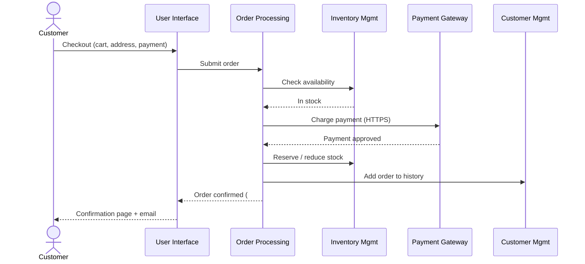
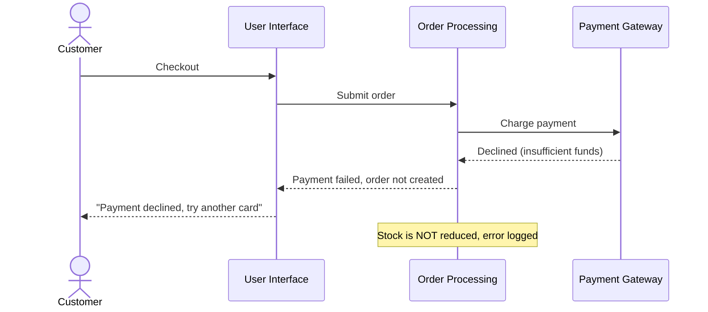
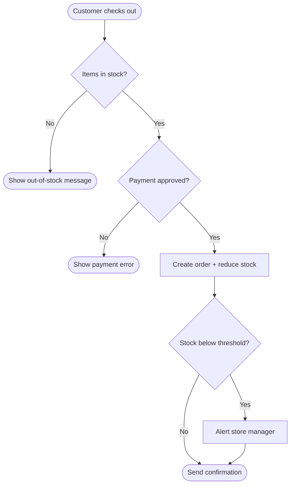
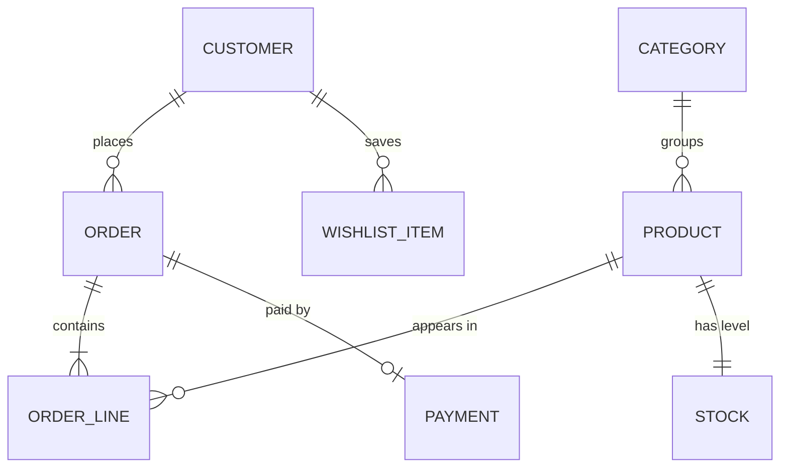
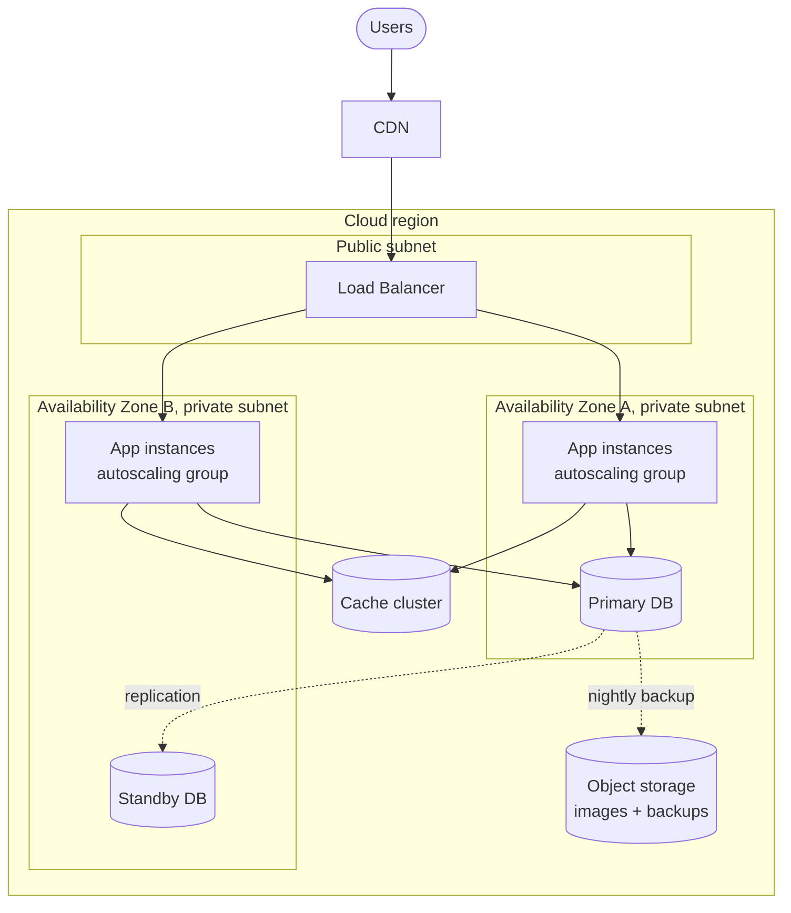
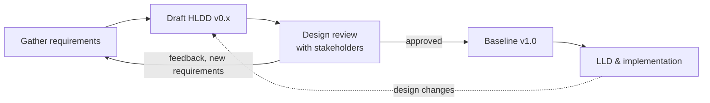

# 1.2.3 The High-Level Design Document (HLDD)

> **Phase 1: Introduction to System Design → 1.2 High-Level Design**
> Sources: Kostiantyn Ivanov, *High-level design document and how it can help us to structure your design artifacts* (Medium, 22 Jul 2023) · *High Level Design Document Template* (SlideShare) · PATH / UC Berkeley, *I-210 Pilot: High-Level Design* (v1.1, 2018) · C. H. Johnson, *Distributed Network Traffic Controller: High Level Design* (UBC Okanagan, v1.0, 2005)
> Previous: [1.2.1 Introduction to HLD, §4 The HLD Document](./1.2.1-Introduction.md#4-the-hld-document) · Related: [1.2.2 Draw an HLD Diagram](../1.2.2-Design-diagram/1.2.2-Draw-High-Level-Design-Diagram.md)

---

## Table of Contents

**Part A: Understanding the HLDD**

1. [What is a High-Level Design Document?](#1-what-is-a-high-level-design-document)
2. [Document Control (Front Matter)](#2-document-control-front-matter)
3. [The Outline at a Glance](#3-the-outline-at-a-glance)

**Part B: Section-by-Section Guide** *(running example: the Goods Store System)*

- [§1 Overview & Scope](#hldd-1-overview--scope)
- [§2 Requirements Summary](#hldd-2-requirements-summary)
- [§3 Architecture Diagram](#hldd-3-architecture-diagram)
- [§4 Module Descriptions](#hldd-4-module-descriptions)
- [§5 Data Flow](#hldd-5-data-flow)
- [§6 Interfaces](#hldd-6-interfaces)
- [§7 Data Storage](#hldd-7-data-storage)
- [§8 Technology Stack](#hldd-8-technology-stack)
- [§9 Deployment](#hldd-9-deployment)
- [§10 Non-Functional Design](#hldd-10-non-functional-design)
- [§11 Trade-offs & Risks](#hldd-11-trade-offs--risks)

**Part C: Finishing and Using the HLDD**

4. [Supporting Sections (Back Matter)](#4-supporting-sections-back-matter)
5. [Writing and Reviewing the HLDD](#5-writing-and-reviewing-the-hldd)
6. [Learning from Real HLD Documents](#6-learning-from-real-hld-documents)
7. [Ready-to-Use HLDD Template](#7-ready-to-use-hldd-template)
8. [Quick Revision](#8-quick-revision)
9. [Self-Check Quiz: Interview Q&A](#9-self-check-quiz-interview-qa)

---

# Part A: Understanding the HLDD

## 1. What is a High-Level Design Document?

A **High-Level Design Document (HLDD)** describes the **architecture and design principles** of a software system at a **conceptual level**. It covers the system's **structure, components, and major interactions**, and leaves out implementation details.

It **brings together all the high-level artifacts** produced so far (requirements, context and architecture diagrams, data flows, UI walkthroughs) into **one reference** that people can read, review, and approve.

### 1.1 Who reads it, and why

| Reader | Uses the HLDD to… |
|---|---|
| **Business stakeholders** | Confirm the system will meet the business goals |
| **Project managers** | Plan work, estimate effort, spot dependencies and risks |
| **Architects** | Review design decisions and trade-offs; check consistency with standards |
| **Developers** | Understand the big picture before writing the **LLD** and code |
| **QA / testers** | Derive test scenarios from flows and NFR targets |
| **Ops / DevOps / security** | Plan infrastructure, deployment, monitoring, and security controls |

### 1.2 Where it sits in the SDLC



> 💡 The HLDD is **derived from the SRS** (see [1.1.3 SRS](../../1.1-Basics/1.1.3-Software-Requirements-Specification.md)) and is the **input to the LLD documents**. The I-210 HLD, for example, states that it is derived from the project's System Requirements Document. The SlideShare template says the HLD "serves as input for the low-level design documents".

### 1.3 SRS vs HLDD vs LLD

| | **SRS** | **HLDD** | **LLD** |
|---|---|---|---|
| **Answers** | *What* must the system do, and how well? | *How* is the system structured? | *How* will each component be implemented? |
| **Contents** | Functional & non-functional requirements, constraints | Architecture, modules, data flow, interfaces, tech stack, deployment, trade-offs | Classes, methods, DB schema, algorithms, detailed API specs |
| **Main diagrams** | Use cases, context | Context, container/architecture, sequence, DFD, deployment | Class, detailed sequence, ERD (full), state |
| **Written by** | Business analysts, product owners | Architects, tech leads | Developers |
| **Level** | Problem | Macro solution | Micro solution |

### 1.4 What a good HLDD is (and isn't)

| ✅ A good HLDD is… | ❌ It is not… |
|---|---|
| A **single source of truth** for the design | A copy-paste of the full SRS |
| **Visual**: every major section has a diagram | A wall of text |
| **Justified**: decisions come with reasons and alternatives | A list of technologies with no "why" |
| **Traceable** back to requirements | Disconnected from what was asked for |
| **Living**: updated through reviews, versioned | Written once and forgotten |
| Written at **one level of abstraction** | Full of class names and code |

---

## 2. Document Control (Front Matter)

Before section 1, a formal HLDD usually has **document-control** pages (as in the SlideShare template):

| Item | Contents |
|---|---|
| **Cover page** | Project name, department/team, document title, **version**, date, **authorized by** |
| **Confidentiality notice** *(if needed)* | Confidentiality / copyright statement |
| **Revision history** | Table of every version: **version, date, author, reviewer, approver, comments** |
| **Approvals / sign-off** | Who approved the document, and when |
| **Table of contents** | Plus lists of figures and tables for long documents |

**Example revision history**

| Version | Date | Author | Reviewer | Approver | Comments |
|---|---|---|---|---|---|
| 0.1 | 01 Oct 2026 | Architect | – | – | First draft: overview, requirements, architecture |
| 0.2 | 05 Oct 2026 | Architect | Tech lead | – | Added data flow, interfaces, data storage |
| 0.3 | 09 Oct 2026 | Architect | Security team | – | Added non-functional design, risks |
| 1.0 | 12 Oct 2026 | Architect | Review board | Head of Engineering | **Baselined** after design review |

> 💡 Versions below **1.0** are drafts; **1.0** is the first **baselined** (approved) version. Tools like **Confluence** keep page history automatically, so a manual revision table there is often just a short summary of major changes.

---

## 3. The Outline at a Glance

### 3.1 The 11 core sections

| # | Section | Contents | Typical diagram |
|---|---|---|---|
| 1 | **Overview & scope** | What the system does, goals, **out-of-scope** items | – |
| 2 | **Requirements summary** | Key functional and non-functional requirements | – (tables) |
| 3 | **Architecture diagram** | Main components and how they interact | **C4 Context**, layered architecture |
| 4 | **Module descriptions** | Responsibility of each service/module | **C4 Container** |
| 5 | **Data flow** | DFDs / sequence of main user flows | **Sequence**, use case, DFD, flowchart |
| 6 | **Interfaces** | External and internal APIs, UI overview | API catalogue, wireframes |
| 7 | **Data storage** | Choice of databases, high-level data model | High-level **ERD** |
| 8 | **Technology stack** | Languages, frameworks, infrastructure | – (table) |
| 9 | **Deployment** | Environments, cloud setup, networking | **Deployment** diagram |
| 10 | **Non-functional design** | Scalability, availability, security, performance targets | – (tables), sometimes topology diagrams |
| 11 | **Trade-offs & risks** | Alternatives considered, why this design was chosen | – (decision & risk tables) |

Plus **back matter**: assumptions & constraints, glossary, references, appendices (see [§4](#4-supporting-sections-back-matter)).

### 3.2 How the outline maps to the source article

The Medium article uses slightly different section names. They map onto the outline like this:

| Outline section | Medium article section(s) | Artifact to reuse |
|---|---|---|
| 1. Overview & scope | Introduction | – |
| 2. Requirements summary | Functional & non-functional requirements | Requirements list |
| 3. Architecture diagram | Architectural Overview | **C4 Context diagram** (optionally layered) |
| 4. Module descriptions | System Components | **C4 Container diagram** |
| 5. Data flow | Data Flow and Processing | **Use case, sequence, flow diagrams** |
| 6. Interfaces | User Interface · External Interfaces | **UI walkthroughs**, API tables, OpenAPI file |
| 7. Data storage | *(part of the architecture's Data Layer)* | High-level data model |
| 8. Technology stack | *(spread across sections)* | – |
| 9. Deployment | Deployment and Environment | **Deployment diagram** |
| 10. Non-functional design | Performance · Security · Error Handling considerations | NFR list |
| 11. Trade-offs & risks | Risks and Mitigation · Assumptions and Constraints | Decision records |

> 💡 **Not every section is always needed.** The article marks *User Interface* and *External Interfaces* as "if needed", and adds NFR sections only for the properties the requirements actually define. Fit the document to the system.

---

# Part B: Section-by-Section Guide

> **Running example:** the **Goods Store System** (from the Medium article), a system that streamlines a retail store selling electronics, clothing, and household items, with a customer-facing shop and an admin interface for store managers. Numbers, technologies, and IDs marked *illustrative* were added for these notes.

---

<a id="hldd-1-overview--scope"></a>
## HLDD §1. Overview & Scope

**Purpose:** Tell the reader **what this document is**, **what the system does**, **why it exists**, and **where its boundaries are**.

### What to include

| Sub-section | Contents |
|---|---|
| **Purpose of the document** | Why this document exists and how it will be used (e.g. as input to LLD) |
| **System description** | A short description of the system and its intended functionality |
| **Goals / objectives** | The business and technical outcomes the system must achieve |
| **Scope (in scope)** | What this design covers |
| **Out of scope** | What it explicitly does **not** cover. This prevents scope creep and false expectations |
| **Intended audience** | Who should read it (dev team, architecture team, QA, business) |
| **Document organization** | One line per section, so readers can jump to what they need |

### Example (Goods Store System)

> *This High-Level Design Document provides an in-depth overview of the architecture and design principles for the **Goods Store System**. The system aims to streamline the operations of a retail store that sells various goods, including electronics, clothing, and household items, to customers. The scope of this document covers the high-level design of the system, including its major components, data flow, user interfaces, and external integrations.*

| Goals *(illustrative)* | In scope | Out of scope *(illustrative)* |
|---|---|---|
| Let customers browse, order, and pay online | Customer web shop, admin interface | Physical point-of-sale terminals |
| Keep stock levels accurate in real time | Order processing, inventory, customer management | Supplier procurement system |
| Give managers sales insight | Reporting & analytics | Accounting / payroll |
| | Integration with payment gateway | Building our own payment processing |

### Tips

- Keep it to **about one page**. Details belong in later sections.
- **Always write the out-of-scope list.** The I-210 HLD, for example, explicitly excludes detailed infrastructure design (servers, data centres) because the system runs entirely on AWS.

---

<a id="hldd-2-requirements-summary"></a>
## HLDD §2. Requirements Summary

**Purpose:** Restate the **key requirements** so the reader can check that **all functionality and target properties are covered** by the design. The full detail lives in the SRS; here you **list** them and reference the SRS.

### What to include

- **Functional requirements (FRs):** short, numbered list.
- **Non-functional requirements (NFRs):** **measurable** targets (see [1.1.2](../../1.1-Basics/1.1.2-Functional-and-Non-functional-Requirements.md)).
- **Traceability:** which section/module of the design satisfies each requirement.

### Example *(IDs and targets illustrative)*

**Functional requirements**

| ID | Requirement | Covered by (module) |
|---|---|---|
| FR-01 | Customers can search, filter, and browse products | User Interface, Catalog |
| FR-02 | Customers can manage a shopping cart and check out | User Interface, Order Processing |
| FR-03 | Customers can pay online securely | Order Processing + Payment Gateway |
| FR-04 | Customers can register, log in, and view order history | Customer Management |
| FR-05 | Managers can add products and update stock | Inventory Management |
| FR-06 | Managers are notified when stock falls below a threshold | Inventory Management |
| FR-07 | Managers can view sales reports and dashboards | Reporting & Analytics |

**Non-functional requirements**

| ID | Quality | Target | Addressed in |
|---|---|---|---|
| NFR-01 | Performance | Product page p95 < 300 ms | HLDD §10 (caching, CDN) |
| NFR-02 | Availability | 99.9% monthly uptime | HLDD §9, §10 (multi-AZ, failover) |
| NFR-03 | Scalability | Handle 10× normal traffic during sales | HLDD §10 (autoscaling) |
| NFR-04 | Security | Card data never stored; all traffic over TLS | HLDD §6, §10 |
| NFR-05 | Recoverability | RPO ≤ 15 min, RTO ≤ 1 h | HLDD §9 (backup & DR) |

> 💡 The I-210 HLD maps **goals → objectives** in a table and lists the **technical capabilities sought**. That is a lightweight form of traceability.

---

<a id="hldd-3-architecture-diagram"></a>
## HLDD §3. Architecture Diagram

**Purpose:** Describe the **high-level architecture and design principles**. Identify the **major components, subsystems, or layers**, and the **relationships, dependencies, and interactions** between them.

### What to include

- The **architectural style** (layered, microservices, event-driven, client-server…) and **why** it was chosen.
- **Design principles** the design follows.
- A **context diagram** (C4 Level 1): the system as one box, plus its users and external systems.
- A **high-level architecture diagram** (e.g. the layers).
- At this level you can **ignore specific technologies, protocols, and flows**. Those come in later sections.

### Example: context diagram (C4 Level 1)



### Example: layered architecture

> *The Goods Store System follows a **layered architectural pattern**, consisting of multiple interconnected components that work together to fulfil the system's objectives. The architecture ensures **separation of concerns** and **modularity**, which supports scalability, maintainability, and extensibility.*



| Layer | Responsibility |
|---|---|
| **Presentation** | Handles user interaction and renders UIs (web pages, mobile apps). Talks to the back end to fetch and display data. |
| **Business logic** | Core rules: processes requests, applies business rules, orchestrates components. Covers catalog management, order processing, customer management. |
| **Integration** | Communication with **external** systems: payment gateways, inventory systems. Ensures data exchange and interoperability. |
| **Data** | Storage and retrieval of products, customers, orders, inventory. Provides persistence for the business layer. |

### Design principles *(examples)*

| Principle | Meaning |
|---|---|
| **Separation of concerns** | Each layer/module has one job |
| **Loose coupling** | Modules talk through defined interfaces; one can change without breaking others |
| **Stateless services** | Any instance can serve any request, which makes scaling easy |
| **Security by design** | Authentication, least privilege, and encryption are built in from the start |
| **Use managed services where possible** | Less operational burden |

> 💡 Real example: the I-210 HLD lists principles such as **100% cloud operation on AWS**, **highly decoupled** design, **use of data standards**, **standardized external interfaces**, and **separation of data, decision support, and control functions**.

---

<a id="hldd-4-module-descriptions"></a>
## HLDD §4. Module Descriptions

**Purpose:** Describe each **major component/module**: its **purpose, responsibilities, and functionality**, and its **interfaces, inputs, outputs, and interactions** with other components.

### What to include

- A **container diagram** (C4 Level 2): applications, services, and data stores.
- For each module: **responsibility**, **key functions**, **inputs/outputs**, **data it owns**, **dependencies**.

### Example: container diagram (C4 Level 2)



### Example: module descriptions

| Module | Responsibility | Key functions | Owns data | Interacts with |
|---|---|---|---|---|
| **User Interface** | Front end for customers **and** store managers | Search, filter, product details, cart, checkout; admin screens for inventory, orders, reports | – | All back-end modules |
| **Order Processing** | End-to-end handling of customer orders | Capture and validate shipping/payment details, process payment via gateway, confirm order, send confirmation | Orders | Payment gateway, Inventory, Customer Mgmt |
| **Inventory Management** | Accurate product and stock data | Add products, update stock, restocking/backorders/discontinuation, **low-stock alerts** | Products, stock levels | Order Processing, admin UI |
| **Customer Management** | Customer accounts and history | Registration, authentication, profile updates, order history, wish lists, loyalty, recommendations | Customers, preferences | UI, Order Processing |
| **Reporting & Analytics** | Insight for managers | Predefined reports, dashboards, KPIs, revenue and trend analysis | Aggregated reporting data | Reads from all modules |

> 💡 Keep descriptions at the level of **responsibilities**. *"Validates payment details"* belongs here; *"`PaymentValidator.validate()` checks the Luhn checksum"* belongs in the LLD.

---

<a id="hldd-5-data-flow"></a>
## HLDD §5. Data Flow

**Purpose:** Show **how data moves** through the system: how it is **received, processed, transformed, and delivered**, and the key **data sources, transformations, and destinations**. This section describes the system's **behaviour**.

### What to include

- A narrative of the **main data flows**.
- **Sequence diagrams** for the most important user flows. Cover **positive and negative scenarios** (the SlideShare template asks for both).
- Optionally **use case diagrams**, **flowcharts** (business process), and **DFDs**.

### Example: the main flows (Goods Store System)

| Flow | What happens |
|---|---|
| **Customer interaction** | The customer browses, adds to cart, checks out. The UI collects selections, quantities, and payment info and sends them to **Order Processing**. |
| **Order processing** | Validates the order (product availability, errors), processes payment through the **payment gateway**, generates a confirmation, and notifies **Customer Mgmt** and **Inventory Mgmt**. |
| **Inventory management** | Reduces stock for the ordered products, keeps the system in sync with real stock to **prevent overselling**, and alerts managers when stock is low. |
| **Customer management** | Stores the new order in the customer's history and updates account details. Gives managers access for support and marketing. |
| **Reporting & analytics** | Collects order, customer, and product data; produces reports, statistics, and visualizations for managers. |

### Example: sequence diagram, "Place order" (happy path)



### Example: negative scenario, "Payment declined"



### Example: business process flowchart



---

<a id="hldd-6-interfaces"></a>
## HLDD §6. Interfaces

**Purpose:** Describe **how people and other systems talk to this system**, and how its own parts talk to each other.

### 6.1 User interface overview *(only if the system has a UI)*

Describe the **design approach**, **key screens**, **user interactions**, and **navigation flows**. Include **wireframes, mockups, or screenshots** (your UI walkthroughs).

| Interface | Key screens / features |
|---|---|
| **Customer interface** | **Product browsing** (search, categories, filters by price/specs) · **Product details** (specs, sizes, colours, reviews, image zoom) · **Shopping cart** (add/remove, quantities, totals, discounts, shipping options) · **Checkout** (shipping, payment, taxes, order summary before confirming) |
| **Administrative interface** | **Inventory management** (add/update products, set stock) · **Order processing** (view and update order status, shipments, invoices, refunds, cancellations) · **Sales reporting** (reports, dashboards) · **Customer management** (profiles, order history, support) |

```
Customer navigation:  Home → Search/Category → Product details → Cart → Checkout → Confirmation
Admin navigation:     Login → Dashboard → { Inventory | Orders | Reports | Customers }
```

### 6.2 External interfaces *(only if the system integrates with others)*

Describe each **integration point**: **protocol**, **data format**, **authentication/security**, and **direction**.

| External system | Direction | Protocol | Data format | Security | Purpose |
|---|---|---|---|---|---|
| **Payment gateway** | Outbound (+ webhook inbound) | **HTTPS** (REST) | **JSON** or XML (per provider spec) | API key / signed requests, TLS | Process card payments, refunds |
| **External inventory system** *(illustrative)* | Bidirectional | HTTPS / SFTP batch | JSON / CSV | Mutual TLS | Sync stock levels |
| **Notification provider** *(illustrative)* | Outbound | HTTPS | JSON | API key | Send emails / SMS |

### 6.3 API catalogue (internal and public APIs)

List the main APIs. The SlideShare template uses columns **#, API name, description, input, output, access level**. You can add the method and path, or attach an **OpenAPI (Swagger)** file instead.

| # | API | Method & path | Description | Input | Output | Access |
|---|---|---|---|---|---|---|
| 1 | Search products | `GET /products?q=&category=&page=` | Search and filter catalogue | Query, filters, page | Paged product list | Public |
| 2 | Get product | `GET /products/{id}` | Product details | Product ID | Product | Public |
| 3 | Add to cart | `POST /cart/items` | Add item to cart | Product ID, qty | Updated cart | Customer |
| 4 | Place order | `POST /orders` | Create order and take payment | Cart ID, address, payment token | Order ID, status | Customer |
| 5 | Order history | `GET /customers/me/orders` | Customer's past orders | Auth token | Order list | Customer |
| 6 | Update stock | `PATCH /admin/products/{id}/stock` | Change stock level | Product ID, qty | Updated stock | Store manager |
| 7 | Sales report | `GET /admin/reports/sales?from=&to=` | Sales for a period | Date range | Report data | Store manager |

### 6.4 Internal interfaces

How modules communicate with each other: **synchronous** (REST/gRPC) or **asynchronous** (message queue/events), and the message formats.

> 💡 Real example: the I-210 HLD defines **Kafka** for data messages and **ActiveMQ** for commands, with **JSON** messages and industry formats (**TMDD**, **GTFS**), and uses Apache Camel to translate protocols (SOAP, REST) at its data and command gateways.

---

<a id="hldd-7-data-storage"></a>
## HLDD §7. Data Storage

**Purpose:** Explain **what data the system keeps**, **where**, and **why those storage choices were made**.

### What to include (based on the SlideShare template's *Data Design* section)

| Sub-section | Contents |
|---|---|
| **Data model** | High-level entities and relationships (high-level ERD). No full column lists. |
| **Storage choice** | Database type per data set (relational, NoSQL, object storage, search index, cache) **and the reason** |
| **Data access mechanism** | E.g. ORM framework, repository pattern, read replicas |
| **Data retention** | How long data is kept; purging and archiving rules |
| **Data migration** | How existing data moves into the new system (or a reference to a migration plan) |

### Example: high-level data model



### Example: storage choices *(illustrative)*

| Data | Store | Why |
|---|---|---|
| Customers, orders, payments, stock | **Relational DB** (e.g. PostgreSQL) | Strong consistency and transactions; must not oversell stock |
| Product search | **Search index** (e.g. Elasticsearch / OpenSearch) | Full-text search and filtering |
| Product images | **Object storage** (e.g. S3) + CDN | Cheap, durable, fast global delivery |
| Sessions, hot product data | **Cache** (e.g. Redis) | Low-latency reads, less DB load |
| Reporting | **Analytics store / data warehouse** | Heavy aggregate queries kept off the transactional DB |

| Policy | Rule *(illustrative)* |
|---|---|
| Retention | Orders kept 7 years (tax rules); logs 30 days hot, 1 year archived |
| Purging | Abandoned carts deleted after 30 days |
| Migration | Existing product catalogue imported from CSV before go-live |

---

<a id="hldd-8-technology-stack"></a>
## HLDD §8. Technology Stack

**Purpose:** Record the **languages, frameworks, platforms, and infrastructure** chosen, **and why**. Each choice should trace back to a requirement or constraint.

### Example *(illustrative)*

| Layer | Technology | Reason |
|---|---|---|
| Web front end | React (TypeScript) | Team skills, rich ecosystem |
| Mobile | Flutter | One codebase for iOS and Android |
| Back end | Java 21 + Spring Boot | Mature, well supported, team experience |
| API style | REST + JSON; OpenAPI specs | Simple, widely understood |
| Messaging | Managed message queue (e.g. SQS / Kafka) | Decouple order events from inventory and notifications |
| Databases | PostgreSQL, Redis, OpenSearch | See HLDD §7 |
| Cloud | AWS (or Azure / GCP) | Managed services, autoscaling, multi-AZ |
| Containers | Docker + Kubernetes (EKS) | Portable, scalable deployments |
| CI/CD | GitHub Actions | Automated build, test, deploy |
| Observability | Centralized logging, metrics, tracing | See [1.2.2 Logging](./1.2.2-Logging.md) |

> 💡 The DNTC design document has a similar **"Tools Used"** section (UML tool, PostgreSQL, JSP, Tomcat, Apache, Python, Fedora Linux). The I-210 HLD explains its choice of **open-source** components by a **constraint**: the agency had to be able to run the system without significant licensing costs. That's the kind of **"why"** this section needs.

---

<a id="hldd-9-deployment"></a>
## HLDD §9. Deployment

**Purpose:** Give an overview of the **deployment architecture**: the **hardware, software, and infrastructure** needed to run the system, plus **environment-specific** dependencies and configuration.

### What to include

| Sub-section | Contents |
|---|---|
| **Cloud / hosting** | Platform (AWS, Azure, GCP, on-prem), regions, availability zones |
| **Compute** | Virtual servers / containers; **autoscaling** rules |
| **Networking** | VPC, public/private subnets, **load balancers**, DNS, CDN, firewalls |
| **Backup & disaster recovery** | Backup schedule and storage, DR plan, **failover** mechanisms |
| **Environments** | Dev, test, staging, production: purpose and differences |
| **Deployment diagram** | Visual of where each component runs |

### Example (Goods Store System)

- **Cloud infrastructure:** hosted on a cloud platform (AWS, Azure, or GCP).
  - **Virtual servers** that can be scaled dynamically with demand.
  - **Load balancers** spread requests across instances.
  - **Autoscaling** adjusts instance count with traffic: performance at peak, cost savings when quiet.
- **Backup & disaster recovery:**
  - **Regular backups** to secure, resilient storage, in the cloud and possibly **off-site**.
  - A **disaster recovery plan** with procedures for recovery and data restoration.
  - **Redundancy and failover** to minimize downtime.
- **Development & testing environments:**
  - **Development:** a sandbox for new features and unit tests.
  - **Testing:** **mimics production** for functional, performance, and integration testing.

### Example: deployment diagram *(illustrative)*



| Environment | Purpose | Data | Scale |
|---|---|---|---|
| **Development** | Build features, unit tests | Fake data | Minimal |
| **Test / QA** | Functional & integration tests | Test data | Small |
| **Staging** | Mirror of production; performance tests, final checks | Anonymized copy | Production-like |
| **Production** | Real customers | Real data | Full, autoscaled, multi-AZ |

---

<a id="hldd-10-non-functional-design"></a>
## HLDD §10. Non-Functional Design

**Purpose:** Explain **how the design meets each NFR** from HLDD §2. Add sub-sections **only for the qualities your requirements define** (the Medium article's advice).

### 10.1 Performance

High-level performance requirements and the factors that affect them: **response times, throughput, scalability, resource use**. State the **targets** and the **design choices** that meet them.

### 10.2 Scalability

How the system grows: **horizontal scaling** of stateless services, **autoscaling**, caching, read replicas, partitioning.

### 10.3 Availability & reliability

Redundancy, **multi-AZ** deployment, **failover**, health checks, graceful degradation, backup & DR (ties into HLDD §9).

### 10.4 Security

**Authentication, authorization, data protection**, other security mechanisms, **potential vulnerabilities and risks**, and best practices.

### 10.5 Error handling & exception management

How errors are **detected, reported, logged, and handled**: retries, timeouts, circuit breakers, user-facing messages, alerting.

### 10.6 Observability

Logging, metrics, tracing, dashboards, and alerts (see [1.2.2 Logging](./1.2.2-Logging.md)).

### Example: NFR → design mapping *(illustrative)*

| NFR | Target | Design mechanism |
|---|---|---|
| **Performance** | Product page p95 < 300 ms | CDN for static assets and images; Redis cache for hot products; search index for queries |
| **Scalability** | 10× traffic during sales | Stateless services in autoscaling groups; queue absorbs order-event spikes |
| **Availability** | 99.9% uptime | Multi-AZ deployment; DB primary + standby with automatic failover; health checks on the load balancer |
| **Security: authentication** | All customer/admin actions authenticated | Token-based auth (OAuth 2.0 / JWT); MFA for admins |
| **Security: authorization** | Least privilege | Role-based access: customer vs store manager vs admin |
| **Security: data protection** | No stored card data; encrypted data | Payment tokenization via gateway (PCI DSS scope reduced); TLS in transit; encryption at rest |
| **Security: abuse** | Prevent brute force / bots | Rate limiting at the gateway; WAF |
| **Error handling** | No silent failures | Retries with backoff for gateway calls; circuit breaker; dead-letter queue for failed events; clear user messages |
| **Observability** | Detect issues within 5 min | Centralized structured logs with trace IDs, metrics dashboards, alerts to on-call |
| **Recoverability** | RPO ≤ 15 min, RTO ≤ 1 h | Continuous DB backups + point-in-time recovery; documented DR runbook |

> 💡 Other qualities a design doc may cover (the DNTC document lists them all): **reliability, maintainability, portability, reusability, compatibility, resource utilization, serviceability**.

---

<a id="hldd-11-trade-offs--risks"></a>
## HLDD §11. Trade-offs & Risks

**Purpose:** Show that the design was **chosen deliberately**: what **alternatives** were considered, **why this design won**, what **risks** remain, and how they'll be handled. Reviewers often read this section first.

### 11.1 Alternatives considered *(illustrative)*

| Decision | Options considered | Chosen | Why | Trade-off accepted |
|---|---|---|---|---|
| Architecture style | Monolith · Modular monolith · Microservices | **Modular monolith** (layered) | Small team, faster delivery, simpler ops; modules can be split later | Less independent scaling per module |
| Main database | Relational · Document (NoSQL) | **Relational** | Orders and stock need **ACID transactions** (no overselling) | Harder to scale writes horizontally |
| Hosting | On-prem · Cloud | **Cloud** | Autoscaling for sales peaks; managed services | Vendor lock-in; ongoing cost |
| Payments | Build in-house · Payment gateway | **Gateway** | Security and **PCI compliance** handled by the provider | Per-transaction fees; external dependency |
| Order → inventory update | Synchronous call · Async event | **Async event** via queue | Checkout isn't blocked by slow inventory updates | **Eventual consistency**; stock briefly out of date |

> 💡 Many teams record each major decision as an **Architecture Decision Record (ADR)**: *Title · Context · Decision · Alternatives · Consequences.* The HLDD can link to the ADRs.

### 11.2 Risks and mitigation *(illustrative)*

| Risk | Likelihood | Impact | Mitigation |
|---|---|---|---|
| Payment gateway outage | Medium | High | Timeouts + retries; clear "try again" message; consider a secondary provider |
| Traffic spike on sale days exceeds capacity | Medium | High | Load testing before sales; autoscaling limits raised; CDN caching |
| Overselling due to concurrent orders | Medium | Medium | Stock reservation inside a DB transaction; reconciliation job |
| Data breach of customer data | Low | Very high | Encryption, least privilege, security reviews, pen testing, no card data stored |
| Team unfamiliar with Kubernetes | High | Medium | Use managed Kubernetes; training; start with simpler deployment |
| Requirements change late | High | Medium | Iterative design reviews; modular design to isolate change |

### 11.3 Assumptions and constraints

| Type | Examples |
|---|---|
| **Assumptions** *(things believed true; if wrong, the design may change)* | Payment provider offers 99.95% uptime · peak traffic ≤ 10× average · managers use modern browsers |
| **Constraints** *(fixed limits the design must respect)* | Fixed budget and deadline · must comply with PCI DSS / data-protection law · must use the company's chosen cloud |

> 💡 Real examples: the **I-210 HLD** lists constraints like **limited deployment time, fixed funding, low licensing cost, and avoiding excess complexity**. The **DNTC** design lists assumptions such as "components will integrate as planned" and "documentation will be sufficient".

---

# Part C: Finishing and Using the HLDD

## 4. Supporting Sections (Back Matter)

| Section | Contents |
|---|---|
| **Assumptions & constraints** | If not already in HLDD §11 (see [11.3](#113-assumptions-and-constraints)) |
| **Glossary / definitions** | Terms and acronyms used (e.g. *SKU, RPO, RTO, PCI DSS, CDN*). Both the DNTC and I-210 documents include one. |
| **References** | SRS, LLD documents, ADRs, standards, vendor docs: with **name, version, date** (SlideShare template format) |
| **Appendices** | Detailed diagrams, OpenAPI specs, UI mockups, capacity calculations |
| **Open issues** | Questions still to resolve, with owner and due date |

---

## 5. Writing and Reviewing the HLDD

### 5.1 It is an iterative process

> *"HLDD preparation is an iterative process. During it, you will always return to your stakeholders, retrieve new requirements, and bring new details. A design document will have a series of review meetings."* (paraphrasing the Medium article)



### 5.2 Suggested writing order

1. **Overview & scope** and **requirements summary** first. They frame everything else.
2. **Architecture** (context + high-level diagram), then **modules**.
3. **Data flow** for the 2–3 most important user journeys.
4. **Interfaces**, **data storage**, **tech stack**, **deployment**.
5. **Non-functional design**: check each NFR has a mechanism.
6. **Trade-offs & risks**: write down decisions while they're fresh.
7. Front and back matter (revision history, glossary, references) last.

### 5.3 Tips

- **A diagram per major section**, each with a **legend** and a short explanation (see [1.2.2 Draw an HLD Diagram](../1.2.2-Design-diagram/1.2.2-Draw-High-Level-Design-Diagram.md)).
- **Explain "why"**, not only "what".
- Keep **one level of abstraction**: no class names or code.
- Use **consistent names** for modules across all diagrams and text.
- **Number requirements** and reference them in the design (traceability).
- Store it where the team works (**Confluence**, the repo as Markdown, Google Docs), with **version history**.

### 5.4 Common mistakes

| Mistake | Fix |
|---|---|
| Too much implementation detail | Move it to the LLD |
| No out-of-scope list | Always state what's excluded |
| Decisions without reasons | Add a "why" and alternatives (HLDD §11) |
| NFRs listed but not designed for | Map each NFR to a mechanism (HLDD §10) |
| Diagrams and text disagree | Review them together; same names everywhere |
| Never updated after approval | Update on design changes; keep revision history |
| Only the happy path | Include failure scenarios in data flows and error handling |

### 5.5 Review checklist

- [ ] Purpose, goals, **in-scope and out-of-scope** are clear
- [ ] Every **FR** maps to at least one module
- [ ] Every **NFR** has a measurable target **and** a design mechanism
- [ ] Context and architecture diagrams are present and consistent
- [ ] Every module has a clear responsibility and owner of its data
- [ ] Key user flows have sequence diagrams, **including failure cases**
- [ ] External interfaces specify protocol, data format, and security
- [ ] Storage choices are justified; retention and migration covered
- [ ] Deployment covers environments, networking, backup & DR
- [ ] Alternatives, trade-offs, **risks with mitigations**, assumptions, and constraints are written down
- [ ] Glossary, references, and revision history are complete
- [ ] Reviewed and **approved** by the right stakeholders

---

## 6. Learning from Real HLD Documents

The three reference documents show that the outline adapts to the project:

| | **SlideShare template** | **I-210 Pilot HLD** (UC Berkeley PATH, 2018) | **DNTC HLD** (UBC Okanagan, 2005) |
|---|---|---|---|
| **System** | Generic template (sample: a taxpayer-registration web portal) | Integrated Corridor Management for a freeway corridor in Los Angeles County: decision support for traffic incidents | Linux gateway that enforces a "fair share" bandwidth limit per IP address |
| **Architecture** | Application design + component design | **Microservices on AWS**; Data Hub, Decision Support System, Corridor Management | Web app (JSP/Tomcat) + PostgreSQL + gateway scripts |
| **Main sections** | Introduction (scope, audience, overview) → System design (process flow, information flow, components, **API catalogue**) → **Data design** (model, access, retention, migration) → Interfaces → NFRs (security, performance) → References | Introduction → Microservices on AWS → Objectives → **Design objectives, constraints, principles** → Core design → Data Hub → Decision Support → **Security** → **Interfaces & messaging** → Definition of terms | Introduction (incl. **definitions**) → General description (perspective, **tools**, **constraints**, **assumptions**) → Design details (architecture, DB, UI, reports, **error handling**, interfaces, **performance, security, reliability, maintainability, portability, reusability…**) |
| **Lesson** | Strong **document control** (revision history with reviewer/approver) and a clear **API catalogue** | Puts **constraints and principles** up front, and explains **why** (open source, cloud); detailed **interface/messaging** standards | Treats **each quality attribute** as its own short section; honest about weaknesses (e.g. "security is minimal") |

> 💡 **Takeaway:** the 11-section outline is a solid default. Big, complex systems (like I-210) add sections per subsystem. Small systems (like DNTC) can merge sections. What matters is that every reader can find **what the system does, how it's structured, and why**.

---

## 7. Ready-to-Use HLDD Template

Copy this into a new Markdown file or a Confluence page and fill it in.

```markdown
# <System Name> – High-Level Design Document

| Version | Date | Author | Reviewer | Approver | Comments |
|---|---|---|---|---|---|
| 0.1 | YYYY-MM-DD | | | | Initial draft |

## 1. Overview & Scope
### 1.1 Purpose of this document
### 1.2 System description
### 1.3 Goals and objectives
### 1.4 In scope / Out of scope
### 1.5 Intended audience

## 2. Requirements Summary
### 2.1 Functional requirements (ID · requirement · covered by)
### 2.2 Non-functional requirements (ID · quality · target · addressed in)

## 3. Architecture
### 3.1 Architectural style and design principles
### 3.2 System context diagram (C4 L1)
### 3.3 High-level architecture diagram

## 4. Module Descriptions
### 4.1 Container diagram (C4 L2)
### 4.2 Modules (responsibility · key functions · owns data · interacts with)

## 5. Data Flow
### 5.1 Main data flows (narrative)
### 5.2 Sequence diagrams: key user flows (happy path + failure cases)

## 6. Interfaces
### 6.1 User interface overview (screens, navigation, wireframes)
### 6.2 External interfaces (system · protocol · format · security)
### 6.3 API catalogue / OpenAPI reference
### 6.4 Internal interfaces (sync / async, messaging)

## 7. Data Storage
### 7.1 High-level data model
### 7.2 Storage choices and rationale
### 7.3 Data access, retention, migration

## 8. Technology Stack (layer · technology · reason)

## 9. Deployment
### 9.1 Cloud / hosting, compute, networking
### 9.2 Deployment diagram
### 9.3 Environments
### 9.4 Backup and disaster recovery

## 10. Non-Functional Design
### 10.1 Performance  ### 10.2 Scalability  ### 10.3 Availability
### 10.4 Security  ### 10.5 Error handling  ### 10.6 Observability

## 11. Trade-offs & Risks
### 11.1 Alternatives considered / key decisions (ADRs)
### 11.2 Risks and mitigations
### 11.3 Assumptions and constraints

## Appendix
### Glossary  ### References  ### Open issues
```

---

## 8. Quick Revision

- **HLDD** = a document describing the system's **architecture and design principles** at a conceptual level: structure, components, major interactions. It **combines all high-level artifacts** and is the **input to LLD**.
- **Readers:** business stakeholders, PMs, architects, developers, QA, ops, security.
- **SRS → HLDD → LLD → code.**
- **Front matter:** cover, **revision history** (version, date, author, reviewer, approver), approvals, ToC.
- **11 sections:**
  1. **Overview & scope**: purpose, goals, **in/out of scope**
  2. **Requirements summary**: numbered FRs, **measurable** NFRs, traceability
  3. **Architecture**: style, principles, **C4 context** + layered diagram (presentation, business logic, integration, data)
  4. **Modules**: **C4 container** diagram; responsibility, functions, data, interactions
  5. **Data flow**: narratives, **sequence diagrams** (happy + failure paths), flowcharts, DFDs
  6. **Interfaces**: UI overview, **external interfaces** (protocol, format, security), **API catalogue** / OpenAPI, internal messaging
  7. **Data storage**: data model, storage choice + reason, access, **retention**, **migration**
  8. **Tech stack**: layer → technology → **reason**
  9. **Deployment**: cloud, compute, networking, **autoscaling**, **backup & DR**, environments, deployment diagram
  10. **Non-functional design**: each NFR → target → mechanism (performance, scalability, availability, security, error handling, observability)
  11. **Trade-offs & risks**: alternatives + why, **risks + mitigation**, assumptions, constraints, ADRs
- **Back matter:** glossary, references, appendices, open issues.
- **Iterative:** draft → review → feedback → baseline v1.0 → keep updated.

---

## 9. Self-Check Quiz: Interview Q&A

> ⭐ Try each question before opening the answer.

### Q1. What is the main purpose of a High-Level Design Document?

- A. To list every class and method in the system
- B. To describe the system's architecture, components, and major interactions at a conceptual level
- C. To record test results
- D. To replace the requirements specification

<details>
<summary>Answer</summary>

**B.** The HLDD gives an overview of the architecture and design principles: structure, components, and major interactions, without implementation details. It's derived from the SRS (D) and feeds the LLD (A).
</details>

### Q2. Which document is the HLDD usually derived from, and which document does it feed into?

<details>
<summary>Answer</summary>

It is derived from the **SRS** (requirements) and is the **input to the LLD** (low-level design) documents: **SRS → HLDD → LLD → code**.
</details>

### Q3. Why should the Overview & Scope section include an "out of scope" list?

<details>
<summary>Answer</summary>

To make the **system boundaries explicit**: it prevents **scope creep** and wrong expectations, and tells reviewers what the design deliberately does **not** handle. (E.g. the I-210 HLD excludes detailed server/data-centre design because it runs on AWS.)
</details>

### Q4. Which C4 diagram best fits the Architecture section, and which fits the Module Descriptions section?

- A. Code diagram; Component diagram
- B. Context diagram; Container diagram
- C. Deployment diagram; Class diagram
- D. Container diagram; Context diagram

<details>
<summary>Answer</summary>

**B.** The **Context** diagram (system + users + external systems) fits the architecture overview. The **Container** diagram (applications, services, data stores) fits the module descriptions.
</details>

### Q5. Name the four layers of the Goods Store System's layered architecture.

<details>
<summary>Answer</summary>

**Presentation** (UIs) → **Business logic** (rules, orchestration) → **Integration** (external systems such as the payment gateway) → **Data** (storage and retrieval).
</details>

### Q6. Why should the Data Flow section include negative (failure) scenarios as well as the happy path?

<details>
<summary>Answer</summary>

Because real systems fail (payment declined, item out of stock, service timeout). Showing failure flows makes sure the design **handles errors deliberately**: no stock reduced on failed payment, clear user messages, logging. It also gives testers their **negative test cases**.
</details>

### Q7. What should the External Interfaces section specify for each integration?

<details>
<summary>Answer</summary>

The **integration point/system**, the **communication protocol** (e.g. HTTPS/REST), the **data format** (e.g. JSON or XML), the **security** considerations (authentication, encryption), and the **direction/purpose**. An API table or an **OpenAPI** file can hold the detail.
</details>

### Q8. A requirement says "99.9% availability". Where in the HLDD should this appear, and what should be written about it?

<details>
<summary>Answer</summary>

In **§2 Requirements summary** as a measurable NFR, and in **§10 Non-functional design** with the **mechanisms** that achieve it (multi-AZ deployment, redundancy, DB failover, health checks), supported by **§9 Deployment** (backup & DR, failover). Listing an NFR without a mechanism is a common mistake.
</details>

### Q9. What belongs in the Trade-offs & Risks section?

<details>
<summary>Answer</summary>

**Alternatives considered** and **why the chosen design won** (with the trade-offs accepted), **risks** with likelihood/impact and **mitigation** plans, and **assumptions and constraints**. Major decisions can be recorded as **ADRs** (context, decision, alternatives, consequences).
</details>

### Q10. What is the difference between an assumption and a constraint?

<details>
<summary>Answer</summary>

An **assumption** is something **believed to be true** but not guaranteed (e.g. "peak traffic ≤ 10× average"). If it turns out false, the design may need to change. A **constraint** is a **fixed limit** the design must respect (e.g. fixed budget, PCI DSS compliance, mandated cloud provider).
</details>

### Q11. What goes in a revision history table, and why is it useful?

<details>
<summary>Answer</summary>

**Version, date, author, reviewer, approver, and comments** for each change. It shows **how the design evolved**, **who reviewed and approved** each version, and which version is **baselined** (1.0). Tools like Confluence also keep automatic page history.
</details>

### Q12. Is the HLDD written once and then frozen?

<details>
<summary>Answer</summary>

**No.** It's **iterative**: drafts go through **review meetings**, stakeholders bring new requirements, and the document is updated. After baselining (v1.0) it should still be **updated when the design changes**, so it remains a trusted source of truth.
</details>

### 🧠 Key Takeaways for Interviews

| # | Remember |
|---|---|
| 1 | HLDD = **architecture + reasons**, at one level of abstraction; **SRS → HLDD → LLD** |
| 2 | **Scope:** always say what's **out of scope** |
| 3 | **Diagrams per section:** context (architecture), container (modules), sequence (data flow), deployment (deployment) |
| 4 | Every **FR → module** and every **NFR → target + mechanism** |
| 5 | Interfaces: **protocol, format, security**; keep an **API catalogue / OpenAPI** |
| 6 | **Justify** choices: alternatives, trade-offs, **risks + mitigations**, assumptions, constraints |
| 7 | **Iterative and versioned:** reviews, revision history, baseline v1.0, keep it updated |

---

### 📚 Further Reading

- Kostiantyn Ivanov, [*High-level design document and how it can help us to structure your design artifacts*](https://medium.com/@svosh2) (Medium, 2023), and the previous article in the series, [*Stakeholder-driven presentation and high-level diagrams*](https://medium.com/@svosh2/stakeholder-driven-presentation-and-high-level-diagrams-ad20cdc6ecd3)
- [High Level Design Document Template](https://www.slideshare.net/slideshow/high-level-design-document-template/250571520) (SlideShare)
- [I-210 Pilot: High-Level Design](https://connected-corridors.berkeley.edu/sites/default/files/i-210_pilot_high-level_design_v1_march_15_2018.pdf) (PATH, UC Berkeley, 2018)
- [Distributed Network Traffic Controller: High Level Design](https://cmps-people.ok.ubc.ca/rlawrenc/research/Students/CJ_05_Design.pdf) (UBC Okanagan, 2005)
- [The C4 model](https://c4model.com/) · [Architecture Decision Records](https://adr.github.io/)
