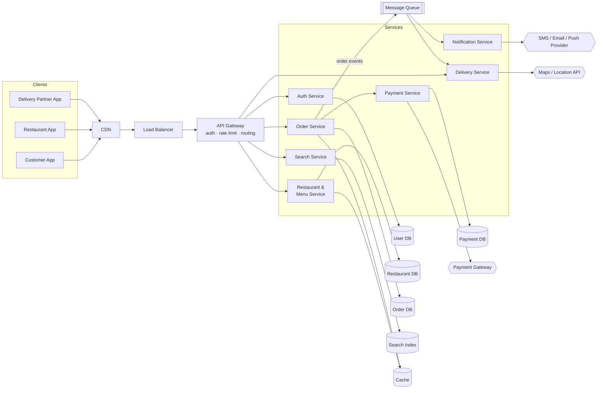
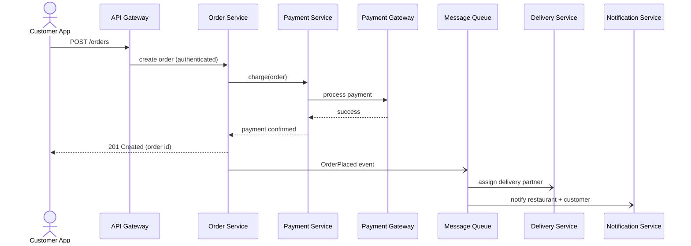
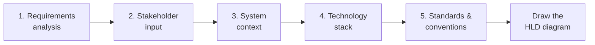
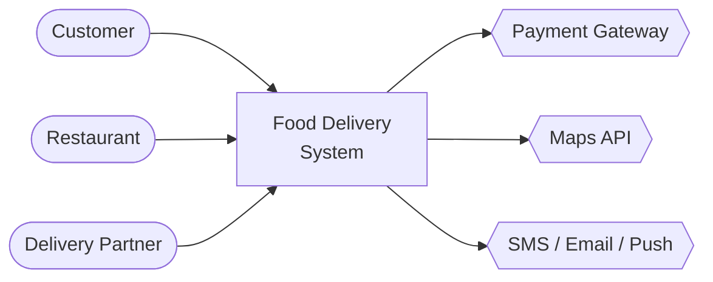
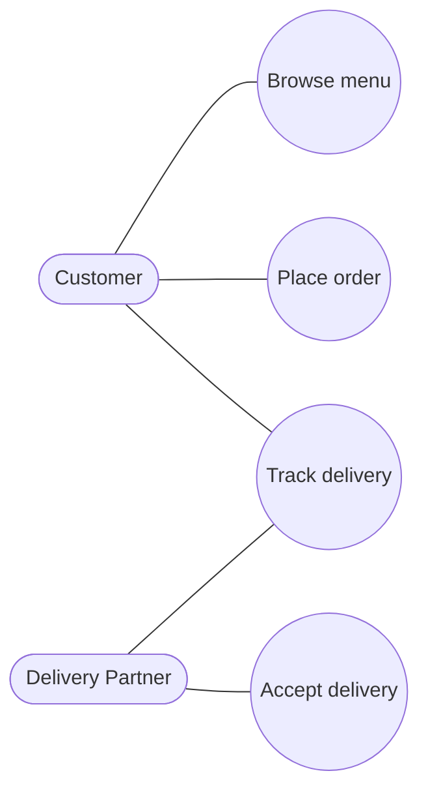
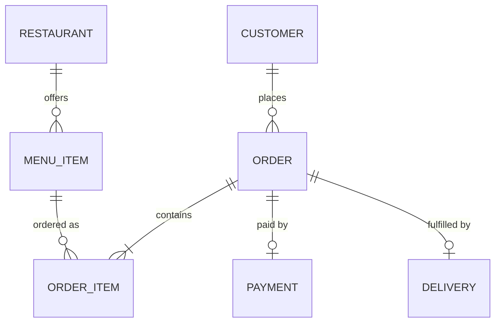
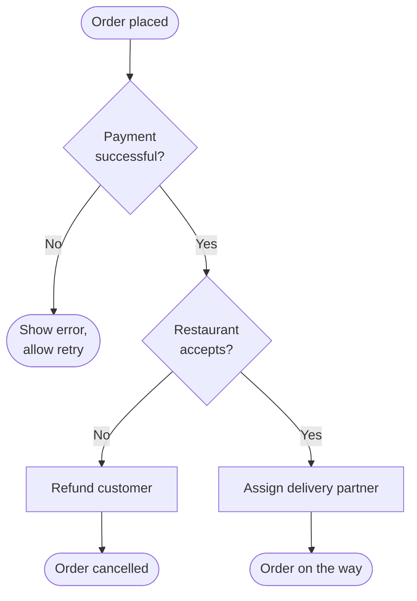
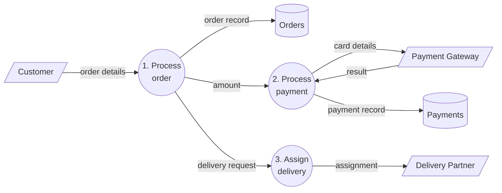
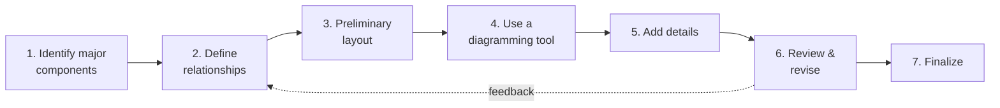

# 1.2.2 Draw a High-Level Design (HLD) Diagram

> **Phase 1: Introduction to System Design → 1.2 High-Level Design**
> Source: GeeksforGeeks, *Draw High Level Design Diagram* (last updated 1 Oct 2026), plus Excalidraw's official docs and repository
> Previous: [1.2.1 Introduction to High-Level Design](../1.2.1-Introduction/1.2.1.1-Introduction.md)

---

## Table of Contents

1. [What is an HLD Diagram?](#1-what-is-an-hld-diagram)
2. [Worked Example: Online Food Delivery System](#2-worked-example-online-food-delivery-system)
3. [Why HLD Diagrams Matter](#3-why-hld-diagrams-matter)
4. [Preparation Before Drawing](#4-preparation-before-drawing)
5. [Diagram Vocabulary: Shapes, Arrows and Conventions](#5-diagram-vocabulary-shapes-arrows-and-conventions)
6. [Techniques (Diagram Types)](#6-techniques-diagram-types)
7. [Tools for Drawing HLD Diagrams](#7-tools-for-drawing-hld-diagrams)
8. [Excalidraw Whiteboard: Deep Dive](#8-excalidraw-whiteboard-deep-dive)
9. [Step-by-Step Guide to Drawing an HLD Diagram](#9-step-by-step-guide-to-drawing-an-hld-diagram)
10. [Drawing HLD Diagrams in an Interview](#10-drawing-hld-diagrams-in-an-interview)
11. [Common Mistakes to Avoid](#11-common-mistakes-to-avoid)
12. [Review Checklist](#12-review-checklist)
13. [Quick Revision](#13-quick-revision)
14. [Self-Check Quiz: Interview Q&A](#14-self-check-quiz-interview-qa)

---

## 1. What is an HLD Diagram?

A **High-Level Design (HLD) diagram** is a **visual overview of a system's architecture**. It shows the **major components** and **how they interact**, and leaves out implementation details such as classes, methods, and table columns.

An HLD diagram:

- Shows the **major system components** and the **flow of data** between them.
- Shows how the system **integrates with external services** and fits into its wider **environment** (cloud, network, third parties).

> 💡 **Rule of thumb:** If a box would take more than a few words to label, or an arrow needs a paragraph to explain, that detail probably belongs in the **LLD**, not the HLD diagram.

---

## 2. Worked Example: Online Food Delivery System

An HLD of an online food delivery system (think Swiggy, Zomato, Uber Eats) shows the major components and how they communicate, **without** implementation details.

### 2.1 The diagram



The same thing as a simple box sketch, which is what you'd draw first on a whiteboard:

```
 ┌──────────┐ ┌──────────┐ ┌──────────┐
 │ Customer │ │Restaurant│ │ Delivery │          EXTERNAL
 │   App    │ │   App    │ │   App    │      ┌───────────────┐
 └────┬─────┘ └────┬─────┘ └────┬─────┘      │Payment Gateway│
      └────────────┼────────────┘            │Maps API       │
                   ▼                         │SMS/Email/Push │
          CDN → Load Balancer                └───────▲───────┘
                   ▼                                 │
              API Gateway                            │
   ┌──────┬───────┼────────┬─────────┬───────────┐   │
   ▼      ▼       ▼        ▼         ▼           ▼   │
 Auth  Restaurant Order  Payment  Delivery  Notification
   │      │       │  ╲      │         │           ▲
   ▼      ▼       ▼   ╲────▶ Queue ───┴───────────┘
 UserDB RestDB  OrderDB     (async events)
          └── Cache ──┘
```

### 2.2 The elements in the diagram

| Element | In this example |
|---|---|
| **User interface** | Customer, restaurant, and delivery-partner apps: browse restaurants and menus, place orders, pay, track deliveries. |
| **Modules / subsystems** | Auth, Restaurant & Menu, Order, Payment, Delivery, Notification, Search. Each handles one area of the business. |
| **Interfaces / APIs** | The **API gateway** exposes REST APIs to clients. Services talk to each other through APIs and a **message queue**. |
| **Data flow** | Requests and information (orders, payments, delivery updates) move between components, shown by the arrows. |
| **Data storage** | Separate stores per service: users, restaurants/menus, orders, payments, plus a **cache** and a **search index**. |
| **External systems** | **Payment gateway**, **maps/location API**, **SMS/email/push** providers. |
| **Deployment / infrastructure** | **CDN**, **load balancer**, servers/containers, cloud services that run and scale the system. |

### 2.3 Tracing one flow: "Customer places an order"

An HLD diagram becomes much clearer when you **walk one request through it**:



> 💡 Notice the **synchronous** part (the customer waits for payment) and the **asynchronous** part (delivery assignment and notifications happen in the background through the queue). Showing that difference is a key job of an HLD diagram.

---

## 3. Why HLD Diagrams Matter

| Benefit | How the diagram helps |
|---|---|
| **Improves communication** | Stakeholders, developers, testers, and ops all see the **same picture** of the system. |
| **Supports project planning** | Each box is a natural unit of work: easier **resource allocation, task distribution**, and implementation planning. |
| **Makes complexity understandable** | Shows how major components interact without drowning readers in detail. |
| **Serves as documentation** | New team members get onboarded faster; decisions are recorded. |
| **Finds problems early** | Single points of failure, missing components, or tight coupling are much cheaper to fix on a diagram than in code. |

---

## 4. Preparation Before Drawing

Drawing too early leads to mistakes and omissions. Do these five steps first.



### 4.1 Requirements analysis

Identify the overall requirements, scope, and constraints. *(See [1.1.2 Functional & Non-Functional Requirements](../../1.1-Basics/1.1.2-Functional-and-Non-functional-Requirements.md) and [1.1.3 SRS](../../1.1-Basics/1.1.3-Software-Requirements-Specification.md).)*

| Step | What to do | Food delivery example |
|---|---|---|
| **Gather** | Collect business goals, functional and non-functional requirements, constraints | "Customers can order and track food"; "p99 latency < 300 ms" |
| **Analyze** | Review and categorize them | Group into ordering, payments, delivery, notifications |
| **Prioritize** | Rank by business importance | Ordering + payments = must-have; ratings = later |
| **Document** | Record them as specifications or user stories | SRS, Jira stories |

### 4.2 Stakeholder input

Make sure the design meets the needs and concerns of everyone involved.

| Step | What to do |
|---|---|
| **Identify stakeholders** | Everyone affected or involved: customers, restaurants, delivery partners, product, ops, security, finance |
| **Gather input** | Meetings, interviews, surveys, workshops |
| **Resolve conflicts** | E.g. "fastest delivery" (ops) vs "lowest cost" (finance) |
| **Validate requirements** | Check they are accurate, complete, and aligned with business goals |
| **Obtain approval** | Get sign-off before moving on to design |

### 4.3 System context

Define the **environment** the system runs in: its **boundaries**, **external entities**, and **interactions** with other systems. The usual output is a **context diagram**, the system as **one box** surrounded by everything it talks to:



| Item | What to capture |
|---|---|
| **Context diagram** | Interactions with users, external apps, and third-party services |
| **Boundaries** | What is **inside** vs **outside** scope (e.g. we use a payment gateway, we don't build one) |
| **External interactions** | APIs, integrations, and data-exchange points |
| **Assumptions & dependencies** | E.g. "maps API has 99.9% uptime", "restaurants have a smartphone" |

### 4.4 Technology stack

Choose technologies that meet the functional and non-functional requirements, balancing scalability, security, maintainability, compatibility, cost, and constraints.

| Step | What to do |
|---|---|
| **Research** | Languages, frameworks, databases, cloud services |
| **Evaluate** | Compare on performance, scalability, security, compatibility, maintainability, cost |
| **Select** | Pick what best fits the requirements and constraints |
| **Document decisions** | Record the choice **and the reasons and trade-offs**, e.g. as an Architecture Decision Record (ADR) |

### 4.5 Standards and conventions

Consistent practice makes the diagram easy to read and maintain.

- **UML standards:** use standard notation where it applies.
- **Naming conventions:** consistent names for modules, components, and interfaces (e.g. always "*X Service*", nouns for services, verbs on arrows).
- **Design patterns:** apply proven patterns where appropriate (API gateway, pub/sub, CQRS…).
- **Documentation standards:** a consistent template so the whole team can read any diagram.

---

## 5. Diagram Vocabulary: Shapes, Arrows and Conventions

HLD diagrams (outside of strict UML) use a widely understood informal notation. Agree on it with your team and **put a legend on the diagram**.

### 5.1 Common shapes

| Shape | Usually means | Example |
|---|---|---|
| Rectangle / rounded rectangle | Service, application, component | `Order Service` |
| Cylinder | Database / persistent store | `(Order DB)` |
| Pipe / stacked rectangles | Queue, stream, topic | `[[Kafka]]` |
| Stick figure / oval | User / actor | `Customer` |
| Cloud | Internet or external cloud | `Internet` |
| Hexagon / dashed box | External or third-party system | `{{Payment Gateway}}` |
| Large dashed boundary | Group: VPC, region, subsystem, team ownership | `subgraph Services` |

### 5.2 Arrow conventions

```
 A ───────▶ B    synchronous request (A waits for B), e.g. REST / gRPC call
 A - - - - ▶ B    asynchronous message / event (A does not wait), e.g. via queue
 A ◀──────▶ B    two-way / persistent connection, e.g. WebSocket
```

- **Label arrows** with *what* flows (`order events`, `GET /menu`) or the protocol (`HTTPS`, `gRPC`, `WebSocket`).
- Point arrows in the **direction of the request** (or of the data, but pick one and say which in the legend).
- Read **left → right** or **top → bottom**: clients on the left/top, data stores on the right/bottom.

### 5.3 Colour and grouping

- Use colour **meaningfully and sparingly**: e.g. blue = our services, grey = external, green = data stores, red = single point of failure under discussion.
- Group related components into **boundaries** (subsystem, availability zone, team).
- Keep one **level of abstraction per diagram**. Don't mix "Order Service" with "OrderController.java".

---

## 6. Techniques (Diagram Types)

No single diagram shows everything. HLD work usually combines several, each answering a different question.

| Technique | Answers the question | Part of HLD? |
|---|---|---|
| **Block / architecture diagram** | *What are the main parts and how are they connected?* | ✅ The core HLD diagram |
| **UML (component, deployment, sequence…)** | *What is the structure / where does it run / what happens in order?* | ✅ Component & deployment diagrams especially |
| **Data Flow Diagram (DFD)** | *How does data move between processes and stores?* | ➕ Complements HLD |
| **Flowchart** | *What steps and decisions happen in one process?* | ➕ Complements HLD (process level) |
| **Entity-Relationship Diagram (ERD)** | *How is the data structured?* | ➕ Supports HLD (data model only) |
| **C4 model** *(extra)* | *What does the system look like at each zoom level?* | ✅ A popular way to organize HLD diagrams |

### 6.1 Unified Modeling Language (UML)

A **standardized modeling language** to specify, visualize, construct, and document software systems.

- **Diagrams:** class, sequence, use case, activity, component, deployment… each with standard notation.
- **Use:** model and communicate structure, behaviour, interactions, and relationships in a widely understood way.
- **Most useful at HLD level:** **component** diagrams (building blocks and interfaces), **deployment** diagrams (nodes, servers, containers), **sequence** diagrams (like the one in [§2.3](#23-tracing-one-flow-customer-places-an-order)), **use case** diagrams (actors and goals).
- **Mostly LLD:** class diagrams, detailed activity diagrams.


*A use-case style view: actors and their goals.*

### 6.2 Block diagrams

**Blocks** represent components and **lines** show relationships between them.

- **Components:** blocks (modules) and connectors (interactions or data flows).
- **Use:** high-level views of the main components and their interactions. The food delivery diagram in [§2.1](#21-the-diagram) is a block diagram. This is what most people mean by "the HLD diagram".

### 6.3 Entity-Relationship Diagrams (ERD)

Used for **database and data modelling**: entities, attributes, and the relationships between them. An ERD **supports** HLD by showing the data model, but it **does not represent the full system architecture**.

- **Components:** entities (tables), attributes (columns), relationships (1-to-1, 1-to-many, many-to-many).



### 6.4 Flowcharts

Show the **flow of a process** with symbols.

- **Components:** start/end (oval), process (rectangle), decision (diamond), arrows for direction.
- **Use:** specific process flows and decision logic. Flowcharts **complement** HLD by showing **process-level** behaviour, not the whole architecture.



### 6.5 Data Flow Diagrams (DFD)

Show **how data moves** through a system.

- **Components:** **processes** (transform data), **data stores**, **data flows** (arrows), **external entities** (sources/sinks).
- **Use:** understanding and documenting data movement. DFDs **complement** HLD by focusing on **data** rather than the full architecture.



*(DFD notation: external entities = squares, processes = circles, data stores = open rectangles. Mermaid approximates them here.)*

### 6.6 Bonus: the C4 model

The **C4 model** (by Simon Brown) organizes architecture diagrams into **four zoom levels**, like a map:

| Level | Shows | Audience | HLD or LLD? |
|---|---|---|---|
| **1. Context** | The system as one box, plus users and external systems | Everyone, including non-technical people | HLD |
| **2. Container** | Applications, services, databases, queues inside the system | Architects, developers, ops | **HLD (the main diagram)** |
| **3. Component** | Major components inside one container | Developers | Borderline |
| **4. Code** | Classes and code structure | Developers | LLD |

> 💡 The context diagram in [§4.3](#43-system-context) is C4 Level 1. The food delivery diagram in [§2.1](#21-the-diagram) is roughly C4 Level 2.

---

## 7. Tools for Drawing HLD Diagrams

The right tool helps you make **clear, professional, easy-to-maintain** diagrams.

### 7.1 The four main tools

| Tool | What it is | Strengths | Watch out for | Cost |
|---|---|---|---|---|
| **Microsoft Visio** | Professional desktop/web diagramming tool, common in enterprises | UML, flowcharts, network diagrams; strong **Microsoft Office / 365** integration; formal stencils | Paid; heavier to learn; less suited to quick sketches | Paid (Microsoft 365 plans) |
| **Lucidchart** | Cloud-based diagramming for **real-time collaboration** | Many users editing at once; integrates with **Google Drive, Slack, Confluence**, Jira; large shape libraries (AWS, GCP, Azure) | Free tier is limited | Freemium |
| **Draw.io (diagrams.net)** | Free online (and desktop) diagramming tool | **Free**; many templates and shapes incl. cloud icons; saves to Google Drive, OneDrive, GitHub or local; Confluence & VS Code integrations | Polished but more "formal" than a whiteboard; slower for quick sketching | Free, open source |
| **Excalidraw** | Free, open-source **virtual whiteboard** with a **hand-drawn** look | Fastest for **sketching and brainstorming**; real-time collaboration with **end-to-end encryption**; no sign-up needed; Mermaid import; very popular for **system design interviews** | Informal look; fewer formal notations (no strict UML stencils); free version keeps drawings in the browser unless you save them | **Free**, open source (MIT). Optional paid **Excalidraw+** |

### 7.2 Diagram-as-code tools (bonus)

You describe the diagram in text and the tool draws it. Great for keeping diagrams in **Git** next to the code, where changes are reviewed like code.

| Tool | Notes |
|---|---|
| **Mermaid** | Text → flowcharts, sequence diagrams, ERDs, etc. Rendered natively by GitHub, GitLab, and many Markdown editors. All diagrams in these notes are Mermaid. |
| **PlantUML** | Text → full UML (class, sequence, component, deployment…). |
| **Structurizr** | Text → **C4 model** diagrams from one model. |

### 7.3 Which tool when?

| Situation | Good choice |
|---|---|
| Brainstorming, whiteboarding with a team, **system design interviews** | **Excalidraw** |
| Formal enterprise documentation in a Microsoft shop | **Visio** |
| Team documentation with Confluence / Google Workspace and live collaboration | **Lucidchart** or **draw.io** |
| Free, polished diagrams with cloud-provider icons | **draw.io** |
| Diagrams that live in the repo and change with the code | **Mermaid / PlantUML / Structurizr**, or `.excalidraw` files in Git |

---

## 8. Excalidraw Whiteboard: Deep Dive

🔗 **[Excalidraw Whiteboard](https://excalidraw.com/)** · Source code: [github.com/excalidraw/excalidraw](https://github.com/excalidraw/excalidraw)

### 8.1 What is Excalidraw?

**Excalidraw** is a **free, open-source virtual whiteboard** for sketching diagrams with a **hand-drawn look**. You open [excalidraw.com](https://excalidraw.com/) in a browser and start drawing. **No account or installation is needed.**

| Fact | Detail |
|---|---|
| **License** | **MIT** (open source) |
| **Popularity** | One of the most-starred projects on GitHub (~134k stars) |
| **Runs in** | Any modern browser; also installable as a **PWA** that works **offline** |
| **File format** | Open `.excalidraw` format (plain **JSON**) |
| **Used by / embedded in** | Google Cloud, Meta, CodeSandbox, Replit, Notion, Obsidian, HackerRank, among others |
| **For developers** | npm package **`@excalidraw/excalidraw`**, a React component to embed the whiteboard in your own app |

**Why the hand-drawn style?** A sketchy look signals *"this is a draft, let's discuss it"*. People focus on the **ideas and structure**, not on pixel-perfect alignment. That is exactly the mindset you want for HLD.

### 8.2 Key features

| Feature | Why it's useful for HLD |
|---|---|
| **Infinite canvas** with zoom and pan | Room for a big architecture plus side notes |
| **Shapes:** rectangle, diamond, ellipse, arrow, line, free-draw, text, image | Everything needed for block diagrams and flowcharts |
| **Arrow binding** | Arrows **stick to shapes**, so moving a box keeps the connections attached |
| **Labeled arrows** and **elbow (right-angle) arrows** | Clean, readable connections with "what flows" labels |
| **Frames** | Group a diagram into a named frame (e.g. "v1", "v2: with cache") and export or present it on its own |
| **Shape libraries** | Reusable icon sets (system design, AWS/GCP/Azure, UML…) from **[libraries.excalidraw.com](https://libraries.excalidraw.com/)**, or your own |
| **Real-time collaboration** | Share a **live link** and draw together; sessions are **end-to-end encrypted** |
| **Shareable links** | Send a read-only snapshot link of the drawing |
| **Export** | **PNG**, **SVG**, clipboard, or `.excalidraw` JSON. PNG/SVG can **embed the scene**, so the image can be re-opened and edited later |
| **Mermaid to Excalidraw** | Paste Mermaid text and get an editable sketch (see [§8.6](#86-mermaid-to-excalidraw-and-text-to-diagram)) |
| **Text to diagram** (AI) | Describe a diagram in words and generate a draft |
| **Laser pointer** | Point at parts of the diagram while presenting on a call |
| **Snapping, grid, alignment tools** | Neat layouts without fuss |
| **Dark mode, view mode, zen mode** | Distraction-free presenting and reading |
| **Local-first autosave** | Work is saved in your **browser** automatically, so you don't lose it on refresh |
| **Undo / redo, localization (many languages)** | Everyday usability |

### 8.3 The toolbar and keyboard shortcuts

Each tool has a **letter** shortcut and a **number** shortcut, so you can draw without touching the toolbar:

| Tool | Key | Use in HLD |
|---|---|---|
| **Selection** | `V` or `1` | Move, resize, group |
| **Rectangle** | `R` or `2` | Services, components |
| **Diamond** | `D` or `3` | Decisions (flowcharts), gateways |
| **Ellipse** | `O` or `4` | Actors, processes (DFDs) |
| **Arrow** | `A` or `5` | Requests, data flow |
| **Line** | `L` or `6` | Boundaries, separators |
| **Draw (free-hand)** | `P` or `7` | Quick annotations |
| **Text** | `T` or `8` | Labels, notes (or double-click the canvas) |
| **Insert image** | `9` | Logos, screenshots |
| **Eraser** | `E` or `0` | Delete by rubbing out |
| **Frame** | `F` | Group a diagram into a named frame |
| **Laser pointer** | `K` | Point while presenting |
| **Hand (pan)** | `H` | Move around the canvas (or hold **Space** and drag) |

**Handy tips:**

- Press **`?`** to open the full list of keyboard shortcuts.
- **Double-click a shape** to type a label **inside** it. Double-click an arrow to label it.
- Hold **Shift** while drawing for perfect squares/circles and straight lines.
- **Ctrl/Cmd + D** duplicates; **Alt + drag** also duplicates. Great for drawing several identical services or replicas.
- **Ctrl/Cmd + G** groups shapes (e.g. a service and its database).
- Hold **Ctrl/Cmd** while drawing an arrow to stop it binding to a shape.
- Use the **Command palette** (in the menu) to search for any action by name.

### 8.4 Drawing the food delivery HLD in Excalidraw (walkthrough)

1. **Open** [excalidraw.com](https://excalidraw.com/). Optionally pick a **library** (e.g. a "system design" or cloud-icons library) from [libraries.excalidraw.com](https://libraries.excalidraw.com/) and add it.
2. **Clients first (left side):** press `R`, draw three boxes and label them *Customer App*, *Restaurant App*, *Delivery App*.
3. **Entry layer:** draw *CDN → Load Balancer → API Gateway* to the right of the clients. Connect them with `A` (arrows bind to the boxes).
4. **Services (middle):** draw boxes for *Auth*, *Restaurant*, *Order*, *Payment*, *Delivery*, *Notification*. Use **Ctrl/Cmd + D** to duplicate a box quickly. Keep them in a column or grid.
5. **Data stores (right/bottom):** draw a cylinder (from a library) or a rounded rectangle labelled *DB* next to each service that owns data. Add *Cache* and *Search Index*.
6. **Async path:** draw a *Message Queue* box. Connect *Order → Queue → Delivery/Notification* using **dashed arrows** (change the stroke style in the properties panel) to show they're asynchronous.
7. **External systems:** put *Payment Gateway*, *Maps API*, *SMS/Email* in a **different colour** (e.g. grey) on the far right, inside a dashed boundary labelled "External".
8. **Label arrows:** double-click an arrow and type, e.g. `HTTPS`, `order events`, `charge`.
9. **Add a legend** in a corner: solid = sync, dashed = async, grey = external.
10. **Wrap it in a frame** (`F`) called *"Food Delivery – HLD v1"*. Copy the frame for *"v2 – with caching & replicas"* as the design evolves.
11. **Share or export:** start a **live collaboration** session for a review, or **export** to PNG/SVG (with the scene embedded) or `.excalidraw`.

### 8.5 Collaboration, saving and sharing

| Action | How |
|---|---|
| **Live collaboration** | Click **Share → Live collaboration**, then send the link. Everyone sees each other's cursors. The session is **end-to-end encrypted** (the key is in the part of the link after `#`, which is never sent to the server). |
| **Share a snapshot** | **Share → Shareable link** creates a read-only link to the current drawing. |
| **Save to your computer** | **Menu → Save to…** downloads a `.excalidraw` file you can reopen later. |
| **Export an image** | **Menu → Export image** (`Ctrl/Cmd + Shift + E`): PNG or SVG, choose background, dark mode, scale, and **"Embed scene"**. |
| **Autosave** | Your current drawing is kept in the **browser's local storage**. It's lost if you clear browser data, so **save important work** as a file. |

### 8.6 Mermaid to Excalidraw and text to diagram

- **Mermaid to Excalidraw:** open **More tools → Mermaid to Excalidraw**, paste Mermaid syntax, and insert it as an **editable** hand-drawn diagram. **Flowcharts** convert to real, editable shapes. **Other diagram types** (e.g. ERDs, git graphs) are inserted as an **image**. Some special flowchart shapes become rectangles.
- **Text to diagram:** describe the system in plain English (*"web app → API gateway → three microservices → Postgres"*) and the AI draws a first draft you can then edit. Usage on the free version is limited.

> 💡 A fast workflow: write the flow as **Mermaid** (like the diagrams in these notes), convert it in Excalidraw, then tidy up and annotate by hand.

### 8.7 Excalidraw in your developer workflow

| Where | How |
|---|---|
| **In this repo / Git** | Commit `.excalidraw` files (JSON, so they diff and version). Or export **`.excalidraw.png` / `.excalidraw.svg` with the scene embedded**: GitHub shows the image, and you can still re-open it in Excalidraw to edit. |
| **VS Code** | The **Excalidraw** extension (*Excalidraw Editor*) opens and edits `.excalidraw`, `.excalidraw.svg`, `.excalidraw.png` files right in the editor. |
| **IntelliJ IDEA** | An Excalidraw integration plugin is available on the JetBrains Marketplace. |
| **Obsidian** | The very popular **Obsidian Excalidraw** plugin: draw inside your notes. |
| **Notion** and other tools | Can embed Excalidraw drawings. |
| **Your own app** | `npm install @excalidraw/excalidraw` (React). |

### 8.8 Excalidraw vs Excalidraw+

| | **Excalidraw (free)** | **Excalidraw+ (paid)** |
|---|---|---|
| Price | Free, no sign-up | Subscription (roughly **$6–7 per user/month** at the time of writing; check the site for current pricing) |
| Storage | Browser + files you save | **Cloud workspace** to store and organize all your scenes |
| Collaboration | Live, end-to-end encrypted sessions | Persistent team workspaces and sharing |
| Extras | Core whiteboard, libraries, Mermaid, limited AI | More AI usage, presentation features, team management |

> For learning and interviews, the **free version is more than enough**.

### 8.9 Pros and cons of Excalidraw for HLD

| ✅ Pros | ⚠️ Cons |
|---|---|
| Free, open source, no login | Informal look may not suit formal/enterprise docs |
| Extremely fast to sketch | No strict UML stencils or validation |
| Encrypted real-time collaboration | Free version doesn't store your work in the cloud |
| Open JSON format, works well with Git | Very large diagrams can become hard to navigate |
| Great for interviews and brainstorming | Not a modelling tool: no shared model between diagrams (unlike Structurizr) |

---

## 9. Step-by-Step Guide to Drawing an HLD Diagram



| # | Step | What to do | Food delivery example |
|---|---|---|---|
| 1 | **Identify major components** | Find the main modules/services from the requirements. A good trick: **nouns** in the requirements often become services or stores. | Auth, Restaurant, Order, Payment, Delivery, Notification |
| 2 | **Define relationships** | How components communicate: sync or async, which protocol, which direction. | Order → Payment (sync REST); Order → Queue → Notification (async) |
| 3 | **Create a preliminary layout** | Rough sketch: clients → entry layer → services → data. Don't worry about neatness. | Paper or an Excalidraw sketch |
| 4 | **Use a diagramming tool** | Redraw cleanly in Excalidraw, draw.io, Lucidchart, or Visio. | Excalidraw (see [§8.4](#84-drawing-the-food-delivery-hld-in-excalidraw-walkthrough)) |
| 5 | **Add details** | Data flow, external systems, key interactions, data stores, caches, load balancers. | Payment gateway, maps API, cache, search index |
| 6 | **Review and revise** | Walk stakeholders through **real flows** ("place an order") and fix gaps. | "Where are delivery-partner locations stored?" → add Location store |
| 7 | **Finalize** | Labels, annotations, **legend**, title, version and date. | "Food Delivery – HLD v1.2 – 12 Oct 2026" |

### How a diagram grows

```
v1 (step 3: sketch)            v2 (step 5: details)                  v3 (after review: scale)
Client → Server → DB           Client → LB → Gateway → Services      + CDN, cache, read replicas,
                               Services → DBs, Queue, 3rd parties      multiple AZs, monitoring
```

---

## 10. Drawing HLD Diagrams in an Interview

System design interviews (often run on **Excalidraw** or a similar online whiteboard) usually last **45–60 minutes**. A typical way to spend that time:

| Time | Phase | On the board |
|---|---|---|
| ~5 min | **Clarify requirements** | A short list of functional requirements + NFRs (scale, latency, availability) |
| ~5 min | **Estimate capacity** | QPS, storage, read/write ratio *(see [1.2.1 §7.1](../1.2.1-Introduction/1.2.1.1-Introduction.md#71-capacity-estimation))* |
| ~5 min | **API / data model** | 3–5 key endpoints; main entities |
| ~15 min | **High-level diagram** | Clients → LB/gateway → services → DBs/cache/queue. **Walk one request through it.** |
| ~10–15 min | **Deep dive & scale** | Bottlenecks, caching, sharding, replication, failure handling |
| ~5 min | **Wrap up** | Trade-offs, what you'd improve next |

**Tips:**

- **Start simple** (client → server → DB), then add components **only when a requirement justifies them**.
- **Talk while you draw**, and say why each box exists.
- Use **consistent shapes** and **label every arrow**.
- Keep a small **"notes" area** on the board for requirements, numbers, and assumptions.
- **Practice the tool beforehand.** Learn the Excalidraw shortcuts (`R`, `A`, `T`, Ctrl/Cmd + D) so the tool doesn't slow you down.

---

## 11. Common Mistakes to Avoid

| Mistake | Why it's a problem | Fix |
|---|---|---|
| **Too much detail** | The diagram becomes complex and hard to read. | Show major components and relationships only; put detailed logic in LLD documents. |
| **Ignoring stakeholders** | Misunderstandings and poor design decisions. | Involve architects, developers, and stakeholders in **design reviews**. |
| **Lack of consistency** | Mixed symbols and notation confuse readers. | Follow standard notation (e.g. UML); keep labels, shapes, and structure consistent; add a **legend**. |
| **Neglecting updates** | The diagram drifts from reality and stops being trusted. | Update it as the architecture evolves; **version** it, ideally in Git next to the code. |
| *Unlabelled arrows* *(extra)* | Readers can't tell what flows or which way. | Label arrows with data or protocol; show sync vs async. |
| *Mixing abstraction levels* *(extra)* | "Order Service" next to "OrderController.java" is confusing. | One level per diagram; link to more detailed diagrams instead. |
| *Missing external systems / failure points* *(extra)* | Hidden dependencies and single points of failure. | Show third parties explicitly; mark SPOFs and redundancy. |
| *No title, date or version* *(extra)* | Nobody knows if it's current. | Add title, version, date, and owner. |

---

## 12. Review Checklist

Before sharing an HLD diagram, check:

- [ ] Has a **title**, **version**, **date**, and **owner**
- [ ] All **major components** from the requirements are present, and nothing is at code level
- [ ] **Clients/users** and **external systems** are shown
- [ ] Every **arrow is labelled** and the direction is clear
- [ ] **Sync vs async** communication is distinguishable
- [ ] **Data stores**, **caches**, and **queues** are shown and owned by a service
- [ ] Entry layer (**CDN / load balancer / API gateway**) is shown where relevant
- [ ] There's a **legend** for shapes, line styles, and colours
- [ ] At least one **key user flow** can be traced end to end
- [ ] **Single points of failure** have been considered
- [ ] Reviewed with **stakeholders**, and the diagram is **saved where the team can find it** (repo, Confluence)

---

## 13. Quick Revision

- **HLD diagram** = visual overview of the architecture: major components, data flow, external integrations, environment. No implementation detail.
- **Elements:** UI · modules/subsystems · interfaces/APIs · data flow · data storage · external systems · deployment/infrastructure.
- **Why:** communication, planning, understanding complexity, documentation, early issue detection.
- **Prepare first:** requirements analysis → stakeholder input → system context (context diagram, boundaries) → tech stack (document decisions) → standards & conventions.
- **Notation:** boxes = services, cylinders = DBs, solid arrows = sync, dashed = async, label every arrow, add a legend.
- **Techniques:** **block diagram** (the core HLD), **UML** (component, deployment, sequence, use case), **DFD**, **flowchart**, **ERD** (data model only), **C4** (context → container → component → code).
- **Tools:** **Visio** (enterprise, MS Office), **Lucidchart** (cloud collaboration), **draw.io** (free, many shapes), **Excalidraw** (free, open-source, hand-drawn whiteboard, E2E-encrypted collaboration, interview favourite); diagram-as-code: **Mermaid, PlantUML, Structurizr**.
- **Excalidraw essentials:** `R` rectangle · `A` arrow · `T` text · `D` diamond · `O` ellipse · `F` frame · `?` help · Ctrl/Cmd + D duplicate · libraries · Mermaid import · export PNG/SVG with embedded scene · `.excalidraw` JSON in Git.
- **7 steps:** components → relationships → preliminary layout → tool → details → review → finalize.
- **Mistakes:** too much detail, ignoring stakeholders, inconsistency, not updating.

---

## 14. Self-Check Quiz: Interview Q&A

> ⭐ These 7 questions come from the GeeksforGeeks suggested quiz and are **important for system design interviews**. Try each one before opening the answer.

### Q1. What does a High-Level Design (HLD) diagram mainly represent?

- A. Detailed program code structure
- B. Overall system architecture and interaction between components
- C. Database queries used in the system
- D. Testing strategies for modules

<details>
<summary>Answer</summary>

**B. Overall system architecture and interaction between components**

An HLD diagram gives a **macro-level** view showing the major components and how they interact. Code structure (A) belongs to LLD. *(See [§1](#1-what-is-an-hld-diagram).)*
</details>

### Q2. Why are High-Level Design diagrams important in software development?

- A. They replace coding completely
- B. They help visualize the overall system structure and communication
- C. They only help in testing the system
- D. They are used only for database design

<details>
<summary>Answer</summary>

**B. They help visualize the overall system structure and communication**

HLD diagrams make complex architectures easier to understand for developers and stakeholders. *(See [§3](#3-why-hld-diagrams-matter).)*
</details>

### Q3. Which of the following is a key component of a High-Level Design diagram?

- A. Compiler configuration
- B. Modules or subsystems
- C. Source code comments
- D. Debugging scripts

<details>
<summary>Answer</summary>

**B. Modules or subsystems**

Modules represent the main functional parts of the system in HLD, e.g. Auth, Order, Payment, and Delivery in the food delivery example. *(See [§2.2](#22-the-elements-in-the-diagram).)*
</details>

### Q4. What is the purpose of a Data Flow Diagram (DFD) in system design?

- A. To write algorithms
- B. To display database tables
- C. To show how data moves through a system
- D. To test software performance

<details>
<summary>Answer</summary>

**C. To show how data moves through a system**

DFDs show how data flows between **processes**, **data stores**, and **external entities**. Database tables (B) are shown in an ERD. *(See [§6.5](#65-data-flow-diagrams-dfd).)*
</details>

### Q5. What is the first step in drawing a High-Level Design diagram?

- A. Deploy the system
- B. Identify major components
- C. Write program code
- D. Create test cases

<details>
<summary>Answer</summary>

**B. Identify major components**

The process starts by identifying the main modules or subsystems of the system. *(See [§9](#9-step-by-step-guide-to-drawing-an-hld-diagram). This assumes the preparation in [§4](#4-preparation-before-drawing), such as requirements analysis, is already done.)*
</details>

### Q6. Which mistake should be avoided when creating an HLD diagram?

- A. Using standard notations
- B. Keeping diagrams simple
- C. Adding too many implementation details
- D. Collaborating with stakeholders

<details>
<summary>Answer</summary>

**C. Adding too many implementation details**

HLD should focus on the big picture; detailed implementation belongs to low-level design. A, B and D are good practices. *(See [§11](#11-common-mistakes-to-avoid).)*
</details>

### Q7. Which tool is widely used for professional diagram creation in enterprises?

- A. Notepad
- B. Microsoft Visio
- C. GitHub
- D. Docker

<details>
<summary>Answer</summary>

**B. Microsoft Visio**

Microsoft Visio is a professional diagramming tool commonly used for system design diagrams in enterprises. Notepad, GitHub, and Docker aren't diagramming tools. *(See [§7.1](#71-the-four-main-tools).)*
</details>

### 🧠 Key Takeaways for Interviews

| # | Remember |
|---|---|
| 1 | **Prepare first:** requirements → stakeholders → context → tech stack → conventions |
| 2 | Draw **left → right**: clients → entry (LB/gateway) → services → data stores; externals on the edge |
| 3 | **Label every arrow**; solid = sync, dashed = async; add a **legend** |
| 4 | **Walk a real request** through the diagram (e.g. "place an order") |
| 5 | Use the right diagram for the question: **block** (architecture), **sequence** (order of calls), **DFD** (data), **ERD** (schema), **flowchart** (process) |
| 6 | **Excalidraw** = fast, free, collaborative whiteboard. Learn its shortcuts before the interview |
| 7 | Avoid **too much detail**, keep it **consistent**, and **keep it updated** |

### Bonus Questions

> Extra practice on diagram types, conventions, Excalidraw, and interviews.

### B1. What is the main purpose of an HLD diagram?

- A. To show the internal logic of each class
- B. To give a visual overview of the system's major components and how they interact
- C. To list all database columns
- D. To document test cases

<details>
<summary>Answer</summary>

**B.** An HLD diagram shows the overall architecture: major components, data flow, and external integrations, without implementation details. A and C belong to LLD.
</details>

### B2. Which diagram is used mainly for database and data modelling, and does NOT show the full system architecture?

- A. Block diagram
- B. Deployment diagram
- C. Entity-Relationship Diagram (ERD)
- D. Context diagram

<details>
<summary>Answer</summary>

**C. ERD.** It shows entities, attributes, and relationships. It **supports** HLD by describing the data model but doesn't show services, infrastructure, or communication.
</details>

### B3. What is a context diagram used for during HLD preparation?

<details>
<summary>Answer</summary>

To show the system as **one box** with the **users and external systems** it interacts with. It defines the **system boundary** (what's inside vs outside scope) and the **external interactions**. It's C4 Level 1.
</details>

### B4. In an HLD diagram, how would you usually show that the Order Service publishes an event that the Notification Service handles later?

- A. A solid arrow directly from Order to Notification labelled "HTTP call"
- B. A dashed arrow from Order to a message queue, and from the queue to Notification
- C. Put both in the same box
- D. Don't show it, because it's an implementation detail

<details>
<summary>Answer</summary>

**B.** Asynchronous, event-based communication through a **queue** is typically drawn with **dashed** arrows, which separates it from synchronous request/response calls.
</details>

### B5. Which tool is a free, open-source, hand-drawn-style whiteboard with end-to-end encrypted live collaboration?

- A. Microsoft Visio
- B. Lucidchart
- C. Excalidraw
- D. PlantUML

<details>
<summary>Answer</summary>

**C. Excalidraw.** It's MIT-licensed, runs in the browser with no sign-up, uses an open `.excalidraw` JSON format, and its live collaboration sessions are end-to-end encrypted.
</details>

### B6. You want an Excalidraw diagram committed to Git that shows as an image on GitHub but can still be edited later. What do you do?

<details>
<summary>Answer</summary>

Export it as **PNG or SVG with "Embed scene" turned on** (e.g. `diagram.excalidraw.png`). GitHub renders the image, and Excalidraw (or the VS Code extension) can re-open it with all shapes editable. Alternatively, commit the `.excalidraw` JSON file.
</details>

### B7. What happens when you paste a Mermaid sequence diagram into Excalidraw's "Mermaid to Excalidraw"?

<details>
<summary>Answer</summary>

Only **flowcharts** are converted into editable Excalidraw shapes. **Other diagram types are inserted as an image**, so you can see them but can't edit the individual elements.
</details>

### B8. Name the four common mistakes when drawing HLD diagrams.

<details>
<summary>Answer</summary>

1. **Too much detail.** Keep implementation logic for LLD.
2. **Ignoring stakeholders.** Hold design reviews.
3. **Lack of consistency.** Use standard notation and a legend.
4. **Neglecting updates.** Keep the diagram current and versioned.
</details>

### B9. In the C4 model, which level is closest to "the HLD diagram" of services, databases, and queues?

- A. Context
- B. Container
- C. Component
- D. Code

<details>
<summary>Answer</summary>

**B. Container.** It shows the applications, services, databases, and queues that make up the system. Context is the zoomed-out view; component and code zoom into LLD territory.
</details>

### B10. In a 45-minute system design interview, when should you start drawing the high-level diagram?

<details>
<summary>Answer</summary>

**After** clarifying requirements and (briefly) estimating scale, usually around the **10–15 minute** mark. Start simple (client → server → DB), then add components as requirements justify them, walking a real request through the diagram as you go.
</details>

---

### 📚 Further Reading

- GeeksforGeeks: *Draw High Level Design Diagram*
- [Excalidraw Whiteboard](https://excalidraw.com/) · [Excalidraw on GitHub](https://github.com/excalidraw/excalidraw) · [Excalidraw Libraries](https://libraries.excalidraw.com/) · [Mermaid to Excalidraw docs](https://docs.excalidraw.com/docs/@excalidraw/mermaid-to-excalidraw/api)
- [The C4 model](https://c4model.com/) · [Mermaid docs](https://mermaid.js.org/) · [draw.io](https://www.drawio.com/)
- Next topics: Capacity Estimation · Availability · Load Balancing · Caching
