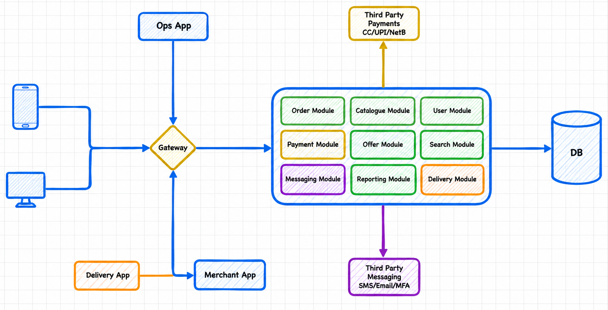
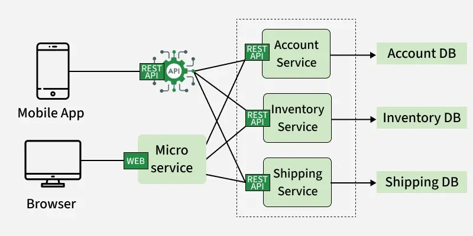
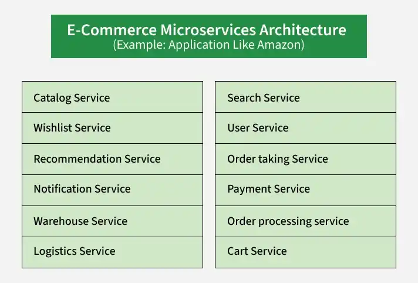
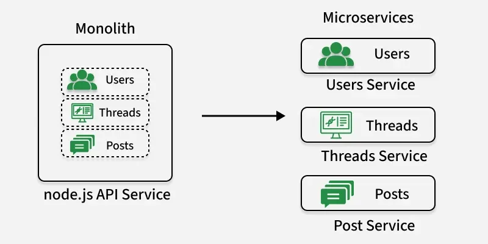

# 1.2.3 Microservices Architecture

> **Phase 1: Introduction to System Design → 1.2 High-Level Design → 1.2.3 System Architecture**
> Source: GeeksforGeeks, *Microservices* (last updated 1 Oct 2026)
> Previous: [1.2.3.1 Monolithic Architecture](1.2.3.1-Monolithic-Architecture.md)

---

## Table of Contents

1. [What are Microservices?](#1-what-are-microservices)
2. [Real-World Applications](#2-real-world-applications)
3. [How Microservices Work](#3-how-microservices-work)
4. [Components and Supporting Patterns](#4-components-and-supporting-patterns)
5. [Communication Between Services](#5-communication-between-services)
6. [Fault Tolerance: Circuit Breaker and Friends](#6-fault-tolerance-circuit-breaker-and-friends)
7. [Worked Example: An Amazon-Style E-Commerce App](#7-worked-example-an-amazon-style-e-commerce-app)
8. [Advantages](#8-advantages)
9. [Challenges](#9-challenges)
10. [Monolith vs Microservices](#10-monolith-vs-microservices)
11. [Migrating from a Monolith: Step by Step](#11-migrating-from-a-monolith-step-by-step)
12. [Quick Revision](#12-quick-revision)
13. [Self-Check Quiz: Interview Q&A](#13-self-check-quiz-interview-qa)

---

## 1. What are Microservices?

A **microservices architecture** splits an application into **small, independent services** that talk to each other **over a network**. Each service does **one business job** (e.g. payments) and can be built and deployed on its own.

- Services are **loosely coupled**: each one can be **developed, deployed and scaled independently**.
- Each service can use a **different language or framework** (e.g. Java for payments, Python for recommendations).
- Each service is usually owned by **one small team**.

> 💡 **Key idea:** A monolith is one big box. Microservices are many small boxes, each with its own job, talking through APIs. You trade **in-process simplicity** for **independence**.

**Example:** an e-commerce platform has separate services for the **product catalog, user authentication, cart, payments and orders**, and they communicate through APIs.



---

## 2. Real-World Applications

Microservices are used where **scale, flexibility and independent teams** matter.

| Who / where | How they use microservices |
|---|---|
| **Amazon** | Moved from a monolith to service-oriented / microservices architecture. Each part of the platform is built, updated and scaled independently. |
| **Uber** | Moved from a largely monolithic system to microservices as it grew, giving teams clear ownership, independent deployments and more autonomy. |
| **Banking & FinTech** | Separate services for accounts, transactions, payments, risk and customer service. Helps with independent scaling and with security, reliability and regulatory needs. |
| **Healthcare** | Separate services for patient records, appointments, billing and reporting, integrated with other healthcare systems. |

---

## 3. How Microservices Work

| Idea | Meaning |
|---|---|
| **One business function per service** | Each service handles one feature, e.g. authentication or product management. |
| **API communication** | Services exchange data through APIs. |
| **Independent operation** | Each service runs on its own and talks to others using **HTTP** or **messaging**. |
| **Request handling** | A user request is routed to the right service(s), which process it and respond. |



---

## 4. Components and Supporting Patterns

| Component | What it does |
|---|---|
| **Microservices** | Small, independent services, each focused on one business capability. |
| **API Gateway** | The **single entry point** for clients. Routes each request to the right service and handles common concerns: authentication, authorization, rate limiting, logging. |
| **Service Registry & Discovery** | Keeps a live list of service instances and their addresses, so services can find each other dynamically (instances come and go as they scale). |
| **Load Balancer** | Spreads traffic across the instances of a service for availability and performance. |
| **Deployment & Infrastructure** | Services can run in containers, VMs or plain servers. **Docker** is common for containers and **Kubernetes** for running and scaling them, but **neither is required**. |
| **Event Bus / Message Broker** | Lets services communicate **asynchronously** through messages, reducing direct dependencies. |
| **Database per Service** | Common pattern: each service **owns its data**, which keeps services loosely coupled and independently scalable. (Not mandatory for every service.) |
| **Caching** | Keeps frequently used data in fast storage to reduce database load and speed up responses. |
| **Fault Tolerance & Resilience** | Keeps the system working, or failing gracefully, using **circuit breakers, retries, timeouts and fallbacks**. |

> 💡 **API Gateway vs Load Balancer:** the gateway decides **which service** a request goes to (and applies auth, rate limits). A load balancer decides **which instance** of that service handles it.

---

## 5. Communication Between Services

Because services live in separate processes, **every interaction is a network call**. There are two styles:

| | Synchronous (request/response) | Asynchronous (messaging/events) |
|---|---|---|
| **How** | Caller sends a request and **waits** for the reply | Caller publishes a message and **moves on** |
| **Typical tech** | **HTTP/REST** (most common), gRPC | Kafka, RabbitMQ, cloud queues |
| **Coupling** | Tighter: the callee must be up right now | Looser: the consumer can process later |
| **Good for** | Reads, queries needing an immediate answer (e.g. "get product price") | Side effects and fan-out (e.g. "order placed" → email, analytics, warehouse) |
| **Risk** | Slow/failed callee slows/fails the caller | Eventual consistency, harder to trace |

> 💡 **HTTP** is the most common protocol between microservices: it's **lightweight, stateless, universal** and works with standard tools (load balancers, gateways, caches). SMTP, FTP and POP3 are for email and file transfer, not service-to-service calls.

---

## 6. Fault Tolerance: Circuit Breaker and Friends

In a distributed system, **some service is always failing somewhere**. Without protection, one slow service can make all its callers pile up waiting, and the failure **cascades** through the system.

| Mechanism | What it does |
|---|---|
| **Timeout** | Don't wait forever. Give up on a call after a set time. |
| **Retry (with backoff)** | Try again a few times for temporary errors, waiting longer each time. |
| **Fallback** | Return something sensible if the call fails (cached data, default value, "try later"). |
| **Circuit breaker** | Stop calling a service that keeps failing, so it isn't flooded and the caller fails fast. |

### Circuit breaker states

Works like an electrical circuit breaker:

```
            failures exceed threshold
   ┌────────┐ ───────────────────────► ┌────────┐
   │ CLOSED │                          │  OPEN  │  calls fail fast immediately
   │(normal)│ ◄───────┐                └───┬────┘  (no request reaches the
   └────────┘         │                    │        failing service)
        ▲     test call succeeds           │ after a cool-down timer
        │             │                    ▼
        │        ┌────┴──────┐
        └────────│ HALF-OPEN │  let a few test calls through
                 └───────────┘  test call fails ──► back to OPEN
```

> 💡 The circuit breaker prevents **repeated requests to a failing service** that would overload it and waste the caller's resources, which gives the failing service time to recover.

---

## 7. Worked Example: An Amazon-Style E-Commerce App

An online store like Amazon runs on many small services, each with one task:



| Service | Responsibility |
|---|---|
| **User** | Accounts and preferences, personalized experience |
| **Search** | Indexes product data so users find products quickly |
| **Catalog** | Product listings and details |
| **Cart** | Add, remove and change items before checkout |
| **Wishlist** | Save items for later |
| **Order Taking** | Accepts orders, checks availability, validates details |
| **Order Processing** | Runs fulfillment with inventory and shipping |
| **Payment** | Secure transactions and payment records |
| **Logistics** | Delivery, shipping costs, tracking |
| **Warehouse** | Inventory levels and restocking |
| **Notification** | Order updates and offers to users |
| **Recommendation** | Suggests products from browsing and purchase history |

**Placing an order:**

```
 User ─► API Gateway ─► Order Taking ──(sync)──► Catalog / Warehouse: "in stock?"
                             │
                             ├──(sync)──► Payment: "charge card"
                             │
                             └── publishes "OrderPlaced" event ─► Message Broker
                                                                   │
                    ┌───────────────────┬──────────────────────────┼─────────────────┐
                    ▼                   ▼                          ▼                 ▼
           Order Processing        Notification              Recommendation     Logistics
           (start fulfillment)     (email/SMS user)          (update history)   (plan delivery)
```

The user only waits for the **synchronous** steps (stock check, payment). Everything else happens **asynchronously**.

---

## 8. Advantages

- **Independent deployment:** release one service without redeploying the whole system.
- **Independent scaling:** scale only the busy service (e.g. Search on sale day).
- **Technology flexibility:** each service picks the best language, framework or database.
- **Fault isolation:** a failing service doesn't have to take down the rest (with proper resilience patterns).
- **Team autonomy:** small teams own services end to end and move faster.
- **Easier to understand per service:** each codebase is small and focused.

> ⚠️ "No need for network communication" is **not** an advantage. Microservices are distributed, so they **always** depend on the network.

---

## 9. Challenges

| Challenge | Why it's hard |
|---|---|
| **Distributed communication** | Network calls add latency, can fail and can time out. |
| **Data consistency** | Each service owns its data, so a business action spanning services can't use one ACID transaction. You need patterns like **sagas** and accept **eventual consistency**. |
| **Operational complexity** | Many services to deploy, monitor, configure and secure. Needs strong DevOps and CI/CD. |
| **Testing & debugging** | Testing interactions between services and tracing a failure across service boundaries is hard. Needs **distributed tracing** (trace IDs) and centralized logs. |
| **Security surface** | Every service endpoint is something to authenticate, authorize and protect. |

---

## 10. Monolith vs Microservices

| Aspect | Monolith | Microservices |
|---|---|---|
| **Deployment** | Whole app at once | Each service independently |
| **Scaling** | Whole app | Per service |
| **Communication** | In-process function calls | Network calls (HTTP, gRPC, messaging) |
| **Data** | Usually one shared DB | Usually a DB per service |
| **Tech stack** | One | Can differ per service |
| **Failure impact** | One bug can crash everything | Can be isolated |
| **Complexity** | Low at first | High (distributed system) |
| **Best for** | Small teams, MVPs | Large teams, complex domains, uneven load |

> See [1.2.3.1 Monolithic Architecture §9](1.2.3.1-Monolithic-Architecture.md#9-monolith-vs-microservices) for the full comparison.

---

## 11. Migrating from a Monolith: Step by Step



| Step | What to do |
|---|---|
| **1. Assess the monolith** | Analyse the app and find components that are good candidates to move out. |
| **2. Define services** | Identify clear **business capabilities** and draw service boundaries around them. |
| **3. Migrate gradually** | Use the **Strangler Fig pattern** to replace parts of the monolith one at a time. |
| **4. Define APIs** | Create clear contracts for how services talk to each other. |
| **5. Set up CI/CD** | Automate testing and deployment for fast, reliable releases of many services. |
| **6. Service discovery** | Let services find each other dynamically. |
| **7. Logging & monitoring** | Track performance, availability and failures across the distributed system. |
| **8. Manage security** | Apply consistent authentication, authorization and other controls across services. |
| **9. Improve iteratively** | Keep refining services based on feedback, requirements and performance. |

> See [1.2.3.1 §10](1.2.3.1-Monolithic-Architecture.md#10-migrating-from-a-monolith-to-microservices) for a Strangler Fig diagram.

---

## 12. Quick Revision

- **Microservices** = an app split into **small, independent, loosely coupled services**, each doing one business job and talking **over the network**.
- Each service can be **developed, deployed and scaled independently** and can use **its own tech stack**.
- **Used by:** Amazon, Uber, banking/FinTech, healthcare.
- **Components:** services · **API Gateway** (single entry, routing, auth) · **service registry/discovery** · **load balancer** · containers/Kubernetes (optional) · **message broker** · **DB per service** · caching · fault tolerance.
- **Communication:** **synchronous** (HTTP/REST most common, gRPC) vs **asynchronous** (messaging/events).
- **Resilience:** timeouts · retries with backoff · fallbacks · **circuit breaker** (closed → open → half-open).
- **Pros:** independent deployment and scaling, tech flexibility, fault isolation, team autonomy.
- **Cons:** network latency/failures, data consistency, operational complexity, hard testing/debugging.
- **Migration (9 steps):** assess → define services → Strangler Fig → APIs → CI/CD → discovery → monitoring → security → iterate.

---

## 13. Self-Check Quiz: Interview Q&A

> ⭐ These 5 questions come from the GeeksforGeeks suggested quiz and are **important for system design interviews**. Try each one before opening the answer.

### Q1. Which protocol is most commonly used for communication between microservices?

- A. SMTP
- B. HTTP
- C. FTP
- D. POP3

<details>
<summary>Answer</summary>

**B. HTTP**

HTTP is widely used in microservices for lightweight, stateless and scalable inter-service communication, usually as REST APIs. *(SMTP and POP3 are email protocols; FTP is for file transfer.)* See [§5 Communication](#5-communication-between-services).
</details>

### Q2. Which of the following is NOT an advantage of microservices?

- A. Independent deployment
- B. Scalability
- C. Technology flexibility
- D. No need for network communication

<details>
<summary>Answer</summary>

**D. No need for network communication**

Microservices are distributed systems, so they **always** need network communication between services. That network dependency is actually one of their main **challenges**. See [§8 Advantages](#8-advantages) and [§9 Challenges](#9-challenges).
</details>

### Q3. Which pattern is often used to route requests between microservices?

- A. Circuit breaker
- B. API Gateway
- C. Singleton
- D. DAO

<details>
<summary>Answer</summary>

**B. API Gateway**

The API Gateway routes client requests to the right microservices and handles cross-cutting concerns like security and logging. *(A circuit breaker handles failures, not routing; Singleton and DAO are code-level design patterns.)* See [§4 Components](#4-components-and-supporting-patterns).
</details>

### Q4. Why is microservices architecture considered more flexible than monolithic architecture?

- A. Because all services must use the same technology stack
- B. Because services are tightly connected inside one system
- C. Because each service can be developed, deployed and scaled independently
- D. Because the entire system must be deployed together

<details>
<summary>Answer</summary>

**C. Because each service can be developed, deployed and scaled independently**

Teams can build, release and scale each service on its own, so the system adapts more easily to change and growth. *(A, B and D describe a monolith.)*
</details>

### Q5. What problem does the Circuit Breaker pattern help prevent in microservices?

- A. Data duplication across services
- B. Repeated requests to a failing service that may overload the system
- C. Slow database queries
- D. Lack of communication between services

<details>
<summary>Answer</summary>

**B. Repeated requests to a failing service that may overload the system**

When calls to a service keep failing, the circuit breaker **"opens"** and stops sending requests to it for a while. Callers fail fast (or use a fallback) instead of waiting and piling up, the failing service gets time to recover, and the failure doesn't **cascade** to other services. After a cool-down it lets a few test calls through (**half-open**) before returning to normal. See [§6 Fault Tolerance](#6-fault-tolerance-circuit-breaker-and-friends).
</details>

### 🧠 Key Takeaways for Interviews

| # | Remember |
|---|---|
| 1 | Microservices = **small, independent services** around **business capabilities**, talking over the network |
| 2 | **API Gateway** = single entry point; **service discovery** = finding instances; **load balancer** = spreading traffic |
| 3 | **Sync** (HTTP/REST, gRPC) for answers now; **async** (message broker) for side effects |
| 4 | **Database per service** keeps services decoupled, but makes consistency harder (sagas, eventual consistency) |
| 5 | Protect against cascading failures with **timeouts, retries, fallbacks, circuit breakers** |
| 6 | The price of independence is **operational complexity**: CI/CD, monitoring, tracing are a must |

### Bonus Questions

> Extra practice on the rest of the topic.

### B1. What is the difference between an API Gateway and a load balancer?

<details>
<summary>Answer</summary>

The **API Gateway** is the client's single entry point: it picks **which service** a request goes to and applies auth, rate limiting and logging. A **load balancer** picks **which instance** of a service handles the request.
</details>

### B2. Why do microservices need service discovery?

<details>
<summary>Answer</summary>

Service instances are started, stopped and moved all the time (scaling, deployments, failures), so their addresses change. A **service registry** keeps a live list of instances so services can find each other dynamically instead of using hard-coded addresses.
</details>

### B3. What are the three states of a circuit breaker?

<details>
<summary>Answer</summary>

**Closed** (normal, requests pass), **Open** (too many failures, requests fail fast), **Half-open** (after a cool-down, a few test requests go through; success → closed, failure → open).
</details>

### B4. When placing an order, which steps should be synchronous and which asynchronous?

<details>
<summary>Answer</summary>

**Synchronous:** things the user must wait for, like the stock check and payment. **Asynchronous:** side effects like sending the confirmation email, updating recommendations, starting fulfillment. Publish an `OrderPlaced` event and let those services react.
</details>

### B5. Why is data consistency harder in microservices than in a monolith?

<details>
<summary>Answer</summary>

Each service owns its own database, so one business action (e.g. order + payment + stock) touches several databases and **can't use one ACID transaction**. You use patterns like **sagas** (a series of local transactions with compensating actions) and accept **eventual consistency**.
</details>

### B6. Is Kubernetes required to build microservices?

<details>
<summary>Answer</summary>

**No.** Docker and Kubernetes are very common for packaging and running microservices, but services can also run on VMs or plain servers.
</details>

### B7. Name four challenges of microservices.

<details>
<summary>Answer</summary>

**Distributed communication** (latency, failures, timeouts), **data consistency**, **operational complexity**, and **testing/debugging** across service boundaries.
</details>

---

### 📚 Further Reading

- GeeksforGeeks: *Microservices*
- Martin Fowler & James Lewis: *Microservices* · Martin Fowler: *CircuitBreaker*
- Chris Richardson: *microservices.io* (patterns: API Gateway, Database per Service, Saga)
- Next: [1.2.3.3 Monolithic vs Microservices Architecture](1.2.3.3-Monolithic-vs-Microservices.md) · then Event-Driven Architecture
