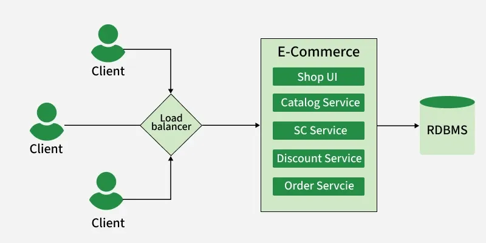
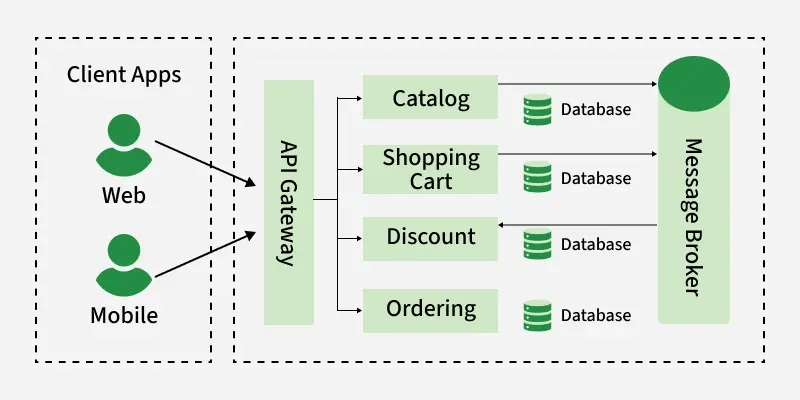
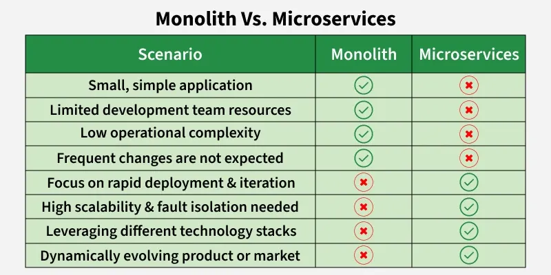

# 1.2.3 Monolithic vs Microservices Architecture

> **Phase 1: Introduction to System Design → 1.2 High-Level Design → 1.2.3 System Architecture**
> Source: GeeksforGeeks, *Monolithic Vs Microservices Architecture* (last updated 25 Jun 2026)
> Previous: [1.2.3.2 Microservices Architecture](1.2.3.2-Microservices.md) · Related: [1.2.3.1 Monolithic Architecture](1.2.3.1-Monolithic-Architecture.md)

---

## Table of Contents

1. [Overview](#1-overview)
2. [Monolithic Architecture in Brief](#2-monolithic-architecture-in-brief)
3. [Microservices Architecture in Brief](#3-microservices-architecture-in-brief)
4. [Side-by-Side Comparison](#4-side-by-side-comparison)
5. [Scaling Compared](#5-scaling-compared)
6. [Deployment Compared](#6-deployment-compared)
7. [When to Choose Which](#7-when-to-choose-which)
8. [The Middle Ground and the Usual Path](#8-the-middle-ground-and-the-usual-path)
9. [Quick Revision](#9-quick-revision)
10. [Self-Check Quiz: Interview Q&A](#10-self-check-quiz-interview-qa)

---

## 1. Overview

**Monolithic** and **microservices** are the two most widely used ways to structure an application.

- **Monolithic:** all functionality lives in **one codebase** and is deployed as **one unit**.
- **Microservices:** the application is split into **many small services**, each developed, deployed and scaled **separately**.

> 💡 **Key idea:** Neither is "better". A monolith optimizes for **simplicity**; microservices optimize for **independence**. The right choice depends on team size, domain complexity and scaling needs.

---

## 2. Monolithic Architecture in Brief

> 📖 **Deep dive:** [1.2.3.1 Monolithic Architecture](1.2.3.1-Monolithic-Architecture.md)

A **traditional** architecture where the UI, business logic and data access layer are built and deployed as **one application**. Simple to build and run for small to medium apps.

- All modules live in **one project**.
- The whole application is deployed as **one package**.
- Development, testing and deployment are all managed from **one place**.
- Modules are **closely connected**, so changes get harder as the app grows.



---

## 3. Microservices Architecture in Brief

> 📖 **Deep dive:** [1.2.3.2 Microservices Architecture](1.2.3.2-Microservices.md)

An application split into **small, independent services**, each focused on one **business capability**, talking through **lightweight APIs or message brokers**.

- Each service handles **one business function**.
- Services run **independently** and communicate via **APIs or message brokers**.
- A service can be **deployed without affecting** the others.
- Each service is **scaled to its own workload**.
- Services can use **different technologies, databases or languages**.



---

## 4. Side-by-Side Comparison

| Aspect | Monolithic | Microservices |
|---|---|---|
| **Codebase** | Single codebase | Distributed services, many codebases |
| **Coupling** | One large app, **tightly coupled** components | Small, **loosely coupled** services |
| **Deployment** | Whole app as **one unit** | Each service **independently** |
| **Horizontal scaling** | Harder: must copy the **whole app** | Easier: scale **only the busy service** |
| **Initial development** | **Simpler** to start | **More complex**: many services, network, infra |
| **Technology stack** | Usually **one** stack | **Best tool per service** |
| **Fault isolation** | One failing part can bring down **everything** | A failing service can be **isolated** (with resilience patterns) |
| **Maintenance** | Easier while small and simple | More effort: many services to run and monitor |
| **Flexibility** | Less: everything changes and ships together | More: develop, deploy, scale each part separately |
| **Communication** | **Fast** in-process function calls | **Slower** network calls (HTTP, gRPC, messaging) |
| **Data** | Usually one shared DB, simple ACID transactions | Often a DB per service; consistency needs sagas / eventual consistency |
| **Debugging** | One process, one log stream | Needs distributed tracing and centralized logs |
| **Team fit** | One small team | Many teams, each owning services |

---

## 5. Scaling Compared

Suppose **Orders** is overloaded on a sale day but Users and Payments are not.

```
MONOLITH: copy the WHOLE app to get more Orders capacity

   LB ─┬─► [ Users | Orders | Payments ]
       ├─► [ Users | Orders | Payments ]     ◄─ Users & Payments copied too
       └─► [ Users | Orders | Payments ]        (wasted CPU / memory)

MICROSERVICES: scale ONLY Orders

   Gateway ─┬─► [ Users ]
            ├─► [ Orders ][ Orders ][ Orders ][ Orders ]   ◄─ just this one
            └─► [ Payments ]
```

> 💡 Both **can** scale horizontally. Microservices make it **easier and cheaper** because only the services under heavy load are scaled.

---

## 6. Deployment Compared

| | Monolithic | Microservices |
|---|---|---|
| **A one-line fix in Payments** | Rebuild, test and redeploy the **entire app** | Redeploy **only the Payments service** |
| **Release frequency** | Fewer, larger releases | Many small, frequent releases per team |
| **Blast radius of a bad release** | The whole application | Usually one service |
| **Pipeline** | One CI/CD pipeline | One pipeline **per service** (more to set up) |

---

## 7. When to Choose Which

### Choose a monolith when...

- You're building an **MVP / startup product** and need to ship fast.
- The **team is small** (one team can understand the whole codebase).
- The domain is **simple or not yet well understood**, so service boundaries would be guesses.
- Load is **modest** or grows **evenly** across features.
- You have **limited DevOps experience or budget** for running many services.
- You need **strong consistency** across features with simple transactions.

**Examples:** an internal admin tool, a small business website, a college project, an early-stage SaaS product.

### Choose microservices when...

- The application is **large and complex**, with clearly separate business domains.
- **Many teams** need to work and release independently.
- Different parts have **very different scaling needs** (e.g. search and checkout spike, profiles don't).
- You need **high availability** and fault isolation.
- Different parts benefit from **different technologies**.
- You have **mature DevOps**: CI/CD, containers, monitoring, tracing.

**Examples:** large e-commerce (Amazon), ride-hailing (Uber), streaming platforms, large banking/FinTech systems.

### Quick decision guide

| Question | Leans monolith | Leans microservices |
|---|---|---|
| How big is the team? | 1 team (≈ < 10 devs) | Several teams |
| How well do we understand the domain? | Still learning | Clear, stable boundaries |
| Do parts scale differently? | No | Yes, a lot |
| Can we run many services in production? | Not yet | Yes (CI/CD, monitoring, on-call) |
| How fast must v1 ship? | Very fast | There's time to invest in platform |



---

## 8. The Middle Ground and the Usual Path

It isn't an all-or-nothing choice.

- **Modular monolith:** one deployable app with **strict module boundaries**. Simple to run, and easy to split later. *(See [1.2.3.1 §5](1.2.3.1-Monolithic-Architecture.md#5-design-principles).)*
- **Gradual extraction:** pull out only the parts that need independent scaling or release, using the **Strangler Fig pattern**. *(See [1.2.3.1 §10](1.2.3.1-Monolithic-Architecture.md#10-migrating-from-a-monolith-to-microservices).)*

```
   Monolith  ──►  Modular monolith  ──►  Monolith + a few services  ──►  Microservices
  (start fast)   (clean boundaries)     (extract hot spots)            (only if needed)
```

> ⚠️ A common mistake is a **"distributed monolith"**: services that are split up but still tightly coupled (shared database, must be deployed together). You get the complexity of microservices **without** the independence.

---

## 9. Quick Revision

- **Monolith** = one codebase, one deployable unit, tightly coupled, fast in-process calls, simple to start.
- **Microservices** = many small loosely coupled services, deployed and scaled independently, talking over the network.
- **Scaling:** monolith copies the **whole app**; microservices scale **only the busy service**.
- **Deployment:** monolith redeploys **everything**; microservices redeploy **one service**.
- **Tech:** monolith = one stack; microservices = best stack per service.
- **Failures:** monolith can fail as a whole; microservices can isolate failures.
- **Cost of microservices:** network latency, data consistency, operational and debugging complexity.
- **Choose monolith** for MVPs, small teams, simple domains. **Choose microservices** for large, complex systems with many teams and uneven load.
- **Middle ground:** modular monolith → extract services gradually (Strangler Fig). Avoid the **distributed monolith**.

---

## 10. Self-Check Quiz: Interview Q&A

> ⭐ These 6 questions come from the GeeksforGeeks suggested quiz and are **important for system design interviews**. Try each one before opening the answer.

### Q1. What best describes a monolithic architecture?

- A. Application built as independent services
- B. Single indivisible application unit
- C. Event-driven architecture
- D. Serverless architecture

<details>
<summary>Answer</summary>

**B. Single indivisible application unit**

In a monolith, all components are tightly coupled and deployed as one unit. *(A describes microservices.)* See [§2](#2-monolithic-architecture-in-brief).
</details>

### Q2. Which architecture supports easier horizontal scalability?

- A. Monolithic
- B. Layered
- C. Microservices
- D. Client-server

<details>
<summary>Answer</summary>

**C. Microservices**

Each service can be scaled independently, so you add instances only where they're needed. See [§5 Scaling Compared](#5-scaling-compared).
</details>

### Q3. Which architecture offers more technology flexibility?

- A. Monolithic
- B. Microservices
- C. Legacy systems
- D. Client-server

<details>
<summary>Answer</summary>

**B. Microservices**

Each microservice can use the technology stack that suits it best (language, framework, database), independently of the others.
</details>

### Q4. What is a key architectural feature of microservices architecture?

- A. All functionalities are combined into one codebase
- B. Application is composed of small independent services representing business capabilities
- C. Services cannot communicate with each other
- D. All services must share the same database

<details>
<summary>Answer</summary>

**B. Application is composed of small independent services representing business capabilities**

Each service focuses on one business function and works independently. *(A describes a monolith; services **do** communicate, via APIs or messaging; and a shared database is discouraged, as each service usually owns its data.)* See [§3](#3-microservices-architecture-in-brief).
</details>

### Q5. How does deployment differ between monolithic and microservices architectures?

- A. Both require deploying the entire application together
- B. Monolithic apps deploy the whole system while microservices allow individual service deployment
- C. Microservices cannot be deployed independently
- D. Monolithic systems deploy each module separately

<details>
<summary>Answer</summary>

**B. Monolithic apps deploy the whole system while microservices allow individual service deployment**

A monolith must be redeployed in full for any change; microservices let you update and deploy one service at a time. See [§6 Deployment Compared](#6-deployment-compared).
</details>

### Q6. Why is horizontal scaling easier in microservices compared to monolithic architecture?

- A. Because microservices eliminate the need for servers
- B. Because all services share the same process
- C. Because microservices run only on one machine
- D. Because only the required services can be scaled independently

<details>
<summary>Answer</summary>

**D. Because only the required services can be scaled independently**

The service under heavy load gets more instances without scaling the rest of the application. *(B and C are false: services run in separate processes, usually on many machines.)* See [§5 Scaling Compared](#5-scaling-compared).
</details>

### 🧠 Key Takeaways for Interviews

| # | Remember |
|---|---|
| 1 | Monolith = **simplicity**; microservices = **independence** |
| 2 | Microservices win on **independent deployment, targeted scaling, tech flexibility, fault isolation** |
| 3 | Monoliths win on **simplicity, speed of in-process calls, easy transactions, low ops cost** |
| 4 | Pick based on **team size, domain clarity, scaling profile, DevOps maturity** |
| 5 | Default for new products: **modular monolith**, then extract services when there's a real need |
| 6 | Avoid the **distributed monolith** |

### Bonus Questions

> Extra practice on the rest of the topic.

### B1. Why is communication between components faster in a monolith?

<details>
<summary>Answer</summary>

Components run in the **same process** and call each other with plain function calls. Microservices go over the **network** (serialization, latency, possible failures), which is slower.
</details>

### B2. A 3-person startup is building its first product. Which architecture would you recommend, and why?

<details>
<summary>Answer</summary>

A **(modular) monolith**. It's faster to build and cheaper to run, the team is small, and the domain isn't settled yet. Services can be extracted later if real scaling or team problems appear.
</details>

### B3. What is a "distributed monolith"?

<details>
<summary>Answer</summary>

A system split into services that are still **tightly coupled**: they share a database or must be deployed together. It has the **complexity** of microservices but **none of the independence**, which is the worst of both worlds.
</details>

### B4. Give two things microservices make harder than a monolith.

<details>
<summary>Answer</summary>

Any two of: **data consistency** across services (no single ACID transaction), **debugging/testing** across service boundaries, **network latency and failures**, **operational overhead** (many deployments, monitoring, security).
</details>

### B5. Can a monolith scale horizontally at all?

<details>
<summary>Answer</summary>

**Yes.** Run several identical copies behind a load balancer (the app must be stateless). It's just **less efficient**, because every copy includes all the parts, even the ones that don't need more capacity.
</details>

---

### 📚 Further Reading

- GeeksforGeeks: *Monolithic Vs Microservices Architecture*
- Martin Fowler: *MonolithFirst* · *Microservice Premium*
- Next: [1.2.3.4 Event-Driven Architecture](1.2.3.4-Event-Driven-Architecture.md) · then Serverless Architecture
