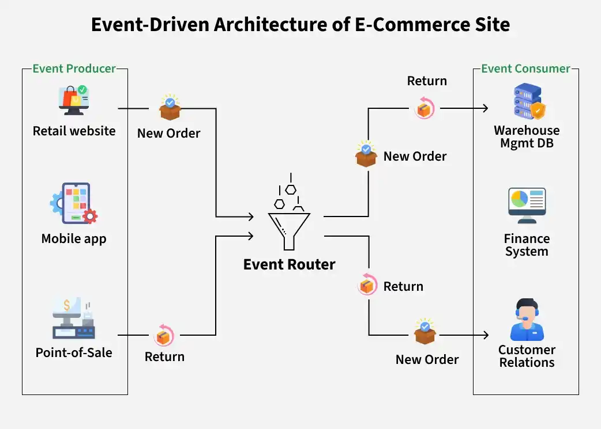

# 1.2.3 Event-Driven Architecture (EDA)

> **Phase 1: Introduction to System Design → 1.2 High-Level Design → 1.2.3 System Architecture**
> Source: GeeksforGeeks, *Event-Driven Architecture (EDA)* (last updated 30 Sep 2026) and *Event-Driven Architecture in an E-commerce System* (last updated 17 Apr 2026)
> Previous: [1.2.3.3 Monolithic vs Microservices Architecture](1.2.3.3-Monolithic-vs-Microservices.md)

---

## Table of Contents

1. [What is Event-Driven Architecture?](#1-what-is-event-driven-architecture)
2. [How It Works: Sources, Broker, Subscribers](#2-how-it-works-sources-broker-subscribers)
3. [Real-World Applications](#3-real-world-applications)
4. [Why EDA Matters](#4-why-eda-matters)
5. [Events in Detail](#5-events-in-detail)
6. [Components](#6-components)
7. [EDA in an E-Commerce System](#7-eda-in-an-e-commerce-system)
8. [Implementation: A Simple Event Bus in Java](#8-implementation-a-simple-event-bus-in-java)
9. [Multiple Subscribers for One Event](#9-multiple-subscribers-for-one-event)
10. [The Event Payload](#10-the-event-payload)
11. [Challenges and How to Handle Them](#11-challenges-and-how-to-handle-them)
12. [Request/Response vs Event-Driven](#12-requestresponse-vs-event-driven)
13. [Quick Revision](#13-quick-revision)
14. [Self-Check Quiz: Interview Q&A](#14-self-check-quiz-interview-qa)

---

## 1. What is Event-Driven Architecture?

**Event-Driven Architecture (EDA)** is a design approach where components communicate by **producing events and reacting to events**. An **event** is something meaningful that happened: a user action ("order placed") or a change of state ("stock is low").

- Components are **loosely coupled**: the one that produces an event doesn't know or care who reacts to it.
- Communication is usually **asynchronous**, which enables **near-real-time** processing, **scalability** and **modularity**.
- When an event happens, every interested component **reacts on its own**.

> 💡 **Key idea:** In request/response, a service says *"Payment service, charge this card."* In EDA, a service announces *"An order was placed"*, and whoever cares (payment, inventory, email) reacts. The announcer doesn't wait and doesn't need to know who's listening.

**Example:** a customer places an order and an **`OrderPlaced`** event is published. The payment, inventory and email services don't keep polling the order system. Each one simply **reacts when the event arrives**.

---

## 2. How It Works: Sources, Broker, Subscribers

```
  ┌────────────────┐                                    ┌──────────────────┐
  │ Event Source 1 │── event A ──┐                ┌────►│ Subscriber 1 (A) │
  └────────────────┘             ▼                │     └──────────────────┘
                          ┌──────────────────┐    │     ┌──────────────────┐
                          │   EVENT BROKER   │────┼────►│ Subscriber 2 (B) │
                          │ receive · filter │    │     └──────────────────┘
                          │     · route      │    │     ┌──────────────────┐
  ┌────────────────┐      └──────────────────┘    └────►│ Subscriber 3     │
  │ Event Source 2 │── event B ──┘    ▲                 │   (A + B)        │
  └────────────────┘                  │                 └──────────────────┘
                     subscriptions: "who wants which event type?"
```

- **Event sources** publish events (here, A and B) to a central **event broker**.
- The **broker** receives the events, **filters** them and **routes** them according to subscriptions.
- Each **subscriber** gets **only the events it subscribed to**: A only, B only, or both.

---

## 3. Real-World Applications

EDA fits wherever **real-time reactions, scale and integration** matter.

| Domain | Events that trigger action |
|---|---|
| **Financial services** | Payments and trades → real-time transaction processing, **fraud detection**, market data updates |
| **E-commerce** | Orders, payments, returns → order processing, inventory updates, external integrations |
| **Telecommunications** | Network signals, calls → network monitoring, call processing, dynamic load handling |
| **Online gaming** | Player moves → game state updates, smooth multiplayer interactions |
| **Real-time apps in general** | Any user action or data change that needs an **instant response** (IoT sensors, live dashboards, notifications) |

---

## 4. Why EDA Matters

| Benefit | Why |
|---|---|
| **Flexibility & responsiveness** | Work starts **when something happens**, so the system adapts to new information right away. |
| **Scalability** | Add or remove consumers **without touching the producer** or the rest of the setup. Each consumer scales on its own. |
| **Real-time processing** | Events are handled **as they happen**, which suits time-sensitive work. |
| **Decentralized communication** | No web of point-to-point connections: everyone talks through events, which improves reliability and simplifies maintenance. |
| **Extensibility** | A new feature (e.g. analytics) just **subscribes** to existing events. No change to existing services. |

---

## 5. Events in Detail

| Aspect | Meaning |
|---|---|
| **Triggering** | Events come from user actions, data changes, sensors, timers, external systems. |
| **Asynchronicity** | Producers don't wait for consumers, so components work **independently and in parallel**. |
| **Messaging patterns** | **Publish-subscribe** or **point-to-point** (see below). |
| **Event types** | Events are named by what happened, in the **past tense**: `UserLoggedIn`, `OrderPlaced`, `PaymentReceived`. |
| **Payload** | Extra data giving context, e.g. `PaymentReceived` carries the amount. *(See [§10](#10-the-event-payload).)* |
| **Event handling** | Each component has **handlers** that define how it responds to each event type. |
| **Immutability** | Once created, an event **isn't changed**. It's a record of a fact that already happened. |

### Publish-subscribe vs point-to-point

```
PUBLISH-SUBSCRIBE (one event → MANY consumers)       POINT-TO-POINT (one message → ONE consumer)

              ┌──► Inventory                                     ┌──► Worker 1
  Producer ─► Topic ─► Email                       Producer ─► Queue ─► Worker 2   (each message goes
              └──► Analytics                                     └──► Worker 3    to only one worker)
```

| | Publish-subscribe | Point-to-point (queue) |
|---|---|---|
| **Who receives a message** | **Every** subscriber | **Exactly one** consumer |
| **Typical use** | Notify many services that something happened | Share out work (e.g. resize images) across workers |
| **Examples** | Kafka topics, SNS, Redis Pub/Sub | RabbitMQ queues, SQS |

> 💡 **Event vs command:** an **event** says something *already happened* (`OrderPlaced`), and anyone may react. A **command** asks for something *to be done* (`ChargeCard`) and is aimed at one specific handler.

---

## 6. Components

### Core components

| # | Component | Role |
|---|---|---|
| 1 | **Event source** | Anything that generates events when a significant action or state change happens: UIs, sensors, databases, external systems. The **starting point** of the flow. |
| 2 | **Event** | The **core unit of communication**: a record of what happened, with relevant data. **Immutable** after creation. |
| 3 | **Event broker / event bus** | The **central hub**: receives events from publishers and **routes** them to the right subscribers. May also filter, guarantee delivery and manage messages. |
| 4 | **Publisher** | **Emits** events to the bus. Converts actions into events, sends them **asynchronously**, and **doesn't know who will consume them**. |
| 5 | **Subscriber** | **Registers interest** in specific event types, **listens** for them, and **reacts** when they arrive. |

> 💡 **Source vs publisher:** the source is *where* the event originates (e.g. the checkout page); the publisher is the code that *sends* it to the bus. Often they're the same component.

### Supporting patterns

Helpful roles that aren't core to EDA:

| Pattern | Role |
|---|---|
| **Event handler** | Processes a received event and runs the business logic or workflow for it. |
| **Dispatcher** | Delivers each event to the right handler inside a component. |
| **Listener** | Watches an event source or bus for specific events and triggers processing when one matches. |

---

## 7. EDA in an E-Commerce System

During peak demand (a big sale), an event-driven design lets the site handle changes from many sources **without crashing**, because producers just drop events on the bus and consumers process them at their own pace.



| Role | Who | What they do |
|---|---|---|
| **Producers** | Retail website, mobile app, POS system | **Generate** events: new orders, stock queries, returns |
| **Router / bus** | Kafka, RabbitMQ, etc. | **Ingests, filters and routes** events; producers and consumers never call each other directly |
| **Consumers** | Warehouse, finance, customer relations | Receive **only the events relevant** to their job |

---

## 8. Implementation: A Simple Event Bus in Java

A minimal **in-memory** version showing the three roles: **event bus**, **publisher**, **subscriber**.

```java
import java.util.*;

// ── Event Bus: keeps subscriptions and delivers events ──────────────
class EventBus {
    private static final Map<String, List<Subscriber>> subscribers = new HashMap<>();

    public static void subscribe(String eventType, Subscriber subscriber) {
        subscribers.computeIfAbsent(eventType, k -> new ArrayList<>()).add(subscriber);
    }

    public static void publish(String eventType, Map<String, Object> payload) {
        for (Subscriber s : subscribers.getOrDefault(eventType, List.of())) {
            s.handleEvent(eventType, payload);
        }
    }
}

// ── Subscriber contract ─────────────────────────────────────────────
interface Subscriber {
    void handleEvent(String eventType, Map<String, Object> payload);
}

// ── Subscribers: each reacts in its own way ─────────────────────────
class OrderNotificationSubscriber implements Subscriber {
    public void handleEvent(String type, Map<String, Object> p) {
        System.out.println("Email: your order " + p.get("order_id") + " has been placed!");
    }
}

class InventorySubscriber implements Subscriber {
    public void handleEvent(String type, Map<String, Object> p) {
        System.out.println("Inventory: reserving stock for order " + p.get("order_id"));
    }
}

// ── Publisher: does its work, then announces what happened ──────────
class OrderService {
    public void placeOrder(int orderId, int userId, double total) {
        // ... save the order ...
        EventBus.publish("OrderPlaced", Map.of(
            "order_id", orderId, "user_id", userId, "total", total));
        // OrderService doesn't know (or care) who is listening
    }
}

public class Main {
    public static void main(String[] args) {
        EventBus.subscribe("OrderPlaced", new OrderNotificationSubscriber());
        EventBus.subscribe("OrderPlaced", new InventorySubscriber());

        new OrderService().placeOrder(123, 42, 59.99);
    }
}
```

**Output:**

```
Email: your order 123 has been placed!
Inventory: reserving stock for order 123
```

| Part | Role |
|---|---|
| **`EventBus`** | Central hub: stores who subscribed to which event type and notifies them all when that event is published. |
| **`OrderService`** (publisher) | Does its work, then **publishes** `OrderPlaced`. It has **no reference** to any subscriber. |
| **Subscribers** | **Listen** for `OrderPlaced` and **react** (send email, reserve stock). |
| **Flow** | Subscribers register first → publisher emits event → bus notifies every matching subscriber. |

> ⚠️ This toy bus is **in-process and synchronous**: `publish()` calls each subscriber one after another and waits. A real broker (Kafka, RabbitMQ) is a **separate system** that stores events and delivers them **asynchronously** across the network, with retries and durability.

---

## 9. Multiple Subscribers for One Event

One event can have **many subscribers**, each doing something different:

```
                         ┌──► Inventory Service  → reserve stock
   OrderPlaced  ──► Bus ─┼──► Email Service      → send confirmation
                         └──► Analytics Service  → update sales dashboard
```

- Each subscriber processes the event **independently**, so a failure in one (e.g. email is down) **doesn't affect the others**.
- Adding a new reaction (e.g. a loyalty-points service) means **adding a subscriber**, with no change to the order service.
- Under heavy load, systems use **backpressure**: consumers signal or control how fast they take events (e.g. pull at their own pace, buffer in the broker), so they aren't overwhelmed.

---

## 10. The Event Payload

The **payload** is the data inside an event. It gives consumers the **context they need to act on their own**, without calling back to the producer.

**Common fields in an e-commerce event:**

| Field | Why it's there |
|---|---|
| **Order ID** | Uniquely identifies the order |
| **User ID** | Identifies the customer |
| **Total amount** | Needed by payment and analytics |
| **Timestamp** | When the event happened |

```json
{
  "event_type": "OrderPlaced",
  "event_id": "e7c1-4a9f-...",
  "version": 2,
  "timestamp": "2026-10-13T10:15:30Z",
  "data": {
    "order_id": 123,
    "user_id": 42,
    "total_amount": 59.99,
    "currency": "USD"
  }
}
```

**Things to get right:**

| Concern | Why it matters |
|---|---|
| **Schema versioning** | Event formats change over time. A `version` field (or a schema registry) lets you evolve them without breaking consumers. |
| **Backward compatibility** | Older consumers must still handle newer events, e.g. by only **adding** optional fields, never renaming or removing them. |
| **Serialization format** | **JSON** (readable), **Avro** or **Protobuf** (compact, schema-based, faster). |
| **Event ID** | A unique ID lets consumers detect and ignore **duplicates**. |

---

## 11. Challenges and How to Handle Them

| Challenge | Why it's hard | Common mitigation |
|---|---|---|
| **Increased complexity** | Many events and components; the overall flow isn't visible in any one place | Document event catalogs; keep event names and schemas consistent |
| **Event order & consistency** | Events can arrive **out of order**; multi-step actions can't use one transaction | Partition by key (e.g. all events for one order go to the same partition); **sagas**; accept eventual consistency |
| **Debugging & tracing** | A problem may span many async hops across services | **Correlation/trace IDs** in every event; centralized logging; distributed tracing |
| **Event latency** | Queues, network delays, consumer load and retries add delay between publish and process | Monitor consumer lag; scale consumers; keep payloads small |
| **Duplicates & failures** | Brokers often deliver **at least once**, so the same event may arrive twice; some events fail repeatedly | Make handlers **idempotent**; retry with backoff; send poison messages to a **dead-letter queue (DLQ)** |

> 💡 **Idempotent handler:** processing the same event twice has the same result as processing it once, e.g. "set order 123 to PAID" rather than "add $59.99 to balance".

---

## 12. Request/Response vs Event-Driven

| Aspect | Request/Response (sync) | Event-Driven (async) |
|---|---|---|
| **Communication** | Caller calls a specific service and **waits** | Producer publishes an event and **moves on** |
| **Coupling** | Caller knows the callee | Producer doesn't know consumers |
| **Adding a new reaction** | Change the caller's code | Just add a subscriber |
| **Failure of the other side** | Caller fails or waits | Event waits in the broker until the consumer recovers |
| **Consistency** | Immediate | **Eventual** |
| **Debugging** | Easier: one call chain | Harder: async, many hops |
| **Best for** | Queries needing an answer now ("what's the price?") | Notifying many parties that something happened |

> 💡 Real systems usually **mix both**: synchronous calls for what the user must wait for (stock check, payment), events for everything else. See [1.2.3.2 Microservices §5 and §7](1.2.3.2-Microservices.md#5-communication-between-services).

---

## 13. Quick Revision

- **EDA** = components communicate by **producing and reacting to events**; loosely coupled, usually **asynchronous**.
- **Flow:** event source → **publisher** → **event broker/bus** (receive, filter, route) → **subscribers** (only the events they subscribed to).
- **Core components:** event source · event (immutable) · broker/bus · publisher · subscriber. **Supporting:** handler · dispatcher · listener.
- **Messaging patterns:** **pub-sub** (one event → many consumers) vs **point-to-point** (one message → one consumer).
- **Why:** flexibility, scalability, real-time processing, decentralized communication, easy extension.
- **E-commerce:** producers (website, app, POS) → router (Kafka/RabbitMQ) → consumers (warehouse, finance, customer relations).
- **One event, many subscribers:** each reacts independently; one failing doesn't stop the others; use backpressure under load.
- **Payload:** order ID, user ID, amount, timestamp; manage **schema versioning**, **backward compatibility**, **serialization** (JSON/Avro/Protobuf).
- **Challenges:** complexity · event order & consistency · debugging/tracing · latency · duplicates → idempotency, partition keys, trace IDs, DLQs.

---

## 14. Self-Check Quiz: Interview Q&A

> ⭐ These 11 questions come from the GeeksforGeeks suggested quizzes (both articles) and are **important for system design interviews**. Try each one before opening the answer.

### Q1. What is the primary concept behind Event-Driven Architecture (EDA)?

- A. Components communicate by directly calling each other's APIs
- B. Services must run in a single process
- C. All components share the same database for communication
- D. Components communicate by producing and reacting to events

<details>
<summary>Answer</summary>

**D. Components communicate by producing and reacting to events**

Components publish events and other components respond to them, without being directly coupled. *(A is request/response; B describes a monolith.)* See [§1](#1-what-is-event-driven-architecture).
</details>

### Q2. What is the role of an Event Broker in an Event-Driven Architecture?

- A. Acts as a central hub that receives and routes events to subscribers
- B. Stores all application data permanently
- C. Executes business logic for all services
- D. Replaces the event source in the system

<details>
<summary>Answer</summary>

**A. Acts as a central hub that receives and routes events to subscribers**

The broker manages the flow of events: it receives them from publishers and delivers them to the right subscribers. It isn't the main database and doesn't run the business logic. See [§2](#2-how-it-works-sources-broker-subscribers).
</details>

### Q3. Why is asynchronous communication commonly used in Event-Driven Architecture?

- A. To allow components to operate independently without waiting for responses
- B. To ensure all components run in the same process
- C. To eliminate the need for event brokers
- D. To guarantee that events are processed in a fixed order

<details>
<summary>Answer</summary>

**A. To allow components to operate independently without waiting for responses**

Producers keep working without waiting for consumers, which improves scalability and performance. *(D is wrong: async processing makes ordering **harder**, not guaranteed.)*
</details>

### Q4. What is the main responsibility of a subscriber in Event-Driven Architecture?

- A. Generating new events in the system
- B. Listening for specific events and responding when they occur
- C. Storing events permanently in the database
- D. Routing events to multiple services

<details>
<summary>Answer</summary>

**B. Listening for specific events and responding when they occur**

Subscribers register interest in certain event types and act when those events arrive. *(A is the publisher's job; D is the broker's.)* See [§6](#6-components).
</details>

### Q5. Why is Event-Driven Architecture suitable for real-time applications?

- A. Because events are processed only after manual approval
- B. Because events are processed only once per day
- C. Because it requires fewer system components
- D. Because systems respond immediately when events occur

<details>
<summary>Answer</summary>

**D. Because systems respond immediately when events occur**

Events are processed as they happen, so the system reacts quickly to user actions or changes. *(C is false: EDA usually adds components, such as the broker.)*
</details>

### Q6. What is one major challenge of Event-Driven Architecture systems?

- A. They cannot support real-time processing
- B. Events cannot contain additional data
- C. Managing event order and debugging distributed asynchronous systems can be difficult
- D. Components cannot scale independently

<details>
<summary>Answer</summary>

**C. Managing event order and debugging distributed asynchronous systems can be difficult**

EDA systems are distributed and asynchronous, so keeping events in order and tracing problems across services is complex. *(A, B and D are actually things EDA does well.)* See [§11](#11-challenges-and-how-to-handle-them).
</details>

### Q7. What is the primary role of the Event Router (or Event Bus) in an event-driven e-commerce architecture?

- A. Stores all order data permanently
- B. Filters and routes events from producers to relevant consumers
- C. Executes all business logic for the system
- D. Replaces publishers and subscribers

<details>
<summary>Answer</summary>

**B. Filters and routes events from producers to relevant consumers**

The router is the central hub between producers and consumers, so they never have to be tightly coupled to each other. See [§7](#7-eda-in-an-e-commerce-system).
</details>

### Q8. In an event-driven e-commerce system, which components are responsible for generating events such as new orders or stock queries?

- A. Event consumers like warehouse or finance systems
- B. Event producers such as retail websites, mobile apps, or POS systems
- C. Event routers that process messages
- D. Event subscribers that listen to events

<details>
<summary>Answer</summary>

**B. Event producers such as retail websites, mobile apps, or POS systems**

Producers create events whenever something significant happens, such as an order being placed or stock being queried. *(A and D receive events; C routes them.)*
</details>

### Q9. What is the main responsibility of an Event Subscriber in the provided EDA implementation example?

- A. Publishing events to the event bus
- B. Listening for specific events and executing related actions
- C. Storing all event data in the database
- D. Filtering events before they reach consumers

<details>
<summary>Answer</summary>

**B. Listening for specific events and executing related actions**

In the Java example, `OrderNotificationSubscriber` registers for `OrderPlaced` and sends a notification when it arrives. *(A is `OrderService`, the publisher.)* See [§8](#8-implementation-a-simple-event-bus-in-java).
</details>

### Q10. Why can multiple services subscribe to the same event in an event-driven system?

- A. Because events must be processed by only one component
- B. Because one event can trigger different independent actions in different services
- C. Because all services share the same database
- D. Because event routers allow only a single subscriber

<details>
<summary>Answer</summary>

**B. Because one event can trigger different independent actions in different services**

For example, `OrderPlaced` lets inventory, email and analytics all react at the same time, independently of each other. See [§9](#9-multiple-subscribers-for-one-event).
</details>

### Q11. What is the purpose of an event payload in an e-commerce event system?

- A. To replace the event router
- B. To provide additional context or data about the event
- C. To limit the number of subscribers
- D. To store events permanently in memory

<details>
<summary>Answer</summary>

**B. To provide additional context or data about the event**

The payload carries details such as the order ID, user ID, amount and timestamp, so each service can understand and process the event on its own. See [§10](#10-the-event-payload).
</details>

### 🧠 Key Takeaways for Interviews

| # | Remember |
|---|---|
| 1 | EDA = **publish what happened, let interested parties react**; producers don't know consumers |
| 2 | **Broker/bus** in the middle: receives, filters, routes (Kafka, RabbitMQ) |
| 3 | **Pub-sub** = fan-out to many; **queue** = one consumer per message |
| 4 | Events are **immutable, past-tense facts** with a **payload** for context |
| 5 | Wins: **loose coupling, scalability, real-time, easy to extend** |
| 6 | Costs: **ordering, eventual consistency, debugging, latency, duplicates** → idempotency, trace IDs, DLQs |

### Bonus Questions

> Extra practice on the rest of the topic.

### B1. What is the difference between publish-subscribe and point-to-point messaging?

<details>
<summary>Answer</summary>

In **pub-sub**, every subscriber gets a copy of each event (fan-out). In **point-to-point**, each message on the queue is handled by **exactly one** consumer (work sharing).
</details>

### B2. What is the difference between an event and a command?

<details>
<summary>Answer</summary>

An **event** states a fact that already happened (`OrderPlaced`), and any number of services may react. A **command** asks one specific handler to do something (`ChargeCard`).
</details>

### B3. Why should events be immutable?

<details>
<summary>Answer</summary>

An event is a **record of something that already happened**. If it could change, different consumers might see different versions, and you couldn't reliably replay or audit the history.
</details>

### B4. Your email service receives the same `OrderPlaced` event twice and sends two emails. How do you fix it?

<details>
<summary>Answer</summary>

Make the handler **idempotent**: store the processed `event_id` (or order ID) and **skip events already handled**. Brokers often guarantee **at-least-once** delivery, so duplicates must be expected.
</details>

### B5. How can you keep all events for the same order in the correct order?

<details>
<summary>Answer</summary>

Use the **order ID as the partition key** (e.g. in Kafka), so all events for that order go to the same partition and are consumed in sequence.
</details>

### B6. What is a dead-letter queue (DLQ)?

<details>
<summary>Answer</summary>

A separate queue where events that **keep failing** after several retries are moved, so they don't block other events. Engineers inspect and replay them later.
</details>

### B7. In the Java example, is the `EventBus` truly asynchronous?

<details>
<summary>Answer</summary>

**No.** `publish()` calls each subscriber directly, one after another, and waits for them to finish. It shows the **decoupling** idea, but a real broker stores events and delivers them asynchronously over the network.
</details>

### B8. How do you change an event's format without breaking older consumers?

<details>
<summary>Answer</summary>

Add a **schema version**, only make **backward-compatible** changes (add optional fields; don't rename or remove fields), and use a schema-aware format like **Avro or Protobuf** with a schema registry.
</details>

---

### 📚 Further Reading

- GeeksforGeeks: *Event-Driven Architecture (EDA)* · *Event-Driven Architecture in an E-commerce System*
- Martin Fowler: *What do you mean by "Event-Driven"?*
- Apache Kafka docs · RabbitMQ tutorials
- Next: [1.2.3.5 Event-Driven Architecture Full Course (deep dive)](1.2.3.5-Event-Driven-Architecture-Full-Course.md)
