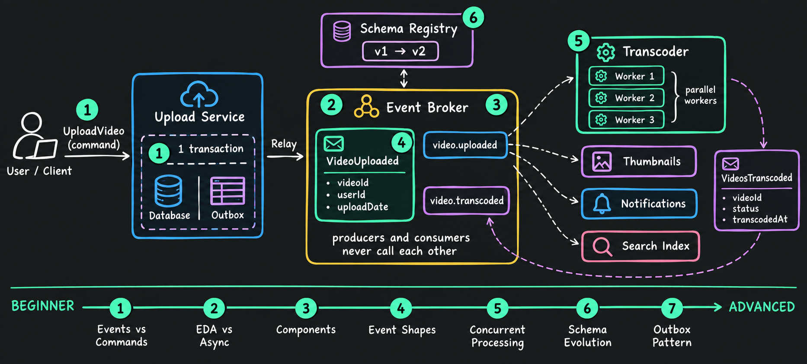
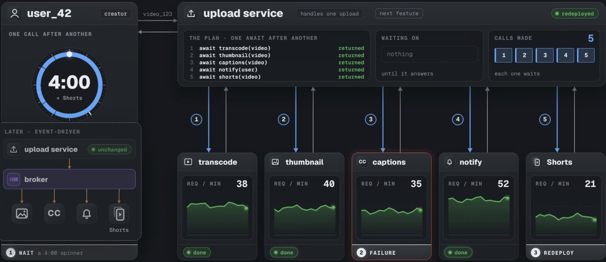

# 1.2.3 Event-Driven Architecture Full Course: Beginner to Advanced

> **Phase 1: Introduction to System Design → 1.2 High-Level Design → 1.2.3 System Architecture**
> Source: YouTube, [*Event-Driven Architecture Full Course: Beginner to Advanced*](https://www.youtube.com/watch?v=W25_BbZCZD0) (1:52:57)
> Previous: [1.2.3.4 Event-Driven Architecture (EDA)](1.2.3.4-Event-Driven-Architecture.md). This note goes much deeper, following the video chapter by chapter.



---

## The Running Example

The whole course follows **one upload** through a video platform:

| Thing | Value |
|---|---|
| Creator | `user_42` |
| Video | `video_123`, titled *"My first vlog"* |
| Work after upload | **transcode** (1080p / 720p / 480p) · **thumbnail** · **captions** · **notify** subscribers · later, **Shorts** clips and **search** |
| Event | `VideoUploaded` (id `evt_8f2a`, correlationId `req_77c`) |

---

## Table of Contents

**Part 1 · The Problem**
1. [Intro: producers, brokers & consumers](#1-intro-producers-brokers--consumers) `0:00`
2. [The problem with calling services in order](#2-the-problem-with-calling-services-in-order) `3:07`

**Part 2 · Messages**

3. [What is an event? Events vs commands](#3-what-is-an-event-events-vs-commands) `9:49`
4. [Queries and command-query separation](#4-queries-and-command-query-separation) `16:20`
5. [Async vs event-driven: the 2×2 grid](#5-async-vs-event-driven-the-22-grid) `17:17`
6. [Anatomy of an event: envelope & payload](#6-anatomy-of-an-event-envelope--payload) `23:09`
7. [Thin vs fat events](#7-thin-vs-fat-events) `30:58`
8. [The CloudEvents standard](#8-the-cloudevents-standard) `33:49`

**Part 3 · Brokers: Where Events Wait**

9. [Where events wait: queues, logs & routers](#9-where-events-wait-queues-logs--routers) `35:43`
10. [Logs: retained history for independent readers](#10-logs-retained-history-for-independent-readers) `39:41`
11. [Routers, fan-out & archives](#11-routers-fan-out--archives) `42:14`
12. [Choosing a broker (Kafka, RabbitMQ, SQS, EventBridge)](#12-choosing-a-broker-kafka-rabbitmq-sqs-eventbridge) `45:55`
13. [Topics, partitions, consumer groups & offsets](#13-topics-partitions-consumer-groups--offsets) `48:36`
14. [Dead letter queues](#14-dead-letter-queues) `53:48`

**Part 4 · What Improves**

15. [Faster responses & fan-out](#15-what-improves-faster-responses--fan-out) `55:57`
16. [Scaling consumers independently](#16-scaling-consumers-independently) `58:44`
17. [Handling bursts and backlog](#17-handling-bursts-and-backlog) `59:55`
18. [Event latency in practice](#18-event-latency-in-practice) `1:02:22`
19. [Surviving outages & replaying history](#19-surviving-outages--replaying-history) `1:03:32`

**Part 5 · What Gets Harder (and the Fixes)**

20. [Eventual consistency](#20-eventual-consistency) `1:06:35`
21. [Tracing an upload across services](#21-tracing-an-upload-across-services) `1:07:28`
22. [Duplicates & idempotent consumers](#22-duplicates--idempotent-consumers) `1:09:12`
23. [Event ordering & partition keys](#23-event-ordering--partition-keys) `1:14:55`
24. [Poison messages & retry limits](#24-poison-messages--retry-limits) `1:19:32`
25. [Debugging missing results with correlation IDs](#25-debugging-missing-results-with-correlation-ids) `1:21:52`

**Part 6 · Reliable Publishing & Changing Events**

26. [The dual-write problem](#26-the-dual-write-problem) `1:25:14`
27. [Transactional outbox & message relay](#27-transactional-outbox--message-relay) `1:27:49`
28. [Schema evolution & compatibility](#28-schema-evolution--compatibility) `1:31:36`
29. [Schema registry](#29-schema-registry) `1:39:32`

**Part 7 · Putting It Together**

30. [End-to-end walkthrough of one upload](#30-end-to-end-walkthrough-of-one-upload) `1:42:58`
31. [Direct calls vs events compared](#31-direct-calls-vs-events-compared) `1:46:47`
32. [When a direct call is enough](#32-when-a-direct-call-is-enough) `1:47:57`
33. [Event sourcing, CQRS & sagas](#33-event-sourcing-cqrs--sagas) `1:49:17`
34. [Recap & key takeaways](#34-recap--key-takeaways) `1:50:47`

35. [Self-Check Quiz: Interview Q&A](#35-self-check-quiz-interview-qa)

---

# Part 1 · The Problem

## 1. Intro: producers, brokers & consumers

> ▶️ [0:00](https://www.youtube.com/watch?v=W25_BbZCZD0)

In event-driven architecture, a service **sends a message when something happens**, and other services **receive it and decide what to do next**. Every event-driven system has three parts:

```
  PRODUCER ──── message ────►  BROKER  ──── delivers ────►  CONSUMERS
  "what happened"              "how it travels,              "do the work"
  (decides name + details)      how long it stays"           (must also handle failures)
```

| Part | Responsibility |
|---|---|
| **Producer** | Decides **what the message says**: its name and the details others need. |
| **Broker** | Decides **how messages reach consumers** and **how long they stay available**. Some wait in **queues**; others stay in a **log** that can be read again later. |
| **Consumers** | Do the work, and must cope with failures: a message may arrive **twice**, **out of order**, or the consumer may **crash** halfway. |

**Goal of the course:** be able to sketch this design, choose between a **queue, a log and a router**, and know where it can fail and which fixes it needs.

---

## 2. The problem with calling services in order

> ▶️ [3:07](https://www.youtube.com/watch?v=W25_BbZCZD0&t=187s)

The simple design: the **upload service calls each step in order** and waits for each to finish.



```
upload service:
  await transcode(video)    2m 30s
  await thumbnail(video)       20s
  await captions(video)        50s
  await notify(user)           20s
  ─────────────────────────────────
  creator waits                4m 00s   ← the times ADD UP
```

It's easy to follow (everything is in one function), and for a small system it's a reasonable start. But it has **three problems**:

| # | Problem | What happens |
|---|---|---|
| 1 | **Long waits** | The creator waits for **every** step: 4 minutes. Running the calls in parallel only cuts it to the slowest step (~2.5 min), and the upload service still has to call everything and handle each failure. |
| 2 | **One failure stops everything** | If **captions is down**, transcode and thumbnail finish, but captions never answers, notify is never called, and the creator sees **"upload failed"**, even though the video was stored fine. Retries and timeouts help with brief outages but **don't remove the dependency**. |
| 3 | **Every feature = change the upload service** | To add **Shorts**, someone must add a 5th call to the upload service and redeploy it. Every future feature touches the code that accepts uploads. |

**Root cause:** the upload service **controls every step**. It chooses which services run, calls each one, and waits. The other services only hear about an upload when it calls them.

**The fix:** the upload service **publishes a message saying "a video was uploaded"**, and each interested service starts its own work. It no longer decides whether that means captions, a thumbnail or a Shorts clip.

> ⚠️ **The trade-off:** the steps are now spread across services, so **no single function shows the whole process** anymore. That makes it harder to follow (see [§21](#21-tracing-an-upload-across-services)).

---

# Part 2 · Messages

## 3. What is an event? Events vs commands

> ▶️ [9:49](https://www.youtube.com/watch?v=W25_BbZCZD0&t=589s)

An **event records something that has already happened.** Once `video_123` is stored, the upload service creates `VideoUploaded` with the video, the creator and the sending service. Other services use it to decide what work *they* need to do.

A **command asks for a specific action.** `TranscodeVideo { videoId: video_123, resolution: 1080p }` asks the transcoder to do one job. The **sender chose both the work and who does it**.

| | **Event** | **Command** |
|---|---|---|
| **Meaning** | "This happened" | "Please do this" |
| **Naming** | Past tense: `VideoUploaded`, `video.deleted` | Imperative: `TranscodeVideo`, `SendNotification` |
| **Audience** | **Any number** of listeners (thumbnail, captions, notify, search…), or none | Normally **one intended handler** |
| **Producer knows listeners?** | No: it has no list of who reacts | Yes: it chose the handler |
| **Can it be rejected?** | No: it already happened. A consumer failing to process it doesn't undo the upload (the failure still needs handling in that consumer) | Yes: the transcoder can **reject** a corrupt `video_999` (**NACK**), so the sender can ask the creator for another file |
| **Response** | Producer doesn't wait for listeners | May return a result or ACK/NACK, or be fire-and-forget |

**Three ways to tell them apart:** **purpose**, **audience**, **expected response**. The name alone isn't enough.

> ⚠️ **Delivery still matters (Gregor Hohpe):** a command sent through a **publish-subscribe** channel can reach several services, and if they all act on it, you get work the sender never intended. Route commands so **one handler** gets them.

### The "passive-aggressive command"

`SendNotificationEvent` *sounds* like an event, but it asks **one service** (notify) for **one action**, so it's really a **command**. Martin Fowler calls this a **passive-aggressive command**: an instruction disguised as an event. Name it honestly: `SendNotification`.

Both designs are valid **when chosen deliberately**:

- send the **command** `SendNotification` (the upload service decides a notification should go out), or
- publish the **event** `VideoUploaded` and let **notify decide** whether to send one.

---

## 4. Queries and command-query separation

> ▶️ [16:20](https://www.youtube.com/watch?v=W25_BbZCZD0&t=980s)

The third kind of message: a **query asks for information**. The creator's page asks *"what's the status of video_123?"* and gets `uploaded`. Reading the status **doesn't change** the video.

| Message | Purpose | Example |
|---|---|---|
| **Event** | Reports what happened | `VideoUploaded` |
| **Command** | Requests an action | `TranscodeVideo` |
| **Query** | Asks for information | `GetVideoStatus(video_123)` |

**Command-Query Separation (CQS):** answering a query must **leave the business state unchanged**. A `getStatus` call that also marks the video as "seen" both reads **and** changes state, mixing two responsibilities.

---

## 5. Async vs event-driven: the 2×2 grid

> ▶️ [17:17](https://www.youtube.com/watch?v=W25_BbZCZD0&t=1037s)

Two **separate** questions people often mix up:

- **Async?** Does the **sender wait** for the work to finish?
- **Event-driven?** Do services **react to events** (rather than being told what to do)?

```
                         SYNCHRONOUS (sender waits)        ASYNCHRONOUS (sender doesn't wait)
                     ┌──────────────────────────────────┬──────────────────────────────────────┐
   COMMAND           │ Direct call:                     │ Queued command / job queue:          │
   (sender picks     │ upload → transcoder              │ TranscodeVideo put on a queue;       │
    the action)      │ TranscodeVideo, waits for reply  │ upload service returns at once.      │
                     │                                  │ Still NOT event-driven.              │
                     ├──────────────────────────────────┼──────────────────────────────────────┤
   EVENT             │ In-process events:               │ Broker pub-sub:                      │
   (consumers decide │ Node EventEmitter: listeners run │ VideoUploaded published to a broker; │
    how to react)    │ in order; handler waits for them │ thumbnail, captions, notify, search  │
                     │                                  │ react on their own time              │
                     └──────────────────────────────────┴──────────────────────────────────────┘
```

| Cell | Notes |
|---|---|
| **Sync command** | Right when the caller **needs the answer now**. |
| **Async command** | The work runs later, but the sender **still chose it**. Adding Shorts would still mean changing the upload service. A **job queue changes *when* work runs, not *who* requested it.** |
| **Sync event** | Listeners register their own reactions, but a slow listener **slows the upload handler**, and an unhandled error can **fail the upload**. |
| **Async event** | Producer publishes and returns. Separates services the most. |

> 💡 **Practical check: "who chose the next action?"** With `TranscodeVideo`, the upload service chose it. With `VideoUploaded`, each consumer decides, and new consumers can **subscribe without changing the producer**.
>
> Both the **message type** and the **delivery setup** decide how independent services really are: sending an event directly to one known service still creates a dependency, while a command queue removes the need for both sides to be up at the same time.

---

## 6. Anatomy of an event: envelope & payload

> ▶️ [23:09](https://www.youtube.com/watch?v=W25_BbZCZD0&t=1389s)

```json
{
  "id":            "evt_8f2a",
  "type":          "video.uploaded",
  "source":        "upload-service",
  "time":          "2026-09-30T14:02:11Z",
  "version":       1,
  "key":           "video_123",
  "correlationId": "req_77c",

  "data": {
    "videoId":    "video_123",
    "creatorId":  "user_42",
    "title":      "My first vlog",
    "duration":   272,
    "storageUrl": "s3://videos/raw/video_123.mp4"
  }
}
```

- **Envelope** (top fields, shared by all the platform's events): helps services **identify, route and trace** the message.
- **Payload** (`data`): the business details each consumer needs. The title goes here because it **describes the video**; it isn't needed to identify or trace the event.

Keeping them separate lets every event type be handled consistently.

### Envelope fields

| Field | Purpose | Watch out for |
|---|---|---|
| **`id`** | Identifies **this event**. A **retry keeps the same id**, so consumers can spot copies. | Generating a **new id on every retry** breaks duplicate detection. |
| **`type`** | **What happened** (`video.uploaded`), so services can select the events they need. | Renaming it breaks consumers and routing rules that match the old name. |
| **`source`** | **Which producer** sent it. `source` + `id` together identify a distinct event (CloudEvents requires the pair to be unique). | |
| **`time`** | When the **producer** recorded it (producer's clock). | Clocks disagree between machines, so **timestamps can't reliably order** events from different producers. |
| **`version`** | The **format of the data** (v1 = original five fields). New events can be v2; stored v1 events stay v1. | A version number doesn't upgrade old data. Consumers still need code for each version. |
| **`key`** | **Which entity** the event is about (`video_123`). `VideoUploaded`, `VideoPublished`, `VideoDeleted` all carry it. Used for partitioning ([§13](#13-topics-partitions-consumer-groups--offsets), [§23](#23-event-ordering--partition-keys)). | |
| **`correlationId`** | **Which request started the work** (`req_77c`). Copied into related events and logs to follow one request across services ([§25](#25-debugging-missing-results-with-correlation-ids)). | **Never use it for duplicate detection**: many different events share it. |

> 💡 **Who identifies what:** `source + id` → one **event** · `key` → the **video** · `correlationId` → the **request** and all the work it caused.

### Naming and immutability

- **Events:** past tense (`video.uploaded`, `video.deleted`). **Commands:** instructions (`TranscodeVideo`). A name like `processVideo` is a command in disguise.
- The **behaviour must match the name**: `SendNotificationEvent` was still a command.
- **Events are immutable.** If the creator later renames the video, **don't edit** the published event (four consumers already processed it). Publish a **new event**, `video.title_corrected` (new id, same key), with *"My first vlog in Lisbon"*. This keeps consumers in sync and **preserves history**.
- **Be careful with personal data:** it's hard to delete from retained events and all their copies. Only include it if the design needs it.

---

## 7. Thin vs fat events

> ▶️ [30:58](https://www.youtube.com/watch?v=W25_BbZCZD0&t=1858s)

| | **Thin event** | **Fat event** |
|---|---|---|
| **Contains** | Just an id: `{ videoId: video_123 }` | The details consumers need: title, creator, duration, file location |
| **Consumers must…** | **Call back** to the producer for details (4 consumers = 4 extra requests per upload) | Work **without** extra calls |
| **Pros** | Small; fewer fields to keep compatible | No lookups; consumers don't depend on the producer being up |
| **Cons** | Extra load on the producer (bad during bursts); consumers depend on it being available | More fields that consumers depend on, so format changes need more care |

**Choose by what consumers actually use.**

### The claim-check pattern

Even a fat event should stay **small**. The **video file itself never goes in the event**: brokers limit message size and videos are huge.

```
1. store the file  ──►  object storage (s3://videos/raw/video_123.mp4)
2. publish event   ──►  { ..., "storageUrl": "s3://videos/raw/video_123.mp4" }
3. consumer        ──►  uses the reference to fetch the file when needed
```

- **Don't put an access token in the message** next to the reference: every copy, and every logging tool, would receive it. Each consumer uses **its own credentials**; access control decides who can read the file.
- Check your broker's **message-size limit** and which systems can **read or log** events, especially if payloads hold sensitive data.

---

## 8. The CloudEvents standard

> ▶️ [33:49](https://www.youtube.com/watch?v=W25_BbZCZD0&t=2029s)

**CloudEvents** is a **vendor-neutral specification** for describing event data, i.e. a standard envelope.

| Required attribute | In our example? |
|---|---|
| `id` | ✅ |
| `source` | ✅ |
| `type` | ✅ |
| `specversion` | ❌ missing |

- `specversion` = the version of the **CloudEvents spec**. It's **different** from our `version` field (the version of the **video data** format).
- A shared format lets **tools** recognise the same basic fields across producers; each producer still defines its own business data.
- Our envelope *resembles* CloudEvents but doesn't follow it yet. Adopting it means adding the required attributes and following their rules. It helps most when events move **between tools or organisations**.

---

# Part 3 · Brokers: Where Events Wait

## 9. Where events wait: queues, logs & routers

> ▶️ [35:43](https://www.youtube.com/watch?v=W25_BbZCZD0&t=2143s)

The **main difference is what happens after delivery**:

| | **Queue** | **Log** | **Router** |
|---|---|---|---|
| **Behaviour** | Holds a message **until a worker handles and acknowledges it** | **Stores** messages so several consumers can read them independently, even after others finish | Sends **copies to matching subscribers** |
| **After delivery** | **Removes** completed work | **Keeps** records (until retention expires) | Usually **keeps no history** |
| **Good for** | Sharing jobs between workers | Many independent readers, replay | Fan-out to current subscribers |

### Queues: competing consumers

`video_123` needs 1080p, 720p and 480p, so we put **three `TranscodeVideo` jobs** on the transcode queue.

```
 transcode queue: [1080p][720p][480p][video_124 jobs…]
                     │      │      │
                     ▼      ▼      ▼
                 worker 3 worker 1 worker 2      ← each job goes to ONE worker
```

- While a worker handles a job, the queue **hides it** from the other workers. Workers **share** the work; nobody gets a copy of every job. This is the **competing-consumers pattern**.
- **More workers = more jobs at once.** Each worker pulls when ready, so a fast worker takes more.
- Jobs **start** in order but don't **finish** in order (resolutions take different times), so this suits **independent** jobs.

**Acknowledgement (ack):**

1. Worker 3 takes the 1080p job. The queue keeps it but hides it.
2. Worker 3 finishes and **acks**, and the queue **removes** it.
3. If the worker **crashes before acking**, the job becomes **visible again** and another worker retries it.

> ⚠️ Once removed, a message is **gone from that queue**. Queues are great for reliable job processing, but **give no history** to a service added later.

---

## 10. Logs: retained history for independent readers

> ▶️ [39:41](https://www.youtube.com/watch?v=W25_BbZCZD0&t=2381s)

Search, recommendations and notifications **all** need the upload event, so one reading it must leave it available for the others. That's what a **log** does.

```
 uploads log:  [0][1][2][3][4: VideoUploaded video_123][5]...   ← append-only
                                    ▲          ▲         ▲
             recommendations ───────┘          │         │
             (still on older uploads)          │         │
                       notifications ──────────┘         │
                       (processing it now)               │
                                         search ─────────┘
                                         (already done)
```

- The producer **appends** `VideoUploaded` to the end and it gets a **numbered position**.
- Each reader **advances its own position**; the record **stays** in the log.
- **Retention settings** (not reads) decide when old records are removed. This platform keeps **2 years**; you can only replay what's still retained.
- Each service reads as its own **consumer group**: a slow reader **doesn't hold back** the others, and notifications finishing a record doesn't mark it finished for recommendations.
- **Within** one group, workers **share** the records (two search workers divide them); a different group gets its **own** view.

---

## 11. Routers, fan-out & archives

> ▶️ [42:14](https://www.youtube.com/watch?v=W25_BbZCZD0&t=2534s)

A **router** sends each event to subscribers whose **rules match**. When `user_42` publishes `video_123`, `VideoPublished` goes to the router, and notify, search and recommendations each get a **copy**.

- **No archive by default:** once delivered, there's **nothing to replay**. A service that subscribes **tomorrow** gets future events, **not this one**.
- **Failed delivery:** the router retries for a configured period, then **discards** the event or sends it to a **dead-letter queue**. Check those settings.

**Archives:** some routers can also **store** events for replay (delivery and archiving are separate jobs).

- **EventBridge:** archive + replay to the original bus. ⚠️ Replay **may not preserve the original order**.
- **Amazon SNS:** archive + replay for **FIFO topics**.
- Only events that arrived **after** the archive was enabled can be replayed.

### Router + queue per subscriber

A subscriber may be **too busy** when the router delivers. Put a **queue in front of each service**:

```
                       ┌──► [search queue]          ──► search          (processes now)
 VideoPublished ─► Router ─► [recommendations queue] ──► recommendations (processes now)
                       └──► [notify queue]          ──► notify          (busy: copy waits)
```

Each service reads **its own queue at its own pace**; others aren't held up. Example: **SNS → SQS**. Each queue still removes messages after completion, so it covers a **temporary delay**, not history for a service that joins next month.

---

## 12. Choosing a broker (Kafka, RabbitMQ, SQS, EventBridge)

> ▶️ [45:55](https://www.youtube.com/watch?v=W25_BbZCZD0&t=2755s)

**Start from behaviour, not product name:** how does it **store, deliver and remove** messages?

| Behaviour | Products / features |
|---|---|
| **Queue**: jobs for competing workers, removed after ack | RabbitMQ **classic queues**, Amazon **SQS**, ActiveMQ, Azure Service Bus |
| **Log**: retained records, independent readers | **Kafka**, Kinesis, Azure Event Hubs, Redis Streams, RabbitMQ **Streams** |
| **Router**: route copies to subscribers | Amazon **SNS**, **EventBridge** |

**One product can do several of these:**

- **RabbitMQ:** classic queues *and* Streams (retained, re-readable).
- **Kafka:** logs, plus **share groups** that share individual records queue-style.
- **Pulsar:** both queue-style consumption and retained streams.
- Some routers can also **retain** events.

**For our design:** transcode jobs → **queue**; upload history → **log**; `VideoPublished` fan-out → **router**. You can mix them.

> ⚠️ Retention and replay depend on **settings**. If a future service will need old events, **configure and verify the history before those events arrive**.

---

## 13. Topics, partitions, consumer groups & offsets

> ▶️ [48:36](https://www.youtube.com/watch?v=W25_BbZCZD0&t=2916s)

### Topics and consumer groups

- A **topic** is a named stream for related events. `uploads` holds `VideoUploaded`, `VideoPublished` and `VideoDeleted` for many videos. (Transcode **commands** go to a separate queue.)
- A **consumer group** acts as **one logical reader**, even with many instances. Different groups read the same records **independently**.
- ⚠️ Two search instances with the **same** group name **divide** the work. With **different** group names, **both** read everything, so the same video could be **indexed twice**.

### Partitions

One ordered list limits throughput, so a topic is split into **partitions** (P0, P1, P2) that work in parallel.

```
 uploads topic
   P0: [..][..][..]
   P1: [VideoUploaded v123][VideoPublished v123][VideoDeleted v123]   ← key video_123 → P1
   P2: [..][..]
```

- The producer uses each event's **key** to choose a partition (Kafka **hashes the key**). Same key → same partition.
- **Order is kept within a partition only.** There's no single order across partitions.
- Changing the **partition count** can move keys to different partitions. A very busy key (**hot key**) can overload one partition.

### Partitions limit consumers in a group

```
 3 partitions, search group:
   1 instance  → reads P0, P1, P2
   3 instances → one partition each
   4 instances → the 4th is IDLE (nothing left to read)
```

**Max active readers per group = number of partitions.** (Kafka **share groups** can exceed this, but may process records **out of order**, which is fine for independent jobs, not for upload-then-delete.)

### Offsets

An **offset** is a consumer group's saved **position** in each partition.

| Group | P0 | P1 | P2 |
|---|---|---|---|
| search | 3 | 5 | 1 |
| notifications | 1 | **2** (next: `VideoDeleted`) | 4 |

- Each group saves **its own** offsets: restarting notifications doesn't move search.
- A replacement consumer **resumes from the last committed offset**. A group can also **move back** to reread retained events.

> ⚠️ **When to commit the offset:**
> - **Before** the work finishes → a crash can **skip** unfinished work (lost).
> - **After** the work finishes → a crash can **repeat** work (duplicate), so consumers must handle repeats ([§22](#22-duplicates--idempotent-consumers)).

---

## 14. Dead letter queues

> ▶️ [53:48](https://www.youtube.com/watch?v=W25_BbZCZD0&t=3228s)

Retrying fixes **temporary** failures, but **not a corrupt file**.

```
 video_999 job → transcoder fails to decode → not acked → visible again → fails again → …
                                         after N attempts (limit reached)
                                                      ▼
                                         DEAD-LETTER QUEUE (DLQ)
```

- Set a **limit on delivery attempts**; once reached, the broker moves the message to a **DLQ** (in **SQS**: `maxReceiveCount`; other brokers have their own settings).
- Workers stop wasting time on it and move on to other jobs; the failed message is **kept for investigation**.
- ⚠️ A DLQ **doesn't repair** anything. Someone must **monitor** it, understand the failure, and **fix and retry** or **discard**.

**So far:** queue = waiting work · log = retained history · router = routed copies · DLQ = failed messages.

---

# Part 4 · What Improves

## 15. What improves: faster responses & fan-out

> ▶️ [55:57](https://www.youtube.com/watch?v=W25_BbZCZD0&t=3357s)

### Faster response

| | Direct calls | Event-driven |
|---|---|---|
| **Creator waits for** | All processing: **4 minutes** | Saving the video + making the event available |
| **Creator sees** | "Done" (or "failed") | **"Processing…"**, updated when ready |
| **Adding a consumer** | Adds its time to the wait | Adds **nothing** to the initial wait |

Transcoding **still takes 2.5 minutes**; the work isn't faster, the creator just **doesn't wait for it**. The UI must now show **processing status** and update when the video is ready.

### Fan-out

**Fan-out** = delivering one event to **several interested consumers**.

- **Shorts:** the Shorts team adds a consumer subscribed to `VideoUploaded`, with **no upload-service change or redeploy**.
- **Captions:** the team deploys independently and continues reading the events that waited.

> ⚠️ **Limit:** if a consumer needs a field the event **doesn't include**, producer and consumer teams still have to **agree** on adding it. Teams are independent only while the **event format stays compatible**.

---

## 16. Scaling consumers independently

> ▶️ [58:44](https://www.youtube.com/watch?v=W25_BbZCZD0&t=3524s)

Uploads grow **10×** and the transcode queue fills faster than workers empty it. The team raises workers from **3 → 30**; new workers take waiting jobs, and the upload service keeps submitting work **exactly as before**.

- Transcoding scales **without** running more copies of the upload service (as long as the rest of the system has capacity).
- ⚠️ **Logs are different:** with **3 partitions and 30 instances** in one group, only **3** read and **27 sit idle**. **Plan the partition count** when planning capacity.

---

## 17. Handling bursts and backlog

> ▶️ [59:55](https://www.youtube.com/watch?v=W25_BbZCZD0&t=3595s)

**Friday night: 1,000 uploads arrive at once.** The upload service accepts them; the broker **holds** the waiting work; consumers process at their own rate.

```
 1,000 uploads ÷ 30 uploads/minute ≈ 33 minutes to clear the backlog
```

- This is **load leveling**: trade a **longer processing wait** for absorbing a **temporary spike** with **fewer workers**.
- ⚠️ A buffer can't fix a **permanent** shortage. If work keeps arriving faster than it's finished, the backlog grows forever, so you need **more capacity**, a **lower incoming rate**, or to **reject** some work.

### Measure it

| Broker | What to watch |
|---|---|
| **Log** | **Consumer lag** = latest position − group's position. It rises during a burst, then falls as consumers catch up. |
| **Queue** | **Number of waiting messages** and **age of the oldest message**. |

> 💡 A lag of 800 needs context: is it **falling**? How long has it lasted? Are users waiting too long? The **age of the oldest waiting message** is usually closest to the delay users actually feel.

---

## 18. Event latency in practice

> ▶️ [1:02:22](https://www.youtube.com/watch?v=W25_BbZCZD0&t=3742s)

How fast do subscribers hear that `user_42` published a video?

- **Hourly batch job:** up to **an hour** later.
- **Event:** notify starts as soon as `VideoPublished` arrives and a worker is free, often **seconds** on a quiet system.

```
 user-visible delay = delivery time + waiting time (backlog) + processing time
```

- A **fast broker ≠ a fast result** if the consumer has a long queue. During a burst, alerts can arrive **minutes** late.
- If a request needs an **immediate answer**, check whether putting it behind buffered work can meet that requirement.

---

## 19. Surviving outages & replaying history

> ▶️ [1:03:32](https://www.youtube.com/watch?v=W25_BbZCZD0&t=3812s)

### Outages

Before: a captions outage **failed the upload**. Now:

```
 captions stops mid-video_123 → its offset stops advancing
 later uploads wait in the broker
 thumbnail, notify, search, Shorts keep working
 captions recovers → resumes from its saved offset → catches up
```

- Works **as long as the retained events haven't expired**.
- The outage still matters to the **creator** (no captions until it catches up), so **monitor each consumer's lag and errors**, even when the upload service looks healthy.

### Replay

A **new recommendations service** needs data on videos uploaded **before it existed**. Start it at the **earliest retained position** in each partition, and it reads **two years** of history, including `video_123`.

- **Replay** = reading retained records again from an earlier position. Also useful to **rebuild a consumer's data after a bug fix**.
- Each group has its own progress, so a rebuild doesn't disturb other groups.
- ⚠️ A new consumer may start with **only new records** unless you set its **starting position**. And replay **can't recover what's already deleted**: choose **retention** deliberately. A **queue's** retention doesn't bring back messages already removed after completion.

---

# Part 5 · What Gets Harder (and the Fixes)

## 20. Eventual consistency

> ▶️ [1:06:35](https://www.youtube.com/watch?v=W25_BbZCZD0&t=3995s)

**One minute after `video_123` arrives:**

| Service | State |
|---|---|
| Database | ✅ row saved |
| Thumbnail | ✅ ready |
| Transcode | ⏳ still running |
| Captions | ⏳ hasn't processed the event yet |
| Search | ❌ doesn't show the video yet |

When services keep **their own views of data**, those views take time to catch up. That's **eventual consistency**: if no new updates arrive and processing succeeds, all views **eventually** reflect the latest state.

> 💡 The **product must make the delay visible**: showing "Processing…" tells the creator the upload was accepted but some work is unfinished.

---

## 21. Tracing an upload across services

> ▶️ [1:07:28](https://www.youtube.com/watch?v=W25_BbZCZD0&t=4048s)

The engineering cost: **no single function shows the complete process** anymore. Each service shows only its own subscriptions and code.

If `video_123` has no captions, you need to know: was the event **published**? **Delivered**? **Processed**?

- **Logs, metrics and traces** show what happened in the running system, including steps that **failed or never started**.
- A shared **correlation ID** connects records across services (see [§25](#25-debugging-missing-results-with-correlation-ids)).

**Summary of Part 4 vs 5:** creators get faster responses, and services react, scale and recover independently. In return, the **product** handles processing delays and **engineers** need tools to follow work across services.

---

## 22. Duplicates & idempotent consumers

> ▶️ [1:09:12](https://www.youtube.com/watch?v=W25_BbZCZD0&t=4152s)

### Delivery guarantees

| Guarantee | Meaning | Trade-off |
|---|---|---|
| **At-most-once** | May be **lost**, never delivered twice | Risk of losing work |
| **At-least-once** | Retries so nothing is lost, so **duplicates possible** | Most common; SQS standard queues can deliver more than one copy |
| **Exactly-once** | One completed result **within the system the guarantee covers** | Has a **boundary** (see below) |

**Why duplicates happen:** the broker saves `evt_8f2a` but its **reply is lost**. The upload service can't tell if it worked, so it **retries**, and the broker now has it **twice**. **Consumers must expect duplicates.**

### Exactly-once has a boundary

A **Kafka transaction** can commit a consumer's **offset together with records it writes to another topic**: both or neither. But sending a **push notification to a phone** happens **outside** that transaction, so Kafka can't stop it repeating.

**Effectively-once** = **at-least-once delivery + consumers that recognise repeats**, so a message can arrive again **without** causing another user-visible action. Check every external effect separately: **payments, notifications, database writes**.

### The duplicate-notification bug

```
 notify receives evt_8f2a → sends alert 📱 → CRASHES before acking
 visibility timeout expires → message visible again
 another notify worker → sends alert again 📱📱
```

A longer **visibility timeout** (SQS) may reduce premature retries, but **doesn't remove the crash window** between "sent alert" and "reported done".

### The fix: idempotency

**Idempotency** = repeating an operation gives the **same result** as doing it once.

1. Keep a **durable record of processed event ids**.
2. On each event, check the record: **already handled → skip**.
3. Use **`source` + `id`** as the duplicate key, **not `correlationId`** (that would discard valid events like `VideoTranscoded` that share `req_77c`).
4. For **database work**: save the processed-id record **and** the change **in one transaction**.
5. For **external actions** (push sent outside the DB): you need help from the external service (e.g. an idempotency key); otherwise a crash after sending but before saving the id can still double-send.

---

## 23. Event ordering & partition keys

> ▶️ [1:14:55](https://www.youtube.com/watch?v=W25_BbZCZD0&t=4495s)

**The bug:** the creator uploads `video_123`, then **deletes** it (wrong file).

```
 No shared key:
   VideoUploaded → P0 (slow)       VideoDeleted → P2 (fast)
   search: delete arrives first → nothing to remove
           upload arrives later → INDEXED → deleted video appears in search ❌
```

Sent in the right order, **processed** in the wrong order.

### Why not sort by timestamp?

Two upload-service instances: one records the upload at `14:02:11`; the other's clock is **several seconds behind** (time sync failed), so the **later delete gets an earlier timestamp**. Sorting puts the delete first. **Timestamps are fine for logs and display, not for ordering related events from different producers.**

### The fix: partition key

A partition gives a different kind of order: **the sequence in which records were appended**, with no clock comparison.

```
 key = video_123 on BOTH events → both go to P1
   P1: [VideoUploaded][VideoDeleted]
   search reads in order → indexes, then removes ✅
```

- Choose a key that **groups the changes whose order matters** (here: one video's changes).
- **SQS FIFO** uses **message group ids** the same way: ordered within a group, groups progress independently.
- Every producer handling `video_123` must use the **same keying rule**, and send related changes in the intended order.

### Consumers can still break the order

```
 search reads VideoUploaded → index temporarily down → sends it to a RETRY path
 search continues → VideoDeleted → nothing to remove
 retry later → indexes the upload → deleted video reappears ❌
```

Retry topics and DLQs can **reorder** work. **Ordered input ≠ ordered results** if work takes different paths.

**Fix:** retry the failed event **before advancing** to the next one. The delete waits for the upload. But a **persistent** failure then **blocks** everything behind it in that sequence, which leads to the next problem.

---

## 24. Poison messages & retry limits

> ▶️ [1:19:32](https://www.youtube.com/watch?v=W25_BbZCZD0&t=4772s)

A **poison message** fails **repeatedly because of its contents**. The `video_999` corrupt file won't become readable by retrying.

- In an **ordered** sequence, retrying it forever **blocks valid work** (`video_125`) behind it.
- In an unordered queue, others progress, but it still **wastes resources** on every retry.

**Fix: retry limit + DLQ.** Example: the transcode queue allows **3 attempts**; `video_999` fails 3 times and moves to the **DLQ**; `video_125` proceeds; the failure stays **recorded** for investigation.

| Retry limit | Risk |
|---|---|
| **Too low** | Valid jobs moved aside during a **brief outage** |
| **Too high** | More time wasted on messages that can **never** succeed |

> ⚠️ Configure **both** the limit **and** the DLQ destination. Check what the broker does **without** a DLQ: it may **silently discard** the message.

---

## 25. Debugging missing results with correlation IDs

> ▶️ [1:21:52](https://www.youtube.com/watch?v=W25_BbZCZD0&t=4912s)

**"My video has no captions"**, yet **every dashboard is green**:

- the upload was accepted and the upload service logged that it published the event,
- the broker still has the record, and transcoding finished,
- captions' logs show activity, **for other videos**.

Each service has only part of the story. A **service-level dashboard can't show whether one particular request completed every step**.

**Search the logs for `correlationId = req_77c`:**

```
 upload-service   VideoUploaded     published      ✅
 transcode        VideoTranscoded   published      ✅
 captions         received work     … no completion record ❌  ← investigate here
```

**Rules:**

- Put the **correlation ID** in **outgoing events** and in the **logs** for their processing.
- **Keep it** when one service triggers work in another.
- `source` shows **which service** produced each event along the path.
- For **distributed tracing**, pass **trace context** through messages so tools can link producer and consumer activity.
- These records show **where** to look; the service's own errors and logs explain **why**.

**Part 5 summary:**

| Failure | Fix |
|---|---|
| Duplicate delivery | **Idempotent** consumers (processed-id record) |
| Wrong order | **Partition keys** + ordered processing (retry before advancing) |
| Repeated failures | **Retry limits** + **DLQ** + investigation |
| Missing results | **Correlation IDs** + tracing |

---

# Part 6 · Reliable Publishing & Changing Events

## 26. The dual-write problem

> ▶️ [1:25:14](https://www.youtube.com/watch?v=W25_BbZCZD0&t=5114s)

The upload service must (1) **save** `video_123` to its database **and** (2) **publish** `VideoUploaded` to the broker. These are **writes to two separate systems**; a DB transaction only protects the DB.

| Order | Crash between the two writes → |
|---|---|
| **Save, then publish** | Video exists in DB, but **consumers never hear about it** (missing event) |
| **Publish, then save** | Consumers start work for a video **that was never committed** (phantom event) |
| **Publish from inside the DB transaction** | Broker accepts the event, then the DB **rolls back**: same phantom problem. The broker isn't part of the transaction. |

A **distributed transaction** across both would need support and coordination that is often unavailable or unsuitable. **Neither order makes both succeed together.** Retries need a **durable record of what still has to be sent**.

---

## 27. Transactional outbox & message relay

> ▶️ [1:27:49](https://www.youtube.com/watch?v=W25_BbZCZD0&t=5269s)

### Transactional outbox

Save the event **in the same database transaction** as the business data:

```
 BEGIN
   INSERT INTO videos (id, …)              VALUES ('video_123', …);
   INSERT INTO outbox (event_id, payload)  VALUES ('evt_8f2a', '{…VideoUploaded…}');
 COMMIT        ← both rows commit together, or both roll back
```

- Failed transaction → **neither** row. Success → the event is **durably saved** even if the service crashes right after.
- The guarantee comes from **one database transaction**.

### Message relay

A separate process, the **message relay**, publishes committed outbox rows:

```
 outbox (pending evt_8f2a) ──► relay ──► broker (uploads log) ──► mark row as SENT
                                  │
                                  └─ retries on failure; the creator never re-uploads
```

| Relay approach | How | Notes |
|---|---|---|
| **Polling** | Regularly query the outbox for pending rows | Simple; **ordering and coordination** need care with several publishers |
| **Change data capture (CDC)** | Read committed changes from the DB's log: MySQL **binlog**, Postgres **WAL**, DynamoDB **Streams** (tools like **Debezium**) | Needs DB-specific support |

The relay must publish **only committed** changes.

### The outbox still allows duplicates

```
 relay publishes evt_8f2a → CRASHES before marking "sent"
 restart → row still pending → publishes evt_8f2a AGAIN
```

CDC tools can also repeat events while recovering. So **every consumer of outbox events must be idempotent** ([§22](#22-duplicates--idempotent-consumers)).

> 💡 **They solve different halves:** the **outbox** ensures a committed event is **never lost**; **idempotent consumers** ensure a repeated delivery **doesn't repeat the result**.

---

## 28. Schema evolution & compatibility

> ▶️ [1:31:36](https://www.youtube.com/watch?v=W25_BbZCZD0&t=5496s)

Captions now needs the video's **language**, but the event has only `videoId, creatorId, title, storageUrl, duration`, and there are **two years** of stored v1 events. Services deploy **separately**, so changing the producer **doesn't update every consumer at once**. The event format is **shared** with consumers even though the producer creates it.

### Adding a field safely

The producer adds an **optional** `language` field **with a default** (e.g. `"en"`). New v2 events carry `language: "en"`.

| Reader | Event | Result |
|---|---|---|
| **Old search** (knows v1) | New v2 | Uses the fields it knows, **ignores** `language` → ✅ (**tolerant reader**) |
| **New captions** (knows v2) | Old v1 | `language` missing → uses the **agreed default** → ✅ |

- **Tolerant reader:** use the fields you need and **allow extra ones**.
- In **Avro**, a reader **default** lets the newer schema read records written with the older one.
- ⚠️ A consumer that **rejects unknown fields** fails on the first v2 event; a new reader that **requires** `language` with no fallback fails on v1 events. **Test both directions.**

### Compatibility directions

| Type | Meaning | Example |
|---|---|---|
| **Backward** | **New reader** can read **old data** | New captions reads v1 history |
| **Forward** | **Old reader** can read **new data** | Old search reads v2 events |
| **Full** | **Both** directions | Teams deploy in any order |

> ⚠️ **Backward-only doesn't protect old consumers from new data**, so **upgrade consumers first** when that's the only guaranteed direction. Also check **which earlier versions** validation covers if consumers replay long history.

### Breaking changes

| Change | What breaks | Safer approach |
|---|---|---|
| **Rename** `title` → `name` | Search looks for `title` and can't find it (the value is there, under a new name) | Support **both names** temporarily or use an **alias**; update and verify readers before removing the old name. (Protobuf **binary** identifies fields by **number**, so keeping the number preserves binary compatibility, but its JSON/text formats differ.) |
| **Remove** `creatorId` | Old notify needs it to find subscribers and **fails on new records**. A **backward** check may still **pass**, since new readers ignore it in old records. | Consumers must **stop depending** on the field **before** the producer stops sending it |
| **Change type** `duration: 272` → `"04:32"` | Recommendations can't add it to numeric watch-time | **Planned migration**: a new field or new event version, supporting existing readers during the change |

> 💡 Check **actual consumer use**, not only the configured compatibility rule. A passing check doesn't prove every deployed reader can cope.

### Upcasters

The envelope's **`version`** lets a consumer choose how to read data. An **upcaster** is a small function that converts an old event into the format current code expects, **as it's read**, **without editing the stored record**.

```
 v1 event ──upcast v1→v2 (add language="en")──► v2 shape ──► captions logic
 (later)  v1 → v2 → v3 … chained, each step defined and tested
```

It adds a bit of work per read and must **preserve meaning**, but avoids rewriting every stored event whenever the format changes.

---

## 29. Schema registry

> ▶️ [1:39:32](https://www.youtube.com/watch?v=W25_BbZCZD0&t=5972s)

A **schema registry** stores schema versions and **checks each new version against a compatibility rule**. The producer must **register** its schema before using it, so validation becomes part of the **release process**.

```
 add optional language    ──► registry check ──► ✅ registered as v2
 duration number → string ──► registry check ──► ❌ rejected, can't publish
```

**Limits:**

- It checks **structure, not meaning**. Changing `duration` from **seconds to milliseconds** passes (still a number), yet every consumer now reads it wrong.
- **Replay needs transitive checks.** Recommendations replaying 2 years may meet **v1, v2, v3…**

```
 v3 removes the default for language
   check v3 vs v2 → ✅ (v2 records have language)
   replay hits v1 → ❌ (no language, no default)
```

**Transitive compatibility** checks a new schema against **all earlier registered versions** covered by the policy, which would catch the v1 problem. **Choose the policy to match how far consumers replay.**

- Compatibility checks **don't repair bad historical values**; those need conversion code, corrections or a recovery plan.

**Part 6 summary:** outbox (event saved with the DB change) → relay (publishes) → idempotent consumers (handle repeats) · compatible additions + version handling + transitive checks (format changes don't break readers, even on replay).

---

# Part 7 · Putting It Together

## 30. End-to-end walkthrough of one upload

> ▶️ [1:42:58](https://www.youtube.com/watch?v=W25_BbZCZD0&t=6178s)

```
 ① Upload service: ONE transaction
      INSERT videos (video_123) + INSERT outbox (evt_8f2a)  → COMMIT
 ② Relay: publishes evt_8f2a (envelope incl. correlationId req_77c)
      key video_123 → partition P1 of the uploads log → marks outbox row sent
 ③ Transcode: 3 jobs (1080p/720p/480p) on the transcode QUEUE → parallel workers
 ④ Search & notifications: separate CONSUMER GROUPS on the uploads LOG,
      each at its own pace; reading doesn't remove the event for others
 ⑤ Relay crashes after publishing, before marking sent → publishes evt_8f2a AGAIN
      notify checks its processed-event record → duplicate → skipped → phone shows ONE alert
 ⑥ Schema versions:
      search (v1 reader) gets a v2 event → ignores language
      captions (v2 reader) gets a v1 event → uses default language
```

> ⚠️ Each consumer needs its **own** safe processing: notify's duplicate protection **doesn't protect search**. And ignoring extra fields handles **additions** only, not removed, renamed or retyped fields.

---

## 31. Direct calls vs events compared

> ▶️ [1:46:47](https://www.youtube.com/watch?v=W25_BbZCZD0&t=6407s)

| | **Direct calls in order** | **Event-driven** |
|---|---|---|
| **Creator waits** | **4 minutes** | Until the upload + pending event are saved |
| **Captions outage** | **Upload fails** | Other services continue; captions catches up later |
| **Adding Shorts** | Change + **redeploy** the upload service | Shorts **subscribes**; no upload-service change |
| **Who controls steps** | Upload service calls and waits for each | Each consumer reacts independently |
| **Scaling / deploys** | Tied together | Each team scales and deploys separately (keeping the format compatible) |
| **Backlog** | Not applicable: everything waits | Broker holds work for consumers that need to catch up |
| **Costs** | Simple to follow | Processing delays in the UI; reliable publishing, safe retries, version handling, cross-service monitoring |

---

## 32. When a direct call is enough

> ▶️ [1:47:57](https://www.youtube.com/watch?v=W25_BbZCZD0&t=6477s)

**Use a direct call when:**

- The caller **needs an answer now**: reading `video_123`'s **title** for the page is a normal request/response.
- Several changes **must commit together**: independent consumers won't give you a shared transaction.
- The team can't justify operating **queues, retries, monitoring and schema changes**, which is a big cost for a small app.

**Use events when:** **one change needs several independent reactions**, especially with **different processing capacity** and work that can run **in the background**.

> 💡 One application can use **both**: events for upload processing, a direct call for reading the title. Check that the separation solves a **real problem** before taking on the operational work.

---

## 33. Event sourcing, CQRS & sagas

> ▶️ [1:49:17](https://www.youtube.com/watch?v=W25_BbZCZD0&t=6557s)

Related patterns that build on these ideas, each solving a **different** problem:

| Pattern | Idea | In our example |
|---|---|---|
| **Event sourcing** | Record **state changes as events**; rebuild state by **replaying** them | Video state = replay of `VideoUploaded`, `title_corrected`, `VideoDeleted`… |
| **CQRS** (Command Query Responsibility Segregation) | **Separate models** for **changing** data and **reading** it | Videos **database** (write) vs **search view** (read) |
| **Saga** | Coordinate a business process across **local transactions**; if a later step fails, run **compensating actions** for earlier ones | e.g. refund a charge if a later step fails |

> ⚠️ Using events **doesn't require** all three, and **having an event log doesn't make the app event-sourced**. Each adds design and operational cost (CQRS: more code, more consistency behaviour). Use one when the trade-off solves a **concrete** need.

**When reading any design, ask:** what does the producer send? How do consumers decide to act? How is it delivered? How are failures handled? Who owns the data? Those questions say more than the "event-driven" label.

---

## 34. Recap & key takeaways

> ▶️ [1:50:47](https://www.youtube.com/watch?v=W25_BbZCZD0&t=6647s)

| Topic | Takeaway |
|---|---|
| **The problem** | Calling services in order → long waits, one failure stops everything, every feature changes the caller. |
| **Messages** | **Events** report what happened (consumers choose reactions) · **commands** request actions (one handler) · **queries** ask for information (no state change). |
| **Async ≠ event-driven** | Async = sender doesn't wait. Event-driven = consumers decide. Ask: *who chose the next action?* |
| **Event shape** | **Envelope** identifies, routes, traces (`id`, `type`, `source`, `time`, `version`, `key`, `correlationId`) · **payload** has the details · large files by **reference** (claim check). |
| **Brokers** | **Queues** share jobs · **logs** retain records for independent readers · **routers** send copies to matching subscribers. |
| **Logs** | **Keys** → **partitions** (order within one) · **consumer groups** (independent readers; max active = partitions) · **offsets** (saved progress). |
| **Benefits** | Faster responses, fan-out, independent scaling, load leveling, survive outages, replay. |
| **Costs** | Processing delays (eventual consistency); engineers need visibility across the whole flow. |
| **Failure handling** | **Idempotent** consumers (duplicates) · **partition keys** + ordered retries (ordering) · **retry limits + DLQ** (poison) · **correlation IDs** + tracing (missing results). |
| **Reliable publishing** | **Transactional outbox** + **relay** (avoid dual-write), still with idempotent consumers. |
| **Changing events** | Optional fields with defaults · tolerant readers · versions + upcasters · **schema registry** with transitive checks. |
| **When** | Use events where **independent reactions and background processing** help; keep **direct calls** where they're simpler. |

---

## 35. Self-Check Quiz: Interview Q&A

> Questions written from the course content. Try each one before opening the answer.

### Q1. Why did the original upload design make the creator wait 4 minutes?

- A. The broker was slow
- B. The upload service called each step in order and waited for every one to finish
- C. The video file was too large to store
- D. Events were processed out of order

<details>
<summary>Answer</summary>

**B.** Transcode (2:30) + thumbnail (0:20) + captions (0:50) + notify (0:20) ran **in sequence**, so the times added up. See [§2](#2-the-problem-with-calling-services-in-order).
</details>

### Q2. Which message is a command, even though its name says "Event"?

- A. `VideoUploaded`
- B. `video.title_corrected`
- C. `SendNotificationEvent`
- D. `VideoPublished`

<details>
<summary>Answer</summary>

**C.** It asks **one service** for **one action**, so it's a "passive-aggressive command" (Fowler). Rename it `SendNotification`. See [§3](#3-what-is-an-event-events-vs-commands).
</details>

### Q3. The upload service puts `TranscodeVideo` on a queue and returns immediately. Is this event-driven?

- A. Yes, because it's asynchronous
- B. Yes, because it uses a broker
- C. No: it's an asynchronous command; the sender still chose the action
- D. No: queues can't be used in event-driven systems

<details>
<summary>Answer</summary>

**C.** Async describes **whether the sender waits**; event-driven describes **who decides the reaction**. A job queue changes *when* the work runs, not *who* requested it. See [§5](#5-async-vs-event-driven-the-22-grid).
</details>

### Q4. Which envelope field should a consumer use to detect duplicate deliveries?

- A. `correlationId`
- B. `time`
- C. `source` + `id`
- D. `key`

<details>
<summary>Answer</summary>

**C.** `source + id` identifies one distinct event, and retries keep the same id. `correlationId` is shared by **many** related events, so using it would discard valid work. See [§6](#6-anatomy-of-an-event-envelope--payload) and [§22](#22-duplicates--idempotent-consumers).
</details>

### Q5. How should an event carry a 2 GB video file?

- A. Embed the file in the payload
- B. Split the file across many events
- C. Store the file first and put its location (`storageUrl`) in the event: the claim-check pattern
- D. Put the file and an access token in the envelope

<details>
<summary>Answer</summary>

**C.** Brokers limit message size. Store the file, send a **reference**, and let each consumer fetch it with **its own credentials**, never a token in the message. See [§7](#7-thin-vs-fat-events).
</details>

### Q6. Search, notifications and recommendations all need every upload event, and a new service next month needs past uploads too. Which broker behaviour fits best?

- A. A queue
- B. A log with enough retention
- C. A router without an archive
- D. A dead-letter queue

<details>
<summary>Answer</summary>

**B.** A log keeps records after reads, so each consumer group reads independently, and a new service can **replay** retained history. A queue removes completed messages; a router without an archive keeps no history. See [§9](#9-where-events-wait-queues-logs--routers)–[§11](#11-routers-fan-out--archives).
</details>

### Q7. A topic has 3 partitions. You run 30 instances of search in one consumer group. How many actively read?

- A. 30
- B. 10
- C. 3
- D. 1

<details>
<summary>Answer</summary>

**C. 3.** Each partition is assigned to only one member of a group at a time, so 27 instances sit idle. Plan partition counts for capacity. See [§13](#13-topics-partitions-consumer-groups--offsets) and [§16](#16-scaling-consumers-independently).
</details>

### Q8. A deleted video reappears in search because `VideoDeleted` was processed before `VideoUploaded`. What's the main fix?

- A. Sort events by their `time` field
- B. Use the video id as the partition key so both events go to the same partition, and process them in order
- C. Add more consumer instances
- D. Use thin events

<details>
<summary>Answer</summary>

**B.** Order is kept **within a partition**. Timestamps can't be trusted because clocks drift between machines. The consumer must also **retry before advancing**, or retries can reorder work. See [§23](#23-event-ordering--partition-keys).
</details>

### Q9. What does a dead-letter queue do?

- A. Repairs broken messages automatically
- B. Stores messages that exceeded the retry limit so they stop blocking work and can be investigated
- C. Deletes duplicate messages
- D. Guarantees exactly-once delivery

<details>
<summary>Answer</summary>

**B.** It moves **poison messages** aside after N attempts. It doesn't fix anything; someone must monitor it and decide to fix-and-retry or discard. See [§14](#14-dead-letter-queues) and [§24](#24-poison-messages--retry-limits).
</details>

### Q10. The upload service saves the video, then crashes before publishing `VideoUploaded`. What is this called, and what fixes it?

- A. Eventual consistency; fixed by retries
- B. The dual-write problem; fixed by the transactional outbox + message relay
- C. Consumer lag; fixed by more workers
- D. A poison message; fixed by a DLQ

<details>
<summary>Answer</summary>

**B.** Two separate systems can't be written atomically. Save the event in an **outbox table in the same DB transaction**, and let a **relay** publish it. See [§26](#26-the-dual-write-problem)–[§27](#27-transactional-outbox--message-relay).
</details>

### Q11. A new captions service (expects `language`) reads old v1 events that don't have it, using a default. Which compatibility is that?

- A. Forward compatibility
- B. Backward compatibility
- C. No compatibility
- D. Transitive incompatibility

<details>
<summary>Answer</summary>

**B. Backward:** a **new reader** reads **old data**. Forward = an **old** reader reads **new** data (old search ignoring `language`). See [§28](#28-schema-evolution--compatibility).
</details>

### Q12. Which change would a schema registry **not** catch?

- A. Changing `duration` from a number to a string
- B. Removing a required field without a default
- C. Changing `duration` from seconds to milliseconds (still a number)
- D. Adding a required field with no default

<details>
<summary>Answer</summary>

**C.** The registry checks **structure, not meaning**. The type is unchanged, so it passes, yet every consumer now misreads the value. See [§29](#29-schema-registry).
</details>

### 🧠 Key Takeaways for Interviews

| # | Remember |
|---|---|
| 1 | **Event** = past fact, many listeners · **command** = request, one handler · **query** = read, no state change |
| 2 | **Async ≠ event-driven**: ask *who chose the next action?* |
| 3 | **Queue** shares jobs · **log** retains for independent readers (replay) · **router** fans out copies |
| 4 | **Key → partition** (ordering) · **consumer group** (max readers = partitions) · **offset** (progress) |
| 5 | Expect **duplicates** (at-least-once) → **idempotent** consumers keyed on `source + id` |
| 6 | **Retry limit + DLQ** for poison messages · **correlation IDs** for missing results |
| 7 | **Outbox + relay** solves dual-write · **schema registry + transitive checks** for safe evolution |
| 8 | Keep **direct calls** where an immediate answer or a shared transaction is needed |

### Bonus Questions

### B1. What's the difference between at-least-once and effectively-once?

<details>
<summary>Answer</summary>

**At-least-once** means a message may be delivered more than once. **Effectively-once** is at-least-once **plus idempotent consumers**, so repeats cause **no extra user-visible effect**.
</details>

### B2. Why can't a Kafka exactly-once transaction stop a duplicate push notification?

<details>
<summary>Answer</summary>

The transaction covers Kafka offsets and Kafka writes only. Sending a push to a phone is **outside that boundary**; it needs the consumer's own idempotency (or an idempotency key from the push provider).
</details>

### B3. When should a consumer commit its offset: before or after processing? What's the trade-off?

<details>
<summary>Answer</summary>

**After.** Committing **before** can **skip** work after a crash (data loss). Committing **after** can **repeat** work after a crash, which idempotent consumers handle safely.
</details>

### B4. What is load leveling, and what can't it fix?

<details>
<summary>Answer</summary>

The broker **buffers a burst** so consumers process it at a manageable rate (1,000 uploads at 30/min ≈ 33 min). It can't fix a **permanent** capacity shortage: if arrivals always exceed processing, the backlog grows forever.
</details>

### B5. What is an upcaster?

<details>
<summary>Answer</summary>

A small function that converts an **old event version into the current shape as it's read** (e.g. v1 → v2 by adding the default `language`), **without rewriting** the stored event. Upcasters can be chained (v1 → v2 → v3).
</details>

### B6. Name the three related patterns from §33 and one sentence each.

<details>
<summary>Answer</summary>

**Event sourcing:** state is stored as a sequence of events and rebuilt by replay. **CQRS:** separate models for writes and reads. **Saga:** a multi-step business process across local transactions, with compensating actions if a later step fails.
</details>

---

### 📚 Further Reading

- YouTube: [*Event-Driven Architecture Full Course: Beginner to Advanced*](https://www.youtube.com/watch?v=W25_BbZCZD0)
- Martin Fowler: *What do you mean by "Event-Driven"?* · Gregor Hohpe & Bobby Woolf: *Enterprise Integration Patterns*
- [CloudEvents specification](https://cloudevents.io/)
- microservices.io: *Transactional Outbox* · *Saga* · *Idempotent Consumer*
- Next: [1.2.3.6 Serverless Architecture](1.2.3.6-Serverless-Architecture.md)
