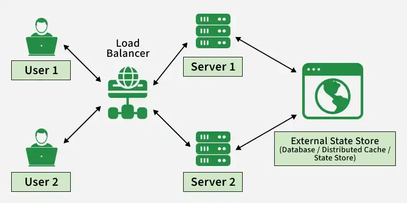
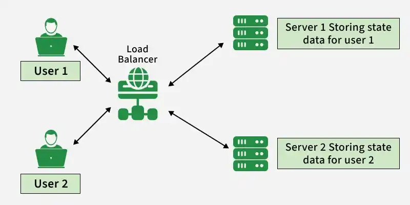

# 1.2.3 Stateless and Stateful Systems

> **Phase 1: Introduction to System Design → 1.2 High-Level Design → 1.2.3 System Architecture**
> Source: GeeksforGeeks, *Stateless and Stateful Systems in System Design* (last updated 1 Oct 2026)
> Previous: [1.2.3.6 Serverless Architecture](1.2.3.6-Serverless-Architecture.md)

---

## Table of Contents

1. [What is "State"?](#1-what-is-state)
2. [Stateless Systems](#2-stateless-systems)
3. [Stateful Systems](#3-stateful-systems)
4. [Side-by-Side Comparison](#4-side-by-side-comparison)
5. [Why Stateless Scales: The Load Balancer View](#5-why-stateless-scales-the-load-balancer-view)
6. [Sessions vs Tokens: Stateful and Stateless Authentication](#6-sessions-vs-tokens-stateful-and-stateless-authentication)
7. [Scaling Stateful Components](#7-scaling-stateful-components)
8. [Combining Stateless and Stateful Components](#8-combining-stateless-and-stateful-components)
9. [Choosing Between Them](#9-choosing-between-them)
10. [Quick Revision](#10-quick-revision)
11. [Self-Check Quiz: Interview Q&A](#11-self-check-quiz-interview-qa)

---

## 1. What is "State"?

**State** is any information a system **remembers between requests**: who you are, what's in your cart, which step of a checkout you're on, an open connection.

The question is **where that state lives**:

| | **Stateless** | **Stateful** |
|---|---|---|
| **Core idea** | Each request is processed **independently**; the server **keeps no client session** between requests | The server **remembers previous interactions** and uses them for later requests |
| **Where's the context?** | Sent **in the request** (e.g. a token) or fetched from **external storage** (DB, cache) | Kept **by the server/component** (memory, local disk, or its own store) |

> 💡 **Key idea:** "Stateless" doesn't mean *the system has no data*. It means a particular **component** (usually the app server) **doesn't hold client state itself**. The state still exists, just **somewhere else** (the client, a database, a cache).

The choice affects **scalability, reliability and architecture**.

---

## 2. Stateless Systems

In a **stateless** system, the server **doesn't store client state between requests**. Every request carries what's needed, or the server fetches it from external storage.

**Example:** a mobile app's **REST API**. Each request includes a **JWT** (JSON Web Token). The server **verifies the token**, processes the request and forgets about it. No session is stored on the server.



### Characteristics

| Characteristic | Meaning |
|---|---|
| **Independence** | Each request is **self-contained**; no reliance on past interactions. Simpler design. |
| **Scalability** | Easy to **scale horizontally**: no shared state to manage across servers. |
| **Fault tolerance** | If a server dies, requests go to **another server**. (Reliability still depends on **retries** and a **consistent backend**.) |
| **State transfer** | The client sends the required state (e.g. a token) **with every request**, adding a little overhead. |
| **Protocols** | Typically **HTTP**, which is stateless by design: each request carries all necessary information. |

### Stateless architecture patterns

Approaches that **minimize or externalize** state inside individual components:

| Pattern | How it relates to statelessness |
|---|---|
| **Microservices** | Services can be **stateless** by keeping persistent state in **external** databases/state stores, which helps scaling and deployment. *(See [1.2.3.2](1.2.3.2-Microservices.md).)* |
| **Serverless computing** | Short-lived functions are **typically stateless**; state goes to external services. *(See [1.2.3.6](1.2.3.6-Serverless-Architecture.md).)* |
| **Layered architecture** | Splits the system into layers by responsibility. ⚠️ Being layered **doesn't by itself** make a system stateless. |
| **Event-driven architecture** | Loose coupling and independent processing. ⚠️ **Not inherently stateless**: state may live in DBs, event stores or stateful stream processors. *(See [1.2.3.4](1.2.3.4-Event-Driven-Architecture.md).)* |
| **Immutable infrastructure** | **Replace** servers with new instances instead of modifying them, which reduces configuration drift. ⚠️ It's about **infrastructure management**, not statelessness itself, but it works best when servers hold no unique state. |

### Use cases

| Use case | Why stateless |
|---|---|
| **Web / REST APIs** | Each request contains everything needed; no server-side session. |
| **CDNs** | Edge cache servers serve static/cached content **independently**, without application session state. |
| **Serverless functions** | Run independently per event; state stored externally. |
| **Stateless authentication** | **JWTs** carry auth info in each request, so there's no server-side session store. |
| **Load balancers** | Often route requests without keeping application session state. ⚠️ Exceptions: **sticky sessions** and **connection tracking** make them stateful. |

### Challenges

| Challenge | Why |
|---|---|
| **Maintaining context** | Multi-step workflows need context **passed in every request** or kept in **external storage**. |
| **State transfer overhead** | All required data travels with each request: **bigger payloads**, more network overhead. |
| **Security** | Tokens/sensitive data in requests must be protected (**HTTPS**, signing/encryption, short expiry). |
| **Limited transaction support** | Multi-step operations **across requests** are hard and need extra coordination. |

---

## 3. Stateful Systems

A **stateful** system **keeps track of client information between requests**: session data, preferences and context, for a **continuous, personalized** experience.

**Example:** an online shop where the server stores the user's **login session** and **shopping cart**. Items added to the cart are **remembered** for the rest of the session.



### Characteristics

| Characteristic | Meaning |
|---|---|
| **Persistence of state** | Keeps user sessions, application context or in-progress process data **across many interactions**. |
| **Complex workflows** | Suits **multi-step** operations that depend on earlier steps. |
| **State management** | State must be maintained and updated, with **synchronization** if several instances share it. |
| **Scalability challenges** | Scaling needs **partitioning, replication and synchronization** of state. |
| **Failure recovery** | Uses **checkpointing, replication and failover** to preserve or restore state after a crash. |

### Stateful architecture patterns

| Pattern | What it does |
|---|---|
| **Session state management** | Stores login status, preferences, carts in **server memory, a database, or a distributed cache**. |
| **Database-centric architecture** | The **database is the main state store**; apps read and write it. Common in monoliths and client-server apps. |
| **Stateful replication** | Copies state across nodes for **availability and fault tolerance**: **primary-backup** or **quorum-based** replication. |
| **Stateful microservices** | Some services **must** keep state (workflow state, sessions, stream processing), locally or in an external store. |
| **Saga pattern** | Manages **long-running distributed transactions** as a sequence of local transactions, with **compensating actions** on failure. It tracks where the workflow is. |

### Use cases

| Use case | Why stateful |
|---|---|
| **User sessions** | Logins, preferences and carts give a continuous, personalized experience. |
| **Databases** | Their whole job is to keep **persistent, consistent, durable** data. |
| **Distributed coordination** | **Raft / Paxos** keep state for **leader election** and consensus across nodes. |
| **Real-time collaboration** | Collaborative editors, chat, live dashboards keep **shared state** in sync. |
| **Online banking** | Tracks user sessions and **transaction state** step by step. |
| **Persistent connections** | WebSockets, multiplayer game servers hold per-connection state. |

### Challenges

| Challenge | Why |
|---|---|
| **Scalability complexity** | State must be **shared or synchronized** across servers (replication, partitioning). |
| **Resource management** | Sessions and connections use **memory and resources**, raising operational overhead. |
| **Consistency** | Keeping state consistent across distributed nodes needs **coordination or consensus**. |
| **Security risks** | Stored session data needs **encryption, authentication and access control**. |
| **Failure impact** | If the server holding a session dies, that session's state may be **lost** unless replicated. |

---

## 4. Side-by-Side Comparison

| Aspect | Stateless | Stateful |
|---|---|---|
| **Remembers client between requests?** | ❌ No | ✅ Yes |
| **Each request** | Self-contained | Depends on previous ones |
| **Horizontal scaling** | **Easy**: add servers, any server takes any request | **Harder**: needs sticky sessions, shared stores, replication or partitioning |
| **Load balancing** | Any algorithm (round robin, least connections) | Often needs **session affinity** or a shared session store |
| **Server failure** | Retry on another server; little or nothing lost | In-memory state can be **lost** without replication/failover |
| **Request size** | Larger (carries tokens/context) | Smaller (server already knows the context) |
| **Server memory** | Low | Higher (sessions, connections) |
| **Multi-step workflows** | Harder: context must be passed or stored externally | Natural |
| **Examples** | REST APIs, CDNs, DNS resolvers, serverless functions, JWT auth | Databases, online banking, shopping carts (server-side), chat/WebSocket servers, Raft/Paxos clusters |

---

## 5. Why Stateless Scales: The Load Balancer View

### Stateful app servers (session in server memory)

```
                      ┌──► Server A  [session S1 for user 42]
  user 42 ─► LB ──────┼──► Server B  [ ]                       ← request lands here?
                      └──► Server C  [ ]                          "who are you?" ❌
```

Fixes, and their costs:

| Option | How | Cost |
|---|---|---|
| **Sticky sessions** (session affinity) | LB always sends user 42 to Server A | Uneven load; if **A dies, S1 is gone**; scaling in/out reshuffles users |
| **Session replication** | Every server copies every session | Memory and network overhead grows with the cluster |

### Stateless app servers (state externalized)

```
                      ┌──► Server A ─┐
  user 42 ─► LB ──────┼──► Server B ─┼──► shared session store / DB (e.g. Redis)
                      └──► Server C ─┘    or the state travels in a token (JWT)
```

- **Any server can handle any request**: use any LB algorithm.
- **Add or remove servers freely** (auto-scaling).
- **A server dies?** The next request just goes to another one.

> 💡 This is the standard move: **make the app tier stateless and push state into a dedicated stateful layer** (database, cache, session store) that is built to be replicated and made highly available.

---

## 6. Sessions vs Tokens: Stateful and Stateless Authentication

```
STATEFUL (server-side session)                    STATELESS (JWT)
 1. login ─► server creates session S1              1. login ─► server signs a JWT {user:42, role, exp}
            stores S1 in memory/Redis                          stores NOTHING
 2. browser gets cookie: session_id=S1               2. client keeps the token
 3. each request: cookie S1 ─► server looks up S1    3. each request: Authorization: Bearer <JWT>
                                                         ─► server verifies signature + expiry
```

| | Server-side session | JWT |
|---|---|---|
| **Server stores** | Session record | Nothing (just a signing key) |
| **Per-request work** | Look up the session | Verify the signature |
| **Scaling** | Needs a shared session store or sticky sessions | Any server can verify |
| **Logout / revoke** | **Easy**: delete the session | **Harder**: token is valid until it expires → short expiry, refresh tokens, or a **deny-list** (which reintroduces some state) |
| **Payload size** | Small cookie | Larger token on every request |

> 💡 Even with JWTs, **authorization** may still depend on external state, such as roles, permissions or policies in a database.

---

## 7. Scaling Stateful Components

When state can't be avoided (databases, chat servers, coordination), these techniques make it scale and survive failures:

| Technique | Idea |
|---|---|
| **Externalize to a shared store** | Move sessions to Redis/Memcached or a DB so app servers become stateless. |
| **Partitioning / sharding** | Split state by key (e.g. user ID) so each node owns a **subset**. |
| **Replication** | Keep copies on several nodes: **primary-backup** (one writer, standby copies) or **quorum-based** (read/write a majority). |
| **Consensus** | **Raft / Paxos** keep replicas agreeing on state and elect a leader. |
| **Checkpointing** | Periodically save state so a restarted process can **resume** (common in stream processing). |
| **Failover** | Automatically promote a backup when the primary fails. |
| **Sticky routing** | Route each key/user to the node that owns its state (consistent hashing). |

---

## 8. Combining Stateless and Stateful Components

Real systems **mix both**: stateless parts for **scale and simple deployment**, stateful parts for **persistent data and workflow state**.

```
             STATELESS TIER (scale freely)                   STATEFUL TIER (protect & replicate)
 Clients ─► LB ─► [API server] [API server] [API server] ─► [ Database ] [ Cache / session store ]
                       │                                     [ Event store ] [ Workflow engine ]
                       └── stateless consumers ◄── broker ─► stateful stream processor (aggregations)
```

| # | Combination | Stateless part | Stateful part |
|---|---|---|---|
| 1 | **Stateless frontend, stateful data layer** | Web/API servers scale horizontally | Databases and session stores keep data across requests |
| 2 | **Stateless microservices + stateful data stores** | Service instances scale independently | DBs, distributed caches, state stores persist service state |
| 3 | **Stateless APIs + stateful or stateless auth** | APIs process requests independently | Server-side sessions (stateful) **or** JWTs (stateless); authorization may read roles/permissions from a DB |
| 4 | **EDA with stateful processors** | Producers and simple consumers handle events independently | **Stateful processors / workflow engines** for aggregation, ordering, long-running workflows |
| 5 | **Mixed workflows** | e.g. registration API validates input and starts the flow | DB persists the user; a state store tracks session/workflow progress |

---

## 9. Choosing Between Them

| Prefer **stateless** when… | Prefer (or accept) **stateful** when… |
|---|---|
| You need **easy horizontal scaling** and auto-scaling | The component's **job is to hold data** (databases, caches) |
| Requests are **independent** (APIs, content delivery) | You need **continuity** across steps (sessions, carts, banking flows) |
| You want **simple failover** (any server can take over) | You hold **long-lived connections** (WebSockets, games, chat) |
| You deploy often or use **serverless/containers** | You need **coordination/consensus** (leader election, locks) |

> 💡 **Rule of thumb for interviews:** *"Keep the application servers stateless and put state in a dedicated, replicated data layer."* Then explain how that layer scales (replication, sharding) and how sessions/auth work (shared store or JWT).

---

## 10. Quick Revision

- **State** = information remembered between requests. The question is **where it lives**.
- **Stateless:** each request independent; context sent with the request (token) or fetched from external storage. Example: **REST API + JWT**.
  - Pros: **easy horizontal scaling**, any server handles any request, simple failover.
  - Cons: context passing, bigger requests, token security, hard multi-step transactions.
  - Patterns: microservices and serverless (externalized state). Layered, EDA and immutable infrastructure aren't automatically stateless.
  - Uses: REST APIs, CDNs, serverless, JWT auth, (most) load balancers.
- **Stateful:** server remembers sessions/context. Example: **shopping cart + login session**.
  - Pros: natural continuity, multi-step workflows, smaller requests.
  - Cons: harder scaling, more memory, consistency, state loss on failure.
  - Patterns: session management, database-centric, replication (primary-backup, quorum), stateful microservices, saga.
  - Uses: user sessions, databases, Raft/Paxos coordination, real-time collaboration, banking.
- **Scaling stateful app servers:** sticky sessions (fragile) → better: **externalize** state to a shared store or token.
- **Best practice:** **stateless app tier + stateful data tier**.

---

## 11. Self-Check Quiz: Interview Q&A

> ⭐ These 5 questions come from the GeeksforGeeks suggested quiz and are **important for system design interviews**. Try each one before opening the answer.

### Q1. What is the key difference between stateless and stateful systems?

- A. Stateless stores session data, stateful does not
- B. Stateless treats each request independently, stateful remembers client state
- C. Stateless requires databases, stateful does not
- D. Stateless is always faster than stateful

<details>
<summary>Answer</summary>

**B. Stateless treats each request independently, stateful remembers client state**

Stateless systems keep no client information between requests; stateful systems store session details for continuity. *(A is reversed; D is false: stateless requests can be slower because they carry more data or need external lookups.)* See [§1](#1-what-is-state).
</details>

### Q2. Which architecture is generally easier to scale horizontally?

- A. Stateful
- B. Stateless
- C. Both equally
- D. Neither

<details>
<summary>Answer</summary>

**B. Stateless**

No session data lives on the server, so requests can go to **any** server. Just add more behind the load balancer. See [§5](#5-why-stateless-scales-the-load-balancer-view).
</details>

### Q3. Which of the following is an example of a stateful system?

- A. REST API
- B. Online Banking System
- C. CDN (Content Delivery Network)
- D. DNS Resolver

<details>
<summary>Answer</summary>

**B. Online Banking System**

It tracks **user sessions and transaction state** across many steps, the hallmark of a stateful design. *(REST APIs, CDNs and DNS resolvers handle each request independently. A DNS resolver may **cache** answers, but it keeps no per-client session.)*
</details>

### Q4. Why are stateless systems more resilient to failures than stateful ones?

- A. They don't use servers
- B. They replicate data automatically
- C. They don't depend on stored state, so requests can be redirected easily
- D. They use stronger encryption

<details>
<summary>Answer</summary>

**C. They don't depend on stored state, so requests can be redirected easily**

No server holds anything unique about a client, so if one fails, any healthy server can take the next request with nothing lost. *(B is wrong: replication is a technique used to protect **stateful** systems.)*
</details>

### Q5. Why are stateless services generally easier to scale?

- A. The server never stores client information
- B. Client session data is maintained across multiple requests
- C. Requests can be served by any server without issues
- D. They are always faster than stateless services

<details>
<summary>Answer</summary>

**C. Requests can be served by any server without issues**

Because stateless services don't keep client session data on the server (the reason behind A), **any request can be handled by any instance**. That's what makes load balancing and horizontal scaling easy. *(B describes a stateful service.)*
</details>

### 🧠 Key Takeaways for Interviews

| # | Remember |
|---|---|
| 1 | Stateless = **each request stands alone**; stateful = **server remembers the client** |
| 2 | Stateless doesn't mean "no data": state is **moved** to the client (token) or an external store |
| 3 | Stateless app servers → **any server, any request** → easy horizontal scaling and failover |
| 4 | Sticky sessions work but are **fragile**; prefer a **shared session store** or **JWT** |
| 5 | Stateful components (DBs, caches, coordination) scale via **replication, sharding, consensus** |
| 6 | Standard design: **stateless app tier + stateful, replicated data tier** |

### Bonus Questions

> Extra practice on the rest of the topic.

### B1. What are sticky sessions, and what's their main drawback?

<details>
<summary>Answer</summary>

The load balancer always routes a given user to the **same server**, which holds their session. Drawbacks: **uneven load**, and if that server dies **the session is lost**. Scaling in or out also reshuffles users.
</details>

### B2. Is a load balancer always stateless?

<details>
<summary>Answer</summary>

**No.** It's often stateless with respect to application sessions, but **sticky sessions** and **connection tracking** make it keep state.
</details>

### B3. Why is logging a user out harder with JWTs than with server-side sessions?

<details>
<summary>Answer</summary>

The server stores nothing, so a JWT stays **valid until it expires**. You need **short expiry + refresh tokens** or a **revocation/deny-list**, which brings back some server-side state. With sessions, you just delete the session record.
</details>

### B4. Is an event-driven architecture automatically stateless?

<details>
<summary>Answer</summary>

**No.** Producers and simple consumers can be stateless, but state often lives in **databases, event stores or stateful stream processors** (e.g. for aggregations, ordering, workflows).
</details>

### B5. How would you make a shopping-cart service scale to many servers?

<details>
<summary>Answer</summary>

Make the app servers **stateless** and store the cart in a **shared, replicated store** (e.g. Redis or a database keyed by user ID). Any server can then read or update the cart, and the store scales with **replication/sharding**.
</details>

### B6. Name two consensus algorithms used by stateful coordination systems and what they're used for.

<details>
<summary>Answer</summary>

**Raft** and **Paxos**. They keep replicated state consistent across nodes and handle **leader election**, so the cluster agrees on one value even when some nodes fail.
</details>

---

### 📚 Further Reading

- GeeksforGeeks: *Stateless and Stateful Systems in System Design*
- The Twelve-Factor App: *VI. Processes* (execute the app as stateless processes)
- Raft consensus: *raft.github.io*
- Next: [1.2.3.8 Stateful vs Stateless Architecture](1.2.3.8-Stateful-vs-Stateless-Architecture.md)
