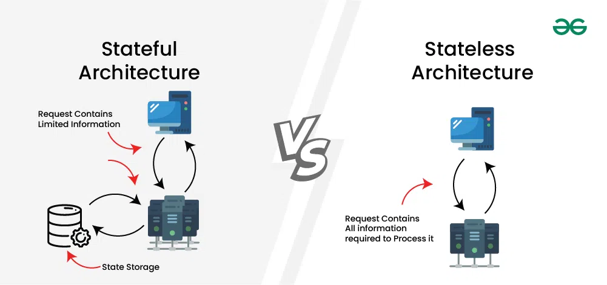

# 1.2.3 Stateful vs Stateless Architecture

> **Phase 1: Introduction to System Design → 1.2 High-Level Design → 1.2.3 System Architecture**
> Source: GeeksforGeeks, *Stateful Vs Stateless Architecture* (last updated 25 Jul 2026)
> Previous: [1.2.3.7 Stateless and Stateful Systems](1.2.3.7-Stateless-and-Stateful-Systems.md). That note covers characteristics, patterns, use cases and scaling techniques in depth; this one focuses on the **head-to-head comparison**.

---

## Table of Contents

1. [Overview](#1-overview)
2. [Stateful Architecture](#2-stateful-architecture)
3. [Stateless Architecture](#3-stateless-architecture)
4. [The Same Shopping Cart, Built Both Ways](#4-the-same-shopping-cart-built-both-ways)
5. [Side-by-Side Comparison](#5-side-by-side-comparison)
6. [Load Balancing and Failures](#6-load-balancing-and-failures)
7. [Benefits of Each](#7-benefits-of-each)
8. [When to Use Which](#8-when-to-use-which)
9. [Implementation in Spring Boot](#9-implementation-in-spring-boot)
10. [Quick Revision](#10-quick-revision)
11. [Self-Check Quiz: Interview Q&A](#11-self-check-quiz-interview-qa)

---

## 1. Overview

**Stateful vs stateless** is about **how a system handles client session data** across interactions. The choice affects **scalability, performance and overall design**.



| | Stateful | Stateless |
|---|---|---|
| **In one line** | The **server stores session data** across many requests | **Each request is independent**; no session stored on the server |
| **Typical use** | Session-heavy apps, continuous workflows | **Preferred for scalable, distributed systems** |

```
STATEFUL                                      STATELESS
 Client ── req 1 ──► Server [remembers you]    Client ── req 1 + token ──► any server [forgets you]
 Client ── req 2 ──► same Server [still knows] Client ── req 2 + token ──► any server [forgets you]
                     └── session lives here                 └── context travels with the request
```

---

## 2. Stateful Architecture

The **server maintains the state (session) of each client**, keeping track of its data and context **across multiple interactions**.

- Session data lives in **server memory, a database, or another store**.
- Classic example: **traditional web apps with server-side sessions** for user data or cart contents.

**Example:** an online shop stores the user's **login session** and **shopping cart** on the server. Items added to the cart are **remembered** for the rest of the session.

```
 Browser                           Server A
   │── POST /login ───────────────►│ create session S1 = {user: 42, cart: []}
   │◄── Set-Cookie: sid=S1 ────────│
   │── POST /cart (sid=S1, book) ─►│ S1.cart = [book]
   │── GET  /cart (sid=S1) ───────►│ returns [book]   ← server remembered
```

---

## 3. Stateless Architecture

The **server stores no client session information** between requests. **Each request is an independent transaction.**

- Session data is kept on the **client side** with **JSON Web Tokens (JWT)** or **client-side cookies**, and sent with each request.
- **More scalable and fault-tolerant**, because no server resources are tied up holding client state.
- Classic example: **RESTful APIs**, where each request carries everything needed to process it.

**Example:** a mobile app's REST API. Every request includes a **JWT**; the server **verifies the token**, handles the request and stores nothing.

```
 Mobile app                                    Server (any instance)
   │── POST /login ─────────────────────────────►│ verify password → sign JWT {user:42, exp}
   │◄── { token: "eyJ..." } ─────────────────────│ (stores nothing)
   │── GET /orders  Authorization: Bearer eyJ...►│ verify signature → user 42 → query DB
   │── GET /profile Authorization: Bearer eyJ...►│ (could be a different instance: still works)
```

> 💡 "Stateless" describes the **server**. Durable data (orders, profiles) still lives in a **database**; the app server just doesn't keep **per-client session state** in itself.

---

## 4. The Same Shopping Cart, Built Both Ways

| Step | **Stateful** | **Stateless** |
|---|---|---|
| Log in | Server creates session `S1` in **its memory**; browser gets cookie `sid=S1` | Server issues a **signed JWT**; stores nothing |
| Add item | Server updates `S1.cart` in memory | Server writes the cart to a **shared DB/cache** keyed by user ID (or the client keeps the cart) |
| Next request | **Must reach the same server** (or a server that can see `S1`) | **Any server** reads the token, then the cart from the shared store |
| Server crashes | Cart in memory is **lost** (unless replicated) | Cart is safe in the shared store; the next request goes to another server |
| Add 10 servers | Need **sticky sessions** or **session replication** | Just add them behind the load balancer |

> 💡 This is the usual real-world answer: **stateless app servers + a stateful shared store** (DB/Redis). *(See [1.2.3.7 §5](1.2.3.7-Stateless-and-Stateful-Systems.md#5-why-stateless-scales-the-load-balancer-view).)*

---

## 5. Side-by-Side Comparison

| Aspect | Stateful | Stateless |
|---|---|---|
| **Scaling** | Requires **synchronizing session data** across servers | **Horizontal scaling is straightforward** |
| **Failure impact** | A server failure can **lose the sessions stored on it** | Failures are **isolated**, affecting only individual requests |
| **Latency** | Session management can **add latency** | Often **faster**: no session overhead *(see note)* |
| **Resources** | **More** memory/storage to hold sessions | **Efficient**: no session state stored |
| **Caching** | **Complex**: responses depend on session-specific data | **Simpler**: requests are independent |
| **Deployment** | **Complex**: session data must survive restarts/rollouts | **Easier** deployment and maintenance |
| **Transactions** | Keeps **session context** for multi-step continuity | Each transaction handled **independently** per request |
| **Load balancing** | May need **session affinity (sticky sessions)** | **Simple**: any server can handle any request |
| **Developer effort** | Must manage **session handling** and its edge cases | Focus mainly on **business logic** |

> ⚠️ **Nuance on performance:** stateless isn't *always* faster. Each request may carry a **larger token** and need **verification or DB/cache lookups** for context, while a stateful server already has the context in memory. Stateless usually wins **at scale** because load spreads evenly and nothing is pinned to one server.

---

## 6. Load Balancing and Failures

### Stateful: session affinity

```
                     ┌──► Server A  [S1: user 42's cart]   ◄── user 42 must keep landing here
 user 42 ──► LB ─────┼──► Server B
 (cookie sid=S1)     └──► Server C
```

- The load balancer uses **sticky sessions**: requests from the same client go to the **same server**, so the session stays reachable.
- **Problems:** uneven load (one busy user group on one server), and if **Server A fails, S1 is gone**. User 42 is logged out and the cart is lost.
- **Mitigations:** replicate sessions, or move them to a **shared session store**, which effectively makes the app tier stateless.

### Stateless: any server

```
                     ┌──► Server A ─┐
 user 42 ──► LB ─────┼──► Server B ─┼──► shared DB / cache
 (JWT on each call)  └──► Server C ─┘
```

- **Round robin / least connections** work fine; servers can be added or removed at any time.
- If a server dies mid-request, **only that request fails**; the client retries and lands on a healthy server.

---

## 7. Benefits of Each

### Stateful

| Benefit | Detail |
|---|---|
| **Session persistence** | Keeps users' sessions so they can move smoothly **across steps** (or devices, if the session is stored centrally). |
| **Efficient data transfer** | Session data stays on the server, so it isn't **re-sent with every request**. |
| **Personalization** | Uses past interactions to tailor the experience (e.g. recommendations). |
| **Centralized security control** | Sessions are managed in one place, so they're **easy to revoke** (log out, kill a stolen session) and to protect with strong auth and encryption. |

### Stateless

| Benefit | Detail |
|---|---|
| **High scalability** | Handles huge request volumes; just add servers. |
| **Fault tolerance** | Requests are independent, so a failure in one place doesn't break others. |
| **Simple load balancing** | Spread requests evenly; **no sticky sessions**. |
| **Performance at scale** | No session lookup/synchronization overhead on the server. |

---

## 8. When to Use Which

| Choose **stateful** when… | Choose **stateless** when… |
|---|---|
| The user flow needs **continuity** (multi-step checkout, banking session, wizard forms) | You need **horizontal scaling** and auto-scaling |
| You keep **long-lived connections** (WebSockets, chat, multiplayer games) | Requests are naturally **independent** (REST APIs, microservices, serverless) |
| You need **instant session revocation** and central control | You want **simple failover** and deployments |
| The component's job is to **hold data** (databases, caches) | The system is **distributed** across many servers/regions |

> 💡 **Interview answer:** *"Make the application tier stateless (JWT or a shared session store), and keep state in a dedicated, replicated data layer."* You get stateless scaling without losing session features.

---

## 9. Implementation in Spring Boot

Two small Spring Boot controllers that show the difference in code. Each exposes the **same feature twice**: once **stateful** (the server remembers, via `HttpSession`) and once **stateless** (the client sends the state on every call).

> Requires Spring Boot 3 (`jakarta.servlet`) and Java 16+ (`Stream.toList()`). Add `spring-boot-starter-web`, drop the controllers into `com.example.demo.controller`, and run on `localhost:8080`.

### 9.1 Example 1: A counter

`/api/stateful/increment` keeps the counter **in the server's session**. `/api/stateless/increment` expects the client to send the **current value** each time.

```java
package com.example.demo.controller;

import jakarta.servlet.http.HttpSession;
import org.springframework.web.bind.annotation.*;
import java.util.Map;

@RestController
@RequestMapping("/api")
public class ArchitectureDemoController {

    // ── 1. STATEFUL ───────────────────────────────────────────────────────
    // HttpSession + a JSESSIONID cookie let the server save, recall and
    // increment the value in SERVER memory between requests.
    @GetMapping("/stateful/increment")
    public Map<String, Object> statefulIncrement(HttpSession session) {
        Integer counter = (Integer) session.getAttribute("sessionCounter");
        if (counter == null) {
            counter = 0;
        }
        counter++;
        session.setAttribute("sessionCounter", counter);   // remembered for next time

        return Map.of(
            "architecture", "Stateful (Server-Side Session)",
            "sessionId", session.getId(),
            "serverStoredCounter", counter,
            "message", "The server remembers this value across consecutive requests from your browser."
        );
    }

    // ── 2. STATELESS ──────────────────────────────────────────────────────
    // The server keeps NOTHING. The client sends the current value; the
    // server computes the next one purely from the input.
    @GetMapping("/stateless/increment")
    public Map<String, Object> statelessIncrement(@RequestParam(defaultValue = "0") int currentCounter) {
        int nextCounter = currentCounter + 1;

        return Map.of(
            "architecture", "Stateless (No Session)",
            "clientProvidedCounter", currentCounter,
            "serverCalculatedCounter", nextCounter,
            "message", "The server forgot your previous request immediately. You must provide the state yourself."
        );
    }
}
```

**Try the stateful endpoint.** The first response sets a `JSESSIONID` cookie. Send it back and the **same** counter goes up:

```bash
# Request 1: the server creates a session and returns a cookie
curl -i -c cookies.txt http://localhost:8080/api/stateful/increment
# Set-Cookie: JSESSIONID=ABC123XYZ...
# {"serverStoredCounter":1, "architecture":"Stateful (Server-Side Session)", ...}

# Request 2: send the cookie back; the server recognises you
curl -b cookies.txt http://localhost:8080/api/stateful/increment
# {"serverStoredCounter":2, ...}

# Request 3: no cookie, so a brand-new session starts from 1 again
curl http://localhost:8080/api/stateful/increment
# {"serverStoredCounter":1, ...}
```

**Try the stateless endpoint.** The server is a clean slate every time: **the same input always gives the same output**.

```bash
curl "http://localhost:8080/api/stateless/increment?currentCounter=5"
# {"clientProvidedCounter":5, "serverCalculatedCounter":6}

curl "http://localhost:8080/api/stateless/increment?currentCounter=5"   # same request…
# {"clientProvidedCounter":5, "serverCalculatedCounter":6}               # …same answer

curl "http://localhost:8080/api/stateless/increment?currentCounter=6"   # the CLIENT advances the state
# {"clientProvidedCounter":6, "serverCalculatedCounter":7}
```

### 9.2 Example 2: Full CRUD on tasks

The same idea with **Create, Read, Update, Delete**:

- **Stateful:** each user gets a private mock "database" (a `Map`) stored **in their own `HttpSession`**.
- **Stateless:** the server is a **pure function**. The client sends the **whole current task list** in the request body, and the server returns the modified list.

```java
package com.example.demo.controller;

import jakarta.servlet.http.HttpSession;
import org.springframework.web.bind.annotation.*;
import java.util.*;

@RestController
@RequestMapping("/api")
public class CrudArchitectureController {

    // Simple data model
    public static class Task {
        public String id;
        public String title;

        public Task() {}
        public Task(String id, String title) { this.id = id; this.title = title; }
    }

    // Stateless request body: the client's full state + the task to act on
    public static class StatelessPayload {
        public List<Task> currentTasks;   // the client's current state
        public Task task;                 // the task to create / update
    }

    // Per-session "database" for the stateful demo
    @SuppressWarnings("unchecked")
    private Map<String, Task> getStatefulDb(HttpSession session) {
        Map<String, Task> db = (Map<String, Task>) session.getAttribute("taskDb");
        if (db == null) {
            db = new HashMap<>();
            session.setAttribute("taskDb", db);
        }
        return db;
    }

    // ═════════ 1. STATEFUL CRUD: the server holds the data per session ═════════

    @PostMapping("/stateful/tasks")                                    // CREATE
    public Map<String, Object> statefulCreate(@RequestBody Task task, HttpSession session) {
        Map<String, Task> db = getStatefulDb(session);
        task.id = UUID.randomUUID().toString();
        db.put(task.id, task);
        return Map.of("message", "Task created in server session", "task", task);
    }

    @GetMapping("/stateful/tasks")                                     // READ (all)
    public Collection<Task> statefulReadAll(HttpSession session) {
        return getStatefulDb(session).values();
    }

    @PutMapping("/stateful/tasks/{id}")                                // UPDATE
    public Map<String, Object> statefulUpdate(@PathVariable String id, @RequestBody Task updatedTask,
                                              HttpSession session) {
        Map<String, Task> db = getStatefulDb(session);
        if (!db.containsKey(id)) {
            return Map.of("error", "Task not found in session");
        }
        updatedTask.id = id;
        db.put(id, updatedTask);
        return Map.of("message", "Task updated in server session", "task", updatedTask);
    }

    @DeleteMapping("/stateful/tasks/{id}")                             // DELETE
    public Map<String, Object> statefulDelete(@PathVariable String id, HttpSession session) {
        Task removed = getStatefulDb(session).remove(id);
        if (removed == null) {
            return Map.of("error", "Task not found in session");
        }
        return Map.of("message", "Task deleted from server session", "deletedId", id);
    }

    // ═════════ 2. STATELESS CRUD: the server holds nothing ═════════

    @PostMapping("/stateless/tasks")                                   // CREATE
    public Map<String, Object> statelessCreate(@RequestBody StatelessPayload payload) {
        List<Task> tasks = payload.currentTasks != null ? new ArrayList<>(payload.currentTasks) : new ArrayList<>();
        Task newTask = payload.task;
        newTask.id = UUID.randomUUID().toString();
        tasks.add(newTask);
        return Map.of("message", "Stateless execution complete. Server saved nothing.",
                      "updatedTasksList", tasks);
    }

    // READ: a pure stateless demo can only filter what the client sends.
    // (Real stateless services read from a shared external DB instead.)
    @PostMapping("/stateless/tasks/search")
    public List<Task> statelessRead(@RequestBody List<Task> clientProvidedTasks, @RequestParam String query) {
        if (clientProvidedTasks == null) return Collections.emptyList();
        return clientProvidedTasks.stream()
                .filter(t -> t.title.toLowerCase().contains(query.toLowerCase()))
                .toList();
    }

    @PutMapping("/stateless/tasks/{id}")                               // UPDATE
    public Map<String, Object> statelessUpdate(@PathVariable String id, @RequestBody StatelessPayload payload) {
        List<Task> tasks = payload.currentTasks != null ? new ArrayList<>(payload.currentTasks) : new ArrayList<>();
        Task target = payload.task;
        boolean found = false;
        for (int i = 0; i < tasks.size(); i++) {
            if (tasks.get(i).id.equals(id)) {
                target.id = id;
                tasks.set(i, target);
                found = true;
                break;
            }
        }
        return Map.of("success", found,
                      "message", found ? "Updated in returned list." : "Task ID not found in provided list.",
                      "updatedTasksList", tasks);
    }

    @PostMapping("/stateless/tasks/delete/{id}")                       // DELETE
    public Map<String, Object> statelessDelete(@PathVariable String id, @RequestBody List<Task> clientProvidedTasks) {
        List<Task> tasks = clientProvidedTasks != null ? new ArrayList<>(clientProvidedTasks) : new ArrayList<>();
        boolean removed = tasks.removeIf(t -> t.id.equals(id));
        return Map.of("success", removed,
                      "message", removed ? "Removed from returned list." : "ID did not exist in provided list.",
                      "updatedTasksList", tasks);
    }
}
```

> 💡 **Why are the stateless "read" and "delete" `POST`s?** They need the client's task list in the **request body**, and `GET`/`DELETE` bodies aren't reliably supported. In a real stateless API the list would live in a **shared database**, so they'd be a normal `GET /tasks?query=` and `DELETE /tasks/{id}`.

**The two lifecycles side by side:**

```
STATEFUL 🔄                                         STATELESS ↩️
1. POST /api/stateful/tasks                          1. POST /api/stateless/tasks
   {"title":"Buy groceries"}                            {"currentTasks":[], "task":{"title":"Buy groceries"}}
   → saved in YOUR session; reply sets JSESSIONID       → server adds an id and returns
                                                          {"updatedTasksList":[{"id":"xyz","title":"Buy groceries"}]}
2. GET /api/stateful/tasks  (same cookie)            2. The server immediately forgets it. The CLIENT keeps the list.
   → [{"id":"…","title":"Buy groceries"}]
3. Server owns storage and lifecycle                 3. POST /api/stateless/tasks/delete/xyz
                                                        body: [{"id":"xyz","title":"Buy groceries"}]
                                                        → {"updatedTasksList":[]}
```

### 9.3 What the code shows

| Trait | Stateful endpoints | Stateless endpoints |
|---|---|---|
| **Where the data lives** | Server memory (`HttpSession`) | Client payload (`@RequestParam`, request body, tokens) |
| **How the client is recognised** | `JSESSIONID` cookie | Self-contained parameters / JWT |
| **Horizontal scaling** | Hard: needs **sticky sessions** or a **shared session store** (e.g. Redis) | Easy: **any instance** can serve any request |
| **Server crash / restart** | Session data is **wiped** (the counter and tasks are gone) | **Unaffected**: the state is with the client |
| **Same request twice** | Different result (counter 1 → 2) | **Same result** every time (5 → 6) |

> ⚠️ **These are teaching demos, not production code.** Session memory is lost on restart and isn't shared between instances. And a "pure" stateless server that trusts a client-sent list is fine for a counter, but in a real app **clients can't be trusted** to send authoritative data: stateless services read and write a **shared database**, and identify users with a **signed token**.

### 9.4 Taking it toward production

**Make the stateful version survive scaling: move sessions to Redis (Spring Session).** The controller code stays the same; sessions now live in Redis instead of one server's memory, so any instance can read them:

```xml
<!-- pom.xml -->
<dependency>
  <groupId>org.springframework.boot</groupId>
  <artifactId>spring-boot-starter-data-redis</artifactId>
</dependency>
<dependency>
  <groupId>org.springframework.session</groupId>
  <artifactId>spring-session-data-redis</artifactId>
</dependency>
```

```properties
# application.properties
spring.data.redis.host=localhost
spring.data.redis.port=6379
```

**Force a truly stateless API with Spring Security.** The server never creates an `HttpSession`, and every request must carry a JWT:

```java
@Configuration
public class SecurityConfig {
    @Bean
    SecurityFilterChain api(HttpSecurity http) throws Exception {
        http
            .csrf(csrf -> csrf.disable())                        // no session cookie → no CSRF risk from it
            .sessionManagement(s -> s.sessionCreationPolicy(SessionCreationPolicy.STATELESS))
            .authorizeHttpRequests(a -> a.anyRequest().authenticated())
            .oauth2ResourceServer(o -> o.jwt(Customizer.withDefaults()));   // validate JWT on each request
        return http.build();
    }
}
```

*(Needs `spring-boot-starter-security` and `spring-boot-starter-oauth2-resource-server`, plus the JWT issuer/key configured, e.g. `spring.security.oauth2.resourceserver.jwt.issuer-uri`.)*

```
 Demo stateful  ──(sessions → Redis)──►  stateless app instances + stateful shared store   ✅ scales
 Demo stateless ──(state → DB, identity → JWT)──►  same target architecture                 ✅ scales
```

Both paths end at the design recommended in [§8](#8-when-to-use-which): **stateless app servers + a stateful, shared data layer**.

---

## 10. Quick Revision

- **Stateful:** server **stores session data** across requests (memory/DB). Example: server-side **shopping cart + login session**.
- **Stateless:** **each request independent**; session data kept **client-side** (JWT, cookies) and sent each time. Example: **REST API + JWT**.
- **Scaling:** stateful needs **session sync**; stateless scales **horizontally** with ease.
- **Failures:** stateful can **lose sessions** with a server; stateless failures affect **only that request**.
- **Load balancing:** stateful often needs **sticky sessions**; stateless: **any server, any request**.
- **Other differences:** resources (stateful uses more), caching (stateless simpler), deployment (stateless easier), dev effort (stateless: focus on business logic).
- **Stateful benefits:** session persistence, less repeated data transfer, personalization, centralized security control.
- **Stateless benefits:** scalability, fault tolerance, simple load balancing, performance at scale.
- **In code (Spring Boot):** stateful = `HttpSession` + `JSESSIONID` cookie (lost on restart, needs sticky sessions or Spring Session/Redis); stateless = client sends state/JWT each call, `SessionCreationPolicy.STATELESS`.
- **Usage:** stateless is **preferred for scalable, distributed systems**; real systems pair a **stateless app tier with stateful data stores**.

---

## 11. Self-Check Quiz: Interview Q&A

> ⭐ These 6 questions come from the GeeksforGeeks suggested quiz and are **important for system design interviews**. Try each one before opening the answer.

### Q1. What is the main difference between stateful and stateless architecture?

- A. Stateful systems store session information while stateless systems treat each request independently
- B. Stateless systems store all client sessions on the server
- C. Both architectures store session data in the same way
- D. Stateful systems do not maintain client data

<details>
<summary>Answer</summary>

**A. Stateful systems store session information while stateless systems treat each request independently**

Stateful architecture tracks client sessions across requests; stateless architecture processes each request without stored session data. *(B and D swap the two definitions.)* See [§1](#1-overview).
</details>

### Q2. Which scenario best represents a stateful architecture?

- A. A REST API that processes each request independently
- B. An online shopping website that remembers items added to a user's cart
- C. A caching system that stores temporary responses
- D. A monitoring system that logs events

<details>
<summary>Answer</summary>

**B. An online shopping website that remembers items added to a user's cart**

The server keeps session information, such as login status and cart contents, across many interactions. *(A cache stores data, but it isn't **per-client session** context.)* See [§2](#2-stateful-architecture).
</details>

### Q3. How do stateless systems typically manage authentication without storing sessions?

- A. Using server-side session storage
- B. Using tokens such as JSON Web Tokens (JWT) or client-side cookies
- C. Using database locks for every request
- D. Using local server memory

<details>
<summary>Answer</summary>

**B. Using tokens such as JSON Web Tokens (JWT) or client-side cookies**

The authentication data travels **with each request**, and the server just verifies it. *(A and D are how **stateful** systems do it.)* See [§3](#3-stateless-architecture).
</details>

### Q4. Why is horizontal scaling easier in stateless architecture?

- A. Because servers share the same session memory
- B. Because requests are independent and can be handled by any server
- C. Because stateless systems require fewer databases
- D. Because all requests are processed sequentially

<details>
<summary>Answer</summary>

**B. Because requests are independent and can be handled by any server**

No server holds session data, so any server can take any request, and you just add more behind the load balancer. See [§6](#6-load-balancing-and-failures).
</details>

### Q5. What challenge is commonly associated with stateful architecture during load balancing?

- A. Servers cannot store session data
- B. Session affinity or sticky sessions may be required
- C. Requests must include authentication tokens
- D. Caching cannot be implemented

<details>
<summary>Answer</summary>

**B. Session affinity or sticky sessions may be required**

Requests from the same client must reach the **same server** so its session data is available. That can unbalance load and loses the session if that server fails. *(C describes stateless systems.)* See [§6](#6-load-balancing-and-failures).
</details>

### Q6. Why do stateless architectures often provide better fault tolerance?

- A. Because servers permanently store all client data
- B. Because failures in one request do not affect other requests
- C. Because they use only a single server
- D. Because they remove the need for authentication

<details>
<summary>Answer</summary>

**B. Because failures in one request do not affect other requests**

Each request is independent, so a failure impacts only that request, never a stored session; the next request simply goes to a healthy server.
</details>

### 🧠 Key Takeaways for Interviews

| # | Remember |
|---|---|
| 1 | Stateful = **server remembers the session**; stateless = **each request stands alone** |
| 2 | Stateless auth = **JWT / client-side tokens** sent on every request |
| 3 | Stateful load balancing → **sticky sessions** (uneven load, sessions lost on failure) |
| 4 | Stateless → **any server, any request** → easy scaling and fault isolation |
| 5 | Stateless isn't automatically faster per request, but it **scales** better |
| 6 | Best of both: **stateless app tier + stateful shared store** |

### Bonus Questions

> Extra practice on the rest of the topic.

### B1. Why is caching harder in a stateful system?

<details>
<summary>Answer</summary>

Responses depend on **session-specific data** (this user's cart, this step of the flow), so the same URL can return different results for different users and can't be cached as one shared response. Independent stateless requests are easier to cache.
</details>

### B2. Give one security advantage of stateful sessions over JWTs.

<details>
<summary>Answer</summary>

**Instant revocation:** deleting the server-side session logs the user out immediately. A JWT stays valid until it **expires**, unless you add a deny-list.
</details>

### B3. A stateful app server crashes. What happens to its users, and how could you have prevented it?

<details>
<summary>Answer</summary>

Users whose sessions lived **in that server's memory** lose them (logged out, carts gone). Prevent it by **replicating sessions** or, better, storing them in a **shared session store** (e.g. Redis) so any server can serve them.
</details>

### B4. Is a stateless system always faster than a stateful one?

<details>
<summary>Answer</summary>

**No.** Each stateless request may carry a bigger token and need **verification or external lookups**, while a stateful server has context in memory. Stateless shines **at scale**: even load, no session sync, easy scaling.
</details>

### B5. How do you get stateless scaling but keep a shopping cart?

<details>
<summary>Answer</summary>

Keep the **app servers stateless** and store the cart in a **shared, replicated store** keyed by user ID (DB or Redis), or on the client. Any server can then read and update it.
</details>

---

### 📚 Further Reading

- GeeksforGeeks: *Stateful Vs Stateless Architecture*
- Deep dive: [1.2.3.7 Stateless and Stateful Systems](1.2.3.7-Stateless-and-Stateful-Systems.md)
- Next: [1.2.3.9 Pub/Sub Architecture](1.2.3.9-Pub-Sub-Architecture.md)
