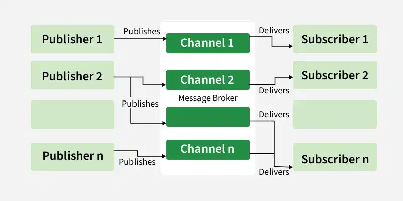

# 1.2.3 Pub/Sub Architecture

> **Phase 1: Introduction to System Design → 1.2 High-Level Design → 1.2.3 System Architecture**
> Source: GeeksforGeeks, *Pub/Sub Architecture* (last updated 1 Oct 2026)
> Previous: [1.2.3.8 Stateful vs Stateless Architecture](1.2.3.8-Stateful-vs-Stateless-Architecture.md) · Related: [1.2.3.4 Event-Driven Architecture](1.2.3.4-Event-Driven-Architecture.md), [1.2.3.5 EDA Full Course](1.2.3.5-Event-Driven-Architecture-Full-Course.md)

---

## Table of Contents

1. [What is Pub/Sub?](#1-what-is-pubsub)
2. [Components](#2-components)
3. [How It Works](#3-how-it-works)
4. [Subscriptions in Practice: Fan-Out, Push/Pull, Filtering](#4-subscriptions-in-practice-fan-out-pushpull-filtering)
5. [Delivery Guarantees](#5-delivery-guarantees)
6. [Real-World Example: A Twitter-Like Feed](#6-real-world-example-a-twitter-like-feed)
7. [Use Cases](#7-use-cases)
8. [Types of Pub/Sub Services](#8-types-of-pubsub-services)
9. [Pub/Sub vs Other Messaging Technologies](#9-pubsub-vs-other-messaging-technologies)
10. [Pub/Sub vs Point-to-Point Messaging](#10-pubsub-vs-point-to-point-messaging)
11. [When to Use and When Not to Use](#11-when-to-use-and-when-not-to-use)
12. [Benefits and Challenges](#12-benefits-and-challenges)
13. [Quick Revision](#13-quick-revision)
14. [Self-Check Quiz: Interview Q&A](#14-self-check-quiz-interview-qa)

---

## 1. What is Pub/Sub?

**Publish/Subscribe (Pub/Sub)** is a messaging pattern where components communicate **without depending on each other directly**:

- **Publishers** send messages to **topics**.
- **Subscribers** receive messages from the **topics they subscribe to**.
- A **message broker** sits in the middle and routes messages from publishers to subscribers.

Key properties:

- **Reduces direct dependencies:** publishers don't know who the subscribers are, and subscribers don't know who the publishers are.
- **Asynchronous and scalable:** publishers don't wait; many subscribers can receive the same message.

**Example:** a **news notification system**. A publisher posts a new article to the `sports` topic, and **every subscriber** interested in `sports` gets the update.


```
                                    ┌──► Subscriber 1  (subscribed to "sports")
 Publisher ── "Match result" ──► [ topic: sports ] ──┼──► Subscriber 2  (subscribed to "sports")
                                    └──► Subscriber 3  (subscribed to "sports")

 Publisher ── "Election update" ──► [ topic: politics ] ──► Subscriber 4 (subscribed to "politics")
```

> 💡 **Key idea:** the publisher says *"here's a message about sports"*, not *"send this to Alice, Bob and Carol"*. Who receives it is decided by **subscriptions**, managed by the broker.

---

## 2. Components



```
 ┌───────────┐  message   ┌──────────────────────────── MESSAGE BROKER ────────────────────────────┐
 │ Publisher │──────────► │  ┌───────────────┐   subscription A ──► Subscriber A                   │
 └───────────┘            │  │ topic: orders │── subscription B ──► Subscriber B                   │
 ┌───────────┐  message   │  └───────────────┘                                                     │
 │ Publisher │──────────► │  ┌───────────────┐   subscription C ──► Subscriber C                   │
 └───────────┘            │  │ topic: users  │                                                     │
                          │  └───────────────┘                                                     │
                          └────────────────────────────────────────────────────────────────────────┘
```

| Component | Role |
|---|---|
| **Publisher** | Creates messages and sends them to topics **without knowing the subscribers**. |
| **Subscriber** | Receives messages from the topics it subscribed to, **without knowing the publishers**. |
| **Topic** | A **named channel** that categorizes messages (`orders`, `sports`). Publishers send to it; subscribers subscribe to it. |
| **Message broker** | **Routes** messages from publishers to subscribers based on subscriptions. Delivery guarantees, persistence and scalability depend on the system and its configuration (e.g. Kafka, RabbitMQ, Google Cloud Pub/Sub, SNS). |
| **Message** | The unit of data: text, JSON or binary, usually with metadata (id, timestamp, attributes). |
| **Subscription** | **Links a subscriber to a topic**: defines which messages it gets, and with which **delivery guarantee** (at-most-once, at-least-once…). |

---

## 3. How It Works

| Step | What happens |
|---|---|
| **1** | **Publishers** create messages and send them to the Pub/Sub system, **sorted into topics** by subject. |
| **2** | **Subscribers** tell the system which **topics** they're interested in, and they'll only get messages from those. |
| **3** | **Topics** are the channels: publishers send to specific topics; subscribers follow one or more. |
| **4** | The **broker** is the go-between: it takes messages from publishers and manages delivery to interested subscribers. |
| **5** | When a message arrives on a topic, the broker **sends a copy to every subscriber** of that topic. |
| **6** | It's **asynchronous**: publishers don't wait for subscribers to be ready, and subscribers process messages when it suits them, even if the publisher is gone. |

```
 Publisher            Broker                         Subscriber A        Subscriber B
    │                   │◄──── subscribe("orders") ────────┤                   │
    │                   │◄──── subscribe("orders") ────────────────────────────┤
    │── publish ───────►│                                  │                   │
    │  (orders, #42)    │── deliver copy ─────────────────►│                   │
    │◄── ack ───────────│── deliver copy ─────────────────────────────────────►│
    │  (moves on)       │◄── ack ──────────────────────────┤                   │
                        │◄── ack ──────────────────────────────────────────────┤
```

---

## 4. Subscriptions in Practice: Fan-Out, Push/Pull, Filtering

### Fan-out across subscriptions, sharing within one

In most real brokers there are **two levels**:

```
                          ┌── subscription "email" ──► [email worker 1] [email worker 2]   ← share the work
 OrderPlaced ──► topic ───┼── subscription "inventory" ──► [inventory worker]
                          └── subscription "analytics" ──► [analytics worker]
```

- **Across subscriptions → fan-out:** **every subscription gets its own copy** of each message (email, inventory and analytics each see `OrderPlaced`).
- **Within one subscription → competing consumers:** several instances of the *same* service **share** that subscription's messages, so each message is handled **once per service**, not once per instance. *(Kafka calls these **consumer groups**; see [1.2.3.5 §13](1.2.3.5-Event-Driven-Architecture-Full-Course.md#13-topics-partitions-consumer-groups--offsets).)*

This is how you **scale a subscriber** without it receiving duplicate copies.

### Push vs pull

| | **Push** | **Pull** |
|---|---|---|
| **How** | Broker calls the subscriber (e.g. an HTTP endpoint) | Subscriber asks the broker for messages when ready |
| **Pros** | Low latency, simple subscriber | Subscriber controls its pace (**backpressure**) |
| **Examples** | SNS → HTTP/Lambda, Google Pub/Sub push | Kafka consumers, Google Pub/Sub pull, SQS |

### Topic-based vs content-based filtering

| Type | Subscriber receives… | Example |
|---|---|---|
| **Topic-based** | Everything on the topics it follows | Subscribe to `orders` |
| **Content-based** | Only messages whose **attributes/content match a filter** | `orders` where `country = "TH"` and `amount > 1000` |

---

## 5. Delivery Guarantees

| Guarantee | Meaning | Risk |
|---|---|---|
| **At-most-once** | Delivered **0 or 1** times; no retries | Messages can be **lost** |
| **At-least-once** | Delivered **1 or more** times; retried until acknowledged | **Duplicates** possible |
| **Exactly-once** | Effect happens **once**, within the system's guarantee boundary | Complex; limited support; costs performance |

- **At-least-once is the most common default** in Pub/Sub systems: the broker retries until the subscriber **acknowledges**, so nothing is lost, but a message may arrive **twice** (e.g. the subscriber processed it but its ack got lost).
- So **subscribers must be idempotent**: processing the same message twice has the same effect as once (e.g. track processed message IDs).

```
 broker ──msg#42──► subscriber processes ✓ ──ack──X (lost)
 broker (no ack, timeout) ──msg#42 again──► subscriber: "already handled #42" → skip ✓
```

*(Deep dive: [1.2.3.5 §22 Duplicates & idempotent consumers](1.2.3.5-Event-Driven-Architecture-Full-Course.md#22-duplicates--idempotent-consumers).)*

---

## 6. Real-World Example: A Twitter-Like Feed

Twitter's tweet distribution **resembles** Pub/Sub:

| Pub/Sub role | Twitter equivalent |
|---|---|
| **Publisher** | A user posting a tweet |
| **Subscriber** | Their **followers** |
| **Topic** | Each user's stream of tweets (following = subscribing) |
| **Broker** | Twitter's backend infrastructure, routing tweets to followers |
| **Message** | A tweet |

```
                                 ┌──► follower 1's timeline
 @alice tweets ──► "alice" topic ┼──► follower 2's timeline
                                 └──► follower N's timeline
```

The publisher doesn't know who will receive the tweet; followers get updates in near real time without talking to the author directly.

> ⚠️ Real systems like Twitter use a **hybrid** approach (caching, **fan-out-on-write** for most users, **fan-out-on-read** for celebrities with millions of followers, ranking), not a pure Pub/Sub model.

---

## 7. Use Cases

| Use case | How Pub/Sub helps |
|---|---|
| **Real-time data streaming** | IoT devices and sensor networks publish readings; many subscribers (alerts, storage, dashboards) consume them immediately. |
| **Event-driven architectures** | Systems **react to events** instead of polling for updates, which makes them more responsive. |
| **Buffering / async delivery** | The broker **holds messages** until subscribers process them, smoothing out bursts. |
| **Notifications & alerts** | Publish once; deliver to email, SMS, push and in-app channels. |
| **Scalable web apps** | Real-time updates and chat **fan out** to many users without overloading app servers (e.g. Redis Pub/Sub between WebSocket servers). |
| **Microservices communication** | Services talk **without being tightly connected**, improving scalability and reliability. |
| **Real-time analytics** | User-activity events go to monitoring, alerting and analytics subscribers at once. |

---

## 8. Types of Pub/Sub Services

| Type | Examples | Trade-off |
|---|---|---|
| **Managed cloud services** | **Google Cloud Pub/Sub**, **Amazon SNS** (often + SQS), Azure Service Bus topics / Event Grid | No infrastructure to run, scales automatically; less control, provider lock-in |
| **Message brokers** | **Apache Kafka**, **RabbitMQ** (fanout/topic exchanges), Redis Pub/Sub, NATS, Pulsar | Powerful routing/streaming features; you choose and tune behaviour |
| **Self-managed systems** | Any of the above run on your own servers | Full control over configuration, data and deployment; you operate it |

---

## 9. Pub/Sub vs Other Messaging Technologies

| Compared with | The other technology | Pub/Sub |
|---|---|---|
| **Message queues** | **Point-to-point**: each message goes to **one** consumer; good for distributing work, often with ordering per queue | **Broadcasts** each message to **all** subscribers; ideal for events |
| **Streaming platforms** (e.g. Kafka) | Continuous streams with **long-term retention**, **replay** and complex processing | Focus on simpler **real-time delivery** (Kafka can do both) |
| **WebSockets** | **Bidirectional** client↔server connection (e.g. chat UI) | Decouples publishers and subscribers; many subscribers, no direct connections. *(Often used together: Pub/Sub behind WebSocket servers.)* |
| **HTTP APIs** | **Synchronous** request → response; caller waits | **Asynchronous**: publisher doesn't wait for subscribers |

---

## 10. Pub/Sub vs Point-to-Point Messaging

```
 PUB/SUB (one → many)                           POINT-TO-POINT (one → one)
              ┌──► Sub A (copy)                               ┌──► Worker 1
 Pub ─► Topic ┼──► Sub B (copy)                  Sender ─► Queue ──► Worker 2   ← each message to ONE worker
              └──► Sub C (copy)                               └──► Worker 3
```

| Pub/Sub messaging | Point-to-point messaging |
|---|---|
| A message can be delivered to **multiple subscribers** | A message is delivered to **a single receiver** |
| Publishers **don't know** the subscribers | Senders don't need to know **which specific consumer** takes the message, but they know **which queue/job** it's for |
| Scales by **adding subscribers** | Suits work where **each message is processed once** |
| **Loosely coupled** | **More tightly coupled**: the sender chooses the destination queue and its purpose |
| **Broadcasting events** to many services | **Direct one-to-one** work distribution (jobs, tasks) |
| Google Cloud Pub/Sub, Amazon SNS, Kafka topics | JMS queues, AMQP queues, RabbitMQ queues, SQS |

> 💡 **Common combo:** **SNS topic → several SQS queues** (or Kafka topic → several consumer groups). Pub/Sub for fan-out between services, and a queue per service for reliable, paced processing.

---

## 11. When to Use and When Not to Use

| ✅ Use Pub/Sub when… | ❌ Avoid Pub/Sub when… |
|---|---|
| Publishers and subscribers **shouldn't know about each other** | You need **very low latency**: routing and subscription management add delay |
| You want to **add publishers/subscribers** without disrupting existing ones | The extra **complexity** (routing, subscriptions, retries) isn't worth it |
| Components should communicate **without waiting** for each other | You need **strict global ordering** and your system can't guarantee it |
| The system is **event-driven** | It's a **small app** where a few components can just call each other |
| Subscribers need to **change interests at runtime** | You need an **immediate answer** (use request/response) |

> ⚠️ **On ordering:** many systems *can* preserve order **within a partition or ordering key** (Kafka partition keys, Google Pub/Sub ordering keys, SNS/SQS FIFO), just not **globally across everything**. *(See [1.2.3.5 §23](1.2.3.5-Event-Driven-Architecture-Full-Course.md#23-event-ordering--partition-keys).)*

---

## 12. Benefits and Challenges

### Benefits

| Benefit | Why |
|---|---|
| **Scalability** | Many publishers, subscribers and messages; decoupled components and brokers scale independently. |
| **Decoupling** | Publishers and subscribers evolve and deploy **independently**. |
| **Asynchronous communication** | Non-blocking: publishers don't wait, which improves responsiveness. |
| **Reliability** | **Acknowledgments, retries** and fault handling (e.g. dead-letter topics) make delivery dependable. |
| **Extensibility** | A new feature is just a **new subscription**; no changes to publishers. |

### Challenges

| Challenge | Detail | Mitigation |
|---|---|---|
| **Message ordering** | Not always in the order produced; guarantees only under specific conditions | Ordering/partition keys; design consumers to tolerate reordering |
| **Duplicate messages** | At-least-once delivery → the same message twice | **Idempotent** subscribers |
| **Exactly-once** | Hard; depends on the system and application design | Idempotency + transactional patterns |
| **Latency** | Broker and extra layers add delay | Keep critical synchronous paths off the broker |
| **Operational complexity** | Topics, subscriptions, retries, failures, monitoring, retention | Managed services, dead-letter topics, monitoring of backlog/lag |
| **Debugging** | Hard to trace a message through many subscribers | Correlation IDs, distributed tracing |

---

## 13. Quick Revision

- **Pub/Sub** = publishers send messages to **topics**; subscribers receive messages from topics they **subscribe** to; a **broker** routes between them.
- **Components:** publisher · subscriber · **topic** (named channel) · **broker** · message · **subscription** (topic link + delivery guarantee).
- **How it works:** publish to topic → broker delivers a **copy to every subscriber** → **asynchronous**.
- **Fan-out** across subscriptions; **competing consumers** within one subscription (to scale a subscriber).
- **Push vs pull**; **topic-based vs content-based** filtering.
- **Delivery:** at-most-once (may lose) · **at-least-once** (most common, may duplicate → **idempotent** subscribers) · exactly-once (hard).
- **Use cases:** IoT/streaming, EDA, notifications, real-time web apps/chat, microservices, real-time analytics.
- **Services:** managed (Google Cloud Pub/Sub, SNS) · brokers (Kafka, RabbitMQ) · self-managed.
- **vs queues:** Pub/Sub = **one-to-many**; queue = **one-to-one**. Often combined (SNS → SQS).
- **Avoid when:** ultra-low latency, strict global ordering, small simple apps, need an immediate response.
- **Challenges:** ordering, duplicates, exactly-once, latency, operational complexity.

---

## 14. Self-Check Quiz: Interview Q&A

> ⭐ These 7 questions come from the GeeksforGeeks suggested quiz and are **important for system design interviews**. Try each one before opening the answer.

### Q1. What is the main characteristic of the Publish/Subscribe messaging model?

- A. Messages are sent directly from sender to receiver
- B. Subscribers pull data from publishers
- C. Publishers send messages to topics, and subscribers receive messages from topics
- D. Messages are stored in a relational database

<details>
<summary>Answer</summary>

**C. Publishers send messages to topics, and subscribers receive messages from topics**

Publishers send to a topic (channel) and all of its subscribers receive the messages, which promotes loose coupling and scalability. *(A is direct point-to-point communication; in B, subscribers never talk to publishers directly; they go through the broker.)* See [§1](#1-what-is-pubsub).
</details>

### Q2. Which aspect of system design does Pub/Sub help improve the most?

- A. Tight coupling between components
- B. Shared memory usage
- C. Decoupling of services for better scalability
- D. CPU usage optimization

<details>
<summary>Answer</summary>

**C. Decoupling of services for better scalability**

Publishers and subscribers operate independently, which improves modularity, scalability and fault tolerance. See [§12](#12-benefits-and-challenges).
</details>

### Q3. What type of message delivery guarantee is most commonly associated with basic Pub/Sub systems?

- A. Exactly-once
- B. At-least-once
- C. At-most-once
- D. Never-once

<details>
<summary>Answer</summary>

**B. At-least-once**

Messages are retried until acknowledged, so none are lost, but one may arrive **more than once**. That's why subscribers must be **idempotent**. See [§5](#5-delivery-guarantees).
</details>

### Q4. Which of the following systems is best suited for a Pub/Sub architecture?

- A. Image rendering pipeline
- B. Real-time chat application
- C. Load balancing among web servers
- D. Real-time analytics dashboard for user activity

<details>
<summary>Answer</summary>

**D. Real-time analytics dashboard for user activity**

Many independent services (monitoring, alerting, analytics, dashboards) subscribe to the same user-activity events, which is the classic fan-out case. *(Chat (B) often **uses** Pub/Sub internally too, but it is mainly a bidirectional, per-conversation problem usually built on WebSockets; an image pipeline (A) is a **work queue**; load balancing (C) isn't messaging.)* See [§7](#7-use-cases).
</details>

### Q5. What happens in a Pub/Sub system when multiple subscribers are subscribed to the same topic?

- A. Only one subscriber receives the message
- B. The message is distributed round-robin
- C. All subscribers receive a copy of the message
- D. The message is deleted after the first read

<details>
<summary>Answer</summary>

**C. All subscribers receive a copy of the message**

This is **fan-out**. *(A and B describe a **queue** / competing consumers, which is what happens **within** a single subscription when several instances of one service share it.)* See [§4](#4-subscriptions-in-practice-fan-out-pushpull-filtering).
</details>

### Q6. What role does a topic play in a Pub/Sub architecture?

- A. It stores subscriber information permanently
- B. It acts as a named channel where messages are categorized and published
- C. It replaces the message broker
- D. It performs message processing

<details>
<summary>Answer</summary>

**B. It acts as a named channel where messages are categorized and published**

Topics organize messages by category, so subscribers receive only the messages for the topics they follow. *(Topics live **inside** the broker; they don't replace it or process messages.)* See [§2](#2-components).
</details>

### Q7. How does Pub/Sub differ from traditional message queue systems?

- A. Message queues deliver messages to multiple consumers simultaneously
- B. Pub/Sub broadcasts messages to many subscribers while queues deliver to one consumer
- C. Pub/Sub requires direct communication between sender and receiver
- D. Message queues do not use brokers

<details>
<summary>Answer</summary>

**B. Pub/Sub broadcasts messages to many subscribers while queues deliver to one consumer**

In Pub/Sub one message can reach many subscribers; in a queue each message is usually processed by **one** consumer. *(A is reversed; C is wrong because Pub/Sub's whole point is indirect communication.)* See [§10](#10-pubsub-vs-point-to-point-messaging).
</details>

### 🧠 Key Takeaways for Interviews

| # | Remember |
|---|---|
| 1 | Pub/Sub = **publish to a topic, every subscriber gets a copy**; broker in the middle |
| 2 | Publishers and subscribers **don't know each other**: loose coupling, independent scaling |
| 3 | **Fan-out across subscriptions**, **competing consumers within** one subscription |
| 4 | Default delivery is **at-least-once**, so make subscribers **idempotent** |
| 5 | **Pub/Sub = one-to-many**, **queue = one-to-one**; combine them (SNS → SQS) |
| 6 | Ordering only per **partition/ordering key**; avoid for ultra-low-latency or request/response needs |

### Bonus Questions

> Extra practice on the rest of the topic.

### B1. You run 5 instances of an email service subscribed to `OrderPlaced`. How do you avoid sending 5 emails per order?

<details>
<summary>Answer</summary>

Put all 5 instances on the **same subscription / consumer group**, so they **share** the messages and each order is handled by one instance. Separate subscriptions are for **different services**, which each need their own copy.
</details>

### B2. What's the difference between push and pull subscriptions?

<details>
<summary>Answer</summary>

**Push:** the broker calls the subscriber (e.g. an HTTP endpoint) as messages arrive. **Pull:** the subscriber asks the broker for messages when it's ready, which gives it control over its own pace (backpressure).
</details>

### B3. What is content-based filtering?

<details>
<summary>Answer</summary>

Subscribers receive only messages whose **content or attributes match a filter** (e.g. `country = "TH"`), rather than everything on a topic.
</details>

### B4. Why would you put an SQS queue behind each SNS subscription?

<details>
<summary>Answer</summary>

SNS **fans out** a copy to each service; each service's **queue** then buffers its copy so the service can process at its own pace, retry failures, and survive downtime without losing messages.
</details>

### B5. Is Twitter's timeline a pure Pub/Sub system?

<details>
<summary>Answer</summary>

**No.** It resembles Pub/Sub (authors publish, followers subscribe), but real feeds use a **hybrid** of caching, fan-out-on-write for most users, fan-out-on-read for very popular accounts, and ranking.
</details>

### B6. Name three situations where Pub/Sub is a poor fit.

<details>
<summary>Answer</summary>

Any three of: **ultra-low-latency** paths; **strict global ordering**; **small/simple apps** with a few components; when the caller needs an **immediate response** (request/response).
</details>

---

### 📚 Further Reading

- GeeksforGeeks: *Pub/Sub Architecture*
- Google Cloud Pub/Sub docs · Amazon SNS docs · Apache Kafka docs · RabbitMQ tutorials (exchanges)
- Related notes: [1.2.3.4 EDA](1.2.3.4-Event-Driven-Architecture.md) · [1.2.3.5 EDA Full Course](1.2.3.5-Event-Driven-Architecture-Full-Course.md)
