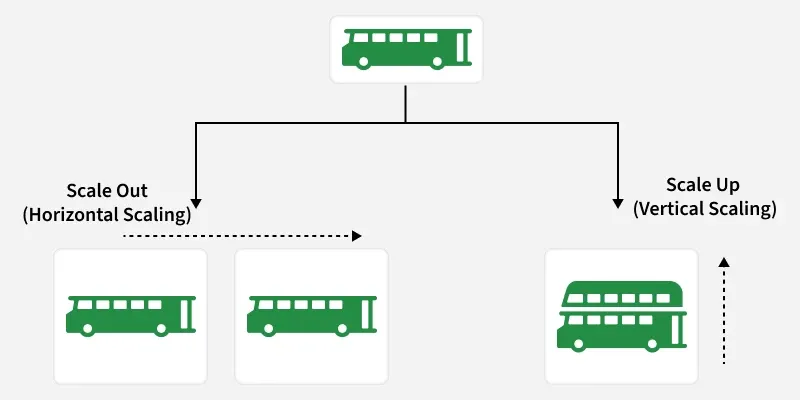

# 1.2.4 Scalability in System Design

> **Phase 1: Introduction to System Design → 1.2 High-Level Design → 1.2.4 Scalability**
> Source: GeeksforGeeks, *Scalability in System Design* (last updated 1 Oct 2026)
> Previous: [1.2.3.9 Pub/Sub Architecture](../1.2.3-System-architecture/1.2.3.9-Pub-Sub-Architecture.md)

---

## Table of Contents

1. [What is Scalability?](#1-what-is-scalability)
2. [Real-World Examples](#2-real-world-examples)
3. [Ways to Scale](#3-ways-to-scale)
4. [Factors Affecting Scalability](#4-factors-affecting-scalability)
5. [Components That Help Increase Scalability](#5-components-that-help-increase-scalability)
6. [Putting It Together: Scaling a System Step by Step](#6-putting-it-together-scaling-a-system-step-by-step)
7. [Measuring Scalability](#7-measuring-scalability)
8. [Challenges and Trade-offs](#8-challenges-and-trade-offs)
9. [Quick Revision](#9-quick-revision)
10. [Self-Check Quiz: Interview Q&A](#10-self-check-quiz-interview-qa)

---

## 1. What is Scalability?

**Scalability** is a system's ability to handle **increasing workloads, users or data** by **adding or adjusting resources** while keeping **acceptable performance**.

- **Handling increased load:** a scalable system supports more users, requests or data as demand grows.
- **Resource expansion:** servers, CPU, memory or storage can be **added or adjusted** to meet that demand.

**Example:** a video streaming platform **adds more application server instances** when viewers increase, so it can handle the extra requests.

> 💡 **Key idea:** a system is scalable if **adding resources gives a roughly proportional increase in capacity**. Double the servers → about double the users, without response times collapsing.

### Scalability vs performance

| | Performance | Scalability |
|---|---|---|
| **Question** | *How fast is it for one user / one request?* | *Does it **stay** fast as load grows?* |
| **Problem looks like** | Slow even with few users | Fast with few users, **slow under heavy load** |

### Dimensions of scale

| Dimension | Growing… | Example |
|---|---|---|
| **Load** | Requests / users per second | Flash sale traffic |
| **Data** | Amount of stored data | Billions of rows, petabytes of video |
| **Geographic** | Users spread around the world | Serving Asia, Europe and the US with low latency |
| **Elasticity** | Ability to scale **up and down** with demand | Add servers at peak, remove them at night to save cost |

---

## 2. Real-World Examples

| Example | How it scales |
|---|---|
| **Cloud platforms** (AWS, Google Cloud) | Let organizations **increase or decrease** compute, storage and other resources on demand (auto-scaling, managed services). |
| **Large web applications** | Combine **load balancing, caching, database replication and horizontal scaling** to serve huge numbers of users. |
| **Streaming platforms** | Use **distributed infrastructure, caching, CDNs and horizontal scaling** to deliver video to millions at once. |

---

## 3. Ways to Scale



### 3.1 Vertical scaling (scale up)

**Increase the resources of an existing server**: more CPU, memory or storage.

- **Simple:** no code changes; same single machine.
- **Hardware limit:** you can only grow as big as the largest machine available, and an upgrade may need **downtime or a restart**.
- Still a **single point of failure**.

### 3.2 Horizontal scaling (scale out)

**Add more servers or instances** and spread the workload across them.

- Usually with a **load balancer** in front distributing requests.
- Capacity grows by adding instances, but the **application and its dependencies must support distributed operation** (e.g. stateless app servers, shared session store; see [1.2.3.7 Stateless and Stateful Systems](../1.2.3-System-architecture/1.2.3.7-Stateless-and-Stateful-Systems.md)).

```
VERTICAL (scale up)                       HORIZONTAL (scale out)

  ┌──────┐        ┌──────────────┐                         ┌─────────────┐
  │ 2 CPU│   ──►  │   16 CPU     │           Users ─► LB ──┬─►│ Server 1 │
  │ 4 GB │        │   64 GB RAM  │                         ├─►│ Server 2 │
  └──────┘        │   bigger disk│                         ├─►│ Server 3 │
                  └──────────────┘                         └─►│ Server N │  ← add more as needed
  one machine, made bigger                                 many machines, work shared
```

| Aspect | Vertical | Horizontal |
|---|---|---|
| **How** | Bigger machine | More machines |
| **Limit** | Hardware ceiling | Practically unlimited (with the right design) |
| **Complexity** | Low | Higher: load balancing, distributed state, consistency |
| **Downtime to scale** | Often (restart) | Usually none (add instances live) |
| **Fault tolerance** | Single point of failure | One server can fail; the others keep serving |
| **Cost curve** | High-end hardware gets expensive fast | Commodity machines; pay as you grow |
| **Best for** | Early stage, databases, quick fixes | Web/app tiers, large-scale and elastic systems |

> 💡 In practice teams use **both**: scale up until it's no longer cost-effective, then scale out. Stateless app servers scale out easily; **databases** are often scaled up first, then with **replicas and sharding**.

### 3.3 Microservices architecture

The application is split into **independently deployable services**.

- **Independent scaling:** each service scales to its own workload (e.g. run 20 search instances but only 2 profile instances).
- ⚠️ Microservices are **an architectural approach, not a scaling technique** themselves; they make independent scaling of components **easier**. *(See [1.2.3.2 Microservices](../1.2.3-System-architecture/1.2.3.2-Microservices.md).)*

### 3.4 Serverless

Developers run code **without managing servers**; the provider handles infrastructure.

- **Managed infrastructure:** platforms **scale functions automatically** with demand (often to zero when idle).
- Great for **variable or unpredictable** workloads, but scaling is still limited by **concurrency quotas, throttling and execution limits**. *(See [1.2.3.6 Serverless](../1.2.3-System-architecture/1.2.3.6-Serverless-Architecture.md).)*

---

## 4. Factors Affecting Scalability

| # | Factor | What it means | Typical fix |
|---|---|---|---|
| 1 | **Performance bottlenecks** | One component limits the **whole system's** capacity: slow DB queries, inefficient code, too little CPU/memory | Profile, optimize queries, add indexes, cache, scale the bottleneck |
| 2 | **Resource utilization** | How efficiently CPU, memory, storage and network are used. Poor use creates bottlenecks | Right-size instances, auto-scaling, avoid idle or overloaded nodes |
| 3 | **Network latency** | Delay as data travels between systems. High latency slows communication between nodes | Co-locate chatty services, CDNs, fewer round trips, batching |
| 4 | **Data storage & access** | How data is stored and read heavily limits scale | **Distributed databases**, **caching**, replicas, sharding, good indexes |
| 5 | **Concurrency & parallelism** | How well the system handles many tasks at once | Async I/O, thread pools, parallel processing, avoiding lock contention |
| 6 | **System architecture** | How components are structured. **Modular, loosely coupled** designs scale more easily | Stateless services, decoupling via queues/events, supports both vertical and horizontal scaling |

### Concurrency vs parallelism

```
CONCURRENCY (managing many tasks in the same period: they take turns / overlap)
  1 core:  [A][B][A][C][B][A][C]...       ← tasks interleave; all "in progress"

PARALLELISM (executing many tasks at the same instant)
  core 1:  [A][A][A][A]
  core 2:  [B][B][B][B]                   ← truly simultaneous, on multiple cores/machines
  core 3:  [C][C][C][C]
```

- **Concurrency** = *dealing with* lots of things at once (structure). A web server juggling thousands of open connections while waiting on I/O.
- **Parallelism** = *doing* lots of things at once (execution). Encoding 4 video chunks on 4 cores.

### The bottleneck rule

> ⚠️ A system is only as scalable as its **narrowest point**. Adding 10× app servers does nothing if every request waits on **one overloaded database**. Find the bottleneck first, scale that, then look for the next one.

---

## 5. Components That Help Increase Scalability

| Component | How it helps | Watch out for |
|---|---|---|
| **Load balancer** | Spreads traffic across servers, avoiding overload; improves performance and **availability** | Can become a bottleneck/SPOF itself, so run it redundantly |
| **Caching** | Keeps frequently used data in fast storage (memory) → **lower latency, less backend load** | Stale data; cache invalidation |
| **Database replication** | Multiple copies of data (often **asynchronous**) → better **read** scaling and availability | Replicas may lag: **consistency trade-off** |
| **Database sharding** | Splits data into **shards** on separate DB instances → scales **writes** and storage | Cross-shard queries, rebalancing, hot shards |
| **Microservices** | Services scale **independently** | Operational complexity |
| **Data partitioning** | Divides data by criteria like **user or region** | Choosing a good partition key; data locality |
| **CDNs** | Serve cached content from **locations close to users** → lower latency, less origin load | Mostly for static/cacheable content |
| **Queueing systems** | Handle work **asynchronously**, absorbing **traffic spikes** (load leveling) | Added latency for queued work; eventual consistency |

```
                    ┌──── CDN (static files, images, video) ◄─── Users
                    │
 Users ──► Load Balancer ──► [App] [App] [App]   (stateless, horizontally scaled)
                                │      │
                    ┌───────────┼──────┴──────────────┐
                    ▼           ▼                     ▼
                 Cache     Primary DB ──replicates──► Read replicas
                (Redis)    (sharded by user_id)
                                │
                                └──► Queue ──► Workers (emails, video processing, reports)
```

---

## 6. Putting It Together: Scaling a System Step by Step

A typical evolution as an app grows. Each step fixes the **current bottleneck**:

| Stage | Change | Fixes |
|---|---|---|
| **1. Single server** | App + DB on one machine | Fine for an MVP |
| **2. Separate DB** | Move the database to its own server | App and DB stop competing for resources |
| **3. Scale up** | Bigger machines | Quick capacity boost |
| **4. Load balancer + multiple app servers** | Stateless app servers behind an LB | App tier scales out; no single app server SPOF |
| **5. Cache** | Redis/Memcached for hot reads | Cuts DB load and latency |
| **6. CDN** | Static content at the edge | Faster global delivery, less origin traffic |
| **7. Read replicas** | Reads go to replicas, writes to the primary | Scales read-heavy workloads |
| **8. Queues + workers** | Slow work done asynchronously | Faster responses; absorbs spikes |
| **9. Sharding / partitioning** | Split data across DB instances | Scales writes and data size |
| **10. Split into services / multi-region** | Independent services; data centers near users | Independent scaling; geographic scale and resilience |

> 💡 **Interview tip:** don't jump to stage 10. Start simple, state the expected load (capacity estimation), and add each component **only when a bottleneck justifies it**.

---

## 7. Measuring Scalability

| Metric | Meaning |
|---|---|
| **Throughput** | Requests (or transactions) handled per second |
| **Latency** | Time per request; watch **p95/p99**, not just the average |
| **Resource utilization** | CPU, memory, disk, network usage per node |
| **Error rate** | Failures/timeouts as load rises |
| **Scaling efficiency** | Capacity gained per resource added (2× servers → ~2× throughput?) |
| **Queue length / consumer lag** | Is async work keeping up? |

```
 throughput                         latency
    │        ┌──────── capacity           │                    ╱
    │      ╱                              │                  ╱   ← latency explodes
    │    ╱                                │               ╱      past capacity
    │  ╱                                  │ ___________╱
    └──────────── load                    └──────────────── load
```

When load passes a system's capacity, **throughput flattens** and **latency shoots up**. Scaling moves that knee further to the right.

---

## 8. Challenges and Trade-offs

| Trade-off | Detail |
|---|---|
| **Cost vs scalability** | More servers, replicas and regions improve performance and availability but raise **infrastructure and operational cost**. Elastic scaling (scale down when quiet) helps. |
| **Complexity** | Bigger distributed systems are harder to **manage, maintain and debug**: more moving parts, more failure modes. |
| **Latency vs throughput** | Different metrics; optimizing one can hurt the other. **Batching** raises throughput but makes each individual request wait longer. |
| **Consistency vs availability** | Replicated/partitioned data may be **temporarily inconsistent** (replica lag, eventual consistency). *(CAP theorem, later in the course.)* |
| **Data partitioning trade-offs** | Must balance **partition size**, **data movement** (rebalancing) and **data locality** (keeping related data together). |
| **Statefulness** | Stateful components are much harder to scale than stateless ones. |

---

## 9. Quick Revision

- **Scalability** = handling **more load, users or data** by adding/adjusting resources while keeping **acceptable performance**.
- Performance = fast for one request; scalability = **stays fast as load grows**.
- **Vertical (scale up):** bigger machine, simple, **hardware limit**, possible downtime, SPOF.
- **Horizontal (scale out):** more machines + **load balancer**, near-unlimited, needs **distributed-ready** (stateless) design.
- **Microservices** make independent scaling easier (not a scaling technique by itself). **Serverless** auto-scales within provider limits.
- **Factors:** bottlenecks · resource utilization · network latency · data storage/access · concurrency & parallelism · architecture.
- **Concurrency** = managing many tasks over time; **parallelism** = executing many at the same instant.
- **Components:** load balancer · caching · replication (reads) · sharding (writes) · microservices · partitioning · CDN · queues.
- **Measure:** throughput, p95/p99 latency, utilization, error rate, scaling efficiency.
- **Trade-offs:** cost, complexity, latency vs throughput, consistency, partitioning balance.

---

## 10. Self-Check Quiz: Interview Q&A

> ⭐ These 6 questions come from the GeeksforGeeks suggested quiz and are **important for system design interviews**. Try each one before opening the answer.

### Q1. What does scalability mean in the context of system design?

- A. A system's ability to handle increasing workloads without degrading performance
- B. A system's ability to store unlimited data on a single server
- C. A system's ability to run only on high-end hardware
- D. A system's ability to operate without databases

<details>
<summary>Answer</summary>

**A. A system's ability to handle increasing workloads without degrading performance**

Scalability is how well a system handles growth in users, traffic or data while keeping performance and reliability. *(B and C describe the limits of a **single** machine, which is the opposite of scalable design.)* See [§1](#1-what-is-scalability).
</details>

### Q2. What is the main concept behind vertical scaling in a system?

- A. Adding more servers to distribute the workload
- B. Splitting the application into microservices
- C. Increasing CPU, memory, or storage on the same server
- D. Moving all workloads to client devices

<details>
<summary>Answer</summary>

**C. Increasing CPU, memory, or storage on the same server**

Vertical scaling (**scale up**) upgrades one machine's hardware. *(A is horizontal scaling.)* See [§3.1](#31-vertical-scaling-scale-up).
</details>

### Q3. Why is horizontal scaling preferred for large-scale applications?

- A. Because it upgrades the operating system automatically
- B. Because it adds more servers to share and distribute the workload
- C. Because it removes the need for databases
- D. Because it reduces the number of users in the system

<details>
<summary>Answer</summary>

**B. Because it adds more servers to share and distribute the workload**

Capacity grows by adding machines, with no single-machine hardware ceiling, and one server failing doesn't take everything down. See [§3.2](#32-horizontal-scaling-scale-out).
</details>

### Q4. What role does a load balancer play in improving scalability?

- A. Stores application data permanently
- B. Processes application logic directly
- C. Replaces databases in distributed systems
- D. Distributes incoming traffic across multiple servers

<details>
<summary>Answer</summary>

**D. Distributes incoming traffic across multiple servers**

It prevents any one server from being overloaded, improving performance and availability, and it's what makes horizontal scaling usable. See [§5](#5-components-that-help-increase-scalability).
</details>

### Q5. How does caching help improve system scalability?

- A. By storing frequently accessed data temporarily to reduce backend load
- B. By increasing the size of the database automatically
- C. By limiting the number of user requests
- D. By removing network communication

<details>
<summary>Answer</summary>

**A. By storing frequently accessed data temporarily to reduce backend load**

Fewer repeated database queries and faster responses mean the same backend can serve many more requests. *(C is rate limiting, not caching.)* See [§5](#5-components-that-help-increase-scalability).
</details>

### Q6. What is one common trade-off when designing highly scalable systems?

- A. Scalable systems always reduce system complexity
- B. Scalability eliminates the need for distributed systems
- C. Improving scalability often increases infrastructure cost and system complexity
- D. Scalable systems cannot handle large traffic spikes

<details>
<summary>Answer</summary>

**C. Improving scalability often increases infrastructure cost and system complexity**

More resources and more complex (distributed) architectures raise operational cost and management effort. See [§8](#8-challenges-and-trade-offs).
</details>

### 🧠 Key Takeaways for Interviews

| # | Remember |
|---|---|
| 1 | Scalability = **more load, same acceptable performance**, by adding resources |
| 2 | **Scale up** (simple, limited) vs **scale out** (needs stateless/distributed design, near-unlimited) |
| 3 | Find and fix the **bottleneck**: often the **database** |
| 4 | Toolbox: **LB · cache · CDN · replicas (reads) · sharding (writes) · queues · services** |
| 5 | Measure with **throughput and p99 latency**, not averages |
| 6 | Every step adds **cost and complexity**, so scale for real, measured needs |

### Bonus Questions

> Extra practice on the rest of the topic.

### B1. What does horizontal scaling require from the application?

- A. Nothing; any application can be scaled horizontally
- B. That it supports distributed operation (e.g. stateless servers, shared state stores)
- C. That it runs on a single server
- D. That it uses a relational database

<details>
<summary>Answer</summary>

**B.** Requests may go to **any** instance, so servers shouldn't keep unique local state, and dependencies must work across many instances. See [§3.2](#32-horizontal-scaling-scale-out).
</details>

### B2. Which statement about microservices and scalability is correct?

- A. Microservices are a scaling technique that automatically scales applications
- B. Microservices make it easier to scale individual services independently, but are an architectural approach rather than a scaling technique
- C. Microservices cannot be scaled
- D. Microservices remove the need for load balancers

<details>
<summary>Answer</summary>

**B.** Splitting the app into services lets you scale each one to its own load; the scaling itself still comes from adding instances. See [§3.3](#33-microservices-architecture).
</details>

### B3. You add 10 more app servers, but the response time doesn't improve. What is the most likely cause?

<details>
<summary>Answer</summary>

A **bottleneck elsewhere**, typically an overloaded **database**. A system is only as scalable as its narrowest point. Fix the bottleneck: caching, read replicas, query optimization, sharding. See [§4](#4-factors-affecting-scalability).
</details>

### B4. What is the difference between concurrency and parallelism?

<details>
<summary>Answer</summary>

**Concurrency** = managing multiple in-progress tasks over the same period (they can take turns on one core). **Parallelism** = executing multiple tasks **at the same instant** on multiple cores or machines. See [§4](#concurrency-vs-parallelism).
</details>

### B5. Your app is very read-heavy and the database is overloaded by reads. What helps most?

<details>
<summary>Answer</summary>

**Caching** (serve hot data without touching the DB) plus **read replicas** (spread the remaining reads). Sharding mainly helps **write** volume and data size.
</details>

### B6. Batching requests increases throughput. What is the usual trade-off?

<details>
<summary>Answer</summary>

**Higher latency for individual requests**: each one may wait for the batch to fill or be processed. See [§8](#8-challenges-and-trade-offs).
</details>

### B7. Why is relying only on one big server (vertical scaling) risky?

<details>
<summary>Answer</summary>

It's a **single point of failure** with a **hardware ceiling**, and upgrades may need **downtime**.
</details>

### B8. What does a CDN do for scalability?

<details>
<summary>Answer</summary>

It serves cached (mostly static) content from **edge locations near users**, which lowers latency and removes that traffic from your origin servers.
</details>

### B9. How do queues help with traffic spikes?

<details>
<summary>Answer</summary>

They **buffer** work so workers process it at a steady rate (**load leveling**) instead of the system being overwhelmed.
</details>

### B10. What's the difference between replication and sharding?

<details>
<summary>Answer</summary>

**Replication** copies the **same** data to multiple nodes, which helps reads and availability. **Sharding** splits **different** data across nodes, which helps writes and total data size.
</details>

### B11. Why watch p99 latency instead of the average?

<details>
<summary>Answer</summary>

The average hides the slowest requests. **p99** shows what the slowest 1% of users experience, which is often where problems appear first under load.
</details>

### B12. What is elasticity?

<details>
<summary>Answer</summary>

Scaling **up and down automatically** with demand, adding resources at peak and removing them when quiet, so you pay only for what you need.
</details>

---

### 📚 Further Reading


- GeeksforGeeks: *Scalability in System Design*
- Related notes: [Monolith vs Microservices §5 Scaling](../1.2.3-System-architecture/1.2.3.3-Monolithic-vs-Microservices.md#5-scaling-compared) · [Stateless and Stateful Systems](../1.2.3-System-architecture/1.2.3.7-Stateless-and-Stateful-Systems.md)
- Next topics: Load Balancing · Caching · Database Replication & Sharding
- Next: [1.2.4.2 Horizontal and Vertical Scaling](1.2.4.2-Horizontal-and-Vertical-Scaling.md)
