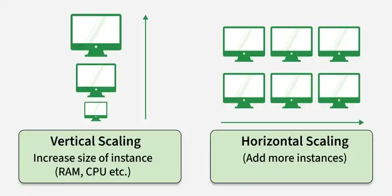
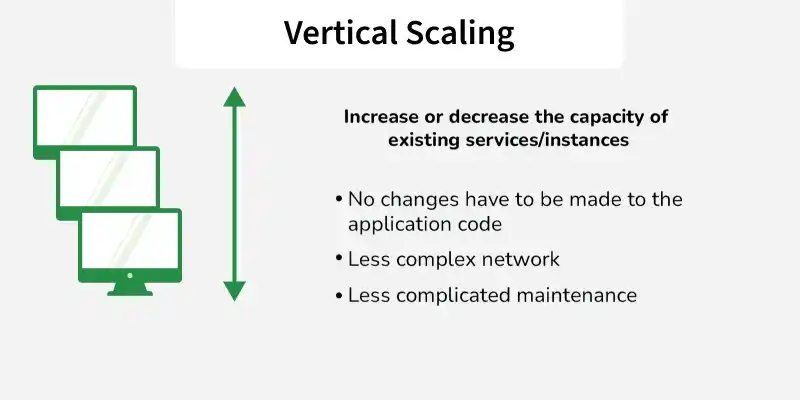
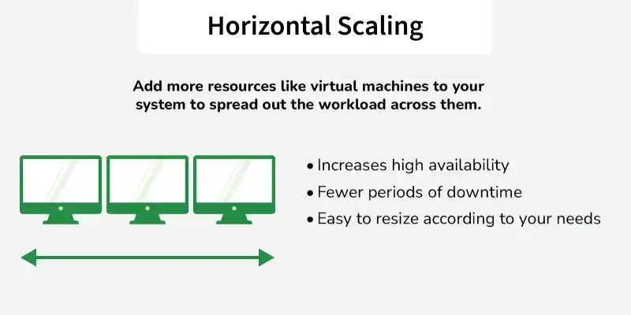
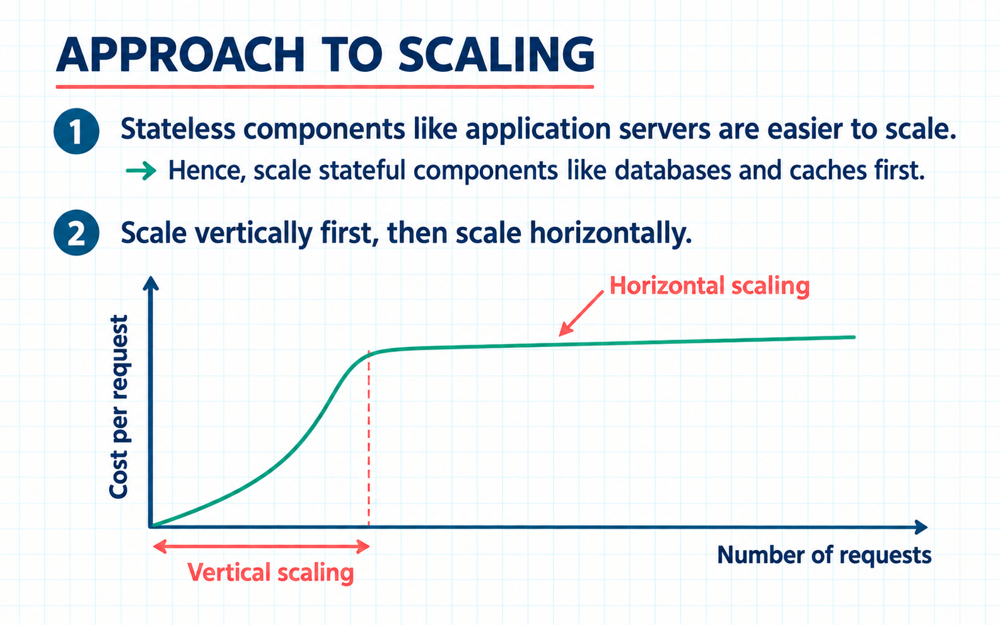

# 1.2.4 Horizontal and Vertical Scaling

> **Phase 1: Introduction to System Design → 1.2 High-Level Design → 1.2.4 Scalability**
> Source: GeeksforGeeks, *Horizontal and Vertical Scaling | System Design* (last updated 1 Oct 2026)
> Previous: [1.2.4.1 Scalability in System Design](1.2.4.1-Scalability.md). That note gives the overview; this one goes deep on the two ways to scale.

---

## Table of Contents

1. [Overview](#1-overview)
2. [Why We Need Scaling](#2-why-we-need-scaling)
3. [Vertical Scaling (Scale Up)](#3-vertical-scaling-scale-up)
4. [Horizontal Scaling (Scale Out)](#4-horizontal-scaling-scale-out)
5. [Side-by-Side Comparison](#5-side-by-side-comparison)
6. [Scaling Each Tier of a System](#6-scaling-each-tier-of-a-system)
7. [Choosing Between Them, and the Hybrid Approach](#7-choosing-between-them-and-the-hybrid-approach)
8. [Quick Revision](#8-quick-revision)
9. [Self-Check Quiz: Interview Q&A](#9-self-check-quiz-interview-qa)

---

## 1. Overview

There are two ways to increase a system's capacity:

| | **Horizontal scaling** (scale **out**) | **Vertical scaling** (scale **up**) |
|---|---|---|
| **What** | Add **more servers/instances** and spread the load | Give **one server** more CPU, RAM or storage |
| **Analogy** | Hire more cashiers and open more checkout lanes | Give your one cashier a faster till |

**Example:** a large e-commerce site **adds servers** during a big sale (horizontal); a small app **upgrades its server's RAM or CPU** (vertical).



> ⚠️ **Scaling ≠ high availability.** Scaling raises **capacity**. **Resilience** comes from **fault tolerance, redundancy and recovery** mechanisms. Horizontal scaling *makes* redundancy possible, but only if you also design for failover (health checks, no single point of failure, replicated data).

---

## 2. Why We Need Scaling

| Need | Why |
|---|---|
| **Handle more users and traffic** | Avoid slowdowns or crashes at peak times. |
| **Increase capacity** | Keep up as the workload grows. |
| **Maintain performance** | Keep response times low by spreading load and removing bottlenecks. |
| **Support growing data** | Storage and data needs grow with the application. |

---

## 3. Vertical Scaling (Scale Up)

**Vertical scaling** increases the capacity of **one existing component** (hardware or software) instead of adding more of them.



- **Upgrade the same machine:** faster processors, more RAM, bigger or faster disks.
- **Simple** to implement; good for **monolithic and small-scale** applications.

```
   Before                     After
 ┌─────────────┐          ┌──────────────────┐
 │ 2 vCPU      │          │ 8 vCPU           │
 │ 8 GB RAM    │   ───►   │ 64 GB RAM        │      same server, same code,
 │ 100 GB SSD  │          │ 1 TB NVMe SSD    │      same IP, more power
 └─────────────┘          └──────────────────┘
        ▲                          ▲
     all traffic                all traffic        (still ONE machine)
```

### Examples

| Example | Upgrade |
|---|---|
| **Database server** | MySQL from **16 GB → 64 GB RAM** so more data fits in memory and more queries run |
| **Website VM** | **2-core → 8-core**, higher-RAM VM |
| **Cloud instance** | An e-commerce app on **one larger AWS EC2 instance** (more CPU, RAM, disk) |

### Advantages

| Advantage | Detail |
|---|---|
| **Increased capacity** | Better hardware lets the server handle more requests, faster. |
| **Easier management** | Only **one node** to run, monitor and secure. |
| **No code changes** | The application doesn't need to be distributed-aware. |
| **No network overhead** | Components talk **in-process / within one machine**, with no cross-server latency. |
| **Simple consistency** | One database on one machine: normal ACID transactions, no replication lag. |

### Disadvantages

| Disadvantage | Detail |
|---|---|
| **Hardware ceiling** | Limited by the **maximum CPU, memory and storage** a machine supports. |
| **Single point of failure** | **All requests hit one server**: if it fails, the whole service is down. |
| **Downtime to upgrade** | Scaling up often needs a **restart or replacement** (e.g. stopping a cloud VM to change its size). |
| **Rising cost** | High-end hardware gets **disproportionately expensive**: doubling capacity can cost much more than double. |
| **Not elastic** | Hard to scale **back down** quickly when traffic drops. |

---

## 4. Horizontal Scaling (Scale Out)

**Horizontal scaling** increases capacity by **adding more machines** and **distributing the workload** across them.



- No need to change or replace the existing server; **add more of them**.
- New servers increase capacity **without replacing anything**, though deployment, warm-up, **traffic rebalancing** or config changes may briefly affect the system.

```
                         ┌───────────────┐
 Users ─────────────────►│ Load Balancer │
                         └──┬─────┬────┬─┘
                ┌───────────┘     │    └────────────┐
                ▼                 ▼                 ▼
          ┌──────────┐     ┌──────────┐      ┌──────────┐
          │ Server 1 │     │ Server 2 │ ...  │ Server N │   ← identical, stateless
          └────┬─────┘     └────┬─────┘      └────┬─────┘
               └────────────────┼─────────────────┘
                                ▼
                  shared data: DB (replicated/sharded), cache, session store
```

### Examples

| Example | How |
|---|---|
| **GeeksforGeeks-style website** | More **web servers behind a load balancer** to handle traffic spikes |
| **Netflix** | Scales **microservices independently**: many instances of the streaming service across regions |
| **AWS Auto Scaling** | Launches more **EC2 instances** at peak (e.g. Black Friday), removes them afterwards |

### Auto scaling in action

```
 CPU > 70% for 5 min ──► scale-out policy ──► launch 2 instances ──► health check ──► LB adds them
 CPU < 30% for 15 min ─► scale-in policy  ──► drain connections ──► terminate 1 instance
                         (min 2, max 20 instances)
```

### What horizontal scaling needs from your design

| Requirement | Why |
|---|---|
| **Load balancer** | Something must **spread requests** across instances. |
| **Stateless app servers** | Any request can go to any server, so keep sessions in a shared store or token. *(See [1.2.3.7 Stateless and Stateful](../1.2.3-System-architecture/1.2.3.7-Stateless-and-Stateful-Systems.md).)* |
| **Shared/distributed data** | All instances must see the same data: shared DB, replicas, sharding, caches. |
| **Health checks** | The LB must stop sending traffic to failed instances. |
| **Automation** | Many machines need automated deploys, config and orchestration (e.g. **Kubernetes**, infrastructure-as-code). |

### Advantages

| Advantage | Detail |
|---|---|
| **Increased capacity** | More nodes handle more requests, with **no single-machine ceiling**. |
| **Improved performance** | Load is spread, so no single server gets overloaded. |
| **Increased fault tolerance** | If a node fails, requests go to **other nodes**, which lowers the risk of downtime. |
| **Elasticity** | Add instances at peak, **remove** them when quiet, and pay for what you use. |
| **No downtime to scale** | New instances join while the others keep serving. |

### Disadvantages

| Disadvantage | Detail |
|---|---|
| **Complex architecture** | Needs load balancers, distributed databases, service discovery, etc. |
| **Consistency is hard** | Keeping data **consistent across nodes** needs synchronization, messaging or replication. |
| **More operations** | More machines = more networking, power, monitoring, patching and maintenance. |
| **Network overhead** | Nodes communicate **over the network**: more latency and more failure modes. |
| **Not every part scales out easily** | Stateful components (databases, legacy apps) need extra work (replication, sharding). |

---

## 5. Side-by-Side Comparison

| Aspect | Horizontal scaling | Vertical scaling |
|---|---|---|
| **How** | Adds more machines/servers | Increases CPU, RAM or storage of **one** machine |
| **Cost** | More **cost-effective at large scale** (commodity machines) | Simple at first, but **expensive over time** (high-end hardware) |
| **Flexibility** | **High**: add servers easily | **Limited** by hardware |
| **Fault tolerance** | **Better**: load spread across machines | **Lower**: depends on one machine |
| **Performance ceiling** | Grows with more servers | Only up to the **hardware limit** |
| **Single point of failure** | **Lower risk** | **Higher risk** |
| **Management** | **More complex** (distributed system) | **Easier** (one machine) |
| **Suitable for** | **Massive scalability** | **Moderate** scalability needs |
| **Load balancing** | **Required** | Usually not needed |
| **Communication** | **Network** between machines | Mostly **within one machine** |
| **Downtime to scale** | Usually none | Often a restart |
| **Data consistency** | Harder (replication, sync) | Simple (single node) |

---

## 6. Scaling Each Tier of a System

Different parts of a system scale differently:

| Tier | Usual approach | Why |
|---|---|---|
| **Web / app servers** | **Horizontal**, first choice | Easy once **stateless**: add instances behind a load balancer |
| **Cache** (Redis, Memcached) | Vertical first, then **horizontal** (cluster/sharding) | Memory-bound; cluster when one node isn't enough |
| **Relational database** | **Vertical first**, then **read replicas** (horizontal for reads), then **sharding** (horizontal for writes) | Stateful and consistency-sensitive; scaling out is hard |
| **NoSQL databases** (Cassandra, DynamoDB) | **Horizontal** by design | Built to partition data across many nodes |
| **Background workers** | **Horizontal** | Add consumers to a queue |
| **Legacy monolith** | **Vertical** | Often can't run as multiple instances without changes |

```
                ┌──── horizontal ────┐      ┌─ vertical first, then replicas/shards ─┐
 Users ─► LB ─► [App] [App] [App] [App] ─►   Primary DB (big machine) ──► Read replicas
                                             └──────────► Shards (when writes outgrow it)
```

---

## 7. Choosing Between Them, and the Hybrid Approach



### How to decide

1. **Identify requirements and business goals:** expected load, growth rate, availability target, budget.
2. **Make design decisions:** ask questions, **prototype**, measure, refine.
3. **Decide per component:** large systems often use **different approaches for different parts**.

| Choose **vertical** when… | Choose **horizontal** when… |
|---|---|
| Traffic is **moderate** and predictable | You need **massive** or **unpredictable** scale |
| The app is a **monolith** or isn't distributed-ready | App servers are (or can be) **stateless** |
| You need a **quick fix** with no code changes | You need **high availability** / no single point of failure |
| Strong **consistency** on one node matters (e.g. a DB) | You want **elastic**, pay-as-you-go capacity |
| The team is small and wants **simple operations** | You can handle distributed-system complexity |

### Hybrid (sometimes called "diagonal") scaling

In practice, most systems **combine both**, depending on workload, performance, cost, availability and architecture:

```
 Stage 1: scale UP        one server: 2 vCPU → 8 vCPU            (fast, simple)
 Stage 2: scale OUT       several 8 vCPU servers behind an LB    (capacity + resilience)
 Stage 3: right-size      pick the instance size with the best price/performance,
                          then add/remove instances of that size automatically
```

- **Vertical** gives a **quick performance boost** with no architectural change.
- **Horizontal** gives **unlimited growth and resilience**.
- Together you get **powerful-enough nodes, in sufficient numbers**: e.g. a large primary database (vertical) plus read replicas and auto-scaled app servers (horizontal).

---

## 8. Quick Revision

- **Vertical (scale up):** bigger CPU/RAM/storage on **one** machine. Examples: MySQL 16→64 GB RAM, 2→8-core VM, larger EC2 instance.
  - ✅ simple, easy management, no code changes, no network overhead.
  - ❌ hardware ceiling, **single point of failure**, downtime to upgrade, expensive at the high end.
- **Horizontal (scale out):** **more machines** + **load balancer**. Examples: more web servers, Netflix microservices, AWS Auto Scaling.
  - ✅ capacity without a ceiling, **fault tolerance**, elasticity, no downtime to scale.
  - ❌ complex (LB, distributed DBs), consistency is hard, more ops, network overhead.
  - Needs **stateless** servers, shared data, health checks, automation.
- **Scaling ≠ availability:** resilience needs redundancy, failover and recovery too.
- **Per tier:** app servers scale out; databases usually scale up, then add replicas and shards.
- **Hybrid:** combine vertical speed with horizontal scalability and resilience. This is what most large systems do.

---

## 9. Self-Check Quiz: Interview Q&A

> ⭐ These 6 questions come from the GeeksforGeeks suggested quiz and are **important for system design interviews**. Try each one before opening the answer.

### Q1. What is the main difference between horizontal scaling and vertical scaling in system design?

- A. Horizontal scaling adds more servers, while vertical scaling increases the resources of an existing server.
- B. Horizontal scaling upgrades a single server, while vertical scaling adds more servers.
- C. Both methods require replacing the entire infrastructure.
- D. Both methods require replacing the entire infrastructure.

<details>
<summary>Answer</summary>

**A. Horizontal scaling adds more servers, while vertical scaling increases the resources of an existing server.**

Horizontal adds machines; vertical upgrades one machine. *(B swaps them; neither requires replacing the whole infrastructure. Options C and D are duplicated in the source quiz.)* See [§1](#1-overview).
</details>

### Q2. In which scenario is vertical scaling commonly used?

- A. Upgrading server RAM from 16 GB to 64 GB to handle more queries
- B. Adding multiple servers behind a load balancer
- C. Deploying microservices across different regions
- D. Splitting a database into multiple shards

<details>
<summary>Answer</summary>

**A. Upgrading server RAM from 16 GB to 64 GB to handle more queries**

Vertical scaling increases CPU, RAM or storage on the **same** machine. *(B, C and D all add more machines, which is horizontal.)* See [§3](#3-vertical-scaling-scale-up).
</details>

### Q3. Why is horizontal scaling considered more fault tolerant than vertical scaling?

- A. Because multiple servers share the workload
- B. Because it removes the need for database
- C. Because it upgrades the operating system automatically
- D. Because it reduces the number of user requests

<details>
<summary>Answer</summary>

**A. Because multiple servers share the workload**

If one server fails, the others keep handling requests, which reduces the risk of downtime. A vertically scaled single server is a single point of failure. See [§4](#4-horizontal-scaling-scale-out).
</details>

### Q4. What is one major limitation of vertical scaling?

- A. It cannot improve system performance
- B. It is limited by the physical hardware capacity of a single machine
- C. It requires distributed databases
- D. It always needs load balancing

<details>
<summary>Answer</summary>

**B. It is limited by the physical hardware capacity of a single machine**

Hardware upgrades eventually hit physical limits; you can't scale one machine indefinitely. *(C and D are requirements of **horizontal** scaling.)*
</details>

### Q5. Why does horizontal scaling often require load balancers?

- A. To store application data across servers
- B. To distribute incoming traffic evenly across multiple servers
- C. To replace database management systems
- D. To compress network data automatically

<details>
<summary>Answer</summary>

**B. To distribute incoming traffic evenly across multiple servers**

With many servers, something must decide which one handles each request, so no single server gets overloaded and failed servers are skipped.
</details>

### Q6. Why do many large organizations use a hybrid approach combining both scaling methods?

- A. To eliminate the need for system monitoring
- B. To combine vertical scaling performance with horizontal scalability and resilience
- C. To avoid using cloud infrastructure
- D. To ensure only one server processes requests

<details>
<summary>Answer</summary>

**B. To combine vertical scaling performance with horizontal scalability and resilience**

Vertical scaling gives fast, simple performance gains; horizontal scaling gives near-unlimited growth and fault tolerance. Using both gets the best of each. See [§7](#7-choosing-between-them-and-the-hybrid-approach).
</details>

### 🧠 Key Takeaways for Interviews

| # | Remember |
|---|---|
| 1 | **Up** = bigger machine; **out** = more machines |
| 2 | Vertical: **simple, no code changes**, but **ceiling + SPOF + downtime** |
| 3 | Horizontal: **elastic + fault tolerant**, but needs **LB, stateless servers, distributed data** |
| 4 | Scaling raises **capacity**; **availability** also needs redundancy and failover |
| 5 | App tier scales **out**; databases usually scale **up**, then replicas and shards |
| 6 | Real systems are **hybrid** |

### Bonus Questions

> Extra practice on the rest of the topic.

### B1. Does scaling automatically make a system highly available?

<details>
<summary>Answer</summary>

**No.** Scaling increases **capacity**. High availability needs **redundancy, health checks, failover and recovery**. A horizontally scaled system with one shared database can still go down if that database fails.
</details>

### B2. What must be true of app servers before you can scale them horizontally?

<details>
<summary>Answer</summary>

They should be **stateless** (sessions in a shared store or token), reach **shared data**, and sit behind a **load balancer with health checks**, so any request can be served by any instance.
</details>

### B3. Why do databases usually scale vertically first?

<details>
<summary>Answer</summary>

They're **stateful** and need **consistency**. One big machine keeps simple ACID transactions with no replication lag. Scaling out (replicas, sharding) adds complexity, so it's done once vertical scaling stops being enough or cost-effective.
</details>

### B4. What's the downside of vertical scaling in the cloud during an upgrade?

<details>
<summary>Answer</summary>

Changing an instance's size often requires **stopping/restarting** it, so there's **downtime** unless you have a standby to fail over to.
</details>

### B5. Describe a typical auto scaling rule.

<details>
<summary>Answer</summary>

E.g. **scale out** by 2 instances when average CPU > 70% for 5 minutes; **scale in** by 1 when CPU < 30% for 15 minutes; keep between a **minimum** (e.g. 2, for redundancy) and a **maximum** (e.g. 20, for cost control).
</details>

### B6. Why can horizontal scaling be more cost-effective at large scale?

<details>
<summary>Answer</summary>

Many **commodity** machines are usually cheaper per unit of capacity than one top-end machine, and with auto scaling you **pay only for the instances you need** at each moment.
</details>

---

### 📚 Further Reading

- GeeksforGeeks: *Horizontal and Vertical Scaling | System Design*
- AWS EC2 Auto Scaling docs · Kubernetes Horizontal Pod Autoscaler docs
- Related: [1.2.4.1 Scalability in System Design](1.2.4.1-Scalability.md) · [1.2.3.7 Stateless and Stateful Systems](../1.2.3-System-architecture/1.2.3.7-Stateless-and-Stateful-Systems.md)
- Next: [1.2.4.3 Choosing the Right Scalability Approach](1.2.4.3-Choosing-the-Right-Scalability-Approach.md)
