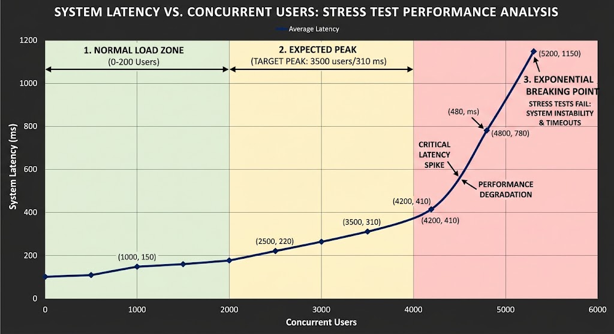

# 1.2.4 Choosing the Right Scalability Approach

> **Phase 1: Introduction to System Design → 1.2 High-Level Design → 1.2.4 Scalability**
> Source: GeeksforGeeks, *Choosing the Right Scalability Approach* (last updated 1 Oct 2026)
> Previous: [1.2.4.2 Horizontal and Vertical Scaling](1.2.4.2-Horizontal-and-Vertical-Scaling.md)

---

## Table of Contents

1. [Overview](#1-overview)
2. [Factors That Affect the Choice](#2-factors-that-affect-the-choice)
3. [Making the Right Choice: Five Scenarios](#3-making-the-right-choice-five-scenarios)
4. [A Decision Guide](#4-a-decision-guide)
5. [Testing Your App's Scalability](#5-testing-your-apps-scalability)
6. [Quick Revision](#6-quick-revision)
7. [Self-Check Quiz: Interview Q&A](#7-self-check-quiz-interview-qa)

---

## 1. Overview

The right scaling approach depends on your system's **traffic, workload, budget and future growth**. Choosing well gives you **performance, reliability and efficient use of resources**.

| Approach | Best for |
|---|---|
| **Vertical scaling** | **Simple** applications with **limited growth** |
| **Horizontal scaling** | **High traffic**, distributed systems, **long-term** growth |
| **Serverless / elastic** | **Unpredictable** or spiky traffic, idle periods |

**Example:** a **small blog** scales **vertically** by upgrading the server's CPU and RAM. A **large e-commerce platform** with millions of users scales **horizontally** with many servers behind a load balancer.

> 💡 **Key idea:** there's no universally "best" approach. **Measure your workload, know your growth and constraints, then choose per component.** Most real systems end up **hybrid**. *(See [1.2.4.2 §7](1.2.4.2-Horizontal-and-Vertical-Scaling.md#7-choosing-between-them-and-the-hybrid-approach).)*

---

## 2. Factors That Affect the Choice

| Factor | What to consider | Leans toward… |
|---|---|---|
| **Application architecture** | A **monolith** is simpler to scale **vertically**; **independently deployable services** make **horizontal** scaling of individual parts easier. | Monolith → vertical · Microservices → horizontal |
| **Database requirements** | Data model, **consistency**, query patterns, **transactions**, workload. **Both SQL and NoSQL** can support large systems. | Strong single-node consistency → vertical first · Read-heavy → **read replicas** (any relationships) · Data with a natural owner key, most queries within one owner (often one-to-many) → **sharding** *(see [below](#what-partitionable-data-means))* |
| **Cost** | Infrastructure pricing, **utilization**, workload, licensing, **operational complexity**. **Neither approach is always cheaper.** | Small/steady → vertical often cheaper · Variable/large → horizontal or serverless |
| **Availability & fault tolerance** | Horizontal scaling enables **redundancy**, together with load balancing and failure handling. | High availability needs → horizontal |
| **Latency requirements** | Latency depends on **network distance, caching, database performance, processing time, data location**. **Horizontal scaling alone doesn't guarantee lower latency.** | Depends: caching, CDNs, data placement often matter more |
| **Traffic patterns** | Variable workloads benefit from **elastic or serverless** scaling, within system limits. | Steady → vertical/fixed · Spiky → auto scaling/serverless |
| **Technology stack** | The stack shapes what's practical; e.g. **Kubernetes** helps manage horizontally scaled containers. | Stateless, containerized → horizontal · Legacy/stateful → vertical |

### What "partitionable data" means

"Partitionable" is **not** about one-to-many vs many-to-many as such. It means the data can be split by **one key** (e.g. `user_id`, `tenant_id`) so that **most queries and transactions touch only one partition**. Relationship types matter because they decide whether such a key exists.

> 💡 **Replicas ≠ sharding.** **Read replicas** copy the **whole** database, so they help read-heavy load **whatever the relationships are**. Only **sharding** splits data, and that's where partitionability matters.

| Relationship | Shards well? | Why / how |
|---|---|---|
| **One-to-many** (customer → orders → order items) | ✅ Usually | Shard by the **parent key** and keep children **on the same shard** as their parent. "This customer's orders" hits one shard; joins and transactions stay local. |
| **Many-to-many** (students ↔ courses, followers ↔ followees, products ↔ tags) | ⚠️ Hard | Any key you pick makes the *other* direction **cross-shard**: shard by student and "who's in course X?" must ask every shard. |
| **Densely connected / global** (social graphs, analytics joining everything) | ❌ Poorly | No key keeps queries local. Scale **vertically / with replicas** first, or use a specialised store (graph DB, data warehouse). |

**Example: one-to-many, shard by `customer_id`:**

```
 Shard A (customers 1–1M)                   Shard B (customers 1M–2M)
 ┌──────────────────────────────┐           ┌──────────────────────────────┐
 │ customer 42                  │           │ customer 1,500,007           │
 │  ├─ order 9001               │           │  ├─ order 7710               │
 │  │   └─ items …              │           │  │   └─ items …              │
 │  └─ order 9002               │           │  └─ …                        │
 └──────────────────────────────┘           └──────────────────────────────┘
 SELECT * FROM orders WHERE customer_id = 42  →  only Shard A ✅
```

**Example: many-to-many, the `follows` table:**

```
 Shard by follower_id:
   "who does Alice follow?"   → Alice's shard only            ✅
   "who follows Alice?"       → must ask EVERY shard          ❌ (scatter-gather)
```

**Common fixes for many-to-many:**

| Fix | How |
|---|---|
| **Store the link twice** | `follows_by_follower` (sharded by follower) **and** `follows_by_followee` (sharded by followee); write both |
| **Denormalise** | Copy the fields each side needs into its own records |
| **Separate store** | Put the relationship in a dedicated service or **graph database** |
| **Accept scatter-gather** | Query all shards and merge, for **rare** queries only |

> **Rule of thumb:** data with a **natural owner key**, where most queries and transactions stay inside one owner (often **one-to-many**) → **sharding**. Read-heavy load → **replicas**, whatever the relationships. Heavily cross-linked data → vertical/replicas first, or a specialised store.

---

## 3. Making the Right Choice: Five Scenarios

### 3.1 Small and steady → **vertical scaling**

Traffic and resource needs **won't grow quickly**.

- Add **CPU, RAM or storage** to the one server as load grows.
- **Simpler**, with **fewer architectural changes** than going horizontal.
- Fits **small-scale** apps without large numbers of concurrent users.

*Example: an internal HR tool, a small business website, a personal blog.*

### 3.2 Going big → **horizontal scaling**

You expect a **big increase in traffic**, especially if the app is split into **microservices**.

- **Add servers/instances** and spread the load across them.
- Keep adding servers as the user base grows: **no single-machine ceiling**.
- With microservices you can **scale each service independently**.

*Example: a fast-growing marketplace or social app.*

### 3.3 Variable loads → **serverless**

**Unpredictable traffic** or **occasional spikes**.

- Resources **scale automatically** with demand.
- **Pay only for what you use**, which is cost-effective with **idle periods**.
- Platforms like **AWS Lambda** or **Azure Functions** run the infrastructure, which reduces operational overhead.

*Example: a ticket-sale page that's quiet for weeks then spikes; nightly batch jobs; webhook handlers.*
*(Watch for cold starts and concurrency limits; see [1.2.3.6 Serverless](../1.2.3-System-architecture/1.2.3.6-Serverless-Architecture.md).)*

### 3.4 Need for speed → **horizontal scaling** (plus latency techniques)

The app must give **low-latency, high-performance** responses.

- Spreading traffic across servers **reduces load on each one**, which keeps response times low under heavy traffic.
- **Load balancing** algorithms can further optimize request distribution.
- Useful for **real-time systems and games**, where responsiveness is critical.

> ⚠️ **Nuance:** horizontal scaling stops servers from being **overloaded**, but it doesn't make a single request faster on its own. Low latency also needs **caching, CDNs, data close to users (multi-region), efficient queries and code**. Sometimes a **faster single machine** (vertical) cuts latency more for CPU-bound work.

### 3.5 Money matters → often **horizontal scaling**

On a budget but still need performance and reliability.

- **Start small** with a few servers and add more as the app grows.
- **Scale up or down with real demand** (auto scaling), so you don't pay for idle capacity.
- Cloud **pricing models** (on-demand, spot, autoscaling groups) fit horizontal scaling well.

> ⚠️ **Nuance:** horizontal is cheaper when load **varies** or is **large**. For a **small, steady** app, one right-sized server (vertical) is usually cheapest, because horizontal adds **load balancers, more instances and operational complexity**. As the factor table says, **neither is always more cost-effective**.

---

## 4. A Decision Guide

```
                         ┌──────────────────────────────┐
                         │ How big and how fast will    │
                         │ traffic grow?                │
                         └──────────────┬───────────────┘
                 small & steady         │           large / fast-growing
          ┌─────────────────────────────┼──────────────────────────────┐
          ▼                             │                              ▼
  VERTICAL scaling                      │                   Is the app stateless /
  (upgrade one server;                  │                   split into services?
   add a standby for HA)                │                    yes │            │ no
                                        │                        ▼            ▼
                                        │             HORIZONTAL scaling   Refactor toward stateless
                                        │             + load balancer      (sessions → shared store),
                                        │             + auto scaling        scale up meanwhile
                                        │
                         unpredictable / spiky, with idle periods
                                        ▼
                         SERVERLESS / elastic auto scaling
```

### Quick decision table

| Situation | Recommended approach |
|---|---|
| Small blog, internal tool, steady traffic | **Vertical** (right-size one server) |
| Monolith that can't run as multiple instances yet | **Vertical** now; refactor to stateless for later |
| Millions of users, growing fast | **Horizontal** + load balancer + auto scaling |
| Microservices with uneven load | **Horizontal**, **per service** |
| Spiky, unpredictable, often idle | **Serverless** or aggressive auto scaling |
| Need high availability (no single point of failure) | **Horizontal** (at least 2 instances, multiple zones) |
| Relational DB under growing load | **Vertical** first → **read replicas** → **sharding** |
| Global users needing low latency | Horizontal **multi-region** + **CDN** + caching |

---

## 5. Testing Your App's Scalability

You can't know a design scales until you **test it**, like taking a car for a test drive.

| Test | Goal | Question it answers |
|---|---|---|
| **Load testing** | Simulate **many concurrent users** at expected/peak levels | *Does it stay fast and error-free at the load we expect?* |
| **Stress testing** | Push **beyond normal limits** until it breaks | *How many users before it fails, where, and why? Does it recover?* |
| **Spike testing** | Sudden jump in traffic | *Can auto scaling react fast enough?* |
| **Soak (endurance) testing** | Sustained load for hours/days | *Do memory leaks or slow degradation appear over time?* |
| **Load-balancer check** ("adding more cars") | Verify traffic is **evenly distributed** across servers | *Is any server overloaded while others idle?* |
| **Database testing** ("checking the engine") | Heavy reads/writes on realistic data volumes | *Do queries stay fast? Any locks, timeouts, slow queries?* |
| **Failure / chaos testing** ("fail on purpose") | Kill servers, cut networks, break dependencies | *Does the app keep working and recover gracefully?* |
| **Monitoring in production** ("keep an eye out") | Real-time metrics, logs, alerts after launch | *What's happening right now, and what needs fixing?* |



**Key Performance Zones Breakdown**

**Normal Load (Stable Latency):**
During typical day-to-day operations, latency remains flat and low because system resources (CPU, memory, connection pools) are well within safe thresholds.

**Expected Peak (Load Test Limit):**
This represents the maximum target load anticipated in production. Load tests check that the system continues to function acceptably at this threshold without degrading response times unacceptably.

**Breaking Point (Stress Test Failure):**
Found by pushing the system beyond its expected limits until resource saturation occurs (e.g., thread starvation, queue backups, memory leaks). Latency exhibits an exponential spike just before complete failure or cascading errors.

**Common tools:** Apache **JMeter**, **k6**, **Gatling**, **Locust** (load/stress); **Chaos Monkey** / chaos-engineering tools (failure testing); **Prometheus + Grafana**, cloud monitoring (production).

**Metrics to watch while testing:** throughput (req/s), **p95/p99 latency**, error rate, CPU/memory per node, DB query time, queue length, and how quickly **auto scaling** adds capacity.

> 💡 Test in an environment that resembles production (data size, instance types, network). A test against an empty database or a single tiny server tells you little.

---

## 6. Quick Revision

- Choose based on **traffic, workload type, budget and future growth**.
- **Factors:** architecture · database needs · cost (neither always cheaper) · availability · latency (horizontal ≠ automatically faster) · traffic patterns · tech stack.
- **Five scenarios:**
  1. **Small & steady** → vertical.
  2. **Going big** → horizontal (especially microservices).
  3. **Variable loads** → serverless (pay per use, auto scaling).
  4. **Need for speed** → horizontal to avoid overload, plus caching/CDN/data locality.
  5. **Money matters** → horizontal for variable/large loads; vertical can be cheaper for small/steady ones.
- **Testing:** load (expected traffic) · **stress (breaking point)** · spike · soak · LB distribution · database · failure/chaos · production monitoring.

---

## 7. Self-Check Quiz: Interview Q&A

> ⭐ These 6 questions come from the GeeksforGeeks suggested quiz and are **important for system design interviews**. Try each one before opening the answer.

### Q1. What is the primary factor when choosing between vertical and horizontal scaling for an application?

- A. Application traffic, workload type, and future growth
- B. The programming language used in the system
- C. The color of the user interface
- D. The number of developers working on the project

<details>
<summary>Answer</summary>

**A. Application traffic, workload type, and future growth**

How much traffic you handle, what kind of work it is, and how much you expect to grow decide the approach. See [§1](#1-overview) and [§2](#2-factors-that-affect-the-choice).
</details>

### Q2. When is vertical scaling usually the better choice for an application?

- A. When the application has small traffic and simple architecture
- B. When the system must support millions of users instantly
- C. When the application requires distributed microservices
- D. When traffic increases unpredictably every second

<details>
<summary>Answer</summary>

**A. When the application has small traffic and simple architecture**

Upgrading one server's resources needs no major architectural change. *(B and C point to horizontal scaling; D points to elastic/serverless scaling.)* See [§3.1](#31-small-and-steady--vertical-scaling).
</details>

### Q3. Why is horizontal scaling suitable for applications with high user traffic?

- A. Because it adds multiple servers to distribute the workload
- B. Because it removes the need for databases
- C. Because it requires only one powerful server
- D. Because it disables load balancing mechanisms

<details>
<summary>Answer</summary>

**A. Because it adds multiple servers to distribute the workload**

Requests are spread across many servers, so the system handles large numbers of users efficiently and keeps growing by adding more. See [§3.2](#32-going-big--horizontal-scaling).
</details>

### Q4. Why can serverless computing be useful for applications with unpredictable traffic?

- A. Because it removes the need for databases
- B. Because it automatically scales resources based on demand
- C. Because it stores all data on a single server
- D. Because it limits the number of incoming requests

<details>
<summary>Answer</summary>

**B. Because it automatically scales resources based on demand**

Capacity follows the traffic automatically, and you pay only for actual use, which is cost-efficient when there are idle periods. See [§3.3](#33-variable-loads--serverless).
</details>

### Q5. Which testing method is used to determine how many users a system can handle before it fails?

- A. Stress testing
- B. Unit testing
- C. Integration testing
- D. Static code analysis

<details>
<summary>Answer</summary>

**A. Stress testing**

It pushes the system **beyond normal limits** to find the breaking point and see how it behaves (and recovers) under extreme load. *(Unit/integration tests check correctness, not capacity.)* See [§5](#5-testing-your-apps-scalability).
</details>

### Q6. Why is load testing important when evaluating system scalability?

- A. It simulates many users to evaluate how the system handles high traffic
- B. It automatically upgrades server hardware
- C. It removes latency from the network
- D. It replaces the need for monitoring tools

<details>
<summary>Answer</summary>

**A. It simulates many users to evaluate how the system handles high traffic**

It measures performance under heavy, realistic usage to confirm the app stays stable and responsive at expected peaks. *(It doesn't replace production monitoring (D); you need both.)*
</details>

### 🧠 Key Takeaways for Interviews

| # | Remember |
|---|---|
| 1 | Decide from **traffic, workload, budget, growth**, not habit |
| 2 | **Small & steady → vertical** · **big & growing → horizontal** · **spiky → serverless** |
| 3 | Horizontal prevents **overload**; low **latency** also needs caching, CDN, data locality |
| 4 | **Neither is always cheaper**: it depends on load shape and operational cost |
| 5 | **Load test** for expected peak; **stress test** for the breaking point; **chaos test** for failures |
| 6 | Keep **monitoring** in production; scaling decisions are ongoing |

### Bonus Questions

> Extra practice on the rest of the topic.

### B1. What's the difference between load testing and stress testing?

<details>
<summary>Answer</summary>

**Load testing** checks behaviour at **expected/peak** traffic (should stay fast and error-free). **Stress testing** goes **beyond** normal limits to find the **breaking point** and how the system fails and recovers.
</details>

### B2. Does horizontal scaling automatically reduce latency?

<details>
<summary>Answer</summary>

**No.** It prevents servers from getting overloaded, which keeps latency from rising under load, but a single request isn't faster. Latency also depends on network distance, caching, database performance and data location.
</details>

### B3. Is horizontal scaling always cheaper than vertical scaling?

<details>
<summary>Answer</summary>

**No.** For variable or very large loads it often is (pay for what you use, commodity machines). For a **small, steady** app, one right-sized server is often cheaper than paying for load balancers, multiple instances and extra operations.
</details>

### B4. Your traffic is quiet most of the month but spikes 50× during ticket sales. What would you choose?

<details>
<summary>Answer</summary>

**Elastic scaling**: serverless functions or **aggressive auto scaling** (plus a **queue** to absorb the burst). You pay little when idle and scale out automatically during the spike. **Spike-test** it beforehand.
</details>

### B5. What is chaos (failure) testing?

<details>
<summary>Answer</summary>

Deliberately breaking things in a controlled way (killing servers, cutting network links, slowing dependencies) to check that the system **keeps working and recovers gracefully**.
</details>

### B6. What is soak testing, and what does it catch?

<details>
<summary>Answer</summary>

Running a **sustained load for hours or days**. It catches problems that only appear over time: **memory leaks**, resource exhaustion, growing queues, slow degradation.
</details>

### B7. Can you shard a many-to-many table (e.g. followers ↔ followees) by one key?

<details>
<summary>Answer</summary>

Only one direction stays local. Shard by `follower_id` and "who does Alice follow?" is one shard, but "who follows Alice?" must query **every** shard. Common fixes: **store the link twice** (one copy sharded by each side), denormalise, or use a graph store. One-to-many data shards more naturally: keep children with their parent's key.
</details>

---

### 📚 Further Reading

- GeeksforGeeks: *Choosing the Right Scalability Approach*
- k6 · Apache JMeter · Gatling · Locust documentation
- Related: [1.2.4.1 Scalability](1.2.4.1-Scalability.md) · [1.2.4.2 Horizontal and Vertical Scaling](1.2.4.2-Horizontal-and-Vertical-Scaling.md) · [1.2.3.6 Serverless](../1.2.3-System-architecture/1.2.3.6-Serverless-Architecture.md)
- Next: [1.2.4.4 Guide for Designing Highly Scalable Systems](1.2.4.4-Guide-for-Designing-Highly-Scalable-Systems.md)
